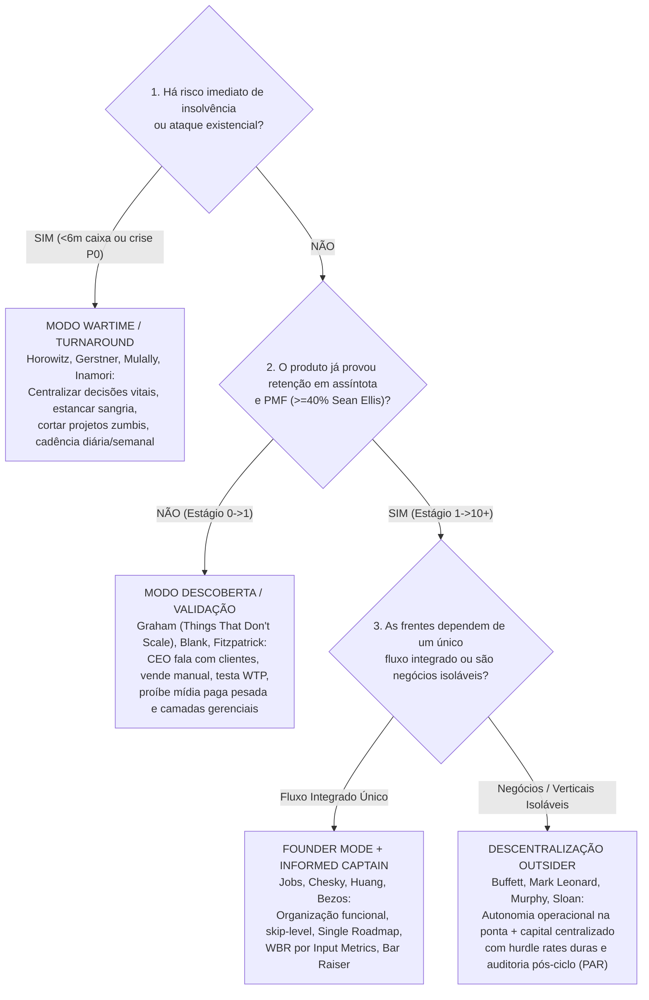

# Enciclopédia Mestre do CEO — Volume 0: Guia Mestre, Síntese Transversal e Playbook Operacional

> **Escopo Verificado da Coleção:** Compêndio enciclopédico em 7 arquivos modulares (Volumes 0 a 6) + 1 volume integral consolidado, reunindo **50 estudos completos de CEOs históricos e contemporâneos (#01 a #50)**, **50 livros canônicos destilados (#01 a #50)**, **7 funções indelegáveis do cargo**, **matriz tripla de conhecimento executivo em 7 áreas funcionais (incluindo Funções de SEO & GEO)**, **cartas aos acionistas, memorandos internos, ensaios seminais, 3 estudos científicos empíricos** e **análise de 9 ciclos de palestras/aulas via transcrições públicas verificadas**.
>
> **Nota Epistemológica Obrigatória:**
> - Todas as métricas numéricas, citações e URLs dos Volumes 1 a 6 distinguem explicitamente `OBSERVADO (fonte primária / transcrição pública)` de `RELATADO (biografia / literatura secundária)`.
> - Os livros foram sintetizados a partir de fontes abertas, artigos técnicos dos autores, documentações oficiais e literatura pública consolidada — sem acesso a arquivos integrais protegidos por direitos autorais.
> - As palestras em vídeo foram analisadas por meio de **transcrições textuais públicas e registros oficiais verificados** (sem reprodução direta de streaming audiovisual).
> - Quanto ao contexto interno do **BataTalk**, após o reset operacional de 17/11/2026, todos os indicadores atuais de tráfego, ativação, retenção, receita e margem encontram-se no estado **`SEM DADOS`** até levantamento ou ordem explícita do fundador.

---

## 1. Mapa Navegável da Enciclopédia (Volumes 0 a 6)

| Volume | Arquivo | Foco Principal | Volume Verificado | Link Local |
| :--- | :--- | :--- | :---: | :--- |
| **Vol. 0** | `00-GUIA-MESTRE-DO-CEO-SINTESE-E-PLAYBOOK.md` | Síntese dos 12 Princípios Universais, Árvore de Contradições e Playbook Aplicado | Guia Mestre | [Volume 0](./00-GUIA-MESTRE-DO-CEO-SINTESE-E-PLAYBOOK.md) |
| **Vol. 1** | `01-OS-50-MAIORES-CEOS-PARTE-1-TECH-PRODUTO-SAAS.md` | CEOs **#01 a #25** (Jobs, Bezos, Huang, Nadella, Gates, Grove, Page, Cook, Su, Chang, Zuckerberg, Musk, Hastings, Chesky, Collison, Lütke, Benioff, von Ahn, Vélez, Galperin, Perkins, Slootman, Ek, Xu, Altman vs. Amodei) | 760 linhas / 17.974 palavras | [Volume 1](./01-OS-50-MAIORES-CEOS-PARTE-1-TECH-PRODUTO-SAAS.md) |
| **Vol. 2** | `02-OS-50-MAIORES-CEOS-PARTE-2-CAPITAL-VAREJO-INDUSTRIA.md` | CEOs **#26 a #50** (Buffett, Munger, Singleton, Leonard, Murphy, Malone, Rales/Culp, Dimon, Schwarzman, Walton, Sinegal, Arnault, Schultz, Knight, Nooyi, Iger, Ortega/Isla, Kroc, Sloan, Ohno/Toyoda, Gerstner, Mulally, Welch + autópsia, Inamori, Kelleher) + **Análise Transversal (#01–#50)** | 816 linhas / 19.304 palavras | [Volume 2](./02-OS-50-MAIORES-CEOS-PARTE-2-CAPITAL-VAREJO-INDUSTRIA.md) |
| **Vol. 3** | `03-MANUAL-DE-COMO-SER-CEO-FUNCOES-E-MATRIZ-CONHECIMENTO.md` | Evidência Empírica (Bandiera et al., Kaplan et al., McKinsey), **7 Funções Indelegáveis**, Modos (*Founder/Peacetime/Wartime/AI-Native*), **Matriz `PRECISA × DEVE × DEVERIA SABER`** nas 7 áreas (incl. **Funções de SEO & GEO**), Fórmulas, Benchmarks e Templates | 695 linhas / 14.224 palavras | [Volume 3](./03-MANUAL-DE-COMO-SER-CEO-FUNCOES-E-MATRIZ-CONHECIMENTO.md) |
| **Vol. 4** | `04-BIBLIOTECA-EXECUTIVA-PARTE-1-CEO-ESTRATEGIA-STARTUPS-PRODUTO.md` | Livros **#01 a #25** (Grove, Horowitz, Mochary, Thorndike, McKinsey, Hastings, Slootman, Helmer, Rumelt, Lafley/Martin, Collins, Munger, Thiel, Ries/Blank, Fitzpatrick, Chen, Bryar/Carr, Hoffman, Fried/DHH, Cagan, Torres, Christensen, Eyal, Singer, Fadell) | 1.026 linhas / 17.431 palavras | [Volume 4](./04-BIBLIOTECA-EXECUTIVA-PARTE-1-CEO-ESTRATEGIA-STARTUPS-PRODUTO.md) |
| **Vol. 5** | `05-BIBLIOTECA-EXECUTIVA-PARTE-2-VENDAS-MARKETING-GROWTH-DECISAO.md` | Livros **#26 a #50** (Dunford, Schwartz, Hormozi x2, Ries/Trout & Play Bigger, Cialdini, Hopkins/Ogilvy, Moore, Heath/Berger, Rackham, Challenger, Ross x2, Roberge, Ramanujam, Voss, Mehta/Murphy, Ellis, Weinberg, Bush/John, Lean Analytics, Doerr, Kahneman, Duke, Taleb) + **Tabela de Roteamento Rápido (12 Cenários)** | 1.204 linhas / 21.207 palavras | [Volume 5](./05-BIBLIOTECA-EXECUTIVA-PARTE-2-VENDAS-MARKETING-GROWTH-DECISAO.md) |
| **Vol. 6** | `06-ARTIGOS-CARTAS-ESTUDOS-E-PALESTRAS-EM-VIDEO.md` | Cartas (Bezos, Buffett, Leonard), Memos (Gates 1995, Netflix, Shopify AI 2025), Ensaios (Graham x5, Andreessen, Vohra, Balfour, Horowitz, Mazal), 3 Estudos Empíricos, 9 Palestras em Vídeo (via transcrições) e 51 URLs verificadas | 607 linhas / 11.686 palavras | [Volume 6](./06-ARTIGOS-CARTAS-ESTUDOS-E-PALESTRAS-EM-VIDEO.md) |
| **Integral** | `ENCICLOPEDIA-MESTRE-DO-CEO-COMPLETA.md` | Compêndio único consolidando Volumes 0 a 6 para leitura contínua ou busca global | Compilado Final | [Compêndio Completo](./ENCICLOPEDIA-MESTRE-DO-CEO-COMPLETA.md) |

---

## 2. A Grande Síntese Operacional: Os 12 Princípios Universais do CEO

Cruzando os 50 maiores CEOs, os 50 livros canônicos, os estudos econométricos de milhares de horas executivas e as cartas primárias aos acionistas, emergem **doze leis invariantes** que separam criação composta de valor de teatro gerencial:

1. **Execução Vence Carisma (Evidência Empírica):** Conselhos frequentemente contratam CEOs por traços interpessoais agradáveis, mas a pesquisa psicométrica de Kaplan, Klebanov & Sorensen (2012) com 316 candidatos comprova que o desempenho pós-contratação é previsto por **resolutividade, velocidade e persistência na execução**.
2. **Alocação de Capital e Tempo É o Multiplicador Central:** No longo prazo, decidir *onde colocar dinheiro, talento e atenção* supera otimizações locais de rotina (Thorndike, *The Outsiders*; Prática nº 3 de *CEO Excellence*; Alavancagem Gerencial de Andy Grove). Cada real ou hora gasto em projeto medíocre é capital roubado do vencedor.
3. **Estratégia É Renúncia e Trade-Off Coerente, Não Lista de Metas:** Foco não significa dizer "sim" à prioridade do dia — significa dizer "não" a centenas de boas ideias (Steve Jobs, WWDC 1997), escolher *onde não jogar* (Lafley & Martin), identificar o obstáculo central (Rumelt) e construir atividades que se reforçam sem canibalização (Porter/Kelleher na Southwest; Sinegal no Costco).
4. **Sobrevivência e Margem Antes de Hipercrescimento (Ergodicidade):** Crescer destruindo caixa unitário ou assumindo risco de ruína irreversível viola a matemática básica do tempo (Taleb; Paul Graham *Default Alive or Default Dead*; Jamie Dimon *Fortress Balance Sheet*). Em modelos com IA, isso exige descontar inferência/LLM/STT/TTS e taxas de gateway antes de escalar aquisição.
5. **Retenção em Assíntota e CURR Precedem Aquisição Paga:** Nunca despeje tráfego caro em um balde furado. Só existe *Product-Market Fit* quando a curva de retenção das coortes achata paralelamente acima de zero (Alex Schultz, CS183B), o teste Sean Ellis atinge $\ge 40\%$ no perfil de alta exigência (Rahul Vohra) e a retenção de usuários ativos atuais (`CURR` no Duolingo de Luis von Ahn e Jorge Mazal) está estabilizada e crescente.
6. **Separe Portas Tipo 1 das Portas Tipo 2 para Vencer na Velocidade:** A esclerose corporativa (*Day 2* de Bezos) acontece quando comitês lentos travam decisões reversíveis baratas (Tipo 2, que devem rodar com ~70% da informação e *disagree and commit*) ou quando decisões irreversíveis (Tipo 1) são tomadas sem leitura silenciosa profunda, pré-mortem e busca de dissenso.
7. **Mecanismos de Verdade Bruta Batem Relatórios Polidos:** Notícias ruins naturalmente não sobem na hierarquia. Líderes de elite criam dispositivos para furar filtros burocráticos: *slides* Vermelhos aplaudidos no BPR de Alan Mulally, e-mails diretos *T5T* em Jensen Huang, o *Andon* parando a fábrica na Toyota, o caso 1-800 onde a anedota real expôs a métrica cega de Jeff Bezos e o *skip-level* do *Founder Mode* de Chesky e Graham.
8. **Um Único Dono (*DRI* / *Informed Captain*) por Resultado:** Responsabilidade dividida significa responsabilidade de ninguém. Seja no *DRI* da Apple, na *AOR* de Matt Mochary, no *Single-Threaded Leader* da Amazon ou no *Informed Captain* da Netflix, toda frente tem um único nome que ouve opiniões conflitantes, decide dentro da alçada e responde pela prova final.
9. **Sistemas Superam Heroísmo Individual, Desde Que Ancorados no Cliente:** Cultura e processos excelentes (*DBS* na Danaher, *TPS* na Toyota, *PR/FAQ* e *WBR* na Amazon, *Humble + Fierce* em Collins) transformam pessoas comuns em operação extraordinária — mas morrem no instante em que o cumprimento do processo (*proxy*) substitui a experiência real do cliente.
10. **Padrão de Qualidade (*High Standards*) É Contagioso, Específico e Testado no Dia 0:** Excelência em vendas não garante excelência em engenharia, copy ou pedagogia (Bezos, Carta 2017). A barra sobe via recrutamento seletivo (*Bar Raiser*, *Keeper Test*), exemplos concretos e auditoria implacável de artefatos brutos — especialmente contra *AI slop* na era generativa.
11. **Monetização e Distribuição São Engenharia de Produto, Não Adereço Final:** O canal dita a arquitetura do produto (*Product-Channel Fit* de Balfour), a disposição a pagar (`WTP`) antecede a engenharia pesada (*Monetizing Innovation* de Ramanujam), a oferta define a eficiência da mídia (*$100M Offers* de Hormozi) e a busca orgânica/IA moderna recompensa utilidade verificável e tráfego não-marca sem gambiarras técnicas (Google Search Central).
12. **Decisões Se Avaliam pela Qualidade das Premissas Antes do Placar (*Anti-Resulting*):** Em mercados incertos, uma decisão ótima pode falhar por variância e uma aposta imprudente pode lucrar por sorte (Annie Duke; Kahneman). Apenas *Kill Criteria* pré-comprometidos (estado + data), *Reference Class Forecasting*, diários de decisão e *Skin in the Game* protegem a empresa da falácia do custo afundado.

---

## 3. Árvore de Decisão Executiva: Resolvendo Contradições Entre Grandes CEOs

Muitos líderes fracassam ao copiar o conselho certo no contexto errado. Use esta tabela decisória antes de importar qualquer prática dos 50 CEOs ou 50 livros:

| Contradição Aparente | Quando Escolher o Polo A | Quando Escolher o Polo B |
| :--- | :--- | :--- |
| **Centralização (*Founder Mode*) vs. Descentralização Extrema (*Outsider*)** | Produto único com alta interdependência entre UX, modelo de IA, áudio e marketing; virada de crise; definição do padrão inaugural de qualidade. | Portfólio de unidades verticalmente isoladas com clientes distintos, gestores maduros e métricas auditáveis de retorno sobre capital (`ROIC + OGr`). |
| **Velocidade (*70% Info / Launch Fast*) vs. Perfeccionismo Longo** | Decisões Tipo 2 reversíveis, testes A/B em software, lotes pequenos de conteúdo/experimentos onde o feedback de mercado custa pouco e ensina rápido. | Decisões Tipo 1 irreversíveis, faturamento/preço, proteção de dados pessoais (LGPD/ANPD 3 dias úteis), segurança física e ativos de marca icônicos. |
| **Margem Alta (*Pricing Power*) vs. *Scale Economies Shared*** | Produto com alto custo de troca, propriedade intelectual forte, nicho especializado ou custo marginal de inferência IA elevado (proteger margem bruta). | Mercados de massa altamente padronizados onde volume reduz custo unitário e existe receita recorrente paralela (assinatura/ecossistema) para monetizar fidelidade. |
| **PLG / SEO / Freemium vs. Vendas Assistidas / Outbound** | *Time-to-Value* imediato (<5 minutos), adoção *bottom-up* por indivíduo, margem para sustentar base gratuita como motor viral ou busca orgânica intensa. | Ticket anual alto (ACV $\ge$ US$ 3k–25k+), comprador top-down exigindo segurança/compliance, ou mercado ainda inconsciente da categoria (*Crossing the Chasm*). |
| **Cultura Sem Regras (*Netflix*) vs. Processos Rígidos (*Toyota/Danaher*)** | Times pequenos altamente seniores pagos no topo do mercado onde criação e julgamento superam repetição, com *Keeper Test* ativo. | Operações de alto volume, manufatura, atendimento crítico, finanças e segurança onde variação de execução gera defeito grave ao cliente. |

---

## 4. Tradução Direta para Produtos Digitais de IA por Voz (Contexto BataTalk)

> **Estado dos dados internos (`SEM DADOS`):** Após o reset de 17/11/2026 no OpenBot, não existem métricas ativas de tráfego, ativação, receita ou custos reais do BataTalk carregadas nesta sessão. As diretrizes operacionais abaixo representam a aplicação rigorosa do conhecimento desta Enciclopédia ao modelo de negócio declarado do produto (prática oral de inglês com IA por voz), servindo como padrão de atuação deste CEO assim que sinais reais forem medidos ou autorizados pelo fundador.

1. **Regra Nº 1 de Produto e Ativação ("Primeira Fala Vence"):**
   - Cruzando *RevenueCat* (80%–90% dos inícios e grande parte dos cancelamentos ocorrem já no Dia 0), *Time Delay* de Hormozi e o onboarding *Linha Reta* do *Bowling Alley*: se a interface da página for premiada mas a primeira prática real de voz travar por latência p95/p99, falha de microfone, cadastro burocrático ou tutor artificial lento, o produto fracassa antes do segundo acesso.
   - **Padrão de execução:** Medir o *Time-to-First-Speech* em dispositivo móvel real (4G) e auditar sessões sintéticas/autorizadas ponta a ponta antes de priorizar polimento visual secundário.
2. **Retenção Comportamental Inspirada no Duolingo (`CURR` + Hábito Pedagógico):**
   - Aplicando a decomposição de Jorge Mazal e Luis von Ahn (#18 / Vol. 6): não perseguir truques de indicação antes de medir **`NURR`** (conversão de novo aluno em recorrente na primeira semana) e **`CURR`** (retenção do aluno ativo recorrente).
   - **Trava de integridade:** Qualquer experimento de paywall ou monetização deve respeitar regra de guarda sobre conclusão real de prática oral e retorno voluntário — nunca transformar aprendizado em gamificação vazia de cliques que gera cancelamento no Dia 7.
3. **Economia Unitária Líquida de Voz e Inferência (*ICONIQ / Sacks / Buffett*):**
   - Em produtos com áudio bidirecional em tempo real (STT + LLM + TTS), custos variáveis de inferência e taxas de processamento podem corroer rapidamente a margem bruta (benchmark médio de IA em 45%–52% vs. 80% de SaaS tradicional).
   - **Padrão de execução:** Calcular Margem de Contribuição por assinatura após descontar custo real por minuto de voz/tokens por decil de uso + taxas de gateway/impostos, evitando promessas "ilimitadas" sem proteção contra abuso que destruam o *CAC Payback*.
4. **Aquisição Orgânica, SEO & GEO Sem Folclore (*Google Search Central 2025–2026*):**
   - Aplicando as diretrizes verificadas no Volume 3 (Área 4): rejeitar atalhos ilusórios (`llms.txt` não suportado pelo Google, geração em massa de páginas de IA sob risco de *Scaled Content Abuse* e relatórios de vaidade inflados por buscas da própria marca).
   - **Padrão de execução:** Construir páginas com utilidade real verificável, HTML rastreável, Core Web Vitals em "Bom" no CrUX p75 e acompanhamento estrito de **cliques e conversões não-marca**.
5. **Organização Enxuta Orientada a Evidência (*Lütke + Bezos + POLICY.md*):**
   - Aplicar a trava de *Tobi Lütke* (não multiplicar agentes ou processos onde um script ou fluxo simples resolve), a arquitetura *Construtor → Crítico → Verificador* contra *AI slop*, contratos claros com **DRI único** e respeito inegociável a `POLICY.md` (separação absoluta entre trabalho reversível em sandbox e ações que exigem aprovação explícita do fundador: publicação externa, gastos fora de orçamento, preços/pagamentos, dados pessoais e manutenção do status pausado do Reels Creator).
