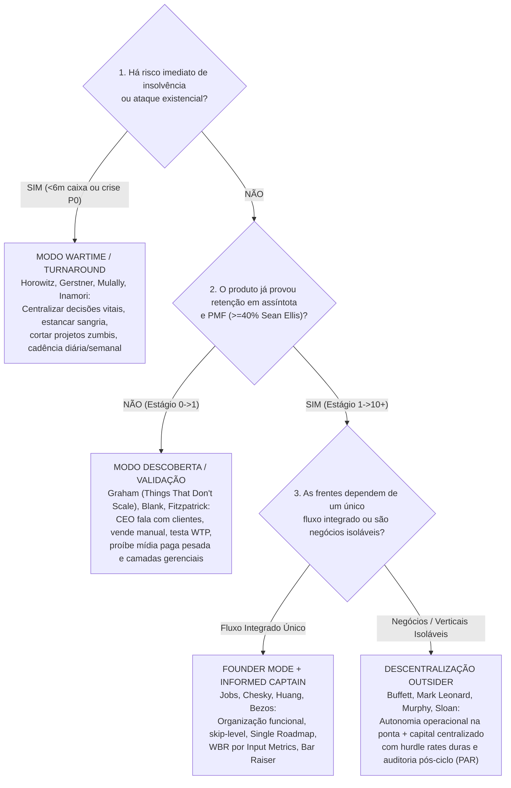

# ENCICLOPÉDIA MESTRE DO CEO — COMPÊNDIO INTEGRAL UNIFICADO (VOLUMES 0 A 6)

> **Documento Consolidado:** Este volume único reúne integralmente os 7 arquivos modulares da pesquisa enciclopédica sobre liderança executiva: **50 Maiores CEOs do Mundo (#01 a #50)**, **Manual Completo das Funções do CEO & SEO/GEO + Matriz Tripla de Conhecimento**, **50 Livros Canônicos Destilados (#01 a #50)**, **Cartas Históricas aos Acionistas, Memorandos Internos, Ensaios Seminais, Estudos Científicos Empíricos e Palestras em Vídeo (via transcrições públicas verificadas)**.

## Sumário Geral do Compêndio

1. **Volume 0:** Guia Mestre, Síntese dos 12 Princípios Universais, Árvore de Contradições e Playbook Aplicado
2. **Volume 1:** Os 50 Maiores CEOs — Parte 1: Tecnologia, Produto, Semicondutores e SaaS (**#01 a #25**)
3. **Volume 2:** Os 50 Maiores CEOs — Parte 2: Capital, Varejo, Indústria e Turnaround (**#26 a #50**) + Análise Transversal (#01–#50)
4. **Volume 3:** Manual Completo de Como Ser CEO, 7 Funções Indelegáveis, Funções de SEO/GEO e Matriz `PRECISA × DEVE × DEVERIA SABER`
5. **Volume 4:** Biblioteca Executiva — Parte 1: Os 25 Livros Canônicos de CEO, Estratégia, Startups e Produto (**#01 a #25**)
6. **Volume 5:** Biblioteca Executiva — Parte 2: Os 25 Livros Canônicos de Vendas, Marketing, Growth, Métricas e Decisão (**#26 a #50**) + Roteamento Rápido
7. **Volume 6:** Cartas de Acionistas, Memos Internos, Ensaios, Estudos Empíricos e Palestras/Entrevistas em Vídeo (Transcrições Públicas)

---

---


<!-- ==================== INÍCIO: 00-GUIA-MESTRE-DO-CEO-SINTESE-E-PLAYBOOK.md ==================== -->

# Enciclopédia Mestre do CEO — Volume 0: Guia Mestre, Síntese Transversal e Playbook Operacional

> **Escopo Verificado da Coleção:** Compêndio enciclopédico em 7 arquivos modulares (Volumes 0 a 6) + 1 volume integral consolidado, reunindo **50 estudos completos de CEOs históricos e contemporâneos (#01 a #50)**, **50 livros canônicos destilados (#01 a #50)**, **7 funções indelegáveis do cargo**, **matriz tripla de conhecimento executivo em 7 áreas funcionais (incluindo Funções de SEO & GEO)**, **cartas aos acionistas, memorandos internos, ensaios seminais, 3 estudos científicos empíricos** e **análise de 9 ciclos de palestras/aulas via transcrições públicas verificadas**.
>
> **Nota Epistemológica Obrigatória:**
> - Todas as métricas numéricas, citações e URLs dos Volumes 1 a 6 distinguem explicitamente `OBSERVADO (fonte primária / transcrição pública)` de `RELATADO (biografia / literatura secundária)`.
> - Os livros foram sintetizados a partir de fontes abertas, artigos técnicos dos autores, documentações oficiais e literatura pública consolidada — sem acesso a arquivos integrais protegidos por direitos autorais.
> - As palestras em vídeo foram analisadas por meio de **transcrições textuais públicas e registros oficiais verificados** (sem reprodução direta de streaming audiovisual).
> - Quanto ao contexto interno do **BataTalk**, após o reset operacional de 17/11/2026, todos os indicadores atuais de tráfego, ativação, retenção, receita e margem encontram-se no estado **`SEM DADOS`** até levantamento ou ordem explícita do fundador.

---

## 1. Mapa Navegável da Enciclopédia (Volumes 0 a 6)

| Volume | Arquivo | Foco Principal | Volume Verificado | Link Local |
| :--- | :--- | :--- | :---: | :--- |
| **Vol. 0** | `00-GUIA-MESTRE-DO-CEO-SINTESE-E-PLAYBOOK.md` | Síntese dos 12 Princípios Universais, Árvore de Contradições e Playbook Aplicado | Guia Mestre | [Volume 0](./00-GUIA-MESTRE-DO-CEO-SINTESE-E-PLAYBOOK.md) |
| **Vol. 1** | `01-OS-50-MAIORES-CEOS-PARTE-1-TECH-PRODUTO-SAAS.md` | CEOs **#01 a #25** (Jobs, Bezos, Huang, Nadella, Gates, Grove, Page, Cook, Su, Chang, Zuckerberg, Musk, Hastings, Chesky, Collison, Lütke, Benioff, von Ahn, Vélez, Galperin, Perkins, Slootman, Ek, Xu, Altman vs. Amodei) | 760 linhas / 17.974 palavras | [Volume 1](./01-OS-50-MAIORES-CEOS-PARTE-1-TECH-PRODUTO-SAAS.md) |
| **Vol. 2** | `02-OS-50-MAIORES-CEOS-PARTE-2-CAPITAL-VAREJO-INDUSTRIA.md` | CEOs **#26 a #50** (Buffett, Munger, Singleton, Leonard, Murphy, Malone, Rales/Culp, Dimon, Schwarzman, Walton, Sinegal, Arnault, Schultz, Knight, Nooyi, Iger, Ortega/Isla, Kroc, Sloan, Ohno/Toyoda, Gerstner, Mulally, Welch + autópsia, Inamori, Kelleher) + **Análise Transversal (#01–#50)** | 816 linhas / 19.304 palavras | [Volume 2](./02-OS-50-MAIORES-CEOS-PARTE-2-CAPITAL-VAREJO-INDUSTRIA.md) |
| **Vol. 3** | `03-MANUAL-DE-COMO-SER-CEO-FUNCOES-E-MATRIZ-CONHECIMENTO.md` | Evidência Empírica (Bandiera et al., Kaplan et al., McKinsey), **7 Funções Indelegáveis**, Modos (*Founder/Peacetime/Wartime/AI-Native*), **Matriz `PRECISA × DEVE × DEVERIA SABER`** nas 7 áreas (incl. **Funções de SEO & GEO**), Fórmulas, Benchmarks e Templates | 695 linhas / 14.224 palavras | [Volume 3](./03-MANUAL-DE-COMO-SER-CEO-FUNCOES-E-MATRIZ-CONHECIMENTO.md) |
| **Vol. 4** | `04-BIBLIOTECA-EXECUTIVA-PARTE-1-CEO-ESTRATEGIA-STARTUPS-PRODUTO.md` | Livros **#01 a #25** (Grove, Horowitz, Mochary, Thorndike, McKinsey, Hastings, Slootman, Helmer, Rumelt, Lafley/Martin, Collins, Munger, Thiel, Ries/Blank, Fitzpatrick, Chen, Bryar/Carr, Hoffman, Fried/DHH, Cagan, Torres, Christensen, Eyal, Singer, Fadell) | 1.026 linhas / 17.431 palavras | [Volume 4](./04-BIBLIOTECA-EXECUTIVA-PARTE-1-CEO-ESTRATEGIA-STARTUPS-PRODUTO.md) |
| **Vol. 5** | `05-BIBLIOTECA-EXECUTIVA-PARTE-2-VENDAS-MARKETING-GROWTH-DECISAO.md` | Livros **#26 a #50** (Dunford, Schwartz, Hormozi x2, Ries/Trout & Play Bigger, Cialdini, Hopkins/Ogilvy, Moore, Heath/Berger, Rackham, Challenger, Ross x2, Roberge, Ramanujam, Voss, Mehta/Murphy, Ellis, Weinberg, Bush/John, Lean Analytics, Doerr, Kahneman, Duke, Taleb) + **Tabela de Roteamento Rápido (12 Cenários)** | 1.204 linhas / 21.207 palavras | [Volume 5](./05-BIBLIOTECA-EXECUTIVA-PARTE-2-VENDAS-MARKETING-GROWTH-DECISAO.md) |
| **Vol. 6** | `06-ARTIGOS-CARTAS-ESTUDOS-E-PALESTRAS-EM-VIDEO.md` | Cartas (Bezos, Buffett, Leonard), Memos (Gates 1995, Netflix, Shopify AI 2025), Ensaios (Graham x5, Andreessen, Vohra, Balfour, Horowitz, Mazal), 3 Estudos Empíricos, 9 Palestras em Vídeo (via transcrições) e 51 URLs verificadas | 607 linhas / 11.686 palavras | [Volume 6](./06-ARTIGOS-CARTAS-ESTUDOS-E-PALESTRAS-EM-VIDEO.md) |
| **Integral** | `ENCICLOPEDIA-MESTRE-DO-CEO-COMPLETA.md` | Compêndio único consolidando Volumes 0 a 6 para leitura contínua ou busca global | Compilado Final | [Compêndio Completo](./ENCICLOPEDIA-MESTRE-DO-CEO-COMPLETA.md) |

---

## 2. A Grande Síntese Operacional: Os 12 Princípios Universais do CEO

Cruzando os 50 maiores CEOs, os 50 livros canônicos, os estudos econométricos de milhares de horas executivas e as cartas primárias aos acionistas, emergem **doze leis invariantes** que separam criação composta de valor de teatro gerencial:

1. **Execução Vence Carisma (Evidência Empírica):** Conselhos frequentemente contratam CEOs por traços interpessoais agradáveis, mas a pesquisa psicométrica de Kaplan, Klebanov & Sorensen (2012) com 316 candidatos comprova que o desempenho pós-contratação é previsto por **resolutividade, velocidade e persistência na execução**.
2. **Alocação de Capital e Tempo É o Multiplicador Central:** No longo prazo, decidir *onde colocar dinheiro, talento e atenção* supera otimizações locais de rotina (Thorndike, *The Outsiders*; Prática nº 3 de *CEO Excellence*; Alavancagem Gerencial de Andy Grove). Cada real ou hora gasto em projeto medíocre é capital roubado do vencedor.
3. **Estratégia É Renúncia e Trade-Off Coerente, Não Lista de Metas:** Foco não significa dizer "sim" à prioridade do dia — significa dizer "não" a centenas de boas ideias (Steve Jobs, WWDC 1997), escolher *onde não jogar* (Lafley & Martin), identificar o obstáculo central (Rumelt) e construir atividades que se reforçam sem canibalização (Porter/Kelleher na Southwest; Sinegal no Costco).
4. **Sobrevivência e Margem Antes de Hipercrescimento (Ergodicidade):** Crescer destruindo caixa unitário ou assumindo risco de ruína irreversível viola a matemática básica do tempo (Taleb; Paul Graham *Default Alive or Default Dead*; Jamie Dimon *Fortress Balance Sheet*). Em modelos com IA, isso exige descontar inferência/LLM/STT/TTS e taxas de gateway antes de escalar aquisição.
5. **Retenção em Assíntota e CURR Precedem Aquisição Paga:** Nunca despeje tráfego caro em um balde furado. Só existe *Product-Market Fit* quando a curva de retenção das coortes achata paralelamente acima de zero (Alex Schultz, CS183B), o teste Sean Ellis atinge $\ge 40\%$ no perfil de alta exigência (Rahul Vohra) e a retenção de usuários ativos atuais (`CURR` no Duolingo de Luis von Ahn e Jorge Mazal) está estabilizada e crescente.
6. **Separe Portas Tipo 1 das Portas Tipo 2 para Vencer na Velocidade:** A esclerose corporativa (*Day 2* de Bezos) acontece quando comitês lentos travam decisões reversíveis baratas (Tipo 2, que devem rodar com ~70% da informação e *disagree and commit*) ou quando decisões irreversíveis (Tipo 1) são tomadas sem leitura silenciosa profunda, pré-mortem e busca de dissenso.
7. **Mecanismos de Verdade Bruta Batem Relatórios Polidos:** Notícias ruins naturalmente não sobem na hierarquia. Líderes de elite criam dispositivos para furar filtros burocráticos: *slides* Vermelhos aplaudidos no BPR de Alan Mulally, e-mails diretos *T5T* em Jensen Huang, o *Andon* parando a fábrica na Toyota, o caso 1-800 onde a anedota real expôs a métrica cega de Jeff Bezos e o *skip-level* do *Founder Mode* de Chesky e Graham.
8. **Um Único Dono (*DRI* / *Informed Captain*) por Resultado:** Responsabilidade dividida significa responsabilidade de ninguém. Seja no *DRI* da Apple, na *AOR* de Matt Mochary, no *Single-Threaded Leader* da Amazon ou no *Informed Captain* da Netflix, toda frente tem um único nome que ouve opiniões conflitantes, decide dentro da alçada e responde pela prova final.
9. **Sistemas Superam Heroísmo Individual, Desde Que Ancorados no Cliente:** Cultura e processos excelentes (*DBS* na Danaher, *TPS* na Toyota, *PR/FAQ* e *WBR* na Amazon, *Humble + Fierce* em Collins) transformam pessoas comuns em operação extraordinária — mas morrem no instante em que o cumprimento do processo (*proxy*) substitui a experiência real do cliente.
10. **Padrão de Qualidade (*High Standards*) É Contagioso, Específico e Testado no Dia 0:** Excelência em vendas não garante excelência em engenharia, copy ou pedagogia (Bezos, Carta 2017). A barra sobe via recrutamento seletivo (*Bar Raiser*, *Keeper Test*), exemplos concretos e auditoria implacável de artefatos brutos — especialmente contra *AI slop* na era generativa.
11. **Monetização e Distribuição São Engenharia de Produto, Não Adereço Final:** O canal dita a arquitetura do produto (*Product-Channel Fit* de Balfour), a disposição a pagar (`WTP`) antecede a engenharia pesada (*Monetizing Innovation* de Ramanujam), a oferta define a eficiência da mídia (*$100M Offers* de Hormozi) e a busca orgânica/IA moderna recompensa utilidade verificável e tráfego não-marca sem gambiarras técnicas (Google Search Central).
12. **Decisões Se Avaliam pela Qualidade das Premissas Antes do Placar (*Anti-Resulting*):** Em mercados incertos, uma decisão ótima pode falhar por variância e uma aposta imprudente pode lucrar por sorte (Annie Duke; Kahneman). Apenas *Kill Criteria* pré-comprometidos (estado + data), *Reference Class Forecasting*, diários de decisão e *Skin in the Game* protegem a empresa da falácia do custo afundado.

---

## 3. Árvore de Decisão Executiva: Resolvendo Contradições Entre Grandes CEOs

Muitos líderes fracassam ao copiar o conselho certo no contexto errado. Use esta tabela decisória antes de importar qualquer prática dos 50 CEOs ou 50 livros:



| Contradição Aparente | Quando Escolher o Polo A | Quando Escolher o Polo B |
| :--- | :--- | :--- |
| **Centralização (*Founder Mode*) vs. Descentralização Extrema (*Outsider*)** | Produto único com alta interdependência entre UX, modelo de IA, áudio e marketing; virada de crise; definição do padrão inaugural de qualidade. | Portfólio de unidades verticalmente isoladas com clientes distintos, gestores maduros e métricas auditáveis de retorno sobre capital (`ROIC + OGr`). |
| **Velocidade (*70% Info / Launch Fast*) vs. Perfeccionismo Longo** | Decisões Tipo 2 reversíveis, testes A/B em software, lotes pequenos de conteúdo/experimentos onde o feedback de mercado custa pouco e ensina rápido. | Decisões Tipo 1 irreversíveis, faturamento/preço, proteção de dados pessoais (LGPD/ANPD 3 dias úteis), segurança física e ativos de marca icônicos. |
| **Margem Alta (*Pricing Power*) vs. *Scale Economies Shared*** | Produto com alto custo de troca, propriedade intelectual forte, nicho especializado ou custo marginal de inferência IA elevado (proteger margem bruta). | Mercados de massa altamente padronizados onde volume reduz custo unitário e existe receita recorrente paralela (assinatura/ecossistema) para monetizar fidelidade. |
| **PLG / SEO / Freemium vs. Vendas Assistidas / Outbound** | *Time-to-Value* imediato (<5 minutos), adoção *bottom-up* por indivíduo, margem para sustentar base gratuita como motor viral ou busca orgânica intensa. | Ticket anual alto (ACV $\ge$ US$ 3k–25k+), comprador top-down exigindo segurança/compliance, ou mercado ainda inconsciente da categoria (*Crossing the Chasm*). |
| **Cultura Sem Regras (*Netflix*) vs. Processos Rígidos (*Toyota/Danaher*)** | Times pequenos altamente seniores pagos no topo do mercado onde criação e julgamento superam repetição, com *Keeper Test* ativo. | Operações de alto volume, manufatura, atendimento crítico, finanças e segurança onde variação de execução gera defeito grave ao cliente. |

---

## 4. Tradução Direta para Produtos Digitais de IA por Voz (Contexto BataTalk)

> **Estado dos dados internos (`SEM DADOS`):** Após o reset de 17/11/2026 no OpenBot, não existem métricas ativas de tráfego, ativação, receita ou custos reais do BataTalk carregadas nesta sessão. As diretrizes operacionais abaixo representam a aplicação rigorosa do conhecimento desta Enciclopédia ao modelo de negócio declarado do produto (prática oral de inglês com IA por voz), servindo como padrão de atuação deste CEO assim que sinais reais forem medidos ou autorizados pelo fundador.

1. **Regra Nº 1 de Produto e Ativação ("Primeira Fala Vence"):**
   - Cruzando *RevenueCat* (80%–90% dos inícios e grande parte dos cancelamentos ocorrem já no Dia 0), *Time Delay* de Hormozi e o onboarding *Linha Reta* do *Bowling Alley*: se a interface da página for premiada mas a primeira prática real de voz travar por latência p95/p99, falha de microfone, cadastro burocrático ou tutor artificial lento, o produto fracassa antes do segundo acesso.
   - **Padrão de execução:** Medir o *Time-to-First-Speech* em dispositivo móvel real (4G) e auditar sessões sintéticas/autorizadas ponta a ponta antes de priorizar polimento visual secundário.
2. **Retenção Comportamental Inspirada no Duolingo (`CURR` + Hábito Pedagógico):**
   - Aplicando a decomposição de Jorge Mazal e Luis von Ahn (#18 / Vol. 6): não perseguir truques de indicação antes de medir **`NURR`** (conversão de novo aluno em recorrente na primeira semana) e **`CURR`** (retenção do aluno ativo recorrente).
   - **Trava de integridade:** Qualquer experimento de paywall ou monetização deve respeitar regra de guarda sobre conclusão real de prática oral e retorno voluntário — nunca transformar aprendizado em gamificação vazia de cliques que gera cancelamento no Dia 7.
3. **Economia Unitária Líquida de Voz e Inferência (*ICONIQ / Sacks / Buffett*):**
   - Em produtos com áudio bidirecional em tempo real (STT + LLM + TTS), custos variáveis de inferência e taxas de processamento podem corroer rapidamente a margem bruta (benchmark médio de IA em 45%–52% vs. 80% de SaaS tradicional).
   - **Padrão de execução:** Calcular Margem de Contribuição por assinatura após descontar custo real por minuto de voz/tokens por decil de uso + taxas de gateway/impostos, evitando promessas "ilimitadas" sem proteção contra abuso que destruam o *CAC Payback*.
4. **Aquisição Orgânica, SEO & GEO Sem Folclore (*Google Search Central 2025–2026*):**
   - Aplicando as diretrizes verificadas no Volume 3 (Área 4): rejeitar atalhos ilusórios (`llms.txt` não suportado pelo Google, geração em massa de páginas de IA sob risco de *Scaled Content Abuse* e relatórios de vaidade inflados por buscas da própria marca).
   - **Padrão de execução:** Construir páginas com utilidade real verificável, HTML rastreável, Core Web Vitals em "Bom" no CrUX p75 e acompanhamento estrito de **cliques e conversões não-marca**.
5. **Organização Enxuta Orientada a Evidência (*Lütke + Bezos + POLICY.md*):**
   - Aplicar a trava de *Tobi Lütke* (não multiplicar agentes ou processos onde um script ou fluxo simples resolve), a arquitetura *Construtor → Crítico → Verificador* contra *AI slop*, contratos claros com **DRI único** e respeito inegociável a `POLICY.md` (separação absoluta entre trabalho reversível em sandbox e ações que exigem aprovação explícita do fundador: publicação externa, gastos fora de orçamento, preços/pagamentos, dados pessoais e manutenção do status pausado do Reels Creator).

---


<!-- ==================== INÍCIO: 01-OS-50-MAIORES-CEOS-PARTE-1-TECH-PRODUTO-SAAS.md ==================== -->

# Enciclopédia Executiva — Os 50 Maiores CEOs do Mundo (Volume 1 de 6)
## Parte 1: Tecnologia, Produto, Semicondutores e SaaS (#01 a #25)

**Escopo do Volume 1:** Análise executiva e operacional de 25 CEOs que definiram sistemas de produto, plataformas digitais, arquitetura de semicondutores, computação em nuvem, gamificação de consumo e governança de inteligência artificial de fronteira.

**Protocolo Epistemológico:**
- **`OBSERVADO (fonte primária)`**: Fatos, números e mecanismos verificados diretamente em relatórios regulatórios (Form 10-K, Form S-1, comunicados oficiais de resultados), cartas oficiais aos acionistas, memorandos internos publicados pelo executivo ou em autos judiciais públicos, ensaios autorais e transcrições gravadas via `search_web`.
- **`RELATADO (biografia/estudo secundário)`**: Reconstruções históricas, bastidores culturais, métricas internas não auditadas em balanço e análises de casos documentados por biógrafos, acadêmicos, jornalistas ou ex-executivos consultados via `search_web`.

---

## #01 — Steve Jobs (Apple / Pixar)

1. **Período, empresa e resultado histórico verificável**
   - **Apple (1º ciclo: 1976–1985; retorno como iCEO/CEO: julho de 1997–agosto de 2011)** e **Pixar (controlador/CEO: 1986–2006)**.
   - `OBSERVADO (fonte primária)`: Ao retornar à Apple em 1997, a companhia registrava receita anual próxima de **US$ 7,0 bilhões**, prejuízo líquido de **US$ 1,04 bilhão** no ano fiscal de 1997 e capitalização de mercado de cerca de **US$ 3 bilhões**, operando a aproximadamente 90 dias da insolvência segundo registros históricos da época. No ano fiscal de 2011, a receita anual atingiu cerca de **US$ 108 bilhões** com lucro líquido de **US$ 25,9 bilhões**, alcançando capitalização de mercado entre **US$ 335 bilhões e US$ 350+ bilhões** em agosto de 2011 e superando brevemente a ExxonMobil como empresa listada mais valiosa do mundo.
   - `RELATADO (biografia/estudo secundário)`: Adquiriu a divisão gráfica da Lucasfilm em 1986 por cerca de US$ 5 milhões para fundar a Pixar; após quase uma década financiando perdas operacionais em hardware e software, lançou *Toy Story* (novembro de 1995), realizou IPO e vendeu a Pixar para a Disney em 2006 por **US$ 7,4 bilhões** em ações, tornando-se o maior acionista individual da Disney.

2. **Sistema Operacional Próprio e Rituais/Mecanismos Exatos**
   - **DRI (Directly Responsible Individual):** `RELATADO (biografia/estudo secundário)` (Adam Lashinsky, *Inside Apple*). Todo item de pauta, projeto e entrega recebe exatamente um único nome como dono final na ata; comitês e departamentos nunca respondem por uma entrega.
   - **ANPP (Apple New Product Process) e Matriz 2x2:** `OBSERVADO (fonte primária)` (Town Hall interno de 23 de setembro de 1997) e `RELATADO (biografia/estudo secundário)`. Ao cortar cerca de 70% das linhas em 1997, substituiu mais de 15 famílias de produtos por quatro quadrantes (Consumidor vs. Profissional; Portátil vs. Mesa) e instituiu o ANPP — manual detalhado do conceito ao lançamento revisado semanalmente pela cúpula funcional, mantendo P&L único consolidado na empresa inteira em vez de unidades de negócio independentes.
   - **Retiro Secreto "Top 100":** `RELATADO (biografia/estudo secundário)`. Encontro anual sigiloso reunindo as 100 pessoas mais críticas para o futuro da Apple independentemente do cargo no organograma (engenheiros individuais de ponta participavam enquanto vice-presidentes podiam ser excluídos) para testar teses de produto dos anos seguintes.
   - **Pixar Braintrust:** `RELATADO (biografia/estudo secundário)`. Conselho criativo de pares (John Lasseter, Andrew Stanton, Pete Docter e diretores sêniores) que aplicava "franqueza sem autoridade": apontava falhas brutais nas histórias sem impor soluções, preservando a autoria e responsabilidade do diretor do filme.

3. **Decisão Definidora sob Incerteza**
   - **Contexto (1997):** A Apple queimava caixa com mais de 15 linhas de computadores e impressoras confusas e sofria canibalização de margens por fabricantes clones de Macintosh.
   - **Alternativas descartadas:** Otimizar custos gradualmente mantendo a amplitude do catálogo ou expandir o licenciamento do Mac OS para disputar volume direto com o Windows.
   - **Trade-off e resultado:** `OBSERVADO (fonte primária)` / `RELATADO (biografia/estudo secundário)`. Jobs fechou acordo com a Microsoft (US$ 150 milhões em ações sem voto e garantia do Microsoft Office para Mac), encerrou o programa de clones e eliminou cerca de 70% dos produtos — sacrificando faturamento imediato para concentrar engenharia e design em poucos produtos integrados (iMac, iPod, iPhone, iPad), capturando margens de software embutidas no hardware.

4. **Ponto Cego, Erro Real Documentado e Quando NÃO Imitar**
   - **Erros documentados:** `RELATADO (biografia/estudo secundário)`. O Apple Lisa (1983) fracassou comercialmente por preço proibitivo e foco técnico excessivo; a NeXT (1985–1996) não ganhou escala em hardware (salva apenas pela compra pela Apple em 1996 por US$ 400 milhões para incorporar o NeXTSTEP como base do OS X/iOS). Em 2008, o lançamento do serviço em nuvem **MobileMe** simultaneamente ao iPhone 3G, iPhone OS 2.0 e App Store provocou falhas severas de sincronização e rejeição pública; Jobs castigou a equipe, passou o comando a Eddy Cue e reconheceu que tentar lançar tudo no mesmo dia foi erro grave de coordenação, devendo ter escalonado o lançamento em janela de 30 dias.
   - **Quando NÃO imitar:** Não copiar a gestão emocionalmente volátil e abrasiva nem a concentração absoluta em um único gosto estético sem possuir densidade de talento excepcional; em mercados B2B altamente regulados, sigilo extremo e isolamento de clientes inviabilizam contratos corporativos.

5. **Lição Prática Direta para um CEO**
   - **Mecanismo reproduzível — Portfólio por Subtração + DRI Único:** Force todas as iniciativas ativas a caber em no máximo quatro blocos claros por trimestre, mate projetos que não cabem na matriz e garanta que cada linha de qualquer ata executiva exiba: *Decisão | DRI (1 pessoa) | Prazo*.

---

## #02 — Jeff Bezos (Amazon)

1. **Período, empresa e resultado histórico verificável**
   - **Amazon (Fundador e CEO: 1994–julho de 2021; Presidente Executivo desde então).**
   - `OBSERVADO (fonte primária)` (Cartas aos Acionistas de 1997 e 2020; Relatório FY2024): A receita cresceu de **US$ 147,8 milhões** em 1997 (+838% sobre 1996) para **US$ 386,1 bilhões** em 2020 (com a AWS fechando 2020 em run rate anualizado de **US$ 50 bilhões**), e alcançou **US$ 638 bilhões** no ano fiscal de 2024 (+11% sobre US$ 575 bilhões de 2023). Na sua última carta anual como CEO (publicada em abril de 2021), registrou **US$ 1,6 trilhão** em riqueza acumulada gerada para acionistas.

2. **Sistema Operacional Próprio e Rituais/Mecanismos Exatos**
   - **Memorandos de 6 Páginas e Leitura Silenciosa:** `OBSERVADO (fonte primária)` (`aboutamazon.com`). Slides foram banidos em reuniões executivas; cada reunião inicia com 20 a 30 minutos de leitura silenciosa de texto corrido estruturado em até 6 páginas mais anexos numéricos, forçando raciocínio causal em vez de tópicos vagos.
   - **Working Backwards e PR-FAQ:** `OBSERVADO (fonte primária)`. Nenhuma linha de código ou orçamento relevante é liberada antes de o time redigir um comunicado de imprensa futuro (*Press Release*) voltado ao cliente e um FAQ rigoroso respondendo viabilidade técnica, econômica e riscos.
   - **Bar Raiser:** `RELATADO (biografia/estudo secundário)`. Todo processo seletivo conta com um avaliador treinado, externo à área contratante e dotado de veto final, cuja missão é garantir que o contratado eleve a média da companhia em pelo menos 50%, impedindo diluição de talento sob pressão de prazo.
   - **Decisões Tipo 1 vs. Tipo 2 e Protocolo Anti-"Dia 2":** `OBSERVADO (fonte primária)` (Carta aos Acionistas de 2016). Decisões Tipo 1 (irreversíveis, "portas de mão única") exigem análise lenta da cúpula; decisões Tipo 2 (reversíveis, "portas de duas mãos") devem ser executadas em velocidade máxima via *disagree and commit*. Para evitar o "Dia 2" ("estase, seguida de irrelevância, declínio doloroso e morte"), instituiu quatro defesas: obsessão real pelo cliente, resistência a proxies de métrica/processo, adoção rápida de tendências externas e alta velocidade decisória.

3. **Decisão Definidora sob Incerteza**
   - **Contexto (2003–2006):** Wall Street precificava a Amazon como varejista digital de baixa margem, enquanto a própria arquitetura interna de software travava o ritmo de novos lançamentos.
   - **Alternativas descartadas:** Refatorar a infraestrutura apenas para uso interno do e-commerce ou aguardar demanda corporativa formal antes de construir capacidade de data centers para terceiros.
   - **Trade-off e resultado:** `OBSERVADO (fonte primária)` / `RELATADO (biografia/estudo secundário)`. Bezos forçou a decomposição interna em APIs e lançou comercialmente a **AWS em 2006**, suportando anos de investimento intenso em capital e críticas de investidores sobre compressão de margem. A AWS criou o mercado global de computação em nuvem pública e virou o principal motor de lucro operacional da Amazon.

4. **Ponto Cego, Erro Real Documentado e Quando NÃO Imitar**
   - **Erros documentados:** `OBSERVADO (fonte primária)` / `RELATADO (biografia/estudo secundário)`. O **Fire Phone (2014)** sofreu rejeição de mercado e gerou baixa contábil pré-impostos de **US$ 170 milhões** por priorizar recursos ligados à captura de compras na Amazon (como Firefly) em detrimento do valor real ao usuário. Na esfera humana, a própria carta de 2020 admitiu falha histórica em aplicar à operação logística o mesmo padrão de obsessão dedicado ao cliente (*"we need to do a better job for our employees"*), após forte pressão pública sobre segurança e rotatividade em centros de distribuição.
   - **Quando NÃO imitar:** Não emular a tolerância a prejuízos operacionais prolongados sem ter um motor de caixa altamente rentável ou em startups com menos de 24 meses de fôlego financeiro.

5. **Lição Prática Direta para um CEO**
   - **Mecanismo reproduzível — PR-FAQ + Triagem Tipo 1/Tipo 2:** Exija um PR-FAQ de 1 a 2 páginas antes de aprovar qualquer iniciativa relevante, leia em silêncio nos primeiros 10 minutos da reunião semanal e marque explicitamente cada decisão da pauta como Tipo 1 (exige consenso do comitê) ou Tipo 2 (autonomia imediata do responsável).

---

## #03 — Jensen Huang (NVIDIA)

1. **Período, empresa e resultado histórico verificável**
   - **NVIDIA (Cofundador e CEO: 1993–presente).**
   - `OBSERVADO (fonte primária)` (Release FY2025 da NVIDIA): No ano fiscal de 2025 (encerrado em janeiro de 2025), a NVIDIA registrou receita anual de **US$ 130,5 bilhões**, salto de **114% ano contra ano** impulsionado pelas arquiteturas Hopper e Blackwell para data centers de IA — trajetória iniciada após quase quebrar na década de 1990 com cerca de 30 dias de caixa restante.

2. **Sistema Operacional Próprio e Rituais/Mecanismos Exatos**
   - **Estrutura Hiper-Achatada (~60 Reportes Diretos) e Zero 1:1 Tradicional:** `OBSERVADO (fonte primária)` (Entrevista em Stanford). Huang opera com até cerca de 60 executivos reportando diretamente a ele e recusa reuniões individuais (1:1) de acompanhamento rotineiro. Sua lógica: líderes seniores precisam do mínimo de tutela, e reuniões fechadas escondem contexto; toda correção crítica ocorre diante do grupo inteiro para criar consciência situacional compartilhada.
   - **E-mails T5T (Top 5 Things):** `OBSERVADO (fonte primária)` / `RELATADO (biografia/estudo secundário)`. Profissionais de múltiplas camadas enviam e-mails curtos com os cinco principais tópicos em curso, desafios e sinais de campo; Huang lê diretamente grande volume dessas mensagens para detectar desvios sem filtragem gerencial intermediária.
   - **Velocidade da Luz (*Speed of Light*):** `RELATADO (biografia/estudo secundário)` (Tae Kim, *The Nvidia Way*). Prazos, custos e gargalos são comparados ao limite teórico da física — não a concorrentes nem a orçamentos passados — mantendo cadência extrema de entrega de hardware e software.

3. **Decisão Definidora sob Incerteza**
   - **Contexto (1996–1997 e 2006):** Primeiro, a falha da arquitetura proprietária do chip NV1 levou ao corte de metade da equipe e deixou caixa para apenas uma última geração de produto. Uma década depois, com liderança consolidada em GPUs para jogos, surgiu a tese de torná-las programáveis para computação científica e paralela.
   - **Alternativas descartadas:** Insistir em padrão proprietário fora do Direct3D (1996) ou preservar margens evitando o custo de silício e engenharia de software exigido para computação genérica (2006).
   - **Trade-off e resultado:** `OBSERVADO (fonte primária)` / `RELATADO (biografia/estudo secundário)`. Em 1997 lançou o **RIVA 128** usando um emulador caro para validar o chip antes da fabricação, salvando a companhia e viabilizando o IPO de 1999. Em 2006 lançou o **CUDA**, embarcando suporte de computação paralela em toda GPU por mais de uma década sob pressão de analistas por custo adicional em silício — construindo o fosso de software que dominaria a revolução de *deep learning* e IA generativa.

4. **Ponto Cego, Erro Real Documentado e Quando NÃO Imitar**
   - **Erros documentados:** `OBSERVADO (fonte primária)` / `RELATADO (biografia/estudo secundário)`. Erro inicial de incompatibilidade de padrão no NV1 (1995); e a tentativa frustrada de adquirir a **Arm por US$ 40 bilhões** da SoftBank (anunciada em setembro de 2020 e cancelada oficialmente em fevereiro de 2022) diante de bloqueio antitruste global (FTC, Comissão Europeia, reguladores britânicos) e oposição coordenada de grandes clientes/licenciados como Qualcomm, Microsoft e Google.
   - **Quando NÃO imitar:** Não eliminar 1:1s nem ampliar reporte direto para dezenas de pessoas em empresas com liderança intermediária júnior ou baixa maturidade emocional; crítica pública sem cultura técnica de altíssima confiança gera paralisia e saída de talentos.

5. **Lição Prática Direta para um CEO**
   - **Mecanismo reproduzível — T5T Semanal Sem Filtro:** Institua toda sexta-feira o e-mail **T5T** (5 linhas objetivas dos líderes e especialistas-chave: 3 avanços factuais, 1 risco oculto e 1 sinal bruto de cliente/mercado) lido diretamente pelo CEO, eliminando apresentações cosméticas de status.

---

## #04 — Satya Nadella (Microsoft)

1. **Período, empresa e resultado histórico verificável**
   - **Microsoft (CEO: fevereiro de 2014–presente).**
   - `OBSERVADO (fonte primária)` (Relatórios Anuais FY2014, FY2024 e resultados FY2025): Ao assumir em fevereiro de 2014, a empresa faturava **US$ 86,8 bilhões** (FY2014) com capitalização em torno de **US$ 300 bilhões**, presa à dependência de Windows e Office após perder a transição móvel. No FY2024 a receita atingiu **US$ 245,12 bilhões** e avançou para **US$ 281,7 bilhões** no FY2025 (com Azure superando **US$ 75 bilhões** de run rate anual), elevando o valor de mercado acima de **US$ 3 trilhões**.

2. **Sistema Operacional Próprio e Rituais/Mecanismos Exatos**
   - **Reforma Cultural *Growth Mindset* ("Learn-It-All" vs. "Know-It-All"):** `OBSERVADO (fonte primária)` (*Hit Refresh* e cartas anuais). Baseado na pesquisa de Carol Dweck, reestruturou critérios de avaliação executiva para punir proteção territorial de divisões internas e recompensar empatia, curiosidade e abertura cross-plataforma (lançando Office para iOS/Android e abraçando Linux no Azure).
   - **"Pensar em Décadas, Executar em Trimestres":** `OBSERVADO (fonte primária)` (Cartas recentes aos acionistas). Combina compromissos multibilionários em infraestrutura de nuvem e data centers em seis continentes com cobrança trimestral disciplinada de consumo e margem.
   - **Secure Future Initiative (SFI):** `OBSERVADO (fonte primária)`. Governança de crise implementada recentemente colocando segurança cibernética acima de lançamentos de funcionalidades e atrelando compensação executiva a entregas de segurança.

3. **Decisão Definidora sob Incerteza**
   - **Contexto (2019–2023):** Embora tivesse pesquisa própria, a Microsoft corria risco de perder a corrida de modelos fundacionais de IA para o Google/DeepMind e se tornar mero fornecedor commoditizado de servidores.
   - **Alternativas descartadas:** Tentar construir modelos fundacionais do zero internamente antes de comercializar, ou recusar aliança profunda com um laboratório de governança não convencional.
   - **Trade-off e resultado:** `OBSERVADO (fonte primária)` / `RELATADO (biografia/estudo secundário)`. Investimento de US$ 1 bilhão na OpenAI (2019), escalado para compromissos multibilionários em 2023 em troca de exclusividade em nuvem no Azure e direitos comerciais para integrar modelos nos Copilots. Aceitou risco de concentração em parceiro instável (visível na crise de novembro de 2023), mas assumiu a liderança comercial imediata da IA corporativa.

4. **Ponto Cego, Erro Real Documentado e Quando NÃO Imitar**
   - **Erros documentados:** `OBSERVADO (fonte primária)` / `RELATADO (biografia/estudo secundário)`. Baixa contábil de US$ 7,6 bilhões em 2015 ligada à herança da divisão de celulares da Nokia (adquirida em 2013 sob Steve Ballmer) após tentativa infrutífera de sustentar o Windows Phone; e incidentes severos de cibersegurança em serviços de nuvem e e-mail corporativo sob escrutínio federal nos EUA, exigindo a criação corretiva da SFI. Há também vulnerabilidade estratégica contínua ligada à dependência de modelos externos enquanto desenvolve modelos proprietários próprios.
   - **Quando NÃO imitar:** Não priorizar transformação cultural gradual e consensual em empresas sem folga de caixa enfrentando risco imediato de insolvência.

5. **Lição Prática Direta para um CEO**
   - **Mecanismo reproduzível — Incentivo Cross-Silo + Trava de Segurança:** Remova bônus que premiem apenas a receita isolada de um produto legado e exija que metas de confiabilidade/segurança operem como condição eliminatória de bônus executivo acima da entrega de novidades.

---

## #05 — Bill Gates (Microsoft)

1. **Período, empresa e resultado histórico verificável**
   - **Microsoft (Cofundador e CEO: 1975–13 de janeiro de 2000; Presidente e Arquiteto-Chefe de Software até 2008).**
   - `OBSERVADO (fonte primária)` (Comunicado de Resultados FY2000 da Microsoft): No último ano fiscal concluído sob seu comando como CEO (FY2000, findo em 30 de junho de 2000), a Microsoft atingiu receita recorde de **US$ 22,96 bilhões** (+16% ano contra ano) e lucro líquido de **US$ 9,42 bilhões** (margem líquida superior a 41%).

2. **Sistema Operacional Próprio e Rituais/Mecanismos Exatos**
   - **Think Week:** `RELATADO (biografia/estudo secundário)` / `OBSERVADO (fonte primária)`. Duas vezes ao ano, Gates se isolava por uma semana para ler mais de 100 artigos técnicos e memorandos de engenheiros internos sem interferência de agenda, produzindo diretrizes estratégicas de longo prazo.
   - **BillG Review:** `RELATADO (biografia/estudo secundário)`. Revisões técnicas implacáveis em que Gates examinava decisões de arquitetura, código e produto no detalhe mais granular possível para testar o rigor lógico das equipes.
   - **Plataforma Horizontal de Software:** Capturou o valor econômico do PC ao separar software (licenciado pela Microsoft com custo marginal próximo de zero) de hardware (commoditizado entre dezenas de fabricantes OEM).

3. **Decisão Definidora sob Incerteza**
   - **Contexto (Maio de 1995):** A Microsoft dominava desktops com o Windows, mas a ascensão do navegador Netscape Navigator ameaçava transformar a web na plataforma primária de execução de aplicativos, reduzindo o sistema operacional a camada secundária.
   - **Alternativas descartadas:** Manter prioridade na rede proprietária fechada MSN ou vender navegador avulso sem integração compulsória ao Windows.
   - **Trade-off e resultado:** `OBSERVADO (fonte primária)` (Memorando *"The Internet Tidal Wave"*, 26 de maio de 1995, *Government Exhibit 20* em `justice.gov`). Declarou a internet a novidade mais importante desde o IBM PC de 1981 e redirecionou toda a companhia em ritmo de guerra para distribuir o Internet Explorer gratuitamente dentro do Windows. Neutralizou o Netscape e preservou a relevância do Windows, mas deflagrou o cerco regulatório federal.

4. **Ponto Cego, Erro Real Documentado e Quando NÃO Imitar**
   - **Erros documentados:** `OBSERVADO (fonte primária)` (`justice.gov` — *U.S. v. Microsoft Findings of Fact*, 1998–2001). Pressões sobre fabricantes OEM e empacotamento agressivo foram condenados judicialmente por abuso de poder monopolista, usando os próprios memorandos de Gates como prova central. Somam-se falhas de usabilidade de consumo (como Microsoft Bob em 1995) e atraso cultural subsequente na entrada em buscas, smartphones e nuvem inicial após o desgaste jurídico dos anos 2000.
   - **Quando NÃO imitar:** Nunca produzir memorandos descrevendo uso de poder de mercado para eliminar rivais em setores sujeitos a escrutínio antitruste; e evitar revisões baseadas em confronto verbal hostil que silenciam alertas reais de engenharia.

5. **Lição Prática Direta para um CEO**
   - **Mecanismo reproduzível — Mini Think Week Trimestral:** Bloqueie 48 horas por trimestre sem reuniões operacionais para ler exclusivamente propostas da base técnica da empresa e análises de concorrentes emergentes buscando responder onde seu produto atual pode ser comoditizado.

---

## #06 — Andy Grove (Intel)

1. **Período, empresa e resultado histórico verificável**
   - **Intel (COO/Presidente: 1979–1987; CEO: 1987–maio de 1998; Chairman até 2005).**
   - `OBSERVADO (fonte primária)` / `RELATADO (biografia/estudo secundário)`: Durante o mandato de Grove como CEO (1987–1998), a receita anual saltou de cerca de **US$ 1,9 bilhão (1987)** para mais de **US$ 26 bilhões (1998)** — multiplicação superior a 13 vezes — tornando os microprocessadores x86 e a marca *Intel Inside* o padrão da computação pessoal.

2. **Sistema Operacional Próprio e Rituais/Mecanismos Exatos**
   - **Alavancagem Gerencial (*High Output Management*, 1983):** `OBSERVADO (fonte primária)`. Aplicação de lógica fabril ao trabalho gerencial: concentrar o tempo do executivo em treinamento, remoção de gargalos, definição clara de métricas e *leading indicators* que antecipam problemas operacionais antes do balanço trimestral.
   - **OKRs (Objectives and Key Results):** `OBSERVADO (fonte primária)` / `RELATADO (biografia/estudo secundário)`. Refinou o MBO em objetivos qualitativos curtos ligados a resultados-chave mensuráveis e objetivos, alinhando a empresa do CEO ao chão de fábrica (método difundido depois por John Doerr ao Google).
   - **1:1 Pertencente ao Subordinado:** `OBSERVADO (fonte primária)`. Na doutrina de Grove, o liderado define a pauta da reunião 1:1 para expor problemas urgentes e bloquear desvios antes que virem crises.

3. **Decisão Definidora sob Incerteza**
   - **Contexto (1985):** Concorrentes japoneses (Toshiba, Hitachi, NEC) derrubaram a participação da Intel em memórias DRAM de mais de 80% para cerca de 1%, gerando prejuízos pesados enquanto executivos hesitavam por apego emocional ao produto fundador.
   - **Alternativas descartadas:** Tentar igualar custos fabris em memórias comoditizadas ou dividir o orçamento entre DRAM e microprocessadores.
   - **Trade-off e resultado:** `OBSERVADO (fonte primária)` (*Only the Paranoid Survive*, 1996). Após o famoso diálogo com Gordon Moore ("se fôssemos demitidos e um novo CEO assumisse, ele sairia das memórias — então por que não saímos pela porta e voltamos para fazer isso nós mesmos?"), Grove encerrou o negócio de DRAM, fechou plantas, demitiu milhares de pessoas e apostou integralmente em microprocessadores (386, 486, Pentium).

4. **Ponto Cego, Erro Real Documentado e Quando NÃO Imitar**
   - **Erro documentado:** `RELATADO (biografia/estudo secundário)`. No **bug FDIV do Pentium (1994)**, Grove e sua equipe técnica inicialmente minimizaram o erro raro de divisão de ponto flutuante usando estatística ("ocorre uma vez a cada 27 mil anos") e exigiram prova de uso complexo antes da troca do processador, provocando boicote da IBM e desastre de confiança pública até cederem a um recall incondicional que custou cerca de **US$ 475 milhões**.
   - **Quando NÃO imitar:** Não manter postura de paranoia constante sem filtrar ruído de curto prazo em produtos muito jovens que precisam de continuidade para provar tese.

5. **Lição Prática Direta para um CEO**
   - **Mecanismo reproduzível — Teste da Porta Giratória + OKRs Binários:** Pergunte semestralmente à sua diretoria qual negócio ou despesa um CEO externo cortaria na primeira semana por falta de apego emocional e execute o corte imediatamente; opere OKRs com no máximo 3 Objetivos e 3 KRs mensuráveis por equipe.

---

## #07 — Larry Page (Google / Alphabet)

1. **Período, empresa e resultado histórico verificável**
   - **Google / Alphabet (Cofundador; CEO do Google: 1998–2001 e abril de 2011–2015; CEO da Alphabet: 2015–dezembro de 2019).**
   - `OBSERVADO (fonte primária)` (Relatórios financeiros anuais e anúncio *"G is for Google"*, agosto de 2015): Entre o retorno ao posto de CEO em 2011 e a reestruturação para a Alphabet em 2015, a receita anual saltou de **US$ 37,91 bilhões (2011)** para **US$ 74,99 bilhões (2015)**.

2. **Sistema Operacional Próprio e Rituais/Mecanismos Exatos**
   - **Pensamento 10x (*Moonshots*):** `OBSERVADO (fonte primária)`. Exigência de perseguir melhorias de 10 vezes em vez de 10%, forçando soluções baseadas em engenharia fundamental em mercados menos congestionados.
   - **Teste da Escova de Dentes (*Toothbrush Test*):** `RELATADO (biografia/estudo secundário)`. Filtro de aquisições aplicado por Page (como na compra da Nest por US$ 3,2 bilhões em 2014): o produto será usado uma ou duas vezes por dia e melhora concretamente a vida do usuário antes de depender de planilha de monetização imediata?
   - **Estrutura Holding Alphabet (2015):** `OBSERVADO (fonte primária)` (`blog.google/.../g-is-for-google/`). Separou o negócio principal de alta margem (Google, sob Sundar Pichai) das apostas de fronteira de alto risco (**Other Bets**: Waymo, Verily, Calico, Wing), dando liderança dedicada e prestação de contas financeira segregada a cada unidade.

3. **Decisão Definidora sob Incerteza**
   - **Contexto (2011–2015):** O Google enfrentava lentidão decisória em comitês, dispersão em dezenas de produtos menores e desconfiança de investidores sobre investimentos opacos em carros autônomos e biotecnologia.
   - **Alternativas descartadas:** Abandonar projetos experimentais para maximizar lucro de curto prazo ou mantê-los ocultos dentro do mesmo orçamento da busca.
   - **Trade-off e resultado:** `OBSERVADO (fonte primária)`. Realizou cortes sucessivos (*spring cleaning* a partir de 2011) encerrando dezenas de produtos periféricos e criou a Alphabet em 2015 para dar autonomia operacional e transparência contábil tanto ao núcleo de publicidade quanto às apostas de década.

4. **Ponto Cego, Erro Real Documentado e Quando NÃO Imitar**
   - **Erros documentados:** `RELATADO (biografia/estudo secundário)`. O **Google+ (lançado em 2011)** fracassou ao tentar enfrentar o Facebook por meio de integração forçada no YouTube e bônus corporativos atrelados ao projeto, produzindo baixa retenção orgânica até o encerramento ao consumidor em 2019 após falha de segurança. Também enfrentou execução difícil na compra da **Motorola Mobility (US$ 12,5 bilhões)**, revendida em 2014 à Lenovo por cerca de US$ 2,9 bilhões (retendo patentes), além de progressivo afastamento comunicacional a partir de 2016.
   - **Quando NÃO imitar:** Não sustentar projetos "10x" sem um negócio central lucrativo que financie os erros, nem forçar adoção de produtos novos por fricção artificial sobre o produto principal.

5. **Lição Prática Direta para um CEO**
   - **Mecanismo reproduzível — Orçamento Segregado para "Other Bets" + Faxina Semestral:** Separe P&L, teto máximo de perda anual e líder exclusivo para projetos exploratórios, e conduza a cada seis meses um corte formal para descontinuar iniciativas zumbis.

---

## #08 — Tim Cook (Apple)

1. **Período, empresa e resultado histórico verificável**
   - **Apple (COO: 1998–2011; CEO: agosto de 2011–presente).**
   - `OBSERVADO (fonte primária)` (Form 10-K FY2024 e comunicado em `apple.com/newsroom`): Assumiu em agosto de 2011 com receita anual de cerca de **US$ 108 bilhões (FY2011)**. No FY2024 (encerrado em 28/09/2024), a Apple reportou receita líquida de **US$ 391,04 bilhões** (US$ 391.035 milhões, +2% vs. US$ 383,29 bilhões no FY2023), com **Serviços** atingindo **US$ 96,17 bilhões** (US$ 96.169 milhões, vs. US$ 85,20 bilhões no FY2023), além de iPhone (US$ 201,18 bilhões), Wearables/Casa/Acessórios (US$ 37,01 bilhões), Mac (US$ 29,98 bilhões) e iPad (US$ 26,69 bilhões), consolidando capitalização na faixa de **US$ 2 trilhões a US$ 3+ trilhões**.

2. **Sistema Operacional Próprio e Rituais/Mecanismos Exatos**
   - **"Estoque é Fundamentalmente Maléfico" (*Inventory is Fundamentally Evil*):** `RELATADO (biografia/estudo secundário)`. Cook trata componentes de tecnologia como leite perecível que perde 1% a 2% de valor por semana. Fechou fábricas próprias da Apple ainda como COO, reduziu drasticamente a lista de fornecedores para elevar poder de negociação e comprimiu o giro de estoque para cerca de **3 a 5 dias**.
   - **Monetização da Base Instalada via Serviços Recorrentes:** `OBSERVADO (fonte primária)`. Sobre mais de 2 bilhões de dispositivos ativos, expandiu receita recorrente de alta margem (App Store, iCloud, Apple Music, Apple Pay, AppleCare) até quase US$ 100 bilhões ao ano.
   - **Pré-compra Estratégica de Capacidade:** Uso do balanço sólido para financiar ferramental exclusivo de fornecedores asiáticos em troca de prioridade absoluta e proteção de margem em componentes críticos.

3. **Decisão Definidora sob Incerteza**
   - **Contexto (2023–fevereiro de 2024):** Após cerca de dez anos e bilhões investidos no **Project Titan** (desenvolvimento de carro elétrico autônomo), o projeto acumulava atrasos crônicos enquanto a inteligência artificial generativa redefinia o setor.
   - **Alternativas descartadas:** Persistir no Project Titan por custo afundado para tentar lançar um veículo de nicho ao final da década.
   - **Trade-off e resultado:** `RELATADO (biografia/estudo secundário)`. Em fevereiro de 2024, Cook cancelou o Project Titan e realocou centenas de engenheiros para projetos de IA (*Apple Intelligence*), aceitando o prejuízo do investimento histórico para evitar entrada tardia em um negócio de capital pesado e margens menores.

4. **Ponto Cego, Erro Real Documentado e Quando NÃO Imitar**
   - **Erros documentados:** `OBSERVADO (fonte primária)` / `RELATADO (biografia/estudo secundário)`. A concentração extrema da manufatura na China (Foxconn/Pegatron) gerou exposição geopolítica e choques de oferta durante lockdowns (como em Zhengzhou em 2022), forçando diversificação tardia para Índia e Vietnã; uma década de P&D no Project Titan terminou sem produto comercial; e o **Apple Vision Pro (2024)** abriu a categoria de computação espacial enfrentando alto atrito de preço, peso e adoção limitada inicial.
   - **Quando NÃO imitar:** Não aplicar hiper-otimização de eficiência fabril e delegação conservadora de risco em empresas jovens que ainda não validaram encaixe produto-mercado.

5. **Lição Prática Direta para um CEO**
   - **Mecanismo reproduzível — Velocidade de Giro + Critério de Cancelamento:** Acompanhe semanalmente o ciclo de conversão de caixa e defina previamente marcos eliminatórios objetivos (*kill criteria*) para qualquer iniciativa de P&D de ciclo longo, impedindo que projetos caros sobrevivam por inércia política.

---

## #09 — Lisa Su (AMD)

1. **Período, empresa e resultado histórico verificável**
   - **AMD (CEO: outubro de 2014–presente).**
   - `OBSERVADO (fonte primária)` (Releases anuais da AMD e caso da Harvard Business School): Assumiu em outubro de 2014 com a AMD beirando a insolvência — dívida próxima a **US$ 2 bilhões**, trimestre após trimestre de prejuízo, receita anual estagnada na faixa de **US$ 4 bilhões** no meio da década de 2010, ação entre **US$ 2 e US$ 3** e capitalização de mercado de pouco mais de **US$ 2 bilhões**. No FY2024, a AMD reportou receita anual de **US$ 25,78 bilhões** (+14% ano contra ano), escalando sua capitalização de mercado nos anos 2020 para a faixa de **US$ 150 bilhões a mais de US$ 300 bilhões** com avanço em data centers, CPUs EPYC e aceleradores de IA MI300.

2. **Sistema Operacional Próprio e Rituais/Mecanismos Exatos**
   - **Arquitetura Limpa + Modularidade por Chiplets:** `RELATADO (biografia/estudo secundário)` (Estudo de caso HBR e análises de engenharia). Em vez de remendar a arquitetura falha *Bulldozer*, Su zerou a prancheta para construir a arquitetura **Zen** (lançada em 2017 como Ryzen e EPYC) baseada em **chiplets** modulares interconectados, elevando rendimento fabril (*yield*) e reduzindo custo unitário frente aos blocos monolíticos da Intel.
   - **Aposta Fabless Exclusiva em Líder de Litografia (TSMC):** `RELATADO (biografia/estudo secundário)`. Consolidou a manufatura fora de fábricas legadas sobre a tecnologia de ponta da **TSMC**, permitindo à AMD alcançar nós menores e mais eficientes do que as fábricas próprias da Intel.
   - **Foco em Cargas de Trabalho de Alta Margem (Data Center):** Realocou recursos escassos de nichos de baixo retorno para servidores corporativos e hiperescala, usando ainda a aquisição estratégica da **Xilinx** para computação adaptativa e aceleradores de IA.

3. **Decisão Definidora sob Incerteza**
   - **Contexto (2014–2016):** Sem caixa para errar duas vezes e pressionada por dívida elevada, a AMD perdia mercado rapidamente para Intel em CPUs e NVIDIA em GPUs.
   - **Alternativas descartadas:** Buscar receita rápida com ajustes incrementais na arquitetura existente (*Bulldozer*) ou dispersar engenharia em dezenas de mercados de baixo preço para sobreviver no curto prazo.
   - **Trade-off e resultado:** `RELATADO (biografia/estudo secundário)` / `OBSERVADO (fonte primária)`. Apostou o futuro plurianual na arquitetura limpa **Zen** e na parceria com a TSMC, suportando anos difíceis antes do lançamento de 2017. A escolha reconstruiu a credibilidade com grandes compradores de nuvem e retirou participação contínua da Intel em servidores.

4. **Ponto Cego, Erro Real Documentado e Quando NÃO Imitar**
   - **Pontos cegos e fragilidades observadas:** `OBSERVADO (fonte primária)` / `RELATADO (biografia/estudo secundário)`. A concentração fabril total na TSMC reduz o controle direto de oferta em picos de demanda ou choques geopolíticos no Estreito de Taiwan; além disso, mesmo com forte hardware (série MI300), a AMD enfrentou desvantagem histórica de ecossistema na camada de software (**ROCm**) frente ao fosso de mais de 15 anos do CUDA da NVIDIA no treinamento de IA.
   - **Quando NÃO imitar:** Não apostar todos os recursos em um ciclo de P&D de 3 a 4 anos sem negociar previamente refinanciamento de dívida ou contratos-âncora de clientes que sustentem a empresa até o lançamento.

5. **Lição Prática Direta para um CEO**
   - **Mecanismo reproduzível — Recusa ao Remendo + Modularidade:** Quando a arquitetura central do produto ou serviço limita margem e qualidade, corte o remendo incremental, concentre o orçamento de engenharia em uma reconstrução modular reutilizável entre segmentos (como chiplets entre desktop e servidor) e terceirize etapas intensivas em capital onde um parceiro externo já detém vantagem de escala impossível de replicar.

---

## #10 — Morris Chang (TSMC)

1. **Período, empresa e resultado histórico verificável**
   - **TSMC — Taiwan Semiconductor Manufacturing Company (Fundador e CEO/Chairman: fundação em 21 de fevereiro de 1987–aposentadoria definitiva em 2018; retornou como CEO entre 2009 e 2013 durante crise financeira).**
   - `OBSERVADO (fonte primária)` (Relatórios anuais e resultados FY2024 da TSMC; palestras em Stanford e autobiografia em dois volumes): Partindo de um modelo inédito considerado inviável por gigantes integradas em 1987, a TSMC alcançou no FY2024 receita consolidada de **US$ 90,08 bilhões** (NT$ 2,89 trilhões, alta de **30,0% em dólares** e **33,9% em novos dólares taiwaneses**), ultrapassando capitalização de mercado entre **US$ 500 bilhões e mais de US$ 1 trilhão** como espinha dorsal da manufatura avançada mundial de chips.

2. **Sistema Operacional Próprio e Rituais/Mecanismos Exatos**
   - **Regra Inviolável da *Pure-Play Foundry*:** `OBSERVADO (fonte primária)`. Ao fundar a TSMC em 1987 após 25 anos na Texas Instruments e dirigir o ITRI em Taiwan, Chang estabeleceu o pacto fundador: **a TSMC jamais projeta nem vende chips com marca própria**. Isso eliminou conflito de interesse, permitindo que rivais diretos (Apple, NVIDIA, AMD, Qualcomm) entregassem suas plantas proprietárias com confiança absoluta.
   - **Grande Aliança (*Grand Alliance*) de Ecossistema:** `RELATADO (biografia/estudo secundário)`. Uniu clientes *fabless*, fornecedores de ferramentas EDA e fabricantes de litografia (como ASML) em padrões compartilhados, criando efeitos de rede fabris impossíveis para uma IDM isolada acompanhar.
   - **Gestão Anti-Cíclica em Crises:** Quando voltou ao comando operacional em 2009 na recessão global, em vez de cortar CapEx e demitir engenheiros, acelerou investimentos em capacidade para capturar 100% da retomada dos clientes.

3. **Decisão Definidora sob Incerteza**
   - **Contexto (1987):** A indústria de semicondutores operava quase exclusivamente no modelo IDM (Intel, Texas Instruments, Motorola), onde cada empresa desenhava e fabricava os próprios chips, barrando novas entrantes pelo custo de centenas de milhões de dólares de uma fábrica.
   - **Alternativas descartadas:** Tentar copiar o modelo IDM competindo em design contra gigantes americanas ou operar apenas como subcontratada barata para sobras de capacidade de terceiros.
   - **Trade-off e resultado:** `OBSERVADO (fonte primária)`. Estruturou a TSMC com apoio estatal inicial de Taiwan, Philips e investidores privados dedicando-se 100% a fabricar projetos de terceiros. O modelo viabilizou toda a revolução *fabless* global (NVIDIA, Qualcomm, Broadcom, AMD moderna e silício próprio da Apple) e consolidou quase um monopólio técnico em nós avançados e litografia EUV.

4. **Ponto Cego, Erro Real Documentado e Quando NÃO Imitar**
   - **Erro documentado — WaferTech em Camas, Washington (1996–1998):** `RELATADO (biografia/estudo secundário)` / `OBSERVADO (fonte primária)` (declarações públicas e autobiografia de Chang). Ao tentar construir uma fábrica de US$ 1,2 bilhão em Camas (EUA) com parceiros como Analog Devices e Altera para ficar perto de clientes americanos, a TSMC enfrentou escassez severa de técnicos qualificados, choques de cultura de turno fabril e custos operacionais cerca de **50% mais altos que em Taiwan** — experiência que Chang descreveu repetidamente como lição cara sobre os limites de exportar um ecossistema industrial local.
   - **Quando NÃO imitar:** Não prometer neutralidade total de plataforma ("nunca competir com clientes") se os sócios não tiverem disciplina para recusar receitas rápidas de produtos próprios no curto prazo; quebrar esse pacto uma única vez destrói a confiança de todo o ecossistema.

5. **Lição Prática Direta para um CEO**
   - **Mecanismo reproduzível — Posicionamento de Infraestrutura Neutra:** Se você opera uma plataforma B2B ou infraestrutura crítica atendendo múltiplos clientes concorrentes, declare e proteja contratualmente uma linha vermelha absoluta de não competição com seu cliente — transformando a ausência de conflito de interesses no seu maior diferencial de aquisição e retenção.

---

## #11 — Mark Zuckerberg (Meta)

1. **Período, empresa e resultado histórico verificável**
   - **Meta Platforms / Facebook (Fundador e CEO: 2004–presente).**
   - `OBSERVADO (fonte primária)` (Release FY2024 em `investor.atmeta.com`, divulgado em 29/01/2025): Em 2024, a receita anual atingiu **US$ 164,50 bilhões** (+22% ano contra ano), com lucro líquido de **US$ 62,36 bilhões** (+59% ano contra ano). No Q4 2024, registrou receita de **US$ 48,39 bilhões** (+21%), lucro líquido de **US$ 20,84 bilhões** (+49%) e margem operacional de **48%** (acima dos 41% de um ano antes), investindo **US$ 39,23 bilhões** em CapEx no ano inteiro.

2. **Sistema Operacional Próprio e Rituais/Mecanismos Exatos**
   - **"Year of Efficiency" (2023) e Achatamento Estrutural:** `OBSERVADO (fonte primária)` (Memorando de março de 2023 em `about.fb.com`). Em resposta à queda severa de 2022, Zuckerberg institucionalizou o princípio de que *"uma empresa mais enxuta executa suas prioridades mais rápido"*: cortou cumulativamente cerca de **21.000 vagas** (2022–2023), removeu camadas de média gerência (*"managers managing managers"*), cancelou projetos de baixa prioridade e impôs retorno ao espírito de engenharia enxuta.
   - **Reconstrução por IA (Advantage+ e Llama):** `OBSERVADO (fonte primária)` / `RELATADO (biografia/estudo secundário)`. Reconstruiu a segmentação e medição de anúncios após o bloqueio de rastreamento da Apple (ATT no iOS) usando modelos preditivos próprios e posicionou os modelos abertos **Llama** como infraestrutura padrão para evitar que rivais proprietários (Apple/Google/OpenAI) cobrassem pedágio sobre a camada de IA.
   - **Controle Absoluto de Governança (Ações Supervotantes):** Mantém controle acionário para sustentar apostas impopulares de décadas sem sucumbir a pressões trimestrais de ativistas.

3. **Decisão Definidora sob Incerteza**
   - **Contexto (2012, 2014 e 2023):** Na transição para smartphones (2012) e diante do colapso de ações de 2022 (queda superior a dois terços, ataque do TikTok e impacto do iOS ATT), Zuckerberg enfrentou momentos de ameaça existencial ao modelo de anúncios.
   - **Alternativas descartadas:** Em 2012/2014, evitar pagar múltiplos vistos como absurdos por Instagram (US$ 1 bi) e WhatsApp (US$ 19 bi); em 2023, defender o tamanho inchado da organização ou manter o metaverso como única narrativa sem disciplina de eficiência e pivô para IA.
   - **Trade-off e resultado:** `OBSERVADO (fonte primária)` / `RELATADO (biografia/estudo secundário)`. Em 2023 executou cortes impopulares de 21 mil empregados e redirecionou o ganho de margem para financiar **US$ 39,23 bilhões** em CapEx de data centers de IA (2024), elevando o lucro líquido para US$ 62,36 bilhões e recuperando o ritmo de produto com Reels e Advantage+.

4. **Ponto Cego, Erro Real Documentado e Quando NÃO Imitar**
   - **Erros documentados:** `OBSERVADO (fonte primária)` (Release FY2024 da Meta). Primeiro, extrapolou permanentemente o pico de comércio digital da pandemia contratando em excesso até 2022; segundo, manteve queimada contínua na divisão **Reality Labs**, que acumulou **prejuízo operacional de US$ 17,73 bilhões** apenas no FY2024 sobre receita de US$ 2,15 bilhões (US$ 4,97 bilhões de perda operacional somente no Q4 2024) após rebatizar a empresa para Meta em 2021 antes da maturidade comercial de realidade virtual/mista.
   - **Quando NÃO imitar:** Não financiar divisões especulativas queimando bilhões por ano sem mecanismos de controle de voto e um monopólio publicitário gerando dezenas de bilhões em caixa livre; sem esse colchão, o erro da Reality Labs teria quebrado qualquer empresa padrão.

5. **Lição Prática Direta para um CEO**
   - **Mecanismo reproduzível — Auditoria "Ano da Eficiência" Anual:** Uma vez por ano, mapeie todos os níveis hierárquicos entre você e quem constrói o produto ou atende o cliente, elimine camadas que apenas traduzem relatórios, cancele os 20% de projetos com menor retorno comprovado e converta 100% da economia em infraestrutura crítica de longo prazo.

---

## #12 — Elon Musk (SpaceX / Tesla)

1. **Período, empresa e resultado histórico verificável**
   - **SpaceX (Fundador e CEO: 2002–presente)** e **Tesla (CEO: 2008–presente; presidente/investidor desde 2004)**.
   - `OBSERVADO (fonte primária)` (Release de Produção e Entregas 2024 em `ir.tesla.com` e relatórios 2024): Em 2024, a Tesla produziu **1.773.443 veículos**, entregou **1.789.226 veículos**, implantou recorde de **31,4 GWh** em armazenamento de energia e superou **US$ 96 bilhões** em receita anual. Na SpaceX, a constelação **Starlink** dobrou sua base em um ano, fechando 2024 com **mais de 4,6 milhões de assinantes ativos** (frente a cerca de 2,3 milhões no fim de 2023) em mais de 100 países.

2. **Sistema Operacional Próprio e Rituais/Mecanismos Exatos**
   - **O Algoritmo de 5 Passos (*The Algorithm*):** `RELATADO (biografia/estudo secundário)` (Walter Isaacson, *Elon Musk*). Repetido obsessivamente em reuniões de chão de fábrica:
     1) *Questionar todo requisito*: todo requisito deve carregar o nome de uma pessoa real (jamais "jurídico" ou "segurança"), especialmente os vindos de pessoas inteligentes; as únicas regras imutáveis são as leis da física.
     2) *Deletar toda parte ou processo possível*: se você não precisar recolocar pelo menos 10% do que apagou, não deletou o suficiente.
     3) *Simplificar e otimizar*: somente após o passo 2, para não otimizar o que nem deveria existir.
     4) *Acelerar o tempo de ciclo*: somente após os três primeiros passos.
     5) *Automatizar*: estritamente por último.
   - **Índice Idiota (*Idiot Index*):** `RELATADO (biografia/estudo secundário)`. Razão entre o custo do componente acabado e o custo de sua matéria-prima básica (ex.: peça aeroespacial vendida a US$ 1.000 feita com US$ 100 de alumínio tem índice 10). Índices altos sinalizam design complexo ou fornecedor ineficiente, forçando reengenharia por primeiros princípios e verticalização.
   - **Modo de Guerra no Chão de Fábrica ("Production Hell"):** Presença física contínua junto às estações-gargalo para remover em horas decisões que levariam meses em escritórios corporativos.

3. **Decisão Definidora sob Incerteza**
   - **Contexto (2008 e 2017–2018):** No fim de 2008, após três falhas de lançamento do Falcon 1 e crise financeira global paralisando crédito automotivo, SpaceX e Tesla enfrentavam falência simultânea em semanas. Em 2017–2018, a rampa do Model 3 levou a Tesla novamente perto da insolvência.
   - **Alternativas descartadas:** Salvar apenas uma das empresas sacrificando a outra em 2008; ou recuar o volume de massa do Model 3 mantendo operação artesanal cara.
   - **Trade-off e resultado:** `RELATADO (biografia/estudo secundário)` / `OBSERVADO (fonte primária)`. Em 2008 dividiu os últimos milhões próprios entre as duas companhias até o sucesso do quarto voo do Falcon 1 e contrato da NASA, e em 2018 arrancou robôs ineficientes da linha do Model 3 montando linha paralela em tenda provisória para bater metas de entrega e alcançar geração de caixa sustentável.

4. **Ponto Cego, Erro Real Documentado e Quando NÃO Imitar**
   - **Erros documentados:** `RELATADO (biografia/estudo secundário)` / `OBSERVADO (fonte primária)`. Primeiro, a tentativa de automatizar tudo desde o dia zero no Model 3 ("*alien dreadnought*") gerou colapso de produção que só foi resolvido revertendo a automação para humanos e formulando *The Algorithm*. Segundo, em outubro de 2022 adquiriu o Twitter (atual **X**) por **US$ 44 bilhões**; cortes abruptos, turbulência de moderação e fuga de anunciantes levaram fundos investidores como a Fidelity a remarcar a participação em 2023–2024 estimando perda de **71% a 72% do valor** (avaliado em torno de **US$ 12,5 bilhões** naquele ciclo), além da primeira leve queda anual recente nas entregas da Tesla em 2024 (de ~1,81 milhão em 2023 para 1,789 milhão em 2024).
   - **Quando NÃO imitar:** Não aplicar o modo crise contínua e metas impossíveis em equipes que dependem de previsibilidade regulatória ou segurança médica/financeira rigorosa sem redundância técnica; e não confundir disciplina de engenharia física com gestão de redes baseadas em confiança de marca e anunciantes.

5. **Lição Prática Direta para um CEO**
   - **Mecanismo reproduzível — Auditoria Mensal do Algoritmo + Idiot Index:** Antes de contratar software, consultoria ou automação para um processo lento, aplique os 5 passos em ordem: atribua dono nominal a cada etapa burocrática, delete pelo menos 20% das etapas, simplifique o restante, acelere manualmente e só automatize o fluxo enxuto validado. Calcule o "Idiot Index" dos seus 5 maiores custos terceirizados.

---

## #13 — Reed Hastings (Netflix)

1. **Período, empresa e resultado histórico verificável**
   - **Netflix (Cofundador e CEO: 1997–janeiro de 2023; Executive Chairman após transição para co-CEOs Ted Sarandos e Greg Peters).**
   - `OBSERVADO (fonte primária)` (Release Q4 2024 da Netflix, 21/01/2025): Construída sobre as bases operacionais de Hastings, a Netflix fechou o Q4 2024 com receita trimestral de **US$ 10,25 bilhões** (+16% ano contra ano), lucro operacional trimestral de **US$ 2,2 bilhões** (margem de ~26,5%) e recorde de **18,9 milhões de adições líquidas pagas no trimestre**, atingindo **301,6 milhões de assinaturas pagas globais**.

2. **Sistema Operacional Próprio e Rituais/Mecanismos Exatos**
   - **Culture Deck (2009) — *Freedom and Responsibility*:** `OBSERVADO (fonte primária)` (`jobs.netflix.com/culture`). Tese central: processos e regras crescem para conter pessoas medianas, afastando talentos excepcionais; portanto, pague salários de topo de mercado, maximize densidade de talento, remova controles burocráticos (sem controle formal de férias ou despesas rígidas, substituído por *"aja no melhor interesse da Netflix"*) e dê contexto em vez de controle (*"Lead with context, not control"*).
   - **Time Esportivo de Elite vs. Família e *Keeper Test*:** `OBSERVADO (fonte primária)`. A Netflix não promete estabilidade de família, mas um "Dream Team" profissional onde cada posição exige titular de elite. O **Teste do Mantenedor (*Keeper Test*)** obriga todo gestor a perguntar regularmente: *"Se essa pessoa viesse pedir demissão amanhã para ir a um concorrente, eu lutaria com unhas e dentes para mantê-la?"* Se a resposta for não, oferece-se desligamento rápido com pacote generoso de indenização (*generous severance*), evitando Planos de Melhoria de Desempenho (PIPs) prolongados e desgastantes.

3. **Decisão Definidora sob Incerteza**
   - **Contexto (2007 e 2013):** O negócio de envio de DVDs por correio era altamente lucrativo, mas a banda larga ameaçava tornar mídias físicas obsoletas; posteriormente, em 2013, estúdios passaram a encarecer licenciamentos para frear a Netflix.
   - **Alternativas descartadas:** Proteger o negócio lucrativo de DVDs evitando canibalização pelo streaming (2007), ou permanecer apenas agregadora passiva de catálogo licenciado de estúdios tradicionais (2013).
   - **Trade-off e resultado:** `RELATADO (biografia/estudo secundário)` / `OBSERVADO (fonte primária)`. Lançou streaming em 2007 canibalizando propositalmente o próprio núcleo de DVDs e iniciou produção de originais de alto orçamento (*House of Cards*, 2013) com alavancagem pesada por anos até construir escala global de conteúdo próprio acima de 300 milhões de assinantes.

4. **Ponto Cego, Erro Real Documentado e Quando NÃO Imitar**
   - **Erro documentado — Fiasco do Qwikster (2011):** `RELATADO (biografia/estudo secundário)`. Ao tentar separar abruptamente o negócio de DVD em uma marca avulsa chamada **Qwikster** (obrigando clientes a gerenciar duas contas, duas filas e duas faturas), Hastings provocou revolta imediata de consumidores, cancelamento de milhões de assinaturas e **queda de cerca de 77% nas ações**, forçando recuo rápido e pedido público de desculpas.
   - **Quando NÃO imitar:** Não aplicar o *Keeper Test* e cortes sem aviso com pacotes financeiros modestos; o modelo só sustenta segurança psicológica e transparência se a empresa pagar no topo do mercado e oferecer indenizações realmente generosas — caso contrário gera medo paralisante, sabotagem interna e fuga preventiva de talentos.

5. **Lição Prática Direta para um CEO**
   - **Mecanismo reproduzível — Revisão Semestral com Keeper Test + Contexto em Vez de Controle:** Antes de criar uma nova política de controle para toda a empresa por causa de um erro isolado, aplique o *Keeper Test* na sua liderança direta, desligue desalinhados com respeito e transparência financeira e substitua regras de microaprovação por metas e contexto explícitos.

---

## #14 — Brian Chesky (Airbnb)

1. **Período, empresa e resultado histórico verificável**
   - **Airbnb (Cofundador e CEO: 2008–presente).**
   - `OBSERVADO (fonte primária)` (Carta de maio de 2020 em `news.airbnb.com` e resultados pós-IPO) e `RELATADO (biografia/estudo secundário)` (Ensaio *"Founder Mode"* de Paul Graham, setembro de 2024): Diante do choque da pandemia em 2020, que derrubou a receita do Airbnb em **80% em apenas oito semanas** e paralisou o IPO planejado, Chesky reestruturou a empresa, abriu capital com sucesso em dezembro de 2020 e converteu o modelo mais enxuto em uma operação geradora de bilhões de dólares em fluxo de caixa livre anual.

2. **Sistema Operacional Próprio e Rituais/Mecanismos Exatos**
   - **Organização Funcional e "Founder Mode":** `RELATADO (biografia/estudo secundário)` (`paulgraham.com/foundermode.html` e palestras de Chesky). Inspirado pelo modelo funcional de Steve Jobs na Apple, Chesky aboliu divisões de negócio isoladas por P&L e reorganizou a companhia por funções especializadas (Design, Engenharia, Marketing), lideradas por especialistas técnicos hands-on em vez de "gestores profissionais de pessoas" desconectados da entrega.
   - **Roadmap Único (*Single Roadmap*) + Regra dos 10%:** `RELATADO (biografia/estudo secundário)`. Reuniu todas as iniciativas que dezenas de equipes pretendiam construir em um único documento mestre, cortando cerca de **90% da lista** para focar nos top 10% de projetos dos quais a liderança realmente se orgulhava, acompanhando pessoalmente revisões de detalhe com os 30 a 40 construtores centrais.
   - **Comunicação de Crise Transparente:** Na demissão de **1.900 funcionários (~25% do quadro)** em maio de 2020, assumiu responsabilidade direta sem terceirizar culpa, detalhou critérios objetivos de corte e manteve apoio transparente de transição.

3. **Decisão Definidora sob Incerteza**
   - **Contexto (Março–Maio de 2020):** Viagens globais congelaram da noite para o dia; a receita evaporou 80% em oito semanas enquanto o Airbnb queimava caixa com estrutura inchada de pré-IPO e apostas paralelas (como hotéis, transporte e produções de mídia).
   - **Alternativas descartadas:** Tentar cortes cosméticos lineares mantendo todas as unidades divisionais e projetos paralelos à espera da reabertura turística, ou captar dívida emergencial sem redesenho operacional.
   - **Trade-off e resultado:** `OBSERVADO (fonte primária)` / `RELATADO (biografia/estudo secundário)`. Além do corte imediato de 25% do quadro e captação emergencial de dívida cara para sobrevivência, Chesky aproveitou o colapso para desmontar toda a estrutura divisional e centralizar o produto no *Single Roadmap* focado na hospedagem principal, saindo da crise mais rentável e ágil do que antes da pandemia.

4. **Ponto Cego, Erro Real Documentado e Quando NÃO Imitar**
   - **Erro documentado (2018–2019):** `RELATADO (biografia/estudo secundário)`. Antes de 2020, ao seguir manuais convencionais de "contratar executivos maduros e sair do caminho", Chesky criou camadas de gerentes médios gerenciando gerentes médios, perdeu visibilidade do produto e viu projetos incharem sem coerência — fase que ele mesmo descreveu depois como *"soul-crushing"* ("esmagadora de alma").
   - **Quando NÃO imitar:** Não confundir "Founder Mode" com microgerenciamento aleatório de quem não domina tecnicamente a área; o CEO entrar em revisões de detalhe funciona quando tem repertório real (como Chesky em design/produto) e usa isso para elevar padrão e remover bloqueios, nunca para gerar fila de aprovação paralisante em decisões operacionais triviais.

5. **Lição Prática Direta para um CEO**
   - **Mecanismo reproduzível — Single Roadmap + Corte de 90%:** Consolide todos os projetos em andamento de todas as áreas em uma única planilha visível para a cúpula, force o corte dos 80%–90% de menor impacto direto no cliente central e realize revisões semanais de produto direto com os responsáveis executores sem intermediários.

---

## #15 — Patrick Collison (Stripe)

1. **Período, empresa e resultado histórico verificável**
   - **Stripe (Cofundador e CEO: 2010–presente, ao lado de John Collison).**
   - `OBSERVADO (fonte primária)` (Cartas Anuais da Stripe de 2023 e 2024 — `stripe.com/annual-updates/2024`): O Volume Total de Pagamentos (TPV) processado pela Stripe ultrapassou **US$ 1 trilhão em 2023** (+25% ano contra ano, equivalente a ~1% do PIB global) e saltou **38% ano contra ano para US$ 1,4 trilhão em 2024**, passando a representar cerca de **1,3% do PIB global**, com forte geração positiva de fluxo de caixa e receita dos clientes crescendo cerca de 7 vezes mais rápido que as empresas do S&P 500.

2. **Sistema Operacional Próprio e Rituais/Mecanismos Exatos**
   - **Obsessão por *Craft*, Velocidade (*Fast*) e Cultura Escrita:** `OBSERVADO (fonte primária)` (`patrickcollison.com/fast` e cartas anuais). Collison cataloga historicamente grandes feitos executados em prazos curtíssimos para combater o fatalismo burocrático. Internamente, cultiva escrita densa, perfeccionismo técnico na experiência do desenvolvedor ("7 linhas de código" para aceitar pagamentos na origem) e metas explícitas contra degradação de latência e qualidade.
   - **Reinvestimento Massivo em P&D sobre Infraestrutura Lucrativa:** `OBSERVADO (fonte primária)`. Ao contrário de adquirentes tradicionais que comprimem P&D, a Stripe reinveste parcela substancial da geração operacional em expansão contínua da suíte (Revenue and Financial Automation, cobranças recorrentes, combate a fraudes por IA, métodos locais globais e infraestrutura de *stablecoins*), lançando centenas de melhorias de produto ao ano.
   - **Elevação Intelectual via Stripe Press:** Institucionalizou uma editora própria (*Stripe Press*) dedicada a progresso econômico, história industrial e ciência operacional para moldar repertório técnico e cultural interno e do ecossistema.

3. **Decisão Definidora sob Incerteza**
   - **Contexto (2010–2011 e ciclo recente 2022–2024):** Na fundação, aceitar pagamentos online exigia semanas de burocracia bancária, contas de comerciante e APIs hostis; em 2022–2024, com a ressaca do mercado tech e alta de juros, startups enfrentavam pressão por corte cego de P&D ou IPO apressado.
   - **Alternativas descartadas:** Na origem, construir um botão simples apenas para usuários não técnicos (estilo PayPal inicial) ignorando programadores; em 2022–2024, abrir capital apressadamente em janela desfavorável ou paralisar lançamentos novos como automação financeira e IA/stablecoins.
   - **Trade-off e resultado:** `OBSERVADO (fonte primária)` / `RELATADO (biografia/estudo secundário)`. Apostou tudo na melhor interface para desenvolvedores (capturando a geração inteira de plataformas SaaS e IA desde o dia zero) e, após ajustar custos em 2022–2023, preservou independência privada com geração de caixa robusta financiando o salto para US$ 1,4 trilhão em TPV.

4. **Ponto Cego, Erro Real Documentado e Quando NÃO Imitar**
   - **Erro documentado:** `RELATADO (biografia/estudo secundário)`. Durante o boom digital de 2020–2021, a Stripe extrapolou o crescimento pandêmico, contratando rapidamente acima da demanda sustentável e acumulando complexidade interna — o que obrigou os fundadores em novembro de 2022 a executar demissão de cerca de **14% da força de trabalho** (~1.100 pessoas) e admitir erro de planejamento de custos operacionais.
   - **Quando NÃO imitar:** Não copiar a obsessão por perfeccionismo de engenharia e escrita longa em negócios onde a janela comercial imediata de vendas locais pesa mais do que elegância técnica de API, nem adiar fechamento de escopo em busca de arquitetura universal antes de validar os primeiros 10 clientes pagantes.

5. **Lição Prática Direta para um CEO**
   - **Mecanismo reproduzível — Registro Público de Velocidade + Redução de Atrito de Entrada:** Crie um canal interno inspirado em `patrickcollison.com/fast` celebrando entregas concluídas em dias em vez de trimestres, e meça rigorosamente quantos minutos leva para um cliente novo experimentar seu produto e perceber valor real sem falar com suporte humano.

---

## #16 — Tobi Lütke (Shopify)

1. **Período, empresa e resultado histórico verificável**
   - **Shopify (Cofundador e CEO: 2006–presente).**
   - `OBSERVADO (fonte primária)` (Resultados FY2024 da Shopify e relatórios SEC): No ano fiscal de 2024, a Shopify registrou **GMV (Volume Bruto de Mercadorias) de US$ 292,28 bilhões** (+24% ano contra ano, ultrapassando US$ 1 trilhão em GMV acumulado histórico), receita anual de **US$ 8,88 bilhões** (+26% ano contra ano), **lucro operacional de US$ 1,08 bilhão** (revertendo prejuízo operacional de **-US$ 1,42 bilhão** no FY2023) e **Fluxo de Caixa Livre de US$ 1,60 bilhão**, mantendo quadro enxuto na casa de 8.100–8.300 funcionários (frente a cerca de 11.600 no pico anterior).

2. **Sistema Operacional Próprio e Rituais/Mecanismos Exatos**
   - **Bateria de Confiança (*Trust Battery*):** `RELATADO (biografia/estudo secundário)`. Cada relação profissional opera com uma carga metafórica (começando em 50%): transparência, entregas cumpridas e candor carregam a bateria; promessas quebradas e política interna a descarregam. Alta carga elimina aprovações burocráticas.
   - **"Chaos Monkey 2023" — Expurgo de Reuniões e Slack:** `RELATADO (biografia/estudo secundário)`. Em janeiro de 2023, a Shopify deletou automaticamente todas as reuniões recorrentes com mais de duas pessoas, instituiu quartas-feiras livres de reuniões, restringiu encontros amplos a janelas curtas às quintas e apagou históricos de canais abertos de Slack limitando canais a 150 pessoas para devolver tempo líquido aos construtores (*maker time*).
   - **Memorando "Uso Reflexivo de IA" (7 de abril de 2025):** `OBSERVADO (fonte primária)` (`x.com/tobi/status/1909251946235437514`). Decretou que uso reflexivo de IA é expectativa básica de todo funcionário; nenhuma equipe pode pedir aumento de quadro ou orçamento sem **demonstrar primeiro por que o trabalho não pode ser feito com IA**, e proficiência em IA passou a compor avaliações de pares e desempenho.

3. **Decisão Definidora sob Incerteza**
   - **Contexto (2022–maio de 2023):** Após apostar em 2020–2022 que a aceleração pandêmica do e-commerce seria permanente e tentar rivalizar com a logística física da Amazon, a Shopify acumulou prejuízos e dispersão operacional.
   - **Alternativas descartadas:** Insistir na operação de galpões e entrega própria (Shopify Fulfillment Network) por teimosia estratégica até recuperar o investimento bilionário.
   - **Trade-off e resultado:** `OBSERVADO (fonte primária)` / `RELATADO (biografia/estudo secundário)`. Em maio de 2023, Lütke admitiu publicamente que a logística física havia se tornado uma *"side quest"* fora da missão central, vendeu a divisão de logística (incluindo a Deliverr) para a **Flexport** em troca de 13% de participação acionária, vendeu a 6 River Systems para a Ocado e cortou **20% do quadro** (após corte de 10% em julho de 2022). A volta disciplinada ao núcleo de software alavancou o lucro operacional para US$ 1,08 bilhão e US$ 1,60 bilhão de FCF em 2024.

4. **Ponto Cego, Erro Real Documentado e Quando NÃO Imitar**
   - **Erro documentado — Compra e Reversão da Deliverr (US$ 2,1 bilhões):** `RELATADO (biografia/estudo secundário)`. Em maio de 2022, a Shopify fez a maior aquisição de sua história comprando a startup de logística **Deliverr por US$ 2,1 bilhões** (dinheiro e ações) para construir rede física própria. Menos de um ano depois precisou desfazer a aposta sob perda patrimonial relevante ao perceber que logística intensiva em ativos físicos corroía margens e foco de software — agravado pela leitura equivocada do pico pandêmico de 2020–2021.
   - **Quando NÃO imitar:** Não aplicar "Chaos Monkey" excluindo reuniões de forma brusca se a empresa não possui documentação assíncrona sólida nem donos claros em cada entrega; apagar rituais sem substituir por contexto escrito gera vácuo de coordenação.

5. **Lição Prática Direta para um CEO**
   - **Mecanismo reproduzível — Trava de Headcount por Prova de Automação/IA + Limpeza Semestral de Calendário:** Antes de aprovar qualquer nova vaga operacional ou administrativa, exija prova documentada de que automação, script ou IA não resolve 70%+ da demanda; e a cada 6 meses zere todas as reuniões recorrentes com 3+ participantes obrigando justificativa para recriar apenas as essenciais.

---

## #17 — Marc Benioff (Salesforce)

1. **Período, empresa e resultado histórico verificável**
   - **Salesforce (Cofundador e CEO: 1999–presente).**
   - `OBSERVADO (fonte primária)` (Releases FY2023 e FY2024 da Salesforce em `investor.salesforce.com`): Pioneira do modelo SaaS multilocatário (*multi-tenant*), a Salesforce alcançou receita de **US$ 31,4 bilhões** no FY2023 (+18% ano contra ano) e **US$ 34,9 bilhões** no FY2024 (+11% ano contra ano, exercício encerrado em 31/01/2024), expandindo a margem operacional non-GAAP para **30,5%** no ano fiscal de 2024 (chegando a **31,6%** já no Q2 FY2024).

2. **Sistema Operacional Próprio e Rituais/Mecanismos Exatos**
   - **Metodologia V2MOM:** `OBSERVADO (fonte primária)` / `RELATADO (biografia/estudo secundário)` (*Behind the Cloud*). Todo planejamento anual do CEO ao analista segue cinco blocos explícitos em documento único compartilhado na empresa: **Vision** (o que queremos), **Values** (o que importa), **Methods** (ações exatas), **Obstacles** (o que impede) e **Measurements** (métricas verificáveis).
   - **Categorização Disruptiva (*"No Software"*):** Em 1999, criou categoria própria atacando diretamente softwares instalados localmente (Siebel/Oracle), usando marketing provocativo e modelo de assinatura previsível em nuvem.
   - **Filantropia Integrada 1-1-1:** Estruturou na fundação a alocação de 1% do capital, 1% do produto e 1% do tempo dos funcionários para impacto social, convertida em pilar de marca empregadora e vendas corporativas.

3. **Decisão Definidora sob Incerteza**
   - **Contexto (2022–2023):** Após décadas crescendo via aquisições agressivas e alto gasto comercial, a desaceleração pós-pandemia atraiu um cerco coordenado de fundos ativistas (Starboard Value, Elliott Management) exigindo compressão radical de custos e fim de aquisições diluidoras.
   - **Alternativas descartadas:** Entrar em guerra societária prolongada defendendo modelo de crescimento a qualquer custo ou manter margens baixas alegando investimento perpétuo em expansão de receita.
   - **Trade-off e resultado:** `RELATADO (biografia/estudo secundário)` / `OBSERVADO (fonte primária)`. Benioff reescreveu o **V2MOM** de 2023 priorizando rentabilidade sobre crescimento puro: executou corte de cerca de 10% do quadro, reduziu imóveis corporativos, dissolveu o comitê de M&A de grandes compras e entregou margem operacional non-GAAP de **30,5% no FY2024** antes das metas originais, desarmando o movimento ativista.

4. **Ponto Cego, Erro Real Documentado e Quando NÃO Imitar**
   - **Erros documentados:** `RELATADO (biografia/estudo secundário)` / `OBSERVADO (fonte primária)`. Dependência excessiva de aquisições megabilionárias ( culminando na compra da **Slack por US$ 27,7 bilhões** em 2021 após Tableau e MuleSoft), gerando inchaço operacional, saída de fundadores adquiridos (como Stewart Butterfield da Slack em início de 2023) e pressão tão severa que a Salesforce deixou de divulgar receita isolada de Slack e Tableau em meados de 2023, absorvendo-as em linhas agregadas.
   - **Quando NÃO imitar:** Não usar M&A caro para comprar crescimento de receita antes de ter máquina orgânica de eficiência comercial disciplinada (CAC payback controlado) e plano rigoroso de integração sem duplicidade de custos.

5. **Lição Prática Direta para um CEO**
   - **Mecanismo reproduzível — V2MOM Anual em 1 Página:** Redija o V2MOM da empresa inteira em 1 a 2 páginas e exija que cada líder direto derive o próprio V2MOM apontando explicitamente a seção **Obstacles** (onde o time costuma mentir para si mesmo) e **Measurements** com alvo numérico trimestral.

---

## #18 — Luis von Ahn (Duolingo) — Aprofundamento em Retenção D1/CURR, Streaks, Gamificação e Freemium

1. **Período, empresa e resultado histórico verificável**
   - **Duolingo (Cofundador e CEO: 2011–presente; cofundado com Severin Hacker).**
   - `OBSERVADO (fonte primária)` (Form S-1 de julho de 2021; Carta aos Acionistas Q4/FY2024 divulgada em 27/02/2025 e Form 10-K FY2024):
     - No IPO (S-1 de 2021, base FY2020), faturava cerca de **US$ 161,7 milhões** anuais com ~9 milhões de usuários ativos diários (DAUs).
     - No **Q4 2024**, atingiu **40,5 milhões de DAUs** (+51% ano contra ano), **116,7 milhões de MAUs** (+32% ano contra ano), razão de engajamento **DAU/MAU de 34,7%** (+4 pontos percentuais ano contra ano) e **9,5 milhões de assinantes pagos** (+43% ano contra ano).
     - No **ano fiscal completo de 2024**, a receita total atingiu **US$ 748,0 milhões** (+41% ano contra ano, sendo US$ 607,5 milhões de assinaturas [+50%] e US$ 140,5 milhões de outras receitas como publicidade, Duolingo English Test e compras no app [+11%]), bookings totais de **US$ 870,6 milhões** (+40%), **Fluxo de Caixa Livre de US$ 274,9 milhões** (margem de **36,8%**) e lucro líquido GAAP de **US$ 88,6 milhões**.
     - `RELATADO (biografia/estudo secundário)`: A taxa de conversão do modelo freemium para planos pagos (*Super Duolingo* e *Duolingo Max*) cresceu para aproximadamente **8,8%** — quase o triplo de patamares históricos iniciais — mantendo investimento relativamente modesto em marketing pago graças ao crescimento orgânico liderado pelo produto (PLG).

2. **Sistema Operacional Próprio e Rituais/Mecanismos Exatos (Deep-Dive em Retenção e Educação Freemium)**
   - **Modelo Matemático de Estados de Retenção (CURR, NURR e D1):** `RELATADO (biografia/estudo secundário)` (Ensaio de Jorge Mazal, ex-CPO do Duolingo, em *Lenny's Newsletter*) e `OBSERVADO (fonte primária)` (Cartas aos acionistas do Duolingo).
     - Nota de transparência metodológica: embora D1 (*Day-1 retention*) e D7 sejam monitorados continuamente internamente nos testes A/B para calibrar onboarding, as cartas trimestrais públicas não divulgam um percentual único consolidado de D1; o motor operacional público e estratégico do Duolingo se estruturou no modelo de transição de estados de usuário: **New (Novos)**, **Current (Correntes)**, **Reactivated (Reativados)** e **Dormant (Dormentes)**.
     - **CURR (*Current User Retention Rate*) como Alavanca Nº 1:** Definido como a probabilidade de um usuário que já esteve ativo na janela recente (pelo menos uma outra vez nos últimos 7 dias) retornar amanhã/nesta semana. A análise de sensibilidade matemática mostrou que melhorar o **CURR tinha impacto aproximadamente 5 vezes maior no crescimento de DAUs** do que a segunda melhor alavanca do modelo. Elevando o **CURR em 21% em termos relativos ao longo de quatro anos**, o Duolingo reduziu o churn diário de usuários correntes em **mais de 40%** e multiplicou os DAUs por **4,5x** entre meados de 2018 e 2022.
     - **NURR (*New User Retention Rate*) e Proteção do Onboarding (D1–D7):** Mede a taxa com que um usuário novo da semana anterior retorna e se converte em usuário corrente. O Duolingo reduz fricção de entrada adiando ao máximo o cadastro obrigatório (*soft wall*), entregando a primeira micro-lição com sucesso imediato em poucos minutos para garantir a primeira vitória antes da tela de login e ancorar o hábito inicial de Dia 1.
   - **Psicologia dos Streaks e *Streak Freeze*:** `OBSERVADO (fonte primária)` (`blog.duolingo.com` / Cartas) e `RELATADO (biografia/estudo secundário)`.
     - O **Streak** (contador de dias consecutivos estudando pelo menos uma lição) explora a **aversão à perda**: após alcançar uma sequência de 7 dias, o custo psicológico de quebrar a sequência cai drasticamente o abandono do curso.
     - O **Streak Freeze** funciona como seguro estratégico contra imprevistos reais (doença, viagem, esquecimento): evita que uma quebra única de rotina destrua meses de progresso percebido e cause abandono definitivo (*rage quit* pós-quebra de streak), mantendo o usuário no ciclo corrente até recuperar o ritmo.
   - **Ligas Semanais (*Leaderboards*) Baseadas em Atividade Similar:** `RELATADO (biografia/estudo secundário)` (Jorge Mazal). Ligas baseadas apenas em amigos falhavam porque a maioria não tinha amigos ativos no app. O redesenho agrupou semanalmente cerca de **30 desconhecidos com nível recente de XP equivalente** em faixas competitivas (Bronze a Diamante). Resultado verificado nos experimentos: **+17% no tempo total de aprendizado** e **triplicação (3x) do número de usuários estudando pelo menos uma hora em cinco dias da semana**.
   - **"The Green Machine" — Experimentação A/B em Escala Industrial e Notificações:** `OBSERVADO (fonte primária)` (Cartas aos acionistas) e `RELATADO (biografia/estudo secundário)`. A empresa opera centenas de testes A/B simultâneos divididos em pilares de retenção, eficácia pedagógica e monetização — com regra estrita de que experimentos de monetização **não podem degradar retenção/DAU**. Notificações push com a persona da coruja Duo (especialmente alertas de última hora antes da meia-noite para salvar o streak, evitando saturação de spam via limites de frequência) formam um loop comportamental diário de altíssimo retorno.
   - **Motor Freemium + Diversificação B2B/Certificação (DET):** `OBSERVADO (fonte primária)`. Usuários gratuitos operam como canal viral e base de dados pedagógicos para treinar algoritmos de dificuldade e recomendação, financiando o funil de assinatura (*Super* removendo atrito de corações/anúncios; *Max* vendendo prática conversacional por IA) e complementado pelo **Duolingo English Test (DET)** (~US$ 70 por exame, aceito por milhares de universidades globais).

3. **Decisão Definidora sob Incerteza**
   - **Contexto (2018):** Apesar de ser o app educacional mais baixado do mundo, o crescimento ano contra ano de DAUs havia desacelerado para um dígito. As primeiras tentativas de cópia mecânica falharam: adicionar contador limitado de movimentos inspirado em *Gardenscapes* trouxe resultado neutro/negativo em satisfação, e um programa de indicação estilo *Uber* (mês gratuito para amigo) elevou novos usuários em apenas cerca de **3%** por falta de necessidade transacional recorrente como corridas de carro.
   - **Alternativas descartadas:** Comprar tráfego pago pesado para compensar estagnação orgânica no topo de funil, ou endurecer o paywall bloqueando acesso gratuito para extrair receita imediata de uma base menor.
   - **Trade-off e resultado:** `RELATADO (biografia/estudo secundário)` / `OBSERVADO (fonte primária)`. Von Ahn e a equipe de produto abandonaram hacks de aquisição e apostaram 100% da engenharia de crescimento no modelo matemático de retenção focado em **CURR**, reescrevendo streaks, notificações e ligas competitivas mantendo o curso gratuito completo. Isso multiplicou os DAUs por 4,5x em quatro anos, destravou o IPO de 2021 e pavimentou conversão orgânica para US$ 748 milhões de receita com margem FCF de 36,8% em 2024.

4. **Ponto Cego, Erro Real Documentado e Quando NÃO Imitar**
   - **Erros documentados:** `RELATADO (biografia/estudo secundário)` / `OBSERVADO (fonte primária)`. Além dos experimentos fracassados de 2018 copiando *Gardenscapes* e *Uber* sem aderência ao contexto educacional, em **abril de 2025** von Ahn publicou um memorando interno no LinkedIn declarando o Duolingo uma empresa **"AI-first"**, anunciando redução gradual de prestadores de serviço contratados (*contractors*) onde a IA pudesse atuar e vinculando adoção de IA a contratações e avaliações de desempenho. A reação negativa de usuários, linguistas e redes sociais (incluindo boicotes e cancelamentos em massa nos canais onde a própria coruja viralizava) forçou von Ahn a recuar publicamente na comunicação, removendo posteriormente métricas de uso obrigatório de IA das avaliações de desempenho após críticas de incentivo a *"IA apenas por usar IA"*. Há também tensão recorrente entre otimização de engajamento gamificado (fazer lição rápida de 2 minutos para manter streak) e profundidade real de fluência oral.
   - **Quando NÃO imitar:** Não introduzir mecânicas de jogo (vidas limitadas, ligas ou notificações provocativas) copiando apps de consumo sem validar por modelo de coorte qual estado de retenção (NURR vs. CURR) realmente impulsiona seu negócio; e não comunicar substituição humana por IA publicamente quando a percepção da sua marca depende de empatia e cuidado pedagógico.

5. **Lição Prática Direta para um CEO**
   - **Mecanismo reproduzível — Matriz de Transição de Retenção + Regra de Ouro do Teste A/B:** Antes de gastar R$ 1 adicional em tráfego pago, decomponha seus usuários em *Novos (NURR / D1–D7)*, *Correntes (CURR)* e *Reativados* e faça análise de sensibilidade para descobrir qual taxa multiplica mais o uso recorrente em 12 meses. Implemente **1 mecanismo de perda evitável** (como Streak + seguro de erro) e proíba que testes de monetização entrem em produção se reduzirem a retenção D7/CURR além de uma margem mínima de tolerância.

---

## #19 — David Vélez (Nubank)

1. **Período, empresa e resultado histórico verificável**
   - **Nubank / Nu Holdings (Cofundador e CEO: 2013–presente).**
   - `OBSERVADO (fonte primária)` (Release Q4 e FY2024 da Nu Holdings, divulgado em 20/02/2025 em `international.nubank.com.br`): Em maio de 2024, o Nubank ultrapassou **100 milhões de clientes** (primeira plataforma bancária digital fora da Ásia a alcançar a marca), fechando dezembro de 2024 com **114,2 milhões de clientes** (+20,4 milhões no ano; mais de metade da população adulta do Brasil, **>10 milhões no México** e **2,5 milhões na Colômbia**). A receita anual recorde de 2024 atingiu **US$ 11,5 bilhões** (+58% ano contra ano em base neutra de câmbio — FXN) e o lucro líquido quase dobrou para cerca de **US$ 1,97 bilhão** (US$ 552,6 milhões apenas no Q4 2024).

2. **Sistema Operacional Próprio e Rituais/Mecanismos Exatos**
   - **Arquitetura 100% Digital com *Cost-to-Serve* Abaixo de US$ 1:** `OBSERVADO (fonte primária)`. Ao operar sem rede física de agências e com tecnologia proprietária desde o núcleo bancário, o custo mensal de atendimento por cliente ativo manteve-se em cerca de **US$ 0,80**, enquanto a receita média mensal por cliente ativo (**ARPAC**) atingiu **US$ 10,70** no final de 2024 (com coortes maduras ultrapassando **US$ 25 por mês**). Esse desacoplamento estrutural permite rentabilizar clientes de baixa e média renda que bancos incumbentes rejeitavam.
   - **Motor de Crédito Orientado por Dados e *Low-and-Grow*:** Concede limites iniciais modestos e amplia exposição de crédito dinamicamente conforme comportamento real de pagamento e principalidade (*Nu Conta*, Pix, investimentos, consignado e cartão *Ultravioleta* para alta renda).
   - **Expansão Disciplinada por Captação Local:** No México e na Colômbia, entrou primeiro com conta remunerada de alta atratividade para construir base de depósitos em moeda local e dados comportamentais antes de acelerar concessão agressiva de crédito sem garantia.

3. **Decisão Definidora sob Incerteza**
   - **Contexto (2013–2016 e 2020–2021):** Na fundação no Brasil, cinco grandes bancos controlavam o mercado e analistas previam que um banco digital sem agências jamais conquistaria confiança nem rentabilizaria sem anuidade; depois, em 2020, o Banco Central lançou o **Pix** gratuito e instantâneo, ameaçando receitas tradicionais de tarifas de pagamento.
   - **Alternativas descartadas:** Lançar primeiro uma conta corrente com agência parceira ou cobrar tarifas escondidas de cartão para empatar o custo inicial; ou tentar frear/competir contra o Pix protegendo receitas antigas de transferência.
   - **Trade-off e resultado:** `RELATADO (biografia/estudo secundário)` / `OBSERVADO (fonte primária)`. Lançou o cartão roxo sem anuidade focado em UX radical e atendimento humano ágil (transformando o CAC em fração do bancário por indicação orgânica); anos depois, abraçou o **Pix** imediatamente como alavanca de principalidade de conta e monetizou a camada de crédito sobre ele (*Pix parcelado*), convertendo risco regulatório em motor de engajamento diário.

4. **Ponto Cego, Erro Real Documentado e Quando NÃO Imitar**
   - **Erros e tensões documentadas:** `OBSERVADO (fonte primária)` / `RELATADO (biografia/estudo secundário)`. Em 2022, a combinação de inflação elevada, alta rápida da taxa básica de juros e expansão acelerada do crédito ao consumo no Brasil elevou os índices de inadimplência (**NPLs**), obrigando aumento expressivo de provisões e aperto na concessão de crédito (além de desgaste de imagem anterior sobre remuneração acionária executiva que levou Vélez a abrir mão de pacote variável). Em 2024, com modelo mais restritivo e avanço de crédito consignado/garantido (+615%), a inadimplência 15–90 dias caiu para **4,1%** e 90+ dias estabilizou em torno de **7,0%** sobre uma carteira geradora de juros de US$ 11,2 bilhões (recebíveis totais de US$ 20,7 bilhões).
   - **Quando NÃO imitar:** Não escalar concessão de crédito sem garantia usando apenas curvas de crescimento de usuários sem provisão anticíclica robusta e capital regulatório para atravessar choques macroeconômicos de juros em mercados emergentes.

5. **Lição Prática Direta para um CEO**
   - **Mecanismo reproduzível — Equação ARPAC vs. *Cost-to-Serve* por Coorte:** Desagregue sua base de clientes por mês de entrada (*coortes*) e acompanhe mensalmente duas linhas inegociáveis: *custo marginal de servir um cliente ativo* versus *evolução da receita por cliente maduro*. Só acelere aquisição paga quando o payback de CAC ocorrer em poucos meses sem inflar o custo fixo de atendimento.

---

## #20 — Marcos Galperin (Mercado Livre)

1. **Período, empresa e resultado histórico verificável**
   - **Mercado Livre / MercadoLibre — MELI (Cofundador e CEO: agosto de 1999–dezembro de 2025; Presidente Executivo a partir de janeiro de 2026, sucedendo Ariel Szarfsztejn no posto de CEO).**
   - `OBSERVADO (fonte primária)` (Relatório FY2024 e filings SEC do MercadoLibre): No ano fiscal de 2024, o Mercado Livre atingiu receita líquida de **US$ 20,78 bilhões** (+37% a +38% ano contra ano), superou pela primeira vez **US$ 50 bilhões em GMV anual** e **100 milhões de compradores únicos anuais**, e registrou lucro líquido de cerca de **US$ 1,91 bilhão**. Sua divisão financeira **Mercado Pago** alcançou **61 milhões de usuários ativos mensais** (+34% ano contra ano) com carteira de crédito de **US$ 6,6 bilhões** e TPV de **US$ 59 bilhões** apenas no Q4 2024 (caminhando em 2025 para completar 28 trimestres consecutivos de crescimento de receita acima de 30% ano contra ano).

2. **Sistema Operacional Próprio e Rituais/Mecanismos Exatos**
   - **Construção de Infraestrutura em Mercados Fragmentados (*Flywheel* Comércio + Pagamentos + Logística):** `OBSERVADO (fonte primária)` / `RELATADO (biografia/estudo secundário)`. Em vez de esperar terceiros na América Latina (Correios lentos, baixa bancarização), Galperin internalizou os dois maiores gargalos regionais criando o **Mercado Pago** (confiança de pagamento/escrow, carteira digital, conta remunerada e crédito) e o **Mercado Envios** (centros de distribuição *fulfillment*, *cross-docking* e frota dedicada entregando no mesmo dia ou dia seguinte nos grandes centros de Brasil, México e Argentina).
   - **Alocação de Longo Prazo Aceitando Compressão Tática de Margem:** `OBSERVADO (fonte primária)` (Cartas aos Acionistas). Reduziu propositalmente pisos de frete grátis e antecipou CapEx em armazéns sempre que o retorno de longo prazo em frequência e retenção superava a pressão de curto prazo sobre a margem trimestral.
   - **Cultura "Beta Contínuo":** Operação em ambientes de inflação, controles cambiais e volatilidade política mantida por meritocracia de execução rápida e descentralização regional controlada.

3. **Decisão Definidora sob Incerteza**
   - **Contexto (2001 e 2017–2019):** Primeiro, no estouro da bolha pontocom em 2001, competidores regionais faliam sem capital enquanto o gigante americano eBay ameaçava invadir a América Latina. Mais tarde, por volta de 2017–2019, a chegada da Amazon ao Brasil exigiu decidir entre defender lucro imediato ou investir bilhões na própria malha logística.
   - **Alternativas descartadas:** Em 2001, tentar guerra de atrito isolada contra o eBay ou vender a empresa prematuramente; em 2017, seguir como marketplace puro dependente de logística estatal de terceiros para preservar margens de software.
   - **Trade-off e resultado:** `RELATADO (biografia/estudo secundário)` / `OBSERVADO (fonte primária)`. Em 2001 cedeu cerca de 18% a 20% de participação societária ao eBay em troca da absorção da operação brasileira do eBay e validação estratégica (superando anos depois o valor combinado de eBay e PayPal); e a partir de 2017–2018 sacrificou margem com subsídios pesados de frete e construção do Mercado Envios, criando o maior fosso competitivo físico-digital da América Latina.

4. **Ponto Cego, Erro Real Documentado e Quando NÃO Imitar**
   - **Riscos e erros de ciclo documentados:** `OBSERVADO (fonte primária)` / `RELATADO (biografia/estudo secundário)`. Ciclos de expansão acelerada de subsídios de frete gratuito no Brasil (2018) comprimiram temporariamente margens operacionais e forçaram recalibragens de tabelas e taxas aos vendedores; paralelamente, a expansão acelerada da carteira de crédito ao consumo sem garantia no Mercado Pago exigiu ajustes severos de modelagem de risco entre 2022 e 2023 diante da volatilidade macroeconômica e cambial (sobretudo na Argentina e em segmentos de cartão no Brasil).
   - **Quando NÃO imitar:** Não verticalizar frota e galpões logísticos próprios (*capex-heavy*) em mercados onde o custo de capital é alto e a densidade de pedidos ainda não paga a capacidade ociosa dos armazéns.

5. **Lição Prática Direta para um CEO**
   - **Mecanismo reproduzível — Resolução do Gargalo Estrutural do Ecossistema:** Mapeie qual falha externa fora do seu produto impede seu cliente de comprar mais vezes (ex.: entrega lenta, falta de crédito, falta de confiança). Em vez de apenas otimizar sua interface, construa ou integre a peça faltante como produto adjacente que aumente a frequência do núcleo principal.

---

## #21 — Melanie Perkins (Canva)

1. **Período, empresa e resultado histórico verificável**
   - **Canva (Cofundadora e CEO: 2013–presente, ao lado de Cliff Obrecht e Cameron Adams).**
   - `RELATADO (biografia/estudo secundário)` / `OBSERVADO (fonte primária)` (Comunicação corporativa Canva e cobertura Forbes/Fortune): Após enfrentar **mais de 100 rejeições de fundos de venture capital** a partir de 2010 operando em Perth (Austrália) sem rede inicial no Vale do Silício, Perkins escalou o Canva em 2024 para **mais de 185 milhões de usuários ativos mensais (MAUs)** em meados do ano (avançando posteriormente acima de 240–265 milhões de MAUs) e **ARR entre US$ 2,2 bilhões e US$ 2,3 bilhões** em 2024 (crescendo subsequentemente para a faixa de US$ 3,3–US$ 4 bilhões), recuperando a avaliação privada de **US$ 26 bilhões** (2023–início de 2024) para **US$ 32 bilhões** no fim de 2024.

2. **Sistema Operacional Próprio e Rituais/Mecanismos Exatos**
   - **Plano em Dois Passos (*Two-Step Plan*):** `OBSERVADO (fonte primária)` (`lifeatcanva.com`). Governança estratégica explícita dividida em duas metas sequenciais: *Passo 1*: construir uma das empresas mais valiosas do mundo; *Passo 2*: fazer o máximo de bem possível (com compromisso dos fundadores de destinar cerca de 30% de sua participação à filantropia e acesso gratuito a escolas e ONGs).
   - **Motor PLG Freemium + Loops Nativos de Colaboração:** `RELATADO (biografia/estudo secundário)`. Todo documento criado no Canva atua como link compartilhável para coedição e visualização gratuita, convertendo destinatários não pagantes em novos criadores sem custo de mídia paga, somado à captura maciça de intenção orgânica de busca via páginas de modelos (*templates*).
   - **Protótipo Validado Antes do Ecossistema Amplo:** Antes de levantar capital para o Canva, Perkins e Obrecht provaram o conceito construindo a *Fusion Books* (ferramenta online para anuários escolares na Austrália) com fluxo de caixa real.

3. **Decisão Definidora sob Incerteza**
   - **Contexto (2010–2013 e março de 2024):** Em 2010–2012, investidores acreditavam que o mercado de design estava saturado pela Adobe ou restrito a profissionais; em 2024, após dominar criadores casuais e pequenas empresas, o Canva enfrentava o teto de percepção corporativa frente à suíte profissional da Adobe.
   - **Alternativas descartadas:** Desistir da tese após dezenas de rejeições ou limitar o Canva a cartões sociais simples; em 2024, tentar desenvolver ferramentas vetoriais e de edição de foto avançadas do zero levando anos de engenharia.
   - **Trade-off e resultado:** `OBSERVADO (fonte primária)` (`canva.com/newsroom/news/canva-acquires-affinity/`). Além da persistência inicial aprendendo *kitesurf* para se conectar a investidores como Bill Tai em Perth até conseguir um cofundador técnico (Cameron Adams), em **março de 2024** adquiriu a suíte profissional **Affinity** (por valor relatado de cerca de **US$ 380 milhões**), comprando anos de maturidade técnica para atacar diretamente Photoshop, Illustrator e InDesign dentro de empresas.

4. **Ponto Cego, Erro Real Documentado e Quando NÃO Imitar**
   - **Desafios e correções documentadas:** `RELATADO (biografia/estudo secundário)`. O valuation de pico de **US$ 40 bilhões** em 2021 sofreu severa remarcação no mercado secundário para **US$ 26 bilhões** entre 2023 e início de 2024 durante o reajuste dos múltiplos de software; além disso, a transição de adoção *bottom-up* (usuários gratuitos) para contratos corporativos de TI enfrenta atrito contínuo contra padrões legados da Adobe e questionamentos sobre fidelidade técnica de impressão/vetorização avançada e monetização de recursos de IA.
   - **Quando NÃO imitar:** Não oferecer um nível gratuito excessivamente generoso se o seu produto não possui **efeito viral de compartilhamento** nem custo marginal de servidor próximo de zero; freemium sem loop orgânico de convite apenas subsidia usuários que nunca convertem.

5. **Lição Prática Direta para um CEO**
   - **Mecanismo reproduzível — Nicho-Semente Rentável + Loop de Compartilhamento:** Se sua visão ampla parece grande demais para investidores ou clientes hoje, prove o motor em um nicho fechado e lucrativo (como *anuários escolares*), depois expanda para a plataforma geral garantindo que todo arquivo/resultado gerado pelo usuário contenha convite natural para o próximo usuário.

---

## #22 — Frank Slootman (Snowflake / ServiceNow / Data Domain)

1. **Período, empresa e resultado histórico verificável**
   - **Data Domain (CEO: 2003–2009)**, **ServiceNow (CEO: 2011–2017)** e **Snowflake (CEO: 2019–fevereiro de 2024; Chairman desde então).**
   - `OBSERVADO (fonte primária)` / `RELATADO (biografia/estudo secundário)` (Releases SEC/IR da Snowflake e histórico público): Um dos raros CEOs profissionais a escalar e conduzir três empresas de software enterprise ao mercado público:
     - **Data Domain (2003–2009):** Partiu de startup sem receita relevante, fez IPO em 2007 e foi vendida à EMC em julho de 2009 após guerra de lances com a NetApp por **US$ 2,1 bilhões de Enterprise Value** (cerca de US$ 2,4 bilhões de equity value total, a US$ 33,50/ação).
     - **ServiceNow (2011–2017):** Assumiu com cerca de **US$ 100 milhões** de receita anual, liderou o IPO em 2012 e escalou para **mais de US$ 1,4 bilhão** anuais ao deixar o cargo.
     - **Snowflake (2019–fev/2024):** Conduziu o maior IPO de software da história em setembro de 2020 e fechou o FY2024 (encerrado em 31/01/2024) com receita total de **US$ 2,8 bilhões** (+36% ano contra ano; receita de produto de **US$ 2,67 bilhões**, +38%), passando o bastão a Sridhar Ramaswamy em fevereiro de 2024.

2. **Sistema Operacional Próprio e Rituais/Mecanismos Exatos**
   - **Tríade *Amp It Up*: Elevar Padrões, Acelerar Ritmo, Estreitar Foco:** `OBSERVADO (fonte primária)` (Livro *Amp It Up*). Slootman sustenta que organizações acumulam folga (*slack*), prioridades difusas e tolerância à mediocridade. Combate isso cortando iniciativas paralelas ("ter muitas prioridades significa não ter nenhuma"), exigindo execução imediata (*"why not tomorrow?"* quando alguém pede uma semana) e declarando guerra aberta a baixo desempenho (*"when there is doubt, there is no doubt"*).
   - **Execução Pós-PMF Orientada a Consumo e Vendas Enterprise:** Entra após a validação inicial de produto e profissionaliza máquina de vendas corporativas, precificação por consumo real e métricas semanais de pipeline sem rodeios.

3. **Decisão Definidora sob Incerteza**
   - **Contexto (2009 na Data Domain e 2020 na Snowflake):** Em 2009, a NetApp já havia acordado comprar a Data Domain por US$ 1,5 bilhão, mas a EMC lançou oferta hostil; na Snowflake, em 2019–2020, precisou definir estratégia de nuvem neutra multi-cloud (rodando sobre AWS, Azure e Google Cloud ao mesmo tempo) antes de abrir capital em plena pandemia.
   - **Alternativas descartadas:** Aceitar passivamente a primeira oferta amigável em 2009 ou atrelar a Snowflake exclusivamente a uma nuvem parceira em troca de subsídios comerciais em 2019.
   - **Trade-off e resultado:** `RELATADO (biografia/estudo secundário)` / `OBSERVADO (fonte primária)`. Conduziu o leilão competitivo até US$ 33,50/ação pela EMC (2009) e manteve arquitetura multi-cloud independente na Snowflake mesmo competindo com AWS Redshift/Google BigQuery, levando ao IPO histórico de 2020 e a US$ 2,8 bilhões de receita anual no FY2024.

4. **Ponto Cego, Erro Real Documentado e Quando NÃO Imitar**
   - **Limites e ponto cego documentados:** `OBSERVADO (fonte primária)` / `RELATADO (biografia/estudo secundário)`. Primeiro, a transição abrupta em **fevereiro de 2024** para Sridhar Ramaswamy (ex-Neeva/Google) ocorreu sob percepção de mercado de que a Snowflake perdia velocidade na corrida de IA generativa frente à Databricks, exigindo um CEO com perfil técnico profundo em pesquisa e IA no lugar de um operador puramente comercial. Segundo, seu estilo extremamente confrontativo e impaciente destrói autonomia em fases exploratórias criativas que exigem experimentação segura antes de escala comercial.
   - **Quando NÃO imitar:** Nunca aplicar o playbook *Amp It Up* em empresas em busca de *Product-Market Fit* inicial; acelerar velocidade e cobrança extrema sobre uma tese de produto errada apenas acelera a queima de caixa e o desgaste da equipe.

5. **Lição Prática Direta para um CEO**
   - **Mecanismo reproduzível — Estreitamento Radical + Regra "Por que não amanhã?":** Corte as 5 iniciativas secundárias de menor impacto da empresa nesta semana deixando apenas 1 a 2 frentes comerciais centrais, e em toda entrega com prazo arbitrário de "semana que vem" pergunte objetivamente o que impede uma primeira versão verificável em 24 horas.

---

## #23 — Daniel Ek (Spotify)

1. **Período, empresa e resultado histórico verificável**
   - **Spotify (Cofundador e CEO: 2006–presente).**
   - `OBSERVADO (fonte primária)` (Release Q4 2024 em `newsroom.spotify.com`, 04/02/2025): Após quase duas décadas operando no vermelho ou em margens próximas de zero para escalar base global contra gravadoras, **2024 marcou o primeiro ano completo de lucro operacional da história do Spotify**, atingindo cerca de **€ 1,4 bilhão em lucro operacional anual** (€ 477 milhões apenas no Q4 2024). Encerrou o Q4 2024 com **675 milhões de MAUs** (+12% ano contra ano) e **263 milhões de assinantes pagantes Premium** (+11% ano contra ano).

2. **Sistema Operacional Próprio e Rituais/Mecanismos Exatos**
   - **Evolução de *Squads/Tribes* Autônomos para Centralização com Gestão por *Bets*:** `RELATADO (biografia/estudo secundário)` / `OBSERVADO (fonte primária)`. Famoso nos anos 2010 pelo modelo descentralizado ágil (*squads, tribes, chapters, guilds*), Ek percebeu no pós-pandemia que a autonomia excessiva criou duplicação de engenharia e custos fora de controle. Em 2023 centralizou liderança de produto e engenharia, subordinando novas apostas (*Bets*) a metas estritas de margem bruta e retorno financeiro.
   - **Poder de Precificação e Empacotamento Multi-Formato:** Sobre a liderança global de distribuição, executou reajustes coordenados de assinatura sem perder retenção relevante, combinando música, podcasts em modelo aberto monetizado por ad-tech e audiolivros.

3. **Decisão Definidora sob Incerteza**
   - **Contexto (2022–2023):** Depois de gastar mais de US$ 1 bilhão em contratos exclusivos e aquisições de podcasts (Gimlet, Parcast, The Ringer, Joe Rogan) e expandir quadro na pandemia, a ação desabou e investidores exigiram prova de que o modelo de streaming musical tinha rentabilidade estrutural apesar dos royalties (~70% para detentores de direitos).
   - **Alternativas descartadas:** Manter estrutura inchada apostando em expansão pura de usuários indefinidamente ou desistir inteiramente de áudio não musical (podcasts/audiolivros).
   - **Trade-off e resultado:** `OBSERVADO (fonte primária)` / `RELATADO (biografia/estudo secundário)`. Executou três rodadas duras de demissão em 2023 — **~600 pessoas em janeiro (~6%)**, **~200 em junho** e **~1.500 em dezembro (~17% da força de trabalho)** —, abandonou exclusividade fechada em podcasts para abrir monetização em rede e elevou preços de planos, entregando **€ 1,4 bilhão de lucro operacional em 2024**.

4. **Ponto Cego, Erro Real Documentado e Quando NÃO Imitar**
   - **Erros documentados:** `RELATADO (biografia/estudo secundário)` (admitidos publicamente pelo próprio Ek em 2024). Primeiro, o excesso de gastos em contratos exclusivos caros de podcasts antes de comprovar economia unitária positiva de publicidade em áudio; segundo, o próprio Ek reconheceu que a intensidade e surpresa do corte de **17% em dezembro de 2023** causou perda inesperada de memória institucional e atrito operacional maior do que a gestão previu no início de 2024.
   - **Quando NÃO imitar:** Não importar frameworks culturais famosos (como *Spotify Squads*) como receita pronta para equipes pequenas; mesmo no Spotify o excesso de autonomia sem governança financeira centralizada gerou inchaço e precisou ser desmontado.

5. **Lição Prática Direta para um CEO**
   - **Mecanismo reproduzível — Revisão Semestral de Apoio a "Apostas" (*Kill/Scale Gate*):** Toda nova vertical de conteúdo ou produto fora do núcleo deve ter teto explícito de capital e data de corte para provar margem unitária positiva; e ao precisar reduzir quadro, mapeie antecipadamente quais donos concentram conhecimento operacional crítico antes de fechar a lista de cortes.

---

## #24 — Tony Xu (DoorDash)

1. **Período, empresa e resultado histórico verificável**
   - **DoorDash (Cofundador e CEO: 2013–presente).**
   - `OBSERVADO (fonte primária)` (Release Q4 e FY2024 em `ir.doordash.com` e Form 10-K 2024): No ano fiscal de 2024, o DoorDash atingiu seu **primeiro ano completo de lucro líquido GAAP positivo** como empresa pública (**US$ 123 milhões** no ano; **US$ 141 milhões no Q4 2024**, revertendo prejuízo de -US$ 154 milhões no Q4 2023), com **Marketplace GOV de US$ 80,2 bilhões** no ano (US$ 21,3 bilhões no Q4, +21% ano contra ano), receita do Q4 de **US$ 2,9 bilhões** (+25% ano contra ano) e **EBITDA Ajustado de cerca de US$ 1,9 bilhão** em 2024.

2. **Sistema Operacional Próprio e Rituais/Mecanismos Exatos**
   - **Programa *WeDash*:** `RELATADO (biografia/estudo secundário)` / `OBSERVADO (fonte primária)` (Carta S-1 de 2020). Obriga funcionários corporativos — incluindo engenheiros de software, gerentes de produto e executivos — a realizar periodicamente entregas reais como *Dashers* ou turnos no suporte ao cliente/lojista para sentir pessoalmente falhas de roteirização, espera em restaurante e fricção de interface.
   - **Economia de Unidade Hiperlocal e Suporte a Pequenos Comerciantes:** Guiado pela história da mãe imigrante dona de restaurante citada na carta S-1, Xu gerencia o marketplace como árvore de métricas locais (velocidade de entrega, precisão do pedido, densidade de frota por zona e margem por corrida).

3. **Decisão Definidora sob Incerteza**
   - **Contexto (2013–2017):** Concorrentes bem financiados como Grubhub e Uber Eats concentravam recursos nas metrópoles mais densas (Manhattan, centro de São Francisco), onde a competição por entregadores e clientes incendiava margens com cupons.
   - **Alternativas descartadas:** Disputar frontalmente os centros urbanos saturados queimando capital de risco em subsídios equivalentes aos rivais maiores.
   - **Trade-off e resultado:** `RELATADO (biografia/estudo secundário)`. Xu concentrou o DoorDash nos **subúrbios e cidades secundárias** dos EUA — inicialmente negligenciados pelos rivais. Lá havia estacionamento fácil, menor congestionamento, cestas familiares maiores e menos competição direta, gerando unit economics positivos que serviram de "banco" lucrativo para financiar a posterior conquista dos grandes centros urbanos e a expansão para mercado/farmácia (*New Verticals*).

4. **Ponto Cego, Erro Real Documentado e Quando NÃO Imitar**
   - **Erros documentados:** `RELATADO (biografia/estudo secundário)` / `OBSERVADO (fonte primária)`. Primeiro, entre 2017 e julho de 2019, o modelo de pagamento garantido usava gorjetas dos clientes para abater o pagamento base prometido pela plataforma aos entregadores — após exposição jornalística (*New York Times*) e forte reação pública/legal, Xu precisou mudar a política para repassar 100% das gorjetas além do pagamento base. Segundo, em dezembro de 2021, a retomada obrigatória do programa **WeDash** gerou revolta pública de um engenheiro anônimo no *Blind* (reclamando de fazer entregas apesar de pacote salarial de US$ 400 mil), expondo o atrito cultural entre elite técnica corporativa e trabalhadores da ponta quando o ritual não é bem pactuado.
   - **Quando NÃO imitar:** Nunca desenhar incentivos ou remuneração opacos que possam ser percebidos como apropriação de gorjeta ou repasse indireto de custo trabalhista; e não impor rituais de imersão na ponta (*WeDash*) sem explicitar o contrato cultural na contratação e alinhar tempo dedicado dentro da jornada regular.

5. **Lição Prática Direta para um CEO**
   - **Mecanismo reproduzível — Estratégia de Subúrbios Lucrativos + Ritual de Ponta:** Antes de atacar o mercado mais glamouroso e disputado, domine um segmento subatendido onde sua margem unitária feche no azul cedo e use esse lucro para financiar a guerra pelo centro; e exija que todo criador de produto ou política interna acompanhe pessoalmente pelo menos 1 atendimento/entrega real por trimestre para eliminar pontos cegos do escritório.

---

## #25 — Sam Altman (Y Combinator / OpenAI) — com Contraponto Estratégico de Dario Amodei (Anthropic)

1. **Período, empresa e resultado histórico verificável**
   - **Sam Altman — Y Combinator (Presidente: 2014–2019) e OpenAI (Cofundador e CEO: 2019–presente, com breve afastamento e retorno em novembro de 2023).**
   - **Contraponto estratégico: Dario Amodei — ex-VP de Pesquisa da OpenAI (até início de 2021) e Cofundador/CEO da Anthropic (2021–presente).**
   - `OBSERVADO (fonte primária)` / `RELATADO (biografia/estudo secundário)`:
     - **OpenAI:** Após lançar o ChatGPT em novembro de 2022 e escalar parceria multibilionária com a Microsoft, a receita anualizada (ARR) saltou na faixa de **US$ 3 bilhões a US$ 6 bilhões em 2024**, atingindo cerca de **US$ 13 bilhões em receita contabilizada em 2025** (com run rate próximo de US$ 20 bilhões ao fim de 2025 e aceleração empresarial contínua em 2026).
     - **Anthropic (contraponto direto):** Fundada em 2021 por Dario Amodei, Daniela Amodei (ex-VP de Segurança e Política da OpenAI) e cerca de uma dezena de pesquisadores egressos da OpenAI, cresceu de cerca de **US$ 1 bilhão em receita em 2024** para a faixa de **US$ 9 bilhões a US$ 10 bilhões em 2025**, tornando-se o principal rival direto de fronteira e governança corporativa no setor.

2. **Sistema Operacional Próprio e Rituais/Mecanismos Exatos (Altman vs. Amodei)**
   - **Modelo Sam Altman (OpenAI / YC) — *Iterated Deployment* e Mobilização de Capital e Talento:** `OBSERVADO (fonte primária)` (`blog.samaltman.com` / `openai.com`). Herdado da escala da Y Combinator (centenas de startups aceleradas com foco obsessivo em *"fazer algo que as pessoas queiram"* e velocidade de lançamento), Altman opera sob a tese de **"segurança por implantação iterativa"**: lançar modelos capazes ao público cedo, coletar feedback do mundo real, gerar receita e atrair volumes históricos de capital/computação para sustentar a curva de escala antes de qualquer concorrente.
   - **Modelo Dario Amodei (Anthropic) — *Responsible Scaling Policy* (RSP) e *Long-Term Benefit Trust*:** `OBSERVADO (fonte primária)` (`anthropic.com/news/anthropics-responsible-scaling-policy` e ensaio *"Machines of Loving Grace"*, outubro de 2024, em `darioamodei.com/machines-of-loving-grace`). Em vez de confiar apenas em supervisão informal de conselho, a Anthropic formalizou uma **Política de Escala Responsável (RSP)** atrelada a **Níveis de Segurança de IA (ASLs)**: se um modelo ultrapassar limiares objetivos de capacidade perigosa (como auxílio a armas biológicas, autonomia crítica ou aceleração de 2x na própria pesquisa de IA), a empresa assume compromisso operacional formal de **pausar treinamento ou implantação** até comprovar e auditar controles de contenção compatíveis. Societariamente, opera como *Public Benefit Corporation* com um *Long-Term Benefit Trust* com poder de governança para sobrepor missão de segurança ao lucro de curto prazo. Ao mesmo tempo, em *"Machines of Loving Grace"*, Amodei rejeita o catastrofismo paralisante, defendendo que IA segura pode comprimir 50–100 anos de avanços em biologia, medicina e economia em 5–10 anos.

3. **Decisão Definidora sob Incerteza**
   - **Contexto (2019–2021 e novembro de 2023):** Laboratório fundado sem fins lucrativos (2015) precisava de bilhões de dólares em GPUs para seguir as leis de escala (*scaling laws*); isso exigiu criar estrutura híbrida (*capped-profit*) e fechar aliança comercial profunda com a Microsoft. Essa comercialização acelerada precipitou primeiro a **cisão de Dario Amodei no início de 2021** e, depois, o **choque institucional de novembro de 2023**, quando o conselho sem fins lucrativos da OpenAI demitiu Sam Altman acusando-o de falta de franqueza consistente em temas de segurança e governança — chegando inclusive a sondar Dario Amodei para substituir Altman ou fundir as duas empresas (oferta recusada por Amodei).
   - **Alternativas descartadas:** Por Altman, aceitar o afastamento ou limitar o ritmo comercial às travas do conselho original de 2015; por Amodei, permanecer travando guerra política interna na OpenAI em 2021 ou absorver a OpenAI em meio ao caos de 2023 sacrificando a arquitetura independente da Anthropic.
   - **Trade-off e resultado:** `RELATADO (biografia/estudo secundário)` / `OBSERVADO (fonte primária)`. Em novembro de 2023, Altman usou lealdade esmagadora dos funcionários (quase todo o quadro ameaçou migrar para a Microsoft) para retornar dias depois e recompor o conselho com perfil mais alinhado à execução comercial; já Amodei preservou independência e provou que uma empresa com travas explícitas de governança (*RSP*) pode competir comercialmente em pé de igualdade no mercado enterprise.

4. **Ponto Cego, Erro Real Documentado e Quando NÃO Imitar**
   - **Erros e tensões documentadas:** `OBSERVADO (fonte primária)` / `RELATADO (biografia/estudo secundário)`. No caso de **Sam Altman**, a estrutura societária ambígua entre missão filantrópica sem fins lucrativos e braço comercial bilionário gerou perda de confiança sucessiva: primeiro perdeu sua principal liderança de pesquisa e segurança na cisão da Anthropic (2021, com Amodei apontando quebra de confiança na liderança), depois sofreu a crise existencial da demissão de novembro de 2023 seguida pela saída de figuras fundadoras como Ilya Sutskever e líderes de alinhamento em 2024. No caso de **Dario Amodei**, o risco estrutural oposto é a vulnerabilidade competitiva caso concorrentes menos restritos ou governos avancem acima dos limiares sem aderir a travas equivalentes, exigindo que a Anthropic comprove continuamente velocidade comercial suficiente para financiar computação de fronteira sem violar os compromissos da RSP.
   - **Quando NÃO imitar:** Nunca construir estruturas societárias híbridas ambíguas onde o poder formal de demissão do CEO reside em um conselho ideologicamente desalinhado dos provedores de capital e dos empregados (o erro de design institucional da OpenAI pré-2023); em empresas comuns, clareza fiduciária e alinhamento explícito entre governança e financiamento são inegociáveis.

5. **Lição Prática Direta para um CEO**
   - **Mecanismo reproduzível — Alinhamento Societário + Protocolo de Escala com Travas Antecipadas (*Pre-Committed Guardrails*):** De Sam Altman, copie a disciplina de **implantação iterativa rápida** para descobrir demanda real antes de concorrentes lentos. De Dario Amodei, copie a **política de limites pré-comprometidos (estilo RSP)**: antes de a pressão comercial ou financeira aparecer, escreva quais gatilhos objetivos de risco (privacidade, qualidade pedagógica, risco de crédito, segurança) **pausam automaticamente** um lançamento ou expansão até haver mitigação auditada — e alinhe seu conselho e sócios com essas regras por escrito desde o primeiro dia.

---

## Tabela Comparativa Completa — Os 25 Maiores CEOs (Parte 1: #01 a #25)

| # | CEO (Empresa) | Arquétipo | Mecanismo-Chave | Métrica Norte | Risco Principal | Quando Aplicar |
|---|---|---|---|---|---|---|
| #01 | **Steve Jobs** (Apple / Pixar) | Arquiteto de Produto e Subtração | DRI único + Matriz 2x2 + ANPP + Braintrust | Qualidade integrada e margem bruta em hardware-software | Centralização extrema e gestão abrasiva em equipe sem elite técnica | Quando portfólio inchado dilui engenharia e falta dono claro |
| #02 | **Jeff Bezos** (Amazon) | Construtor de Mecanismos de Longo Prazo | Memorando 6-pager + PR-FAQ + Bar Raiser + Tipo 1/2 | Fluxo de caixa livre por ação e velocidade em decisões Tipo 2 | Queima prolongada sem retorno (Fire Phone) ou desgaste laboral | Ao escalar organização multi-produto evitando burocracia "Dia 2" |
| #03 | **Jensen Huang** (NVIDIA) | Estrategista de Plataforma Hiper-Achatado | ~60 reportes diretos + T5T + *Speed of Light* + CUDA | Liderança de plataforma (hardware + software) e velocidade teórica | Falta de 1:1 para líderes juniores e risco antitruste em M&A (Arm) | Com liderança sênior autônoma em corrida tecnológica de década |
| #04 | **Satya Nadella** (Microsoft) | Transformador Cultural e de Ecossistema | *Growth Mindset* + Aliança externa (OpenAI) + SFI | Receita e consumo em nuvem (Azure) sobre plataforma aberta | Dependência estratégica de parceiro externo e dívida de segurança | Em incumbentes lucrativos travados por feudos internos legados |
| #05 | **Bill Gates** (Microsoft) | Arquiteto de Plataforma Horizontal | *Think Week* semestral + *BillG Review* | Participação de padrão de software (custo marginal ~0) | Exposição antitruste severa e cultura combativa hostil | Para blindar plataforma central e detectar ondas disruptivas cedo |
| #06 | **Andy Grove** (Intel) | Operador Paranóico de Alta Alavancagem | OKRs + Alavancagem Gerencial + 1:1 do subordinado | Alavancagem por hora gerencial e *leading indicators* fabris | Paranoia excessiva em produtos jovens e resposta fria ao cliente (FDIV) | Em pontos de inflexão estratégica exigindo abandono do negócio antigo |
| #07 | **Larry Page** (Google / Alphabet) | Apostador de Ordem de Grandeza (10x) | Pensamento 10x + *Toothbrush Test* + Holding Alphabet | Utilidade diária em massa e retorno de apostas segregadas | Dispersão cara e adoção forçada sem valor real (Google+) | Quando núcleo altamente lucrativo precisa financiar futuros negócios |
| #08 | **Tim Cook** (Apple) | Mestre de Cadeia de Suprimentos e Ecossistema | Giro de estoque (3–5 dias) + Base instalada em Serviços | Giro de inventário, margem bruta e receita recorrente de Serviços | Concentração geopolítica de cadeia (China) e P&D sem produto (Titan) | Na fase de escala madura para transformar base instalada em margem |
| #09 | **Lisa Su** (AMD) | Engenheira de Virada Modular | Arquitetura limpa (Zen) + Chiplets + Aposta fabless TSMC | Desempenho por watt/custo em cargas de data center | Dependência exclusiva de único fabricante e software atrás de rival | Quando produto legado está condenado e exige reconstrução modular |
| #10 | **Morris Chang** (TSMC) | Criador de Infraestrutura Neutra | Regra *Pure-Play Foundry* (nunca competir com cliente) | Confiança do ecossistema e liderança de nó litográfico | Alto custo ao replicar ecossistema fabril fora da base (WaferTech) | Ao operar infraestrutura B2B crítica servindo concorrentes entre si |
| #11 | **Mark Zuckerberg** (Meta) | Fundador Adaptativo Controlador | *Year of Efficiency* + Achatamento + IA aberta (Llama) | Margem operacional e engajamento/conversão de anúncios | Superinvestimento especulativo de longo prazo (Reality Labs -$17,7B/ano) | Quando empresa inchada precisa cortar camadas para financiar nova onda |
| #12 | **Elon Musk** (SpaceX / Tesla) | Engenheiro de Primeiros Princípios | *The Algorithm* (5 passos) + *Idiot Index* | Custo físico vs. matéria-prima e tempo de ciclo fabril | Automação prematura, desgaste humano e erosão de marca/anunciantes (X) | Em gargalos físicos de manufatura onde normas legadas inflam custos |
| #13 | **Reed Hastings** (Netflix) | Designer de Densidade de Talento | *Culture Deck* + *Keeper Test* + Contexto vs. Controle | Retenção de assinantes e densidade de talento por posição | Choques de confiança de cliente (Qwikster) e medo sem indenização alta | Em times enxutos seniores pagos no topo de mercado onde velocidade manda |
| #14 | **Brian Chesky** (Airbnb) | Fundador em *Founder Mode* | Organização funcional + *Single Roadmap* (top 10%) | Fluxo de caixa livre e coerência da experiência de produto | Microgerenciamento se fundador não dominar ofício técnico | Quando empresa pós-crescimento vira colcha burocrática de unidades |
| #15 | **Patrick Collison** (Stripe) | Arquiteto de *Craft* e Velocidade | Cultura escrita + *Fast* + Reinvestimento contínuo em P&D | Volume processado (TPV) e velocidade de integração do dev | Perfeccionismo lento antes do PMF e contratação cíclica excessiva | Ao construir infraestrutura técnica cuja adoção nasce pelos desenvolvedores |
| #16 | **Tobi Lütke** (Shopify) | Minimalista Técnico Anti-Burocracia | *Trust Battery* + *Chaos Monkey* + AI Memo (prova antes de vaga) | GMV por comerciante e alavancagem operacional (receita/pessoa) | Apostas fora do núcleo intensivas em ativos (Deliverr -$2,1B revertida) | Quando inchaço de reuniões e equipes ameaça capacidade de entrega |
| #17 | **Marc Benioff** (Salesforce) | Criador de Categoria SaaS Alinhada | V2MOM anual compartilhado + Posicionamento *"No Software"* | Crescimento de receita recorrente e margem operacional (30%+) | Inchaço de custos pós-M&A caro (Slack/Tableau) atraindo ativistas | Para alinhar organização inteira anualmente com obstáculos explícitos |
| #18 | **Luis von Ahn** (Duolingo) | Cientista de Retenção Gamificada | Modelo de estados (**CURR**/NURR) + Streaks + *Green Machine* A/B | **DAU** e **CURR** (sem degradar retenção em testes pagos) | Backlash cultural ao priorizar IA sobre humanos (memo abril/2025) | Em produtos digitais de hábito recorrente e funil freemium de alto volume |
| #19 | **David Vélez** (Nubank) | Escalador de *Unit Economics* Digitais | *Cost-to-Serve* (<US$ 1) vs. ARPAC por coorte + *Low-and-Grow* | ARPAC, *Cost-to-Serve* e inadimplência (NPL) ajustada ao risco | Picos de inadimplência (NPL) em reversão macroeconômica de juros | Em serviços financeiros ou mercados de massa travados por custo físico |
| #20 | **Marcos Galperin** (Mercado Livre) | Construtor de *Flywheel* em Infraestrutura Difícil | Integração Marketplace + Mercado Pago + Mercado Envios | GMV, TPV e velocidade de entrega (*Same/Next Day*) | Compressão temporária de margem por subsídio e risco de crédito regional | Em mercados emergentes onde gargalos externos exigem verticalização |
| #21 | **Melanie Perkins** (Canva) | Evangelista de Produto Viral (*PLG*) | *Two-Step Plan* + Loop de compartilhamento + Nicho-semente | MAUs e conversão orgânica de equipes para ARR pago | Remarcação de valuation pós-pico e barreira em fluxos pro legados | Quando simplicidade radical democratiza ferramenta cara com viralidade nativa |
| #22 | **Frank Slootman** (Snowflake / ServiceNow) | Operador de Escala Pós-PMF | Tríade *Amp It Up* (padrão alto, foco estreito, ritmo) | Crescimento de receita corporativa e eficiência comercial | Desgaste cultural em fase criativa e atraso na virada técnica de IA | Exclusivamente **após** PMF provado para acelerar vendas e disciplina pública |
| #23 | **Daniel Ek** (Spotify) | Reestruturador de Margem em Plataforma | Transição de *Squads* soltos para *Bets* centralizados + Preço | Lucro operacional, margem bruta e assinantes Premium | Sobregasto em exclusividades de conteúdo e cortes tardios abruptos (17%) | Quando plataforma de escala massiva precisa converter alcance em lucro real |
| #24 | **Tony Xu** (DoorDash) | Operador Hiperlocal Orientado à Ponta | Estratégia de subúrbios lucrativos + *WeDash* | Marketplace GOV e economia unitária por corrida/zona | Conflito de remuneração de entregadores (gorjetas 2019) e atrito interno | Em marketplaces físicos trifásicos onde logística local define margem |
| #25 | **Sam Altman** (YC/OpenAI) vs. **Dario Amodei** (Anthropic) | Escalador Aceleracionista vs. Arquiteto de Travas de Segurança | Altman: implantação iterativa + captação; Amodei: **RSP** (ASLs) + Trust | Altman: escala de usuários/ARR e computação; Amodei: capacidade sob travas auditadas | Altman: cisões de governança/confiança; Amodei: risco competitivo sob freio | Combinar velocidade iterativa de distribuição com travas pré-acordadas (RSP) |

---

## Lista de Referências Primárias e Fontes Verificadas

1. **Steve Jobs (Apple / Pixar):**
   - Discurso em Stanford (2005): https://news.stanford.edu/news/2005/june15/jobs-061505.html
   - Registros históricos financeiros 1997/2011 e Town Hall 1997 (referenciados em buscas sobre arquivos SEC da Apple, `archive.org`, biografia de Walter Isaacson e *Inside Apple* de Adam Lashinsky).
2. **Jeff Bezos (Amazon):**
   - Carta aos Acionistas de 1997 (SEC Exhibit 99.1): https://www.sec.gov/Archives/edgar/data/1132597/000119312513152545/d513813dex991.htm
   - Carta aos Acionistas de 2016 (Dia 1 vs. Dia 2): https://s2.q4cdn.com/299287126/files/doc_financials/2017/annual/2016-Letter-to-Shareholders.pdf
   - Hub Oficial de Cartas aos Acionistas (incluindo carta final de 2020): https://www.aboutamazon.com/news/company-news/amazon-shareholder-letters
   - Portal de Relações com Investidores (Relatórios Anuais): https://ir.aboutamazon.com/annual-reports-proxies-and-shareholder-letters/default.aspx
3. **Jensen Huang (NVIDIA):**
   - Resultados Q4 e FY2025 da NVIDIA: https://nvidianews.nvidia.com/news/nvidia-announces-financial-results-for-fourth-quarter-and-fiscal-2025
   - Entrevista Stanford GSB e estudo *The Nvidia Way* (Tae Kim) verificados via buscas em `stanford.edu`, `fortune.com` e `ftc.gov` (caso Arm).
4. **Satya Nadella (Microsoft):**
   - Relatórios anuais FY2014, FY2024 e FY2025 e comunicados da *Secure Future Initiative* em `microsoft.com` (consultados via busca de fontes oficiais da Microsoft).
5. **Bill Gates (Microsoft):**
   - Autos judiciais oficiais do Departamento de Justiça dos EUA (*U.S. v. Microsoft Findings of Fact* — citando *"The Internet Tidal Wave"*, 26/05/1995): https://www.justice.gov/atr/us-v-microsoft-courts-findings-of-fact
   - Dados FY2000 verificados via comunicados oficiais em `microsoft.com`.
6. **Andy Grove (Intel):**
   - Obras primárias *High Output Management* (1983) e *Only the Paranoid Survive* (1996), além de dados históricos de receita 1987–1998 via `intc.com` e *Academy of Management*.
7. **Larry Page (Google / Alphabet):**
   - Anúncio oficial da criação da Alphabet (*"G is for Google"*, agosto de 2015): https://blog.google/outreach-initiatives/public-policy/g-is-for-google/
8. **Tim Cook (Apple):**
   - Resultados Q4 e Ano Fiscal 2024 (Form 10-K / Newsroom Apple): https://www.apple.com/newsroom/2024/10/apple-reports-fourth-quarter-results/
9. **Lisa Su (AMD):**
   - Portal oficial de Relações com Investidores da AMD (Resultados FY2024): https://ir.amd.com
   - Estudo de caso Harvard Business School (`hbs.edu`).
10. **Morris Chang (TSMC):**
    - Filings SEC e Relatórios Anuais da TSMC: https://investor.tsmc.com/english/sec-filings
    - Registros históricos e palestras em `semi.org`, `stanford.edu` e `tsmc.com`.
11. **Mark Zuckerberg (Meta):**
    - Memorando *"Update on Meta's Year of Efficiency"* (março de 2023): https://about.fb.com/news/2023/03/mark-zuckerberg-update-on-metas-year-of-efficiency/
    - Portal oficial de Relações com Investidores da Meta (Resultados FY2024): https://investor.atmeta.com
12. **Elon Musk (SpaceX / Tesla):**
    - Produção e Entregas Q4 e FY2024 da Tesla: https://ir.tesla.com/press-release/tesla-fourth-quarter-2024-production-deliveries-and-deployments
    - Registros de *The Algorithm* / *Idiot Index* (biografia de Walter Isaacson) e assinantes Starlink 2024.
13. **Reed Hastings (Netflix):**
    - Memorando Oficial de Cultura da Netflix: https://jobs.netflix.com/culture
    - Portal Oficial de Investidores (Resultados Q4 2024): https://ir.netflix.com
14. **Brian Chesky (Airbnb):**
    - Carta de Demissão e Crise COVID-19 (maio de 2020): https://news.airbnb.com/a-message-from-co-founder-and-ceo-brian-chesky/
    - Ensaio *"Founder Mode"* de Paul Graham (setembro de 2024): https://paulgraham.com/foundermode.html
15. **Patrick Collison (Stripe):**
    - Carta Anual da Stripe (2024 — marco de US$ 1,4 trilhão em TPV): https://stripe.com/annual-updates/2024
    - Página autoral *"Fast"*: https://patrickcollison.com/fast
16. **Tobi Lütke (Shopify):**
    - Publicação original do Memorando de IA (7 de abril de 2025): https://x.com/tobi/status/1909251946235437514
    - Resultados FY2024 da Shopify: https://news.shopify.com/shopify-to-announce-fourth-quarter-and-full-year-2024-financial-results
17. **Marc Benioff (Salesforce):**
    - Portal Financeiro da Salesforce (FY2023 e FY2024): https://investor.salesforce.com/financials/
18. **Luis von Ahn (Duolingo):**
    - Portal de Relações com Investidores do Duolingo (Cartas aos Acionistas Q4/FY2024 e Form 10-K/S-1): https://investors.duolingo.com
    - Estudo técnico de crescimento de Jorge Mazal (*"How Duolingo Reignited User Growth"*): https://www.lennysnewsletter.com/p/how-duolingo-reignited-user-growth
19. **David Vélez (Nubank):**
    - Comunicado Oficial de Resultados Q4 e FY2024 da Nu Holdings: https://international.nubank.com.br/newsroom/nu-holdings-ltd-reports-fourth-quarter-and-full-year-2024-financial-results/
    - Portal de Investidores Nu Holdings: https://www.investors.nu
20. **Marcos Galperin (Mercado Livre):**
    - Portal Oficial de Relações com Investidores do MercadoLibre (Resultados FY2024 e SEC Filings): https://investor.mercadolibre.com
21. **Melanie Perkins (Canva):**
    - Anúncio Oficial da Aquisição da Affinity (março de 2024): https://www.canva.com/newsroom/news/canva-acquires-affinity/
    - Página Oficial do *Two-Step Plan* e Cultura Canva: https://www.lifeatcanva.com
22. **Frank Slootman (Snowflake / ServiceNow / Data Domain):**
    - Resultados Q4 FY2024 da Snowflake e transição executiva (fevereiro de 2024): https://investors.snowflake.com/events/event-details/q4-fy24-snowflake-earnings-conference-call
23. **Daniel Ek (Spotify):**
    - Resultados Q4 e Ano Completo de 2024 do Spotify (4 de fevereiro de 2025): https://newsroom.spotify.com/2025-02-04/spotify-reports-fourth-quarter-2024-earnings/
24. **Tony Xu (DoorDash):**
    - Resultados Q4 e Ano Completo de 2024 do DoorDash: https://ir.doordash.com/news/news-details/2025/DoorDash-Releases-Fourth-Quarter-and-Full-Year-2024-Financial-Results/default.aspx
25. **Sam Altman (OpenAI / YC) e Dario Amodei (Anthropic):**
    - Blog de Sam Altman: https://blog.samaltman.com
    - Framework de Governança de Fronteira da OpenAI: https://openai.com/index/frontier-governance-framework/
    - Ensaio *"Machines of Loving Grace"* (Dario Amodei, outubro de 2024): https://www.darioamodei.com/machines-of-loving-grace
    - Política de Escala Responsável da Anthropic (*Responsible Scaling Policy*): https://www.anthropic.com/news/anthropics-responsible-scaling-policy

---


<!-- ==================== INÍCIO: 02-OS-50-MAIORES-CEOS-PARTE-2-CAPITAL-VAREJO-INDUSTRIA.md ==================== -->

# Enciclopédia Executiva — Os 50 Maiores CEOs do Mundo
## Volume 2 de 6: Parte 2 — Capital, Varejo, Indústria e Turnaround (#26 a #50) + Análise Transversal (#01 a #50)

> **Nota Metodológica e Rigor Epistemológico**  
> Este documento consolida pesquisa executiva comparada sobre sistemas operacionais de CEOs históricos. Todas as afirmações fatuais estão classificadas explicitamente conforme a natureza da fonte consultada:  
> - **`OBSERVADO (fonte primária)`**: dados extraídos diretamente de cartas anuais aos acionistas, relatórios anuais (Form 10-K), arquivamentos regulatórios (SEC/TSX) e portais oficiais de Relações com Investidores verificados.  
> - **`RELATADO (biografia/estudo secundário)`**: dados históricos, métricas pluridecenais consolidadas, dinâmicas de sala de decisão e autópsias documentadas em estudos de caso acadêmicos (HBS, MIT, Yale, Stanford), análises comparativas de referência (ex.: *The Outsiders*, *What Is Strategy?*) e memórias executivas (*Shoe Dog*, *Who Says Elephants Can't Dance?*, *My Years with General Motors*, *What It Takes*, *Made in America*, *My Life in Full*).  
> Métricas de CAGR, retornos acumulados e receitas preservam exatamente as janelas temporais originais das fontes para evitar comparações anacrônicas.

---

# Bloco I — Alocadores de Capital, Financeiros e Engenheiros de Holding (#26 a #34)

---

## #26 — Warren Buffett (Berkshire Hathaway)

### 1. Período, Empresa e Resultado Histórico Verificável
- **Empresa e Mandato:** Berkshire Hathaway Inc.; controle assumido em **1965** (Chairman e CEO por seis décadas). `OBSERVADO (fonte primária)`
- **Desempenho Financeiro:** Conforme a Carta aos Acionistas de **2024** (cobrindo **1965–2024**), o valor de mercado por ação da Berkshire Hathaway alcançou **ganho anual composto (CAGR) de 19,9%**, frente a **10,4%** do índice S&P 500 (com dividendos incluídos). No acumulado de **1964–2024**, o ganho por ação foi de **5.502.284%**, contra **39.054%** do S&P 500. `OBSERVADO (fonte primária)`
- **Motor Financeiro (*Float*):** Ao encerramento de 31 de dezembro de 2024, o *float* de seguros da Berkshire atingiu aproximadamente **US$ 171 bilhões** (acima dos US$ 169 bilhões em 2023 e US$ 164 bilhões em 2022), operando frequentemente a custo negativo quando a subscrição (*underwriting*) gera lucro técnico. `OBSERVADO (fonte primária)`

### 2. Sistema Operacional Próprio e Rituais/Mecanismos Exatos
- **Arquitetura de Capital de Custo Zero ou Negativo:** Buffett transformou seguradoras (National Indemnity, GEICO, General Re) em fontes permanentes de *float* — prêmios recebidos antecipadamente antes do pagamento de sinistros — financiando investimentos de longo prazo em ações líquidas e aquisições integrais sem dependência de dívida bancária de curto prazo nem chamadas de margem. `OBSERVADO (fonte primária)`
- **Descentralização Operacional Extrema + Centralização Absoluta de Capital:** Dezenas de subsidiárias operacionais (BNSF, Berkshire Hathaway Energy, See's Candies, Marmon) operam sem interferência da sede de Omaha em preços, contratações ou rotina comercial. Em contrapartida, **100% do excesso de caixa** sobe para a matriz, onde Buffett decide sozinho entre reinvestimento orgânico, aquisições integrais, ações minoritárias, títulos do Tesouro ou recompras oportunísticas. `OBSERVADO (fonte primária)`
- **Política Anti-Recompra Tola e Anti-Diluição:** Recompras só ocorrem quando a ação negocia com desconto significativo frente ao valor intrínseco conservadoramente estimado; a emissão de ações próprias em M&A é evitada ao máximo após erros históricos. `OBSERVADO (fonte primária)`
- **Comunicação como Filtro Acionário:** A carta anual e a assembleia de Omaha selecionam investidores de horizonte longo, reduzindo pressão externa por suavização artificial de lucros trimestrais. `OBSERVADO (fonte primária)`

### 3. Decisão Definidora sob Incerteza
- Entre **1967 e 1972**, diante do declínio estrutural da indústria têxtil da Nova Inglaterra que deu nome à companhia, Buffett interrompeu a realocação automática de lucros no negócio original e adquiriu a seguradora **National Indemnity** (1967) e a **See's Candies** (1972, via Blue Chip Stamps, sob influência de Charlie Munger). Essa guinada converteu um ativo industrial moribundo em uma plataforma permanente de alocação de capital sustentada por poder de precificação (*pricing power*) e *float* de seguros. `RELATADO (biografia/estudo secundário)`

### 4. Ponto Cego, Erro Real Documentado e Quando NÃO Imitar
- **Erros Admitidos nas Cartas:**
  1. **Fábrica Têxtil da Berkshire (1965–1985):** Buffett manteve a operação têxtil deficitária por cerca de vinte anos por apego e lealdade aos funcionários locais, destruindo capital que deveria ter sido realocado mais cedo. `OBSERVADO (fonte primária)`
  2. **Dexter Shoe (1993):** Classificada pelo próprio Buffett como seu erro "mais grotesco". Pagou **US$ 433 milhões** usando **ações da Berkshire Hathaway** por uma fabricante de calçados cuja vantagem competitiva evaporou diante da concorrência asiática; o negócio zerou, mas as ações cedidas passaram a valer dezenas de bilhões de dólares. `OBSERVADO (fonte primária)`
  3. **Precision Castparts (2016–2020):** Na carta de 2020, admitiu ter pago caro demais pelo poder de ganho normalizado da empresa adquirida em 2016, resultando em baixa contábil (*writedown*) de **US$ 9,8 bilhões**. `OBSERVADO (fonte primária)`
- **Quando NÃO Imitar:** Não imite a ausência de sinergias nem a autonomia passiva de Omaha se o seu negócio exige integração tecnológica veloz, P&D compartilhado ou se você não dispõe de *float* estável nem competência transversal para avaliar múltiplos setores. A descentralização pura da Berkshire pressupõe comprar empresas maduras com gestão pronta e fossos (*moats*) já construídos.

### 5. Lição Prática Direta para um CEO
Separe rigorosamente o papel de **operador de unidade** do papel de **alocador de capital**: nunca reinvista por inércia os lucros de um negócio em declínio no próprio negócio e jamais pague aquisições emitindo ações subavaliadas da sua empresa.

---

## #27 — Charlie Munger (Berkshire Hathaway / Wesco Financial)

### 1. Período, Empresa e Resultado Histórico Verificável
- **Empresas e Mandatos:** Sócio-fundador da **Wheeler, Munger & Co.** (1962–1975); Chairman e Presidente da **Wesco Financial Corporation** (final de **1983** até a incorporação integral pela Berkshire em **2011**); Vice-Chairman da **Berkshire Hathaway** (1978–2023). `OBSERVADO (fonte primária)` / `RELATADO (biografia/estudo secundário)`
- **Desempenho Verificável:**
  - Na **Wheeler, Munger & Co.** (1962–1975), citada no ensaio *The Superinvestors of Graham-and-Doddsville* (1984), entregou **CAGR composto de 19,8% ao ano** (ante **5,0%** do Dow Jones Industrial Average no mesmo intervalo), com retornos médios brutos de **28,3%** antes das alocações ao sócio-geral na fase inicial, apesar das quedas severas de **-31,9%** em 1973 e **-31,5%** em 1974 durante o mercado baixista. `RELATADO (biografia/estudo secundário)`
  - Na **Wesco Financial**, sob sua presidência a partir do fim de 1983/1984, converteu uma antiga associação de poupança e empréstimo (*Mutual Savings*) em mini-conglomerado de seguros (Kansas Bankers Surety), locação (CORT), manufatura (Precision Steel) e ações concentradas, elevando o **valor patrimonial por ação (*book value per share*)** a **US$ 358** ao fim de 2009 e **US$ 388,45** em 31 de dezembro de 2010, base da incorporação em 2011. `OBSERVADO (fonte primária)`

### 2. Sistema Operacional Próprio e Rituais/Mecanismos Exatos
- **Grade de Modelos Mentais Multidisciplinares (*Latticework of Mental Models*):** Munger rejeitava decisões unidimensionais apoiadas apenas em finanças contábeis; cruzava incentivos econômicos, psicologia do erro humano (*efeito Lollapalooza*, quando múltiplos vieses convergem na mesma direção), física de escala crítica, redundância de engenharia e ecologia competitiva. `RELATADO (biografia/estudo secundário)`
- **Inversão Sistemática:** Antes de desenhar o plano de vitória, mapeava exatamente o que garantiria a destruição da empresa ou do investimento e removia essas condições por desenho. `RELATADO (biografia/estudo secundário)`
- **Concentração Extrema + Paciência Inativa:** Mantinha capital em espera por anos para agir decisivamente em raríssimas oportunidades assimétricas, como **Belridge Oil** (cuja disputa entre Shell e Texaco em 1979 gerou ganho transformador para Blue Chip Stamps e Wesco) e apostas concentradas posteriores. `RELATADO (biografia/estudo secundário)`
- **Auditoria de Incentivos:** Regra fixa de examinar os incentivos econômicos e psicológicos de quem recomenda uma decisão antes mesmo de conferir a modelagem financeira. `RELATADO (biografia/estudo secundário)`

### 3. Decisão Definidora sob Incerteza
- Em **1972**, convenceu Warren Buffett a superar a doutrina estrita de Benjamin Graham ("comprar empresas medíocres abaixo do ativo líquido") para pagar **US$ 25 milhões** pela **See's Candies** — mais de três vezes seu ativo tangível líquido de **US$ 8 milhões** — apostando no poder de marca e na capacidade de reajustar preços acima da inflação sem exigir capital físico adicional. Essa mudança de paradigma redefiniu toda a evolução posterior da Berkshire Hathaway. `RELATADO (biografia/estudo secundário)`

### 4. Ponto Cego, Erro Real Documentado e Quando NÃO Imitar
- **Erros Documentados:**
  1. **Volatilidade de Concentração Extrema na Wheeler, Munger (1973–1974):** A concentração agressiva em veículo com capital sujeito a resgates produziu dois anos consecutivos de perdas acima de 31%, culminando no fechamento da parceria em 1975. `RELATADO (biografia/estudo secundário)`
  2. **Erros de Omissão por Rigor Excessivo de Preço e Ceticismo Tecnológico:** Munger reconheceu que o conservadorismo extremo quase os fez desistir da própria See's Candies por US$ 5 milhões de diferença e os manteve fora de grandes compostos de varejo e tecnologia por décadas. `RELATADO (biografia/estudo secundário)`
- **Quando NÃO Imitar:** Não imite concentração extrema quando o seu passivo tiver liquidez diária, risco de chamadas de margem ou covenants bancários curtos; tampouco trate o "círculo de competência" como justificativa estática para ignorar rupturas tecnológicas que ameaçam o seu negócio principal.

### 5. Lição Prática Direta para um CEO
Institucionalize a **inversão** e a **auditoria de incentivos** antes de aprovar qualquer política comercial, bônus ou aquisição: documente exatamente como pessoas racionais podem jogar contra a empresa dentro das regras propostas e elimine esses vetores de falha antes do lançamento.

---

## #28 — Henry Singleton (Teledyne)

### 1. Período, Empresa e Resultado Histórico Verificável
- **Empresa e Mandato:** Cofundador e CEO da **Teledyne, Inc.** (**1960–1990**). `RELATADO (biografia/estudo secundário)`
- **Desempenho Financeiro:** Entre 1960 e 1990, Singleton gerou **CAGR composto de 20,4% ao ano** aos acionistas — transformando cada **US$ 1** investido na fundação em aproximadamente **US$ 180**, desempenho documentado por William Thorndike em *The Outsiders* como muito superior ao S&P 500 e aos grandes conglomerados da época. `RELATADO (biografia/estudo secundário)`

### 2. Sistema Operacional Próprio e Rituais/Mecanismos Exatos
- **Arbitragem Dinâmica do Custo de Capital:** Singleton recusava dogmas permanentes sobre crescimento, emissão ou recompra. Nos anos **1960**, quando ações de conglomerados negociavam a múltiplos P/L altos, usou ações da Teledyne como moeda cara para comprar cerca de **130 empresas** lucrativas a múltiplos baixos. `RELATADO (biografia/estudo secundário)`
- **Recompras Contrárias em Massa (1972–1984):** Quando Wall Street abandonou conglomerados nos anos 1970 e a ação caiu para múltiplos P/L de um dígito, Singleton parou completamente de adquirir empresas e lançou sucessivas ofertas públicas de recompra (*self-tender offers*), recomprando quase **90% das ações** em circulação entre 1972 e 1984. `RELATADO (biografia/estudo secundário)`
- **Descentralização por Fluxo de Caixa Livre:** Operava com sede minúscula em Los Angeles, cobrando das unidades industriais, aeroespaciais e seguradoras geração rigorosa de caixa livre e retorno sobre ativos líquidos empregados. `RELATADO (biografia/estudo secundário)`
- **Desconglomeração por Spin-Offs Isentos de Impostos:** Para destravar valor sem gerar imposto imediato de ganho de capital aos acionistas, realizou *spin-offs* puros de suas operações seguradoras: **Argonaut Group** (1986) e **Unitrin Inc.** (1990). `OBSERVADO (fonte primária)` / `RELATADO (biografia/estudo secundário)`

### 3. Decisão Definidora sob Incerteza
- Em **1972**, na contramão de praticamente todos os conglomerados da época que seguiram emitindo dívida e comprando negócios de baixa qualidade para inflar receita contábil enquanto suas ações desabavam, Singleton fechou a torneira de aquisições e usou fluxo de caixa e crédito prudente para comprar de volta quase 90% da própria Teledyne a múltiplos deprimidos, multiplicando exponencialmente o lucro e fluxo de caixa por ação. `RELATADO (biografia/estudo secundário)`

### 4. Ponto Cego, Erro Real Documentado e Quando NÃO Imitar
- **Erros e Limites Documentados:**
  1. **Sucessão Tardia e Envelhecimento Operacional (Final dos Anos 1980–1990):** A centralização absoluta das decisões de capital em Singleton sem formar um núcleo sucessor de igual calibre deixou divisões industriais e de defesa expostas ao fim de seu mandato, culminando em disputas contratuais e posterior fusão com a Allegheny (1996) e nova cisão (1999). `RELATADO (biografia/estudo secundário)`
  2. **Opacidade Deliberada ao Mercado:** A recusa sistemática de dialogar com analistas e explicar ativos complexos gerou descontos persistentes sempre que o ritmo de recompras diminuiu. `RELATADO (biografia/estudo secundário)`
- **Quando NÃO Imitar:** Não imite recompras maciças alavancadas em negócios com alta obsolescência tecnológica que exigem reinvestimento pesado em P&D, nem quando o negócio operacional estiver sofrendo erosão estrutural de demanda.

### 5. Lição Prática Direta para um CEO
Trate suas próprias ações como uma ferramenta dinâmica de arbitragem de capital: **emita apenas quando estiverem muito caras frente ao valor intrínseco e recompre agressivamente apenas quando negociarem muito abaixo dele**.

---

## #29 — Mark Leonard (Constellation Software)

### 1. Período, Empresa e Resultado Histórico Verificável
- **Empresa e Mandato:** Fundador e Presidente da **Constellation Software Inc. (CSI)** desde **1995**; IPO na Bolsa de Toronto (TSX: CSU) em maio de **2006**; renunciou à presidência em **25 de setembro de 2025** por motivos de saúde (sucedido pelo COO Mark Miller) e anunciou saída do Conselho após a assembleia de **15 de maio de 2026**, assumindo papel consultivo na estratégia *Permanent Engaged Minority Shareholder (PEMS)*. `OBSERVADO (fonte primária)`
- **Desempenho Financeiro:** Desde o IPO de 2006, tornou-se um *100-bagger* (multiplicando mais de 100x o preço inicial antes de 2024), com **CAGR histórico estimado entre 27% e 34%** ao ano conforme janela e reinvestimento de dividendos, sustentado por centenas de aquisições de *Vertical Market Software (VMS)* de missão crítica. `RELATADO (biografia/estudo secundário)`

### 2. Sistema Operacional Próprio e Rituais/Mecanismos Exatos
- **Indicador-Mestre `ROIC + Crescimento Orgânico`:** Leonard consolidou a soma do **ROIC** (frequentemente superior a 25%–35% em softwares verticais *asset-light* com capital de giro negativo via cobrança anual antecipada) mais o **Crescimento Orgânico Líquido de Receita** (historicamente baixo, próximo de ~2% ao ano). Demonstrou que, reinvestindo 100% do fluxo de caixa livre em M&A, o retorno composto da companhia converge assintoticamente para a **hurdle rate** aplicada às aquisições. `OBSERVADO (fonte primária)`
- **Descentralização Radical de M&A sob Hurdle Rates Rígidas:** Centenas de aquisições pequenas e médias são originadas, negociadas e integradas por *Operating Groups* e *Business Units* autônomos seguindo taxas mínimas de retorno estritas (historicamente ~25%–30% para alvos pequenos). `OBSERVADO (fonte primária)` / `RELATADO (biografia/estudo secundário)`
- **Spin-Offs como Moeda para Fundadores:** Cindiu e listou **Topicus.com** (2021) e posteriormente **Lumine Group** para permitir ofertas com ações líquidas (*rollover equity*) a fundadores europeus e de telecom/mídia sem diluir a CSI matriz. `OBSERVADO (fonte primária)`
- **Alinhamento Compulsório no Mercado Aberto:** Executivos bônus-elegíveis investem fração relevante da remuneração variável comprando ações da CSI no mercado secundário com bloqueio plurianual de venda. `RELATADO (biografia/estudo secundário)`

### 3. Decisão Definidora sob Incerteza
- Na carta de **15 de fevereiro de 2021**, diante da "lei dos grandes números" — em que o caixa gerado já superava a oferta de pequenas VMS com *hurdle rates* acima de 25% — Leonard abandonou sua doutrina anterior de distribuir dividendos especiais para proteger o ROIC percentual. Estruturou uma equipe dedicada na sede para competir por **grandes aquisições de VMS (>US$ 100 milhões)** aceitando **hurdle rates menores** (em competição direta com *private equity*), priorizando maximizar a massa total de capital composto dentro da empresa em vez de um índice percentual estático. `OBSERVADO (fonte primária)`

### 4. Ponto Cego, Erro Real Documentado e Quando NÃO Imitar
- **Erros e Limites Documentados:**
  1. **Demora Histórica em Ajustar Hurdle Rates para Grandes Negócios:** Na carta de 2021, Leonard reconheceu que sua relutância anterior em aceitar taxas mínimas menores para grandes aquisições retardou a entrada da CSI em leilões maiores enquanto o caixa escapava em dividendos especiais. `OBSERVADO (fonte primária)`
  2. **Baixo Crescimento Orgânico (~2%) e Exposição a Disrupção Arquitetural:** O foco intenso em fluxo de caixa e manutenção de sistemas verticais maduros tende a produzir baixo crescimento orgânico, exigindo vigilância constante caso plataformas de IA ou SaaS horizontais reduzam o custo de migração dos clientes. `OBSERVADO (fonte primária)` / `RELATADO (biografia/estudo secundário)`
- **Quando NÃO Imitar:** Não tolere crescimento orgânico de ~2% em mercados onde o custo de troca do software é baixo, nem descentralize aquisições sem um sistema contábil granular que audite cada aquisição 12, 24 e 36 meses após o fechamento.

### 5. Lição Prática Direta para um CEO
Codifique uma **hurdle rate explícita e auditada pós-investimento** para delegar decisões de alocação com segurança, mas revise a própria *hurdle rate* antes que a escala torne impossível reinvestir seu fluxo de caixa nos nichos originais.

---

## #30 — Tom Murphy (Capital Cities / ABC)

### 1. Período, Empresa e Resultado Histórico Verificável
- **Empresa e Mandato:** CEO da **Capital Cities Broadcasting** (depois Capital Cities/ABC) de **1966 a 1995** (vendida à Disney por **US$ 19 bilhões**). `RELATADO (biografia/estudo secundário)`
- **Desempenho Financeiro:** Gerou **CAGR composto de 19,9% ao ano** entre 1966 e 1995 — **US$ 1** investido tornou-se aproximadamente **US$ 204**, superando amplamente os ~**10,1%** do S&P 500 e os concorrentes de mídia no mesmo período. `RELATADO (biografia/estudo secundário)`

### 2. Sistema Operacional Próprio e Rituais/Mecanismos Exatos
- **Arquitetura de Dupla Complementar (Murphy + Dan Burke):** Murphy formou com o COO Dan Burke um modelo explícito de divisão de trabalho (*"Burke gerava o caixa; Murphy o alocava"*): Murphy focava em negociações, aquisições e alocação de capital; Burke dirigia orçamentos anuais de base zero e eficiência diária nas emissoras e jornais. `RELATADO (biografia/estudo secundário)`
- **Sede Enxuta e Autonomia Local com Cobrança Mensal:** Sem departamentos corporativos inchados de planejamento ou relações públicas; contratava gerentes gerais locais com autonomia total de grade e vendas, medidos rigorosamente por margem operacional mensal e disciplina de custos. `RELATADO (biografia/estudo secundário)`
- **Ciclo Repetitivo de Aquisição + Desalavancagem:** Adquiria ativos locais protegidos por licenças regulatórias de transmissão, financiava com dívida controlada, cortava gordura administrativa de imediato e usava o caixa livre elevado para pagar a dívida rapidamente antes da próxima compra. `RELATADO (biografia/estudo secundário)`

### 3. Decisão Definidora sob Incerteza
- Em **1985**, apoiado por financiamento acionário da Berkshire Hathaway, Murphy adquiriu a gigante nacional **ABC** por US$ 3,5 bilhões — operação chamada pela imprensa de *"o peixinho engolindo a baleia"*. Ao exportar a disciplina orçamentária de Burke para a rede nacional e seus canais a cabo (como a ESPN), elevou drasticamente as margens e preparou a venda histórica à **The Walt Disney Company** em **1995** por **US$ 19 bilhões**. `RELATADO (biografia/estudo secundário)`

### 4. Ponto Cego, Erro Real Documentado e Quando NÃO Imitar
- **Erros e Limites Documentados:**
  1. **Limite da Frugalidade em Negócios Criativos Nacionais:** Enquanto emissoras regionais e jornais locais eram quase monopólios geográficos sensíveis a custo, a criação de conteúdo nacional exige investimento artístico contínuo em que cortes lineares podem corroer audiência e talento. `RELATADO (biografia/estudo secundário)`
  2. **Exposição Secular Pós-1995:** O modelo dependia de escassez regulatória de espectro e monopólios impressos locais, ambos estruturalmente erodidos pela internet nas décadas seguintes à saída de Murphy. `RELATADO (biografia/estudo secundário)`
- **Quando NÃO Imitar:** Não aplique austeridade contábil indiscriminada sobre equipes de produto criativo ou P&D cujo diferencial competitivo depende de experimentação e retenção de talentos raros, e não de eficiência de distribuição regulada.

### 5. Lição Prática Direta para um CEO
Construa a complementaridade entre **quem extrai eficiência operacional diária e quem aloca o capital excedente** — e mantenha a sede corporativa radicalmente pequena frente às unidades que geram receita.

---

## #31 — John Malone (TCI / Liberty Media)

### 1. Período, Empresa e Resultado Histórico Verificável
- **Empresa e Mandato:** CEO da **Tele-Communications, Inc. (TCI)** de 1º de abril de **1973** até a venda à **AT&T** em **1999** (transação avaliada em ~**US$ 48 bilhões**); posteriormente arquiteto da **Liberty Media** e **Liberty Global**. `RELATADO (biografia/estudo secundário)`
- **Desempenho Financeiro:** Durante 26 anos à frente da TCI (1973–1999), entregou **CAGR composto de 30,3% ao ano**, transformando **US$ 1** em **mais de US$ 900** (contra ~**14,3%** do S&P 500 no mesmo período). `RELATADO (biografia/estudo secundário)`

### 2. Sistema Operacional Próprio e Rituais/Mecanismos Exatos
- **Foco em EBITDA e Fluxo de Caixa Pré-Impostos:** Malone popularizou o **EBITDA** no mercado financeiro ao demonstrar que redes de cabo podiam zerar lucro líquido tributável via alta depreciação de infraestrutura e juros dedutíveis, enquanto o fluxo de caixa operacional pré-impostos financiava expansão contínua e serviço de dívida sem destruir valor com imposto corporativo prematuro. `RELATADO (biografia/estudo secundário)`
- **Escala de Assinantes como Alavanca sobre Conteúdo:** Consolidou centenas de pequenas operadoras regionais com dívida calibrada sobre EBITDA e usou sua fatia dominante de assinantes para negociar descontos drásticos com programadores e exigir participações societárias em canais nascentes (Discovery, QVC, BET, Turner). `RELATADO (biografia/estudo secundário)`
- **Engenharia Societária e Fiscal:** Uso sistemático de *spin-offs* (separação da Liberty Media em 1991), trocas de ativos regionais (*asset swaps*) livres de imposto imediato e ações rastreadoras (*tracking stocks*). `OBSERVADO (fonte primária)` / `RELATADO (biografia/estudo secundário)`

### 3. Decisão Definidora sob Incerteza
- Ao assumir a TCI em **1973** próxima da insolvência técnica, com juros em alta e ação abaixo de US$ 1, Malone recusou liquidar ativos em pânico ou emitir ações diluídas. Renegociou prazos diretamente com bancos credores e fornecedores, cortou despesas corporativas e dobrou a aposta na consolidação de redes locais de cabo financiada por fluxo de caixa pré-impostos. `RELATADO (biografia/estudo secundário)`

### 4. Ponto Cego, Erro Real Documentado e Quando NÃO Imitar
- **Erros e Limites Documentados:**
  1. **Retaliação Regulatória (Cable Act de 1992):** O uso agressivo de poder de monopólio regional contra programadores e prefeituras gerou forte reação política em Washington (rendendo a Malone o apelido de "Darth Vader"), culminando em controle tarifário federal em 1992 que comprimiu avaliações do setor. `RELATADO (biografia/estudo secundário)`
  2. **Complexidade Societária Opaca (*Tracking Stocks* e Estruturas Liberty):** Arquiteturas jurídicas em múltiplas camadas frequentemente geraram descontos de holding permanentes no mercado público e perdas relevantes em algumas apostas internacionais e de mídia alavancada. `RELATADO (biografia/estudo secundário)`
- **Quando NÃO Imitar:** Não opere com alavancagem elevada sobre EBITDA sem receita recorrente de assinaturas contratuais altamente previsíveis, e nunca permita que sua tática comercial agressiva provoque resposta regulatória existencial contra o setor inteiro.

### 5. Lição Prática Direta para um CEO
Gerencie o negócio pelo **fluxo de caixa econômico após impostos e poder de barganha estrutural na cadeia**, não por lucro contábil de curto prazo — mantendo estruturas jurídicas simples o suficiente para que o mercado entenda o valor criado.

---

## #32 — Steven & Mitchell Rales e Larry Culp (Danaher / General Electric)

### 1. Período, Empresa e Resultado Histórico Verificável
- **Empresas e Mandatos:** **Steven e Mitchell Rales** fundaram a **Danaher Corporation** em **1984** (a partir da REIT DMG, Inc.); **Larry Culp** foi CEO da Danaher de **2001 a 2014**, entrou no conselho da **General Electric (GE)** em abril de **2018**, assumiu como CEO da GE em outubro de **2018** e tornou-se CEO da **GE Aerospace** após a conclusão da cisão em abril de **2024**. `OBSERVADO (fonte primária)` / `RELATADO (biografia/estudo secundário)`
- **Desempenho Financeiro:**
  - Desde os anos 1980, a Danaher construiu histórico de retorno composto superior a **20%–25% ao ano** em ciclos de longo prazo; especificamente no mandato de Larry Culp (**2001–2014**), executou **mais de US$ 22 bilhões** em aquisições disciplinadas com apreciação acionária anualizada de cerca de **14% ao ano** vs ~**5,5%** do S&P 500, migrando de ferramentas industriais para ciência e diagnóstico médico. `RELATADO (biografia/estudo secundário)`
  - Na **GE (2018–2024)**, Culp assumiu com cerca de **US$ 150 bilhões em dívida** e fluxo de caixa em crise, reduziu o endividamento em **mais de US$ 100 bilhões**, restaurou fluxo de caixa livre e executou a cisão histórica em **GE HealthCare** (jan/2023), **GE Vernova** (2 de abril de 2024) e **GE Aerospace** (abril de 2024), elevando o valor de mercado agregado das três empresas para próximo de **US$ 700 bilhões**. `OBSERVADO (fonte primária)` / `RELATADO (biografia/estudo secundário)`

### 2. Sistema Operacional Próprio e Rituais/Mecanismos Exatos
- **Danaher Business System (DBS) e "Flight Deck" na GE:** Construído a partir de meados dos anos 1980 com apoio de ex-especialistas da Toyota (consultoria Shingijutsu) em plantas como *Jacobs Chuck* e *Jake Brake*, o DBS codificou o Lean em plataforma corporativa replicável:
  1. **Go to Gemba:** Líderes vão fisicamente à fábrica ou ao cliente para resolver desvios com "evidência de Gemba" direta, proibindo gestão remota por PowerPoint. `RELATADO (biografia/estudo secundário)`
  2. **Bowler Charts e Gestão Diária (*Daily Management*):** Painéis visuais em forma de placar de boliche acompanham KPIs mensais/diários com código binário **Verde/Vermelho**; qualquer célula vermelha aciona imediatamente um **Problem Solving Process (PSP)** formal de causa raiz. `RELATADO (biografia/estudo secundário)`
  3. **Semanas Kaizen e Ferramentas Comerciais/M&A:** Sob Culp, o DBS incorporou ferramentas de crescimento orgânico, funil comercial, liderança interna e integração de 100 dias pós-aquisição — exportadas depois para a GE sob o nome **Flight Deck**. `OBSERVADO (fonte primária)` / `RELATADO (biografia/estudo secundário)`

### 3. Decisão Definidora sob Incerteza
- Entre **2018 e 2021**, diante de dívida sufocante na GE e do colapso da aviação comercial em 2020, Larry Culp vendeu divisões estratégicas para limpar o balanço (como BioPharma à própria Danaher por US$ 21,4 bilhões) e decidiu em novembro de 2021 encerrar o modelo de conglomerado de mais de um século, cindindo a GE em três empresas puras — implementando o sistema Lean de fluxo e caixa em cada fábrica antes de listá-las separadamente. `OBSERVADO (fonte primária)` / `RELATADO (biografia/estudo secundário)`

### 4. Ponto Cego, Erro Real Documentado e Quando NÃO Imitar
- **Erros e Limites Documentados:**
  1. **Atrito Cultural com Pesquisa Exploratória de Longo Prazo:** O controle rigoroso por metas mensais (*bowler charts*) pode desincentivar apostas científicas ou criativas cujo retorno leva 5–10 anos para maturar. `RELATADO (biografia/estudo secundário)`
  2. **Sensibilidade a Múltiplos Pagos e Ciclos de Desestocagem:** Mesmo o DBS não protege integralmente contra ciclos setoriais de excesso de estoque pós-pandemia em ciências da vida ou contra sobrepreço em leilões aquecidos de M&A. `RELATADO (biografia/estudo secundário)`
- **Quando NÃO Imitar:** Não adote *bowler charts* e semanas *Kaizen* como ritual cosmético de consultoria se os executivos sêniores não descerem ao *Gemba* para eliminar restrições reais de engenharia e atendimento.

### 5. Lição Prática Direta para um CEO
Codifique sua excelência operacional em um **sistema proprietário portátil e ensinável** (gestão diária, painéis verde/vermelho, *Gemba* obrigatório e resolução de causa raiz) antes de tentar transformar sua empresa em plataforma de aquisições ou reestruturação.

---

## #33 — Jamie Dimon (JPMorgan Chase)

### 1. Período, Empresa e Resultado Histórico Verificável
- **Empresa e Mandato:** CEO do **Bank One** (março de **2000**–2004); Chairman e CEO do **JPMorgan Chase & Co.** desde a fusão de 1º de julho de **2004** até a atualidade. `OBSERVADO (fonte primária)`
- **Desempenho Financeiro:** Na Carta aos Acionistas de **2024** (até 31 de dezembro de 2024), os retornos totais ao acionista com dividendos reinvestidos são:
  - **Desde a fusão JPMorgan Chase / Bank One (01/07/2004 – 31/12/2024):** **CAGR de 12,3%** (ganho total de **978,1%**), frente a **10,5%** do S&P 500 (**668,5%**) e **5,9%** do S&P Financials Index (**222,1%**). `OBSERVADO (fonte primária)`
  - **Desde a entrada de Dimon no Bank One (27/03/2000 – 31/12/2024):** **CAGR de 13,2%** (ganho total de **2.065,0%**), contra **7,6%** do S&P 500 e **5,8%** do S&P Financials. `OBSERVADO (fonte primária)`

### 2. Sistema Operacional Próprio e Rituais/Mecanismos Exatos
- **Doutrina do "Fortress Balance Sheet":** Formulada desde as cartas de 2006–2007, impõe reservas conservadoras de perda, capital acima dos mínimos regulatórios e liquidez elevada, aceitando abrir mão de ROE máximo na euforia para comprar ativos em crises sistêmicas. `OBSERVADO (fonte primária)`
- **Orçamento Granular + Investimento Contínuo em Tecnologia:** Revisão detalhada de *unit economics* por linha bancária combinada a orçamento multibilionário anual em TI, infraestrutura em nuvem, agências e IA mesmo em ciclos recessivos. `OBSERVADO (fonte primária)` / `RELATADO (biografia/estudo secundário)`
- **Cartas Anuais como Doutrina de Risco:** As longas cartas anuais funcionam como manual interno e externo sobre taxas de juros, déficit público, risco geopolítico, concorrência de crédito privado/*fintechs* e alocação de capital. `OBSERVADO (fonte primária)`

### 3. Decisão Definidora sob Incerteza
- Entre **2006 e 2007**, resistindo à pressão de investidores por maior alavancagem em títulos hipotecários *subprime*, Dimon manteve reservas elevadas e balanço blindado. Isso transformou o JPMorgan Chase no comprador solvente capaz de absorver o **Bear Stearns** (março de 2008) e o **Washington Mutual** (2008) — roteiro repetido em maio de **2023**, ao adquirir os ativos do **First Republic Bank** em intervenção da FDIC, integrando cerca de **500 mil clientes** na crise regional americana. `OBSERVADO (fonte primária)` / `RELATADO (biografia/estudo secundário)`

### 4. Ponto Cego, Erro Real Documentado e Quando NÃO Imitar
- **Erros Documentados:**
  1. **Escândalo "London Whale" (2012):** O Chief Investment Office (CIO) em Londres acumulou posições sintéticas gigantescas de derivativos de crédito mal monitoradas, causando perda de aproximadamente **US$ 6,2 bilhões** e multas regulatórias severas — após Dimon inicialmente minimizar publicamente o problema como "tempestade em copo d'água". `RELATADO (biografia/estudo secundário)`
  2. **Sucessão Prolongada e Risco de Pessoa-Chave:** Mais de duas décadas de permanência no cargo sem transição executada levaram à saída de diversos executivos seniores potenciais sucessores ao longo dos anos. `RELATADO (biografia/estudo secundário)`
- **Quando NÃO Imitar:** Não centralize sucessão indefinidamente nem confie que um balanço forte elimina risco de falhas de controle em mesas financeiras ou unidades técnicas altamente opacas.

### 5. Lição Prática Direta para um CEO
Construa um **balanço-fortaleza durante a bonança**, sacrificando alavancagem marginal de curto prazo, para ser o **comprador líquido quando seus concorrentes precisarem de resgate**.

---

## #34 — Stephen Schwarzman (Blackstone)

### 1. Período, Empresa e Resultado Histórico Verificável
- **Empresa e Mandato:** Cofundador (com Pete Peterson em **1985**, com **US$ 400 mil** de capital inicial) e CEO da **Blackstone Inc.** (IPO na NYSE em junho de **2007**). `OBSERVADO (fonte primária)` / `RELATADO (biografia/estudo secundário)`
- **Desempenho Financeiro:** Primeira gestora alternativa a superar **US$ 1 trilhão** em AUM, alcançando **mais de US$ 1,27 trilhão** ao término do ano fiscal de **2025**, ancorado por **mais de US$ 523 bilhões em Capital Perpétuo** (*Perpetual Capital*), com sólida geração de receitas recorrentes de gestão e forte retorno total aos acionistas via dividendos e recompras. `OBSERVADO (fonte primária)`

### 2. Sistema Operacional Próprio e Rituais/Mecanismos Exatos
- **Regra nº 1 ("Don't Lose Money") e Comitê de Investimentos Institucional:** Nascida do fracasso no terceiro negócio da firma (*Edgcomb Steel*), toda proposta de investimento passa por escrutínio coletivo obrigatório do Comitê de Investimentos focado exaustivamente em **como o capital pode ser perdido** e em estresse macroeconômico antes de discutir cenários positivos. `RELATADO (biografia/estudo secundário)`
- **Arquitetura de Capital Perpétuo (*Perpetual Capital*):** Expansão deliberada além de fundos fechados tradicionais de *private equity* para veículos permanentes de imobiliário, crédito privado, infraestrutura, seguros e *private wealth*, estabilizando receitas de taxas independentemente de janelas de saída. `OBSERVADO (fonte primária)`
- **Ritual Semanal de Pipeline e Padrão "Nota 10":** Reuniões semanais de segunda-feira com transparência brutal sobre obstáculos e recrutamento rigoroso voltado a excelência técnica sem complacência. `RELATADO (biografia/estudo secundário)`

### 3. Decisão Definidora sob Incerteza
- Em **junho de 2007**, contrariando o sigilo tradicional das parcerias privadas de *buyout*, Schwarzman abriu o capital da **Blackstone na NYSE**, obtendo moeda permanente para reter talentos e escalar estratégias multiproduto — seguido após a crise de 2008 pela compra agressiva e contrária de imóveis residenciais unifamiliares (Invitation Homes) e galpões logísticos voltados ao e-commerce. `OBSERVADO (fonte primária)` / `RELATADO (biografia/estudo secundário)`

### 4. Ponto Cego, Erro Real Documentado e Quando NÃO Imitar
- **Erros Documentados:**
  1. **Edgcomb Steel (Terceiro Negócio):** Perda integral do *equity* por subestimar ciclicidade siderúrgica e depender demais da tese otimista inicial, erro que levou Schwarzman às lágrimas e motivou o veto rigoroso do Comitê. `RELATADO (biografia/estudo secundário)`
  2. **Erro de Sequência na Primeira Captação:** Abordou seus dez melhores investidores potenciais (1 a 10) logo no início antes de testar a tese em contatos médios e ouvir todas as objeções reais do mercado. `RELATADO (biografia/estudo secundário)`
  3. **Timing Cíclico do IPO (2007) e Limites de Liquidez no Varejo:** Abrir capital no pico do crédito de 2007 expôs acionistas iniciais a queda acentuada em 2008–2009; posteriormente, limitações de resgate no fundo imobiliário BREIT em 2022–2023 testaram a gestão de expectativas com investidores individuais. `RELATADO (biografia/estudo secundário)`
- **Quando NÃO Imitar:** Não aplique cultura punitiva de "zero erro" em times iniciais de descoberta de produto onde hipóteses baratas precisam falhar rápido para revelar demanda; reserve o rigor "zero perda" para alocações de capital irreversíveis e de grande porte.

### 5. Lição Prática Direta para um CEO
Institucionalize um **comitê de escrutínio de risco de perda permanente** antes de comprometer capital relevante e **nunca apresente sua tese comercial aos clientes ou investidores nº 1 antes de testá-la contra as objeções dos alvos médios**.

---

# Bloco II — Arquitetos de Varejo, Marca Global, Consumo e Entretenimento (#35 a #43)

---

## #35 — Sam Walton (Walmart)

### 1. Período, Empresa e Resultado Histórico Verificável
- **Empresa e Mandato:** Fundador e CEO do **Walmart** (primeira loja Wal-Mart aberta em **2 de julho de 1962**, em Rogers, Arkansas; liderança executiva direta até sua morte em **5 de abril de 1992**, aos 74 anos). `OBSERVADO (fonte primária)` / `RELATADO (biografia/estudo secundário)`
- **Desempenho Financeiro:** Realizou **IPO em 1º de outubro de 1970** ofertando 300 mil ações a **US$ 16,50/ação** (levantando cerca de **US$ 5 milhões**). No exercício fiscal de **1992**, a receita anual alcançou aproximadamente **US$ 43,9 bilhões a US$ 44 bilhões**, convertendo o Walmart no maior varejista dos Estados Unidos logo em seguida. Nas primeiras décadas após o IPO de 1970, a ação entregou **CAGR estimado entre 20% e 25% ao ano**, multiplicando-se por meio de onze desdobramentos históricos de 2 para 1 (além de um posterior 3 para 1 em fevereiro de 2024). `OBSERVADO (fonte primária)` / `RELATADO (biografia/estudo secundário)`

### 2. Sistema Operacional Próprio e Rituais/Mecanismos Exatos
- **Reunião Matinal de Sábado (*Saturday Morning Meeting*):** Ritual semanal sagrado em Bentonville, Arkansas, reunindo compradores, diretores e gerentes para revisar vendas da semana recém-encerrada, dissecar concorrência, celebrar associados de loja e aprovar ajustes operacionais que entravam em vigor já na segunda-feira seguinte. `RELATADO (biografia/estudo secundário)`
- **Logística *Hub-and-Spoke* e *Cross-Docking*:** Em vez de construir lojas dispersas primeiro, construía centros de distribuição ("hubs") cercados por agrupamentos densos de lojas ("spokes"). No *cross-docking*, mercadorias descarregadas de carretas de fornecedores seguiam diretamente para caminhões rumo às lojas com estoque intermediário próximo de zero, cortando capital de giro e custo de armazenagem. `RELATADO (biografia/estudo secundário)`
- **Infraestrutura Proprietária de Dados em Tempo Real:** Investiu pesado em rede privada de comunicação por satélite para consolidar vendas por SKU de todas as lojas diariamente antes dos concorrentes. `RELATADO (biografia/estudo secundário)`
- **Regra nº 10 (*Made in America*):** *"Nade contra a corrente. Vá pelo outro caminho. Ignore a sabedoria convencional"* — atacar mercados onde os grandes varejistas não estavam. `RELATADO (biografia/estudo secundário)`

### 3. Decisão Definidora sob Incerteza
- Em **1962**, quando analistas de varejo e redes estabelecidas (Sears, Kmart) afirmavam que lojas de desconto precisavam de cidades com pelo menos 50 mil a 100 mil habitantes para sustentar giro, Walton apostou em abrir grandes descontos em cidades rurais e pequenas do sul e centro-oeste americano com menos de 50 mil habitantes, criando monopólios locais de conveniência e preço baixo cotidiano (*Everyday Low Price — EDLP*) abastecidos por sua própria malha logística regional antes que rivais percebessem a rentabilidade do formato. `RELATADO (biografia/estudo secundário)`

### 4. Ponto Cego, Erro Real Documentado e Quando NÃO Imitar
- **Erros Documentados:**
  1. **Campanha "Made in America" (1985) vs. Realidade de Custo Global:** Lançada por Walton para priorizar manufatura doméstica americana, a iniciativa colidiu com a exigência implacável do próprio modelo de "preço mais baixo todos os dias", pois fornecedores asiáticos entregavam bens básicos a custos estruturalmente menores — expondo a contradição entre discurso patriótico de fornecimento e elasticidade de preço do consumidor. `RELATADO (biografia/estudo secundário)`
  2. **Overexpansion e Descontrole Inicial de Estoque/TI (Anos 1960–1970):** O crescimento financiado por dívida antes da padronização informática quase levou a companhia a estrangulamento de caixa antes do IPO de 1970 e gerou resistência inicial do próprio Walton à automação de sistemas até ser convencido por sua equipe técnica. `RELATADO (biografia/estudo secundário)`
- **Quando NÃO Imitar:** Não imite guerra de preços *EDLP* se você não possui vantagem logística física real ou escala de compras superior à concorrência; baixar preço sem ter a menor estrutura de custo da cadeia é suicídio financeiro.

### 5. Lição Prática Direta para um CEO
Aumente a **velocidade do ciclo decisão-execução** com rituais semanais apoiados em dados reais de ponta de venda (como o sábado em Bentonville) e transforme **logística e giro de estoque**, não margem unitária, na fonte do preço imbatível.

---

## #36 — Jim Sinegal (Costco)

### 1. Período, Empresa e Resultado Histórico Verificável
- **Empresa e Mandato:** Cofundador (com Jeffrey Brotman em **15 de setembro de 1983**, em Seattle, WA) e CEO da **Costco Wholesale** de **1983 até janeiro de 2012** (sucedido por Craig Jelinek). `OBSERVADO (fonte primária)` / `RELATADO (biografia/estudo secundário)`
- **Desempenho Financeiro:** Abriu capital em **1985**; fundiu-se em outubro de **1993** com a **Price Club** (fundada por Sol Price) formando a **PriceCostco** (206 clubes e ~**US$ 16 bilhões** em vendas anuais), retomando o nome Costco Wholesale em 1997. No exercício fiscal de **2011** (último ciclo completo sob Sinegal), a receita atingiu **US$ 88,9 bilhões**, mantendo taxas globais de renovação de sócios consistentemente em **88% a 90%+** e entregando retorno composto de longo prazo muito acima dos índices de varejo desde o IPO de 1985. `OBSERVADO (fonte primária)` / `RELATADO (biografia/estudo secundário)`

### 2. Sistema Operacional Próprio e Rituais/Mecanismos Exatos
- **"Scale Economies Shared" (Termo Formalizado por Nick Sleep):** Todo ganho de poder de compra com fornecedores e eficiência logística é devolvido deliberadamente ao cliente na forma de preço mais baixo, em vez de ser capturado como expansão de margem bruta — gerando confiança absoluta do sócio, maior volume por SKU e nova rodada de poder de barganha. `RELATADO (biografia/estudo secundário)`
- **Teto Rígido de Markup de ~14% (e ~15% na Marca Própria):** Enquanto supermercados tradicionais praticam margens de 25% a 30%, Sinegal impôs teto institucional estrito (~14% em marcas nacionais; ~15% em **Kirkland Signature**). O piso de loja opera próximo do ponto de equilíbrio, e praticamente todo o lucro líquido provém da **receita recorrente de anuidades de associação**. `RELATADO (biografia/estudo secundário)`
- **Curadoria Extrema de SKUs e "Caça ao Tesouro":** Estoque enxuto (~3.700–4.000 SKUs vs dezenas de milhares em hipermercados) acelerando giro de caixa (muitas vezes recebendo do cliente antes de pagar o fornecedor). `RELATADO (biografia/estudo secundário)`
- **Contrato Simbólico de Confiança (Combo Hot Dog a US$ 1,50):** Mantido inalterado desde meados dos anos 1980, chegando a verticalizar fábricas próprias de salsicha para proteger o preço e simbolizado pela resposta direta de Sinegal contra executivos que sugeriram reajuste: *"Se você aumentar o maldito hot dog, eu te mato. Dê um jeito."* `RELATADO (biografia/estudo secundário)`

### 3. Decisão Definidora sob Incerteza
- Em **1993–1997**, ao enfrentar guerra de abertura de clubes regionais contra a pioneira Price Club (de seu próprio mentor Sol Price) e contra o Sam's Club do Walmart, Sinegal orquestrou a fusão com a Price Club (outubro de 1993), recusou pressões de Wall Street nos anos 2000 para elevar o teto de markup de 14% ou cortar salários e benefícios dos funcionários de loja, e apostou no lançamento da marca própria **Kirkland Signature** para forçar qualidade igual ou superior às marcas líderes com custo estrutural menor. `RELATADO (biografia/estudo secundário)`

### 4. Ponto Cego, Erro Real Documentado e Quando NÃO Imitar
- **Erros e Limites Documentados:**
  1. **Hesitação Tardia em E-Commerce e Logística Digital:** Durante os anos 2000 e início da década de 2010, a proteção ferrenha à experiência física de "caça ao tesouro" nos armazéns retardou o investimento em entrega digital e infraestrutura omnicanal, exigindo recuperação posterior com aquisições logísticas como a Innovel Solutions em 2020. `RELATADO (biografia/estudo secundário)`
  2. **Atrito Pós-Fusão Price Club (Meados dos Anos 1990):** Diferenças culturais e executivas após a fusão de 1993 geraram cisões temporárias de ativos antes da consolidação definitiva da Costco em 1997. `RELATADO (biografia/estudo secundário)`
- **Quando NÃO Imitar:** Não adote teto de margem de 14% se você não cobra anuidade recorrente de assinatura com retenção próxima a 90% nem opera com baixíssimo número de SKUs de giro ultrarrápido; sem o motor de assinatura, margem bruta de 14% quebra qualquer varejista tradicional.

### 5. Lição Prática Direta para um CEO
Crie um **teto autoinfligido de margem** em seu produto principal se puder monetizar o relacionamento recorrente via assinatura — e **use um item simbólico de valor incontestável para provar ao cliente, todo dia, que você não o explora na inflação**.

---

## #37 — Bernard Arnault (LVMH)

### 1. Período, Empresa e Resultado Histórico Verificável
- **Empresa e Mandato:** Assumiu a **Financière Agache / Christian Dior** em **1984**; consolidou controle acionário e assumiu como Chairman e CEO da **LVMH Moët Hennessy Louis Vuitton** em **1989**, permanecendo no comando por mais de 35 anos. `OBSERVADO (fonte primária)`
- **Desempenho Financeiro:** Escalou o grupo para cerca de **75 Maisons** de prestígio (moda/couro, vinhos/destilados, perfumes/cosméticos, relógios/joias e varejo seletivo), atingindo **€ 84,7 bilhões em receita no exercício fiscal de 2024** e posicionando a LVMH repetidamente como a companhia mais valiosa da Europa, superando marcos históricos como **€ 400 bilhões (US$ 434 bilhões)** e picos acima de **US$ 500 bilhões** em valor de mercado. `OBSERVADO (fonte primária)` / `RELATADO (biografia/estudo secundário)`

### 2. Sistema Operacional Próprio e Rituais/Mecanismos Exatos
- **Centralização Financeira + Autonomia Criativa Descentralizada das Maisons:** Enquanto a matriz controla alocação de capital, pontos imobiliários globais nobres, cadeia industrial compartilhada e mobilidade de talentos executivos entre marcas, cada Maison (Louis Vuitton, Dior, Guerlain, Tiffany & Co.) preserva identidade própria, ateliês, herança histórica e liberdade de direção artística para evitar comoditização. `OBSERVADO (fonte primária)` / `RELATADO (biografia/estudo secundário)`
- **Motor de Caixa Desequilibrado ("Star Brands") Financiando Portfólio:** Fluxos de caixa extraordinários de marcas âncora de altíssima margem e controle total de distribuição sem descontos (como Louis Vuitton e Dior) financiam aquisição e paciência de décadas para reerguer casas históricas (como Guerlain, adquirida em 1994, ou Tiffany & Co.). `RELATADO (biografia/estudo secundário)`
- **Inspeção Pessoal de Loja e Produto:** Arnault visita pessoalmente lojas aos sábados e revisa coleções, vitrines e posicionamento de preço para impedir promoções que diluam desejabilidade. `RELATADO (biografia/estudo secundário)`

### 3. Decisão Definidora sob Incerteza
- Entre **1987 e 1989**, aproveitando a guerra interna fratricida entre os fundadores da recém-fundida Moët Hennessy e Louis Vuitton (Alain Chevalier e Henry Racamier), Arnault aliou-se estrategicamente à Guinness, acumulou participação decisiva na bolsa e assumiu o controle da LVMH em 1989 — e, décadas depois, em **2019–2021**, conduziu a maior aquisição da história do luxo (**Tiffany & Co.**, por quase **US$ 16 bilhões**), usando litígio duro durante a pandemia para renegociar o preço antes do fechamento. `OBSERVADO (fonte primária)` / `RELATADO (biografia/estudo secundário)`

### 4. Ponto Cego, Erro Real Documentado e Quando NÃO Imitar
- **Erros Documentados:**
  1. **O Erro Histórico da Gucci (1994–2001):** Em 1994, a Investcorp ofereceu a Gucci em crise a Arnault por cerca de **US$ 400 milhões**, e ele recusou afirmando que não valia "nada". Após o renascimento da marca sob Tom Ford e Domenico De Sole, Arnault tentou tomada hostil em 1999 acumulando **34%** no mercado, mas a gestão da Gucci emitiu novo bloco de ações e trouxe **François Pinault (PPR/Kering)** como "cavaleiro branco". Após batalha judicial internacional encerrada em setembro de 2001, Arnault vendeu sua participação (com ganho de ~€ 760 milhões), mas perdeu para sempre a principal concorrente do mercado. `RELATADO (biografia/estudo secundário)`
  2. **Exposição Cíclica à Demanda Asiática/Chinesa:** A forte concentração de crescimento marginal em consumidores chineses gera volatilidade pronunciada em vendas e múltiplo quando o consumo asiático desacelera. `RELATADO (biografia/estudo secundário)`
- **Quando NÃO Imitar:** Não compre dezenas de marcas se você for padronizá-las sob uma estética única ou fazer promoções de liquidação para bater metas trimestrais — no luxo, desconto de estoque é veneno permanente contra o *pricing power*.

### 5. Lição Prática Direta para um CEO
Em portfólios multimarcas, **centralize capital, pontos físicos nobres e disciplina de preço (zero liquidação)**, mas **descentralize radicalmente a identidade criativa** — e nunca subestime o potencial de turnaround de um ativo icônico em crise temporária como ocorreu com a Gucci.

---

## #38 — Howard Schultz (Starbucks)

### 1. Período, Empresa e Resultado Histórico Verificável
- **Empresa e Mandato:** Adquiriu a **Starbucks** dos fundadores originais em **1987** por **US$ 3,8 milhões** (fundindo-a com sua rede *Il Giornale*); CEO de **1987 a 2000**, retornou para turnaround de **2008 a 2017** e assumiu terceiro mandato interino em **2022–2023**. `OBSERVADO (fonte primária)` / `RELATADO (biografia/estudo secundário)`
- **Desempenho Financeiro:** Realizou **IPO em 26 de junho de 1992** a **US$ 17/ação** (US$ 0,27 ajustado por desdobramentos), acumulando retorno total superior a **16.000% a 21.000%+** nas décadas seguintes conforme a janela medida. No turnaround pós-crise de 2008, segundo os arquivamentos financeiros da companhia, o lucro operacional saltou de cerca de **US$ 562 milhões** no ano fiscal 2009 para aproximadamente **US$ 1,4 bilhão** no ano fiscal 2010 (margem operacional de **13,3%**, impulsionada por +7% em vendas comparáveis globais). `OBSERVADO (fonte primária)` / `RELATADO (biografia/estudo secundário)`

### 2. Sistema Operacional Próprio e Rituais/Mecanismos Exatos
- **Construção do "Terceiro Lugar" (*Third Place*):** Transformar uma commodity (café) em ritual comunitário entre casa e trabalho por meio de arquitetura sensorial, iluminação, som e interação barista-cliente. `RELATADO (biografia/estudo secundário)`
- **Alinhamento Trabalhista como Infraestrutura de Atendimento ("Partners"):** Mesmo em turnos parciais, colaboradores receberam seguro saúde e participação acionária (*Bean Stock*) para reduzir rotatividade num setor historicamente precário. `RELATADO (biografia/estudo secundário)`
- **Agenda de Transformação de 2008 e Inovação Aberta (*My Starbucks Idea*):** Ao retornar em 2008, reestruturou fechando lojas deficitárias, parando abertura desenfreada e lançando o portal **My Starbucks Idea** (2008), que coletou centenas de milhares de sugestões de clientes que originaram itens de cardápio e a arquitetura do programa Starbucks Rewards. `RELATADO (biografia/estudo secundário)`

### 3. Decisão Definidora sob Incerteza
- Em **fevereiro de 2008**, em plena recessão e queda brusca de vendas por loja, Schultz assumiu publicamente que a Starbucks havia perdido a alma e tomou a decisão impopular em Wall Street de **fechar simultaneamente todas as 7.100 lojas nos Estados Unidos em uma tarde** para retreinar integralmente todos os baristas na extração do espresso perfeito, substituindo máquinas automáticas altas que bloqueavam o contato visual e removendo o cheiro de sanduíches quentes que mascarava o aroma de café. `RELATADO (biografia/estudo secundário)`

### 4. Ponto Cego, Erro Real Documentado e Quando NÃO Imitar
- **Erros Documentados:**
  1. **Crescimento como "Carcinoma" (Pré-2008):** Sob sucessores com supervisão de Schultz como Chairman, a busca por metas agressivas de abertura de lojas e automação operacional (embalagem a vácuo de grãos, máquinas superautomáticas altas, cardápio desconexo) comoditizou o produto e destruiu a experiência sensorial que justificava o preço premium. `RELATADO (biografia/estudo secundário)`
  2. **Atrito Trabalhista e Saída de Sucessores (2022):** A incapacidade de resolver tensões de ritmo operacional nas lojas (complexidade excessiva de bebidas frias customizadas no app) catalisou onda sindical nos EUA e exigiu um terceiro retorno emergencial de Schultz em 2022 após falhas de transição de liderança. `RELATADO (biografia/estudo secundário)`
- **Quando NÃO Imitar:** Não confunda abertura acelerada de pontos físicos com fortalecimento de marca; quando a complexidade do cardápio ou do processo destrói a cadência do operador de linha de frente, o crescimento começa a canibalizar a reputação.

### 5. Lição Prática Direta para um CEO
Quando o crescimento numérico começar a **degradar o atributo sensorial ou funcional que deu origem ao seu poder de marca**, tenha coragem de **frear a expansão, pausar a operação e retreinar a base inteira antes de escalar novamente**.

---

## #39 — Phil Knight (Nike)

### 1. Período, Empresa e Resultado Histórico Verificável
- **Empresa e Mandato:** Cofundador da **Blue Ribbon Sports (BRS)** em **1964** com o treinador **Bill Bowerman** (US$ 500 cada), rebatizada como **Nike** em **1971**; CEO de **1964 a 2004** (permanecendo Chairman depois). `RELATADO (biografia/estudo secundário)`
- **Desempenho Financeiro:** Escalou de uma distribuidora universitária vendendo tênis japoneses no porta-malas de um carro para receita anual de aproximadamente **US$ 12,2 bilhões** no exercício fiscal de **2004** (crescimento anual composto de receita superior a **30% ao ano** ao longo de quatro décadas). `RELATADO (biografia/estudo secundário)`

### 2. Sistema Operacional Próprio e Rituais/Mecanismos Exatos
- **Desacoplamento Fabril Global (*Asset-Light Manufacturing*):** Originado no trabalho de MBA de Knight em Stanford, o modelo manteve P&D biomecânico, design e marca internamente nos EUA enquanto terceirizou 100% da produção intensiva em mão de obra para fábricas na Ásia (inicialmente Japão via Onitsuka Tiger, depois Coreia do Sul, Taiwan, China e Vietnã), liberando capital de fábrica para financiar inovação e marketing. `RELATADO (biografia/estudo secundário)`
- **Motor Cultural "Put 'Em On The Pros":** Em vez de apenas comprar publicidade funcional tradicional, associava o produto à narrativa heroica de atletas de ponta — atingindo o ponto de inflexão com a assinatura do novato **Michael Jordan** em **1984** (*Air Jordan*), criando uma submarca cultural bilionária. `RELATADO (biografia/estudo secundário)`
- **Inovação Prática de Produto (Sola Waffle, 1971):** Coautoria com Bill Bowerman testando poliuretano líquido na máquina de waffle da família, provando que melhoria mecânica real de tração e peso sustenta a mística da marca. `RELATADO (biografia/estudo secundário)`

### 3. Decisão Definidora sob Incerteza
- Em **1971–1972**, após o rompimento traumático e litigioso com a fornecedora japonesa **Onitsuka Tiger** (que tentou cortar a BRS da distribuição americana), Knight — altamente endividado com bancos e sem fornecedor garantido — decidiu apostar tudo na criação de marca própria (**Nike** e o *Swoosh* desenhado por Carolyn Davidson por US$ 35) e na construção direta de cadeia fabril independente no Japão e na Ásia, sobrevivendo por anos no limite do capital de giro sem abrir mão do controle da marca. `RELATADO (biografia/estudo secundário)`

### 4. Ponto Cego, Erro Real Documentado e Quando NÃO Imitar
- **Erros Documentados:**
  1. **Crise das *Sweatshops* (Anos 1990):** Ao terceirizar agressivamente para subcontratados asiáticos buscando o menor custo unitário sem auditoria trabalhista independente, a Nike tornou-se símbolo global de trabalho precário e abusos fabris, sofrendo boicotes universitários e erosão de marca. Knight inicialmente reagiu de forma defensiva, até proferir em **1998** discurso histórico comprometendo-se com idade mínima, padrões de qualidade do ar e inspeção independente nas fábricas. `RELATADO (biografia/estudo secundário)`
  2. **Risco Crônico de Subcapitalização nos Anos Iniciais e Subestimação do Aeróbico (Reebok nos Anos 1980):** A obsessão extrema por corrida levou a Nike a perder momentaneamente a liderança de mercado nos EUA para a Reebok na onda do *fitness* aeróbico antes de reagir com *Just Do It* e Jordan. `RELATADO (biografia/estudo secundário)`
- **Quando NÃO Imitar:** Nunca terceirize produção para fora do seu balanço sem auditar condições trabalhistas, ambientais e de qualidade na ponta — passivo reputacional na cadeia terceirizada recai integralmente sobre a sua marca, jamais sobre o fornecedor anônimo.

### 5. Lição Prática Direta para um CEO
Concentre capital escasso onde reside a margem de longo prazo (**propriedade intelectual de produto e narrativa emocional de marca**) usando cadeia fabril terceirizada para escalar — mas **assuma responsabilidade direta de auditoria ética sobre seus fornecedores antes que o mercado a imponha via boicote**.

---

## #40 — Indra Nooyi (PepsiCo)

### 1. Período, Empresa e Resultado Histórico Verificável
- **Empresa e Mandato:** Chairman e CEO da **PepsiCo, Inc.** de **2006 a 2018**. `OBSERVADO (fonte primária)`
- **Desempenho Financeiro:** A receita líquida anual cresceu de aproximadamente **US$ 35 bilhões** em 2006 para **US$ 64,7 bilhões** em 2018. Durante seu mandato de 12 anos, a PepsiCo entregou **Retorno Total ao Acionista (TSR) de 162%** (com janelas intermediárias frequentemente analisadas em ~149%), mantendo sólida geração de dividendos e resistência frente à desaceleração secular de refrigerantes açucarados. `OBSERVADO (fonte primária)` / `RELATADO (biografia/estudo secundário)`

### 2. Sistema Operacional Próprio e Rituais/Mecanismos Exatos
- **Estratégia "Performance with Purpose" (PwP):** Vinculou explicitamente retorno financeiro de longo prazo à transição do portfólio (*Fun for You*, *Better for You*, *Good for You*), redução de açúcar/sódio, eficiência hídrica e redução de pegada ambiental — antecipando regulação governamental e mudança de preferência de gerações mais jovens. `OBSERVADO (fonte primária)` / `RELATADO (biografia/estudo secundário)`
- **Sinergia Integrada "Power of One" (Snacks + Bebidas):** Em vez de desmembrar o grupo, usou o poder conjunto da **Frito-Lay** (lanches altamente lucrativos) e das bebidas para negociar espaço em gôndola, campanhas conjuntas de varejo e distribuição. Em 2009, recomprou suas duas maiores engarrafadoras (Pepsi Bottling Group e PepsiAmericas) para recuperar controle ágil de distribuição e inovação na América do Norte. `RELATADO (biografia/estudo secundário)`
- **Gestão Humana e Elevação do Design (*Chief Design Officer*):** Incorporou design estruturado de embalagem e experiência de consumo dentro da diretoria executiva e manteve rituais pessoais de reconhecimento às famílias de seus executivos sêniores. `RELATADO (biografia/estudo secundário)`

### 3. Decisão Definidora sob Incerteza
- Entre **2013 e 2016**, sob ataque pesado do fundo ativista **Trian Fund Management (Nelson Peltz)** — que comprou fatia bilionária exigindo a cisão da PepsiCo entre lanches (Frito-Lay) e bebidas (Pepsi) para extrair valor financeiro imediato — Nooyi recusou a ruptura estrutural. Defendeu com dados comerciais a tese do "Power of One", executou melhorias operacionais de produtividade e manteve o apoio do conselho até que a Trian aceitou acordo de governança em 2015 e liquidou toda a posição em 2016, preservando o portfólio integrado que impulsionou a PepsiCo nos anos seguintes. `RELATADO (biografia/estudo secundário)`

### 4. Ponto Cego, Erro Real Documentado e Quando NÃO Imitar
- **Erros Documentados:**
  1. **O Fiasco do Redesign da Tropicana (Janeiro–Fevereiro de 2009):** Em campanha de **US$ 35 milhões** liderada pelo designer Peter Arnell, a PepsiCo substituiu a icônica laranja com canudo da **Tropicana Pure Premium** por um copo genérico minimalista e virou o logotipo na vertical. Clientes leais não reconheceram o produto nas prateleiras e associaram a embalagem limpa a marca própria barata: **as vendas unitárias desabaram 20% em seis semanas** (cerca de **US$ 30 milhões a US$ 33 milhões em vendas perdidas**), forçando a reversão integral ao design original após apenas **49 dias** (23 de fevereiro de 2009). `RELATADO (biografia/estudo secundário)`
  2. **Comunicação Tardia de ROI para o Mercado:** Nos primeiros anos da agenda *Performance with Purpose*, o mercado interpretou o discurso sustentável como distração de margem até Nooyi traduzir claramente cada iniciativa em redução real de custo (água/energia) e captura de categorias crescentes. `RELATADO (biografia/estudo secundário)`
- **Quando NÃO Imitar:** Jamais elimine ativos visuais icônicos de reconhecimento instantâneo em produtos de gôndola de alta frequência para satisfazer o gosto estético minimalista de agências ou executivos sem testes rigorosos de prateleira real.

### 5. Lição Prática Direta para um CEO
Antecipe ventos contrários estruturais no seu produto legado **rebalanceando o portfólio antes da crise** e **não destrua códigos visuais de memória construídos ao longo de décadas** em nome de modernização cosmética.

---

## #41 — Bob Iger (The Walt Disney Company)

### 1. Período, Empresa e Resultado Histórico Verificável
- **Empresa e Mandato:** CEO da **The Walt Disney Company** de outubro de **2005 a fevereiro de 2020** (Executive Chairman até fim de 2021), retornando como CEO em novembro de **2022**. `OBSERVADO (fonte primária)`
- **Desempenho Financeiro:** Durante seu primeiro mandato (**2005–2020**), o valor de mercado da Disney multiplicou-se de cerca de **US$ 48 bilhões para mais de US$ 250 bilhões** (alta acionária de ~371% e **TSR total próximo de 579%** com dividendos, superando largamente o S&P 500 segundo análises de mercado e Yale). `RELATADO (biografia/estudo secundário)`

### 2. Sistema Operacional Próprio e Rituais/Mecanismos Exatos
- **Três Pilares Estratégicos Explícitos:** Logo ao assumir em 2005, Iger condensou a estratégia em três prioridades simples e repetidas incessantemente: (1) criação de conteúdo de altíssima qualidade ancorado em franquias globais; (2) adoção agressiva de tecnologia (distribuição digital e parques); e (3) expansão internacional (ex.: Xangai). `RELATADO (biografia/estudo secundário)`
- **M&A de Propriedade Intelectual com Integração Respeitosa:** Adquiriu estúdios geradores de franquias atemporais — **Pixar** (2006), **Marvel** (2009), **Lucasfilm** (2012) e **21st Century Fox** (2019, por **US$ 71,3 bilhões**) — protegendo deliberadamente a autonomia criativa dos líderes adquiridos (como Ed Catmull, John Lasseter e Kevin Feige) e dissolvendo a burocracia centralizadora anterior de planejamento estratégico da Disney. `RELATADO (biografia/estudo secundário)`
- **Motor Multiplicador de Franquia (*Flywheel*):** Cada propriedade intelectual alimenta simultaneamente bilheteria, streaming, parques temáticos, cruzeiros e licenciamento de consumo. `OBSERVADO (fonte primária)`

### 3. Decisão Definidora sob Incerteza
- Em **2005–2006**, recém-nomeado CEO após a ruptura amarga entre Michael Eisner e Steve Jobs que ameaçava o contrato de distribuição da Pixar, Iger engoliu o orgulho corporativo da Disney, viajou pessoalmente até Cupertino para reconstruir confiança com Steve Jobs e concluiu a compra da **Pixar** (2006) entregando aos fundadores da adquirida o comando criativo da própria **Disney Animation** — decisão contra-intuitiva que ressuscitou o motor criativo central da empresa e destravou o roteiro para Marvel e Lucasfilm. `RELATADO (biografia/estudo secundário)`

### 4. Ponto Cego, Erro Real Documentado e Quando NÃO Imitar
- **Erros Documentados:**
  1. **Erro Grave de Sucessão em 2020 (Bob Chapek):** A escolha de **Bob Chapek** (vindo de Parques e sem profundidade criativa) em fevereiro de 2020, agravada pela permanência ambígua de Iger como Executive Chairman até o fim de 2021, gerou choque de autoridade, centralização artificial do poder de decisão financeira sobre executivos criativos e conflitos culturais/públicos que culminaram na demissão de Chapek e no retorno emergencial de Iger em novembro de 2022. `RELATADO (biografia/estudo secundário)`
  2. **Guerra por Assinantes no Streaming (Disney+) e Preço da Fox:** A perseguição desenfreada por volume de assinantes sem disciplina de custo levou a divisão *Direct-to-Consumer* a **prejuízos operacionais superiores a US$ 1,5 bilhão em um único trimestre** ao final de 2022; além disso, analistas apontam que os **US$ 71,3 bilhões** pela Fox aumentaram o endividamento às vésperas do colapso estrutural da TV paga linear e da pandemia. `RELATADO (biografia/estudo secundário)`
- **Quando NÃO Imitar:** Nunca escolha um sucessor com perfil puramente controlador de custos para comandar uma máquina movida a criação artística sem um contrapeso criativo no topo — e nunca permaneça na cadeira de Presidente Executivo interferindo após passar o cargo de CEO.

### 5. Lição Prática Direta para um CEO
Em empresas de propriedade intelectual, **use aquisições para comprar motores criativos vivos — preservando os criadores — e trate sua própria sucessão como o projeto estratégico número um de seu mandato**, saindo de cena de fato quando entregar o bastão.

---

## #42 — Amancio Ortega & Pablo Isla (Inditex / Zara)

### 1. Período, Empresa e Resultado Histórico Verificável
- **Empresa e Mandatos:** **Amancio Ortega** abriu a primeira **Zara** em A Coruña, Espanha, em **1975** (originada da oficina Confecciones GOA) e estruturou o grupo **Inditex** em **1985**; **Pablo Isla** foi CEO (**2005–2011**) e Presidente Executivo/Chairman & CEO (**2005–2022**), eleito pela *Harvard Business Review* o **#1 "Best-Performing CEO in the World"** em anos consecutivos (como 2017 e 2018). `OBSERVADO (fonte primária)` / `RELATADO (biografia/estudo secundário)`
- **Desempenho Financeiro:** Sob Isla (2005–2022), a Inditex multiplicou aproximadamente **sete vezes** seu valor de mercado nos anos de pico, ultrapassou **7.400 lojas globais** antes de consolidar o parque em *flagships* maiores integradas ao digital, manteve margens líderes no vestuário mesmo durante a crise europeia e consolidou-se como o maior grupo global de moda rápida em receita e lucratividade. `RELATADO (biografia/estudo secundário)`

### 2. Sistema Operacional Próprio e Rituais/Mecanismos Exatos
- **Sede Integrada de Arteixo (Galícia) e Ciclo de ~2 Semanas:** Estilistas, compradores comerciais e logística operam juntos no "cubo" de Arteixo. Em contraste ao calendário tradicional da moda (6 a 9 meses de antecedência), a Inditex vai **do esboço ou sinal de tendência à arara da loja em até duas semanas**, produzindo lotes iniciais pequenos e escalando apenas o que gira rápido no caixa real das lojas. `OBSERVADO (fonte primária)` / `RELATADO (biografia/estudo secundário)`
- **Fornecimento de Proximidade (*Proximity Sourcing*):** Enquanto rivais terceirizavam quase tudo para fábricas distantes na Ásia em navios lentos, a Inditex manteve parcela crucial de itens sensíveis à moda em polos próximos (Espanha, Portugal, Marrocos e Turquia), abastecendo lojas por caminhão e avião **duas vezes por semana** para eliminar liquidações de estoque encalhado. `RELATADO (biografia/estudo secundário)`
- **Tecnologia RFID e Omnicanalidade Unificada (Era Isla, pós-2011):** Isla implantou rastreamento **RFID** peça a peça e unificou estoques físicos e online a partir de 2011, permitindo despachar pedidos de e-commerce diretamente do estoque das lojas físicas locais e reduzir rupturas. `OBSERVADO (fonte primária)` / `RELATADO (biografia/estudo secundário)`

### 3. Decisão Definidora sob Incerteza
- Ao assumir em **2005–2011** e enfrentar a crise econômica espanhola e a ascensão do e-commerce, Pablo Isla recusou separar o e-commerce como empresa isolada ou cortar a base produtiva de proximidade em Arteixo para perseguir margem bruta asiática de curto prazo. Investiu na digitalização integrada via **RFID** e no redesenho do parque físico (fechando lojas pequenas periféricas para abrir *flagships* digitais integradas), transformando as lojas em mini-centros de distribuição urbana de alta margem. `RELATADO (biografia/estudo secundário)`

### 4. Ponto Cego, Erro Real Documentado e Quando NÃO Imitar
- **Erros e Limites Documentados:**
  1. **Controvérsias de Cópia Criativa, Subcontratação e Sustentabilidade:** A velocidade de resposta a tendências atraiu processos recorrentes de imitação de designers independentes, escrutínio por subcontratação irregular em elos terceirizados e forte pressão regulatória/ambiental sobre o volume de desperdício têxtil do *fast fashion*. `RELATADO (biografia/estudo secundário)`
  2. **Pressão da Ultra-Velocidade Digital Pura (Pós-2022):** Modelos nativos digitais sem lojas físicas (como a Shein) passaram a testar itens em dias diretamente da China via algoritmos sociais, pressionando a Inditex a acelerar ainda mais a sofisticação de marca e valor percebido. `RELATADO (biografia/estudo secundário)`
- **Quando NÃO Imitar:** Não copie o ciclo de duas semanas tentando fabricar na Ásia por navio; sem *proximity sourcing* e lotes pequenos de teste, acelerar lançamentos apenas multiplica o volume de estoque encalhado para liquidação.

### 5. Lição Prática Direta para um CEO
Substitua **previsão de demanda de longo prazo (que quase sempre erra)** por **velocidade de resposta e leitura em tempo real na ponta**, usando lotes iniciais pequenos e proximidade logística para escalar somente o que o cliente já está comprando.

---

## #43 — Ray Kroc (McDonald's)

### 1. Período, Empresa e Resultado Histórico Verificável
- **Empresa e Mandato:** Abriu o primeiro restaurante franqueado **McDonald's** em **15 de abril de 1955** (Des Plaines, Illinois); comprou integralmente o negócio dos irmãos McDonald em **1961** por **US$ 2,7 milhões**; liderou a expansão como CEO e depois Chairman até sua morte em **14 de janeiro de 1984**. `RELATADO (biografia/estudo secundário)`
- **Desempenho Financeiro:** Realizou **IPO em 21 de abril de 1965** a **US$ 22,50/ação** (~US$ 0,03 ajustado após 12 desdobramentos, subindo 35% no primeiro dia). Alcançou **3.000 restaurantes em 1974** e mais de **7.500 restaurantes globais** com vendas no sistema entre **US$ 8 bilhões e US$ 10 bilhões** em 1984, construindo **CAGR acionário histórico entre 13% e 15%** ao longo de décadas. `RELATADO (biografia/estudo secundário)`

### 2. Sistema Operacional Próprio e Rituais/Mecanismos Exatos
- **"Banquinho de Três Pernas" (*Three-Legged Stool*):** Arquitetura de alinhamento entre **franqueados + fornecedores + corporação** — Kroc proibia a matriz de esmagar fornecedores ou cobrar taxas iniciais predatórias que impedissem o operador local de enriquecer, garantindo que as três pernas crescessem juntas. `RELATADO (biografia/estudo secundário)`
- **Padronização Extrema QSC&V e *Hamburger University* (1961):** Junto de **Fred Turner** (contratado em 1957), codificou manuais detalhados de temperatura, tempo de fritura, limpeza e atendimento (*Quality, Service, Cleanliness & Value*) e fundou a **Hamburger University** (1961) para treinar operadores do mundo todo na mesma disciplina. `RELATADO (biografia/estudo secundário)`
- **Modelo Imobiliário de Harry Sonneborn:** Primeiro presidente/CEO contratado por Kroc em 1955, Sonneborn redesenhou a economia da rede: a McDonald's comprava ou arrendava o terreno/prédio e **sublocava ao franqueado** com aluguel mínimo mais percentual sobre vendas — transformando a franqueadora em proprietária imobiliária com fluxo previsível e alavanca real de cumprimento de padrão. `RELATADO (biografia/estudo secundário)`

### 3. Decisão Definidora sob Incerteza
- Entre **1955 e 1961**, diante de franqueadores tradicionais que ganhavam dinheiro vendendo equipamentos e direitos territoriais grandes (que geravam lojas sujas e inconsistentes), Kroc recusou vender franquias regionais amplas: insistiu em vender **apenas loja por loja**, implementou o modelo imobiliário de Sonneborn e em **1961** assumiu dívida pesada (US$ 2,7 milhões) para comprar integralmente os direitos dos irmãos McDonald, preservando o controle absoluto do padrão da marca em escala nacional. `RELATADO (biografia/estudo secundário)`

### 4. Ponto Cego, Erro Real Documentado e Quando NÃO Imitar
- **Erros Documentados:**
  1. **Conflito Kroc vs. Harry Sonneborn (1967):** Sonneborn defendia alavancar dívida para expandir lojas próprias da corporação e capturar 100% do lucro de loja; Kroc insistia em limitar lojas próprias abaixo de ~30% por acreditar que somente donos-operadores franqueados sustentavam o nível de obsessão local necessário. O conflito levou à saída definitiva de Sonneborn em 1967, que rompeu relações permanentemente com a empresa. `RELATADO (biografia/estudo secundário)`
  2. **Fricção Estrutural com Franqueados sobre Aluguel e Preços:** O modelo imobiliário que fortaleceu a matriz também gerou tensões periódicas históricas quando franqueados questionavam repasses de custos promocionais e aluguéis em ciclos de margem comprimida. `RELATADO (biografia/estudo secundário)`
- **Quando NÃO Imitar:** Nunca escale por franquia antes de transformar sua operação em manual replicável à prova de variação humana e sem garantir que a economia unitária deixe o franqueado genuinamente lucrativo.

### 5. Lição Prática Direta para um CEO
Se você escala via rede distribuída ou parceiros, **garanta que o parceiro enriqueça primeiro** — mas **retenha o ativo estratégico mais difícil de replicar (localização, padrão treinado e plataforma)** para impedir perda de qualidade.

---

# Bloco III — Mestres Industriais, Produção Enxuta e Turnarounds de Guerra (#44 a #50)

---

## #44 — Alfred P. Sloan (General Motors)

### 1. Período, Empresa e Resultado Histórico Verificável
- **Empresa e Mandato:** Presidente (**1923–1937**), CEO e posteriormente Chairman (**1937–1956**, com liderança executiva direta principal entre **1923 e 1946**) da **General Motors Corporation**, experiência codificada em *My Years with General Motors* (1964). `RELATADO (biografia/estudo secundário)`
- **Desempenho Financeiro:** Assumiu uma GM fragmentada após a saída do fundador Billy Durant em **1921**, quando a Ford dominava cerca de **60%** do mercado americano com o Model T e a Chevrolet detinha apenas ~**4%**. Conduziu a GM a ultrapassar a Ford no início dos anos 1930, alcançando aproximadamente **45% a 47,5%** de participação de mercado em **1940** e cerca de **50%** do mercado automotivo dos EUA em **1955**, mantendo lucratividade mesmo durante a Grande Depressão. `RELATADO (biografia/estudo secundário)`

### 2. Sistema Operacional Próprio e Rituais/Mecanismos Exatos
- **Estrutura Multidivisional (M-Form) — "Descentralização Coordenada":** Criou o arquétipo da corporação moderna ao separar **operações descentralizadas** (divisões autônomas Chevrolet, Pontiac, Oldsmobile, Buick e Cadillac com responsabilidade plena por fábrica e vendas) de **controle financeiro e alocação de capital centralizados** (comitês corporativos auditando ROI, capital de giro e estoques de concessionárias em tempo real). `RELATADO (biografia/estudo secundário)`
- **Arquitetura de Mercado "Um Carro para Cada Bolso e Propósito":** Eliminou a canibalização caótica entre divisões organizando as marcas em uma escada contínua de preços (da Chevrolet de entrada até a Cadillac de luxo), retendo o consumidor dentro do ecossistema GM conforme sua renda subia. `RELATADO (biografia/estudo secundário)`
- **Ciclo Anual de Produto + Crédito ao Consumidor (GMAC):** Combinou renovação anual de estilo/engenharia com braço financeiro próprio para parcelamento veicular. `RELATADO (biografia/estudo secundário)`

### 3. Decisão Definidora sob Incerteza
- Entre **1921 e 1923**, quando assessores e rivais acreditavam que vencer a Ford exigia construir um carro ainda mais barato para enfrentar o Model T no preço mínimo, Sloan declarou essa guerra frontal "suicida". Decidiu posicionar a Chevrolet imediatamente acima do Model T em conforto, estilo fechado e financiamento (GMAC), atacando a rigidez do *"qualquer cor contanto que seja preto"* de Henry Ford com segmentação por faixa de renda — forçando a Ford a fechar fábricas em 1927 para redesenhar o Model A. `RELATADO (biografia/estudo secundário)`

### 4. Ponto Cego, Erro Real Documentado e Quando NÃO Imitar
- **Erros Documentados:**
  1. **Fiasco do Motor Refrigerado a Cobre (*Copper-Cooled Engine*, Anos 1920):** Sloan documentou pessoalmente a aposta cara de engenharia liderada por Charles Kettering que falhou em testes de campo e consumo, forçando o descarte completo do projeto após elevado gasto de capital. `RELATADO (biografia/estudo secundário)`
  2. **Armadilha de Longo Prazo da Burocracia Sloanista:** Embora brilhante para organizar escala continental nos anos 1920–1950, a hipertrofia posterior de comitês financeiros, relatórios contábeis desconectados do chão de fábrica e obsolescência planejada sem foco em qualidade enxuta tornou a GM lenta e vulnerável à invasão japonesa nas décadas de 1970 e 1980. `RELATADO (biografia/estudo secundário)`
- **Quando NÃO Imitar:** Não adote estrutura *M-Form* cheia de comitês financeiros se a empresa ainda busca *product-market fit* ou compete por velocidade radical de inovação — o excesso de governança sloanista mata o ímpeto fundador antes da maturidade de mercado.

### 5. Lição Prática Direta para um CEO
Quando a empresa ultrapassar o limite da gestão pessoal direta, **descentralize a execução por unidade de negócio, mas centralize métricas de retorno sobre capital e elimine sobreposição interna de produtos** — vigiando para que os comitês centrais nunca substituam contato real com engenharia e cliente.

---

## #45 — Taiichi Ohno & Eiji Toyoda (Toyota)

### 1. Período, Empresa e Resultado Histórico Verificável
- **Empresa e Mandatos:** **Eiji Toyoda** (engenheiro, Presidente da Toyota Motor Co. de **1967 a 1982** e Chairman da consolidada **Toyota Motor Corporation** de **1982 a 1994**) e **Taiichi Ohno** (engenheiro-chefe e arquiteto industrial do **Toyota Production System — TPS** entre o fim dos anos **1940 e 1978**, com consolidação plena na rede de fornecedores até fins dos anos 1960). `OBSERVADO (fonte primária)` / `RELATADO (biografia/estudo secundário)`
- **Desempenho Financeiro e Produtividade:** Partindo do desafio lançado por Eiji Toyoda no pós-guerra de igualar a produtividade americana em poucos anos sem mercado de massa nem capital abundante, o TPS converteu a Toyota na montadora de maior eficiência fabril e confiabilidade global do século XX, servindo de matriz intelectual para todo o movimento global de *Lean Manufacturing* (e diretamente para o DBS da Danaher). `OBSERVADO (fonte primária)` / `RELATADO (biografia/estudo secundário)`

### 2. Sistema Operacional Próprio e Rituais/Mecanismos Exatos
- **A Casa do Toyota Production System (TPS) — Dois Pilares Estruturais:**
  1. **Just-In-Time (JIT) com Cartões *Kanban*:** Inspirado na reposição de prateleiras de supermercados americanos, cada estação só produz e puxa exatamente a peça necessária, na quantidade exata e no momento exato, eliminando estoques ocultadores de defeito e sete categorias de desperdício (*muda*). `OBSERVADO (fonte primária)` / `RELATADO (biografia/estudo secundário)`
  2. **Jidoka (Autonomação com Toque Humano) + Corda/Painel *Andon*:** Derivado do tear automático de Sakichi Toyoda que travava sozinho ao romper um fio, qualquer máquina ou operário tem autoridade — e obrigação — de acionar o **Andon** e **parar toda a linha de montagem** ao detectar um defeito, forçando resolução imediata antes que o erro avance. `OBSERVADO (fonte primária)` / `RELATADO (biografia/estudo secundário)`
- **Método dos "5 Porquês" (*5 Whys*) no Chão de Fábrica:** Protocolo prático de perguntar "por quê?" sucessivamente no local real (*genchi genbutsu*) até atingir a causa raiz sistêmica, em vez de culpar o operador. `RELATADO (biografia/estudo secundário)`

### 3. Decisão Definidora sob Incerteza
- Entre **1950 e 1967**, com a Toyota à beira da falência pós-greve de 1950 e sem escala para justificar grandes prensas dedicadas como Detroit, Eiji Toyoda blindou politicamente Taiichi Ohno contra a resistência feroz de supervisores veteranos e fornecedores para substituir produção em massa por lotes unitários (*single-piece flow*), redução radical de tempo de troca de matriz (*SMED*) e autonomia dos operários para parar a linha via *Andon*. `RELATADO (biografia/estudo secundário)`

### 4. Ponto Cego, Erro Real Documentado e Quando NÃO Imitar
- **Erros e Limites Documentados:**
  1. **Crise Global de Recalls (2009–2010):** Após décadas buscando agressivamente a liderança mundial em volume de vendas na década de 2000, a expansão acelerada de plantas e plataformas esticou os recursos de engenharia além da capacidade de mentoria do TPS original, culminando no recall de milhões de veículos por aceleração involuntária (pedais e tapetes) e audiência no Congresso dos EUA com Akio Toyoda — obrigando pausa na expansão de volume e retorno à qualidade em primeiro lugar. `RELATADO (biografia/estudo secundário)`
  2. **Fragilidade a Choques Extremos de Suprimento sem Buffer:** Um sistema *JIT* puro levado ao extremo minimiza estoques de segurança; em desastres naturais (terremoto de 2011) ou escassez global de semicondutores (2021), peças críticas exigiram adaptação para estoques estratégicos híbridos em componentes de longo *lead time*. `RELATADO (biografia/estudo secundário)`
- **Quando NÃO Imitar:** Não implemente *Just-In-Time* enxuto sem capacidade simultânea de *Jidoka* (parar e corrigir defeitos na hora) e sem fornecedores geograficamente confiáveis; estoque zero sem qualidade zero apenas para a fábrica inteira toda semana.

### 5. Lição Prática Direta para um CEO
**Torne defeitos e gargalos imediatamente visíveis (como a corda *Andon*) e dê poder à linha de frente para interromper a produção antes de entregar erro ao cliente** — mantendo sempre um colchão estratégico nos insumos com fornecedor único ou longo prazo de entrega.

---

## #46 — Lou Gerstner (IBM)

### 1. Período, Empresa e Resultado Histórico Verificável
- **Empresa e Mandato:** Chairman e CEO da **IBM** de abril de **1993** a março de **2002** (primeiro CEO externo da história da companhia), relatado em *Who Says Elephants Can't Dance?*. `OBSERVADO (fonte primária)` / `RELATADO (biografia/estudo secundário)`
- **Desempenho Financeiro:** Assumiu em meio a prejuízo anual recorde de **US$ 8 bilhões em 1993** (o maior da história corporativa americana até então), com a ação tendo desabado de cerca de US$ 43 (base ajustada) para **US$ 11–12**. Em nove anos de mandato (1993–2002), estabilizou o caixa, restaurou lucros bilionários e multiplicou o preço da ação da IBM em aproximadamente **8 vezes**. `RELATADO (biografia/estudo secundário)`

### 2. Sistema Operacional Próprio e Rituais/Mecanismos Exatos
- **Suspensão do Desmembramento ("Manter o Elefante Inteiro"):** Contrariando o consenso unânime de Wall Street para fatiar a IBM em "Baby Blues" independentes (PCs, mainframes, software, serviços), Gerstner usou sua vivência prévia como cliente corporativo (na American Express) para apostar que grandes empresas queriam um **integrador único ponta a ponta**. `RELATADO (biografia/estudo secundário)`
- **Foco em Execução Antes de Retórica ("A última coisa que a IBM precisa é de uma visão"):** Nos primeiros 100 dias, cortou burocracia, vendeu ativos não essenciais para estancar hemorragia de caixa, reduziu custos estruturais pesados e substituiu reuniões fechadas de consenso arrogante por contato direto com clientes ("Operação Urso" / *Operation Bear Hug*). `RELATADO (biografia/estudo secundário)`
- **Pivô para Serviços Integrados (*IBM Global Services*) e Padrões Abertos:** Deslocou o centro econômico da IBM da venda proprietária de caixas de hardware para consultoria, integração de sistemas complexos, *middleware* e suporte a padrões abertos (como Linux/Java). `RELATADO (biografia/estudo secundário)`

### 3. Decisão Definidora sob Incerteza
- Em **1993–1995**, quando todos os consultores, imprensa e executivos internos pressionavam pelo desmembramento da empresa e pela continuidade de guerra cara contra a Microsoft no desktop, Gerstner tomou duas decisões simétricas decisivas: **vetou a cisão da IBM** para preservar a oferta integrada ao cliente corporativo e, em agosto de **1995** (às vésperas do Windows 95), **concedeu formalmente derrota na guerra do sistema operacional desktop (OS/2)**, declarando que era "tarde demais" e redirecionando engenharia e caixa para infraestrutura corporativa e serviços. `RELATADO (biografia/estudo secundário)`

### 4. Ponto Cego, Erro Real Documentado e Quando NÃO Imitar
- **Erros e Limites Documentados:**
  1. **Desperdício Bilionário Prévio e Demora no OS/2 e PCs:** A IBM queimou bilhões tentando manter o **OS/2** contra o ecossistema Windows antes da decisão de 1995; igualmente, a divisão de PCs só seria vendida à Lenovo após a saída de Gerstner (2005). `RELATADO (biografia/estudo secundário)`
  2. **Legado Pós-2002 de Dependência de Serviços/Engenharia Financeira:** Embora tenha salvado a IBM da insolvência, a cultura orientada a serviços de mão de obra e otimização de lucro por ação nos ciclos posteriores dificultou a reinvenção tecnológica em nuvem pública (*hyperscale cloud*) frente à Amazon (AWS) e Microsoft (Azure). `RELATADO (biografia/estudo secundário)`
- **Quando NÃO Imitar:** Não use a frase "não precisamos de visão" como desculpa para operar sem direção estratégica em fases de crescimento ou disrupção tecnológica; ela se aplica estritamente a *turnarounds* de emergência onde a empresa já tem estratégia demais no papel e execução zero no caixa.

### 5. Lição Prática Direta para um CEO
Em uma crise de sobrevivência, **suspenda declarações grandiosas de visão, escute os 50 maiores clientes, corte rapidamente o que sangra caixa e tenha coragem de encerrar guerras perdidas (como o OS/2)** para concentrar forças onde sua escala integrada ainda vence.

---

## #47 — Alan Mulally (Ford Motor Company)

### 1. Período, Empresa e Resultado Histórico Verificável
- **Empresa e Mandato:** Recrutado da Boeing (onde comandou a divisão de aviões comerciais e o programa 777) em setembro de **2006**; Presidente e CEO da **Ford Motor Company** de **2006 a julho de 2014**. `OBSERVADO (fonte primária)` / `RELATADO (biografia/estudo secundário)`
- **Desempenho Financeiro:** Recebeu a Ford registrando prejuízo histórico de **US$ 12,6 bilhões em 2006** e atravessou perda de **US$ 14,7 bilhões em 2008** durante a crise financeira global — sendo a **única das três grandes montadoras de Detroit a evitar falência judicial e resgate federal (*bailout*)**. Conduziu a Ford a **19 trimestres consecutivos de lucratividade** e expressiva recuperação acionária antes de sua aposentadoria em 2014. `OBSERVADO (fonte primária)` / `RELATADO (biografia/estudo secundário)`

### 2. Sistema Operacional Próprio e Rituais/Mecanismos Exatos
- **Business Plan Review (BPR) Semanal às Quintas-Feiras:** Reunião obrigatória semanal sem substitutos (*no surrogates*), reunindo todos os líderes regionais e funcionais em torno de um plano único (**One Ford**) e do código de conduta **"Working Together"**. `RELATADO (biografia/estudo secundário)`
- **Semáforo Verde / Amarelo / Vermelho + Segurança Psicológica Real:** Cada área apresentava indicadores coloridos — **Verde** (no plano), **Amarelo** (problema com plano de correção) e **Vermelho** (problema grave sem solução atual). Nas primeiras semanas, mesmo com a Ford perdendo bilhões, todos os executivos mostravam apenas gráficos **Verdes** por medo de retaliação cultural. Quando **Mark Fields** (chefe das Américas) finalmente apresentou um slide **Vermelho** sobre falha grave no lançamento do Ford Edge, o salão congelou esperando sua demissão; Mulally aplaudiu de pé (*"Mark, isso é ótimo! Os dados nos libertarão... o que todos nós vamos fazer para ajudar?"*), quebrando décadas de feudos políticos e acobertamento. `RELATADO (biografia/estudo secundário)`
- **Enxugamento Radical de Marcas:** Desinvestiu de marcas de luxo europeias dispersas (Jaguar, Land Rover, Aston Martin, Volvo) para focar engenharia e escala global em plataformas unificadas como Focus, Fusion e Taurus. `RELATADO (biografia/estudo secundário)`

### 3. Decisão Definidora sob Incerteza
- No final de **2006**, antecipando o risco de recessão severa enquanto o mercado de crédito ainda estava aberto, Mulally hipotecou praticamente todos os ativos da empresa (incluindo fábricas e a marca oval azul) para contratar uma linha de crédito garantida de **US$ 23,5 bilhões a US$ 23,6 bilhões**. Esse colchão antecipado garantiu liquidez suficiente para atravessar 2008–2009 sem Chapter 11 nem diluição governamental, enquanto GM e Chrysler precisaram de intervenção federal. `OBSERVADO (fonte primária)` / `RELATADO (biografia/estudo secundário)`

### 4. Ponto Cego, Erro Real Documentado e Quando NÃO Imitar
- **Erros e Limites Documentados:**
  1. **Peso Prolongado do Endividamento da Hipoteca de 2006:** Embora o crédito de US$ 23,6 bilhões tenha salvado a companhia da falência, o serviço da dívida restringiu investimentos em novas tecnologias por vários anos no pós-crise. `RELATADO (biografia/estudo secundário)`
  2. **Sucessão e Dependência Contínua de Picapes/SUVs na América do Norte:** Após a saída de Mulally em 2014 (sucedido por Mark Fields), a redução de carros globais frente à pressão estrutural na Europa e América do Sul e a demora inicial na transição elétrica expuseram limites da simplificação de linha pós-2014. `RELATADO (biografia/estudo secundário)`
- **Quando NÃO Imitar:** Nunca adote um painel Verde/Amarelo/Vermelho se você punir o primeiro gerente que trouxer um indicador Vermelho — sem reação visível de apoio na primeira crise exposta, o semáforo apenas formaliza a mentira corporativa.

### 5. Lição Prática Direta para um CEO
Institucionalize um **ritual semanal obrigatório onde não existem substitutos nem feudos** e **aplauda publicamente o primeiro executivo que trouxer um problema "Vermelho" real à mesa** — você não pode resolver os desvios que sua cultura proíbe enxergar.

---

## #48 — Jack Welch (General Electric) — Incl. Autópsia Crítica Rigorosa

### 1. Período, Empresa e Resultado Histórico Verificável
- **Empresa e Mandato:** Chairman e CEO da **General Electric (GE)** de **1981 a 2001**. `OBSERVADO (fonte primária)` / `RELATADO (biografia/estudo secundário)`
- **Desempenho Financeiro no Mandato (1981–2001):** Durante seus 20 anos à frente da GE, a receita cresceu de aproximadamente **US$ 27 bilhões** para quase **US$ 130 bilhões**; o valor de mercado saltou de cerca de **US$ 12–14 bilhões para mais de US$ 400 bilhões** (chegando temporariamente a ser a empresa mais valiosa do mundo), entregando **CAGR acionário estimado entre 20,9% e 21% ao ano** entre 1981 e 2001. *Nota de rigor:* a avaliação histórica desse retorno exige leitura conjunta da autópsia de longo prazo apresentada abaixo. `RELATADO (biografia/estudo secundário)`

### 2. Sistema Operacional Próprio e Rituais/Mecanismos Exatos
- **Mandato de Portfólio "Be #1 or #2":** Toda divisão da GE precisava liderar ou ocupar o segundo lugar em seu setor global; caso contrário, devia ser **consertada, vendida ou fechada** (*fix, sell, or close*). `RELATADO (biografia/estudo secundário)`
- **Work-Out e Destruição de Camadas (*Delayering*):** Sessões intensas em que funcionários de base confrontavam chefes diretamente para eliminar aprovações inúteis, combinadas a cortes drásticos de burocracia e demissões iniciais (que lhe renderam o apelido de "Neutron Jack"). `RELATADO (biografia/estudo secundário)`
- **Six Sigma e Crotonville:** Importou rigor estatístico de defeito zero (**Six Sigma**, meados dos anos 1990) atrelado a bônus de executivos e usou o centro de treinamento de Crotonville para formar líderes gerais móveis. `RELATADO (biografia/estudo secundário)`
- **Curva de Vitalidade (*Stack Ranking* 20-70-10):** Avaliação forçada anual classificando profissionais em **Top 20%** (recompensados fortemente), **70% centrais** e **Bottom 10%** (sistematicamente demitidos). `RELATADO (biografia/estudo secundário)`

### 3. Decisão Definidora sob Incerteza
- No início dos anos **1980**, diante da estagflação e da competição industrial japonesa, Welch desmontou o planejamento estratégico inchado da era anterior na GE, cortou mais de 100 mil postos em reestruturações e desinvestimentos (vendendo até áreas tradicionais como eletrodomésticos pequenos e semicondutores) e pivotou agressivamente para serviços financeiros (**GE Capital**) e alta tecnologia industrial (turbinas, motores a jato, equipamentos médicos). `RELATADO (biografia/estudo secundário)`

### 4. Ponto Cego, Autópsia Crítica Rigorosa e Quando NÃO Imitar
- **Autópsia Crítica: Financeirização / GE Capital e *Stack Ranking* vs. O que Sobreviveu:**
  1. **O Veneno da Financeirização via GE Capital:** Sob Welch, a **GE Capital** deixou de ser financiadora de equipamentos industriais da GE para virar um **megabanco paralelo desregulado**, passando a gerar **40% a 50% de todo o lucro corporativo**. Essa caixa preta permitiu à GE suavizar lucros trimestrais artificialmente ("bater o consenso por 1 centavo todo trimestre"), inflando o múltiplo industrial sobre lucros financeiros altamente alavancados. Na crise de **2008**, a GE Capital quase faliu toda a corporação (exigindo socorro emergencial), e seus passivos tóxicos destruíram valor sob Jeff Immelt — forçando, duas décadas depois, o desmembramento completo da GE por Larry Culp (2023–2024). `RELATADO (biografia/estudo secundário)`
  2. **Fiasco da Kidder, Peabody (1986–1994):** A compra do banco de investimentos de Wall Street culminou em escândalo de fraude contábil em títulos públicos (Joseph Jett) e prejuízos substanciais antes da venda. `RELATADO (biografia/estudo secundário)`
  3. **Patologia do *Stack Ranking* (20-70-10):** Útil como choque curto para romper complacência em organizações estagnadas, quando institucionalizado permanentemente destrói colaboração entre pares, incentiva retenção egoísta de informação, cria terror político e força gestores de times de elite a demitir bons profissionais apenas para preencher a cota de 10%. `RELATADO (biografia/estudo secundário)`
  4. **O que Sobreviveu da Escola Welch:** A clareza impiedosa contra unidades sem vantagem competitiva (*#1 ou #2*), remoção rápida de camadas gerenciais intermediárias e o investimento sistemático na formação de gerentes gerais.
- **Quando NÃO Imitar:** **Nunca** use um braço financeiro alavancado para mascarar desaceleração orgânica do negócio principal e atingir metas trimestrais de lucro por ação; **nunca** transforme *stack ranking* anual em dogma perpétuo em equipes de produto, engenharia ou conhecimento colaborativo.

### 5. Lição Prática Direta para um CEO
Combata a burocracia e elimine divisões sem vantagem competitiva real, **mas jamais confunda engenharia contábil e alavancagem financeira de curto prazo (modelo GE Capital) com criação duradoura de valor operacional**.

---

## #49 — Kazuo Inamori (Kyocera / KDDI / Japan Airlines)

### 1. Período, Empresa e Resultado Histórico Verificável
- **Empresas e Mandatos:** Fundador da **Kyocera** (**1959**), fundador da **DDI / KDDI** (**1984**, desafiando o monopólio estatal NTT após desregulamentação), e Chairman chamado pelo governo japonês para resgatar a **Japan Airlines (JAL)** de **2010 a 2013** (atuando *pro bono* aos 77 anos, sem salário). `OBSERVADO (fonte primária)` / `RELATADO (biografia/estudo secundário)`
- **Desempenho Financeiro Verificável:** Construiu duas gigantes globais do zero (Kyocera sem nenhuma greve relevante e KDDI como potência de telecom) e executou o turnaround mais rápido da aviação moderna: a JAL pediu proteção contra falência em janeiro de **2010** sob dívida de **2,3 trilhões de ienes (~US$ 25 bilhões)**, emergiu da recuperação em março de **2011**, entregou lucro operacional de **188,4 bilhões de ienes (~US$ 2,35 bilhões)** no ano fiscal 2011/2012 e recorde de **204,9 bilhões de ienes** em 2012/2013, realizando retorno à Bolsa de Tóquio em setembro de **2012** com IPO de cerca de **US$ 8,5 bilhões**. `OBSERVADO (fonte primária)` / `RELATADO (biografia/estudo secundário)`

### 2. Sistema Operacional Próprio e Rituais/Mecanismos Exatos
- **Amoeba Management ("Gestão por Todos"):** Divide grandes empresas em centenas ou milhares de microunidades semiautônomas ("amebas" de **5 a 50 pessoas**), cada uma com seu próprio P&L gerencial simplificado em tempo real (diário/mensal, não trimestral atrasado). `OBSERVADO (fonte primária)` / `RELATADO (biografia/estudo secundário)`
- **Métrica Única de Eficiência por Hora:** Cada ameba acompanha em tempo real:
  $$\text{Valor Adicionado por Hora} = \frac{\text{Receita} - \text{Despesas (sem folha)}}{\text{Total de Horas Trabalhadas}}$$
  Na JAL, isso permitiu saber com precisão e rapidez o lucro ou prejuízo de cada rota aérea individual, despertando consciência de custo e receita em pilotos, comissários e equipes de solo. `OBSERVADO (fonte primária)` / `RELATADO (biografia/estudo secundário)`
- **Filosofia Ética Compartilhada (*Kyosei* e *JAL Philosophy*):** Para evitar que o lucro por hora gerasse guerra interna cínica, Inamori conduziu pessoalmente seminários éticos e instituiu o manual *JAL Philosophy* ancorando decisões no princípio *"o que é correto como ser humano"*. `OBSERVADO (fonte primária)` / `RELATADO (biografia/estudo secundário)`

### 3. Decisão Definidora sob Incerteza
- Em **janeiro de 2010**, aos 77 anos, sem experiência prévia no setor aéreo e diante da maior falência não financeira do Japão, Inamori aceitou liderar a JAL sem remuneração contra o ceticismo de analistas que previam liquidação inevitável. Recusou atuar apenas como figurante de conselho: cortou rotas cronicamente deficitárias e frota obsoleta, substituiu o orçamento político anual burocrático pelo **Amoeba Management por rota** em meses e trabalhou diretamente na conversão cultural da alta cúpula que levara a companhia à arrogância estatal. `OBSERVADO (fonte primária)` / `RELATADO (biografia/estudo secundário)`

### 4. Ponto Cego, Erro Real Documentado e Quando NÃO Imitar
- **Erros e Limites Documentados:**
  1. **Silos e Hipercompetição Interna entre Amebas:** Se os preços internos de transferência (*transfer pricing*) entre amebas fornecedoras e vendedoras não forem calibrados com precisão e justiça, unidades passam a otimizar sua própria métrica por hora prejudicando o todo corporativo. `RELATADO (biografia/estudo secundário)`
  2. **Sobrecarga Contábil e Fracasso de Cópia Mecânica:** Medir receitas, insumos e horas de centenas de microunidades exige disciplina administrativa intensa; empresas que tentam copiar apenas a fórmula contábil sem adotar o investimento contínuo em alinhamento ético e propósito coletivo frequentemente colhem cinismo e burocratização. `RELATADO (biografia/estudo secundário)`
- **Quando NÃO Imitar:** Não implante micro-P&Ls por hora em times de P&D exploratório de longo prazo onde o valor econômico surge anos depois e a cobrança horária força visão imediatista.

### 5. Lição Prática Direta para um CEO
Transforme grandes estruturas lentas em **células pequenas com visibilidade imediata de receita, custo e tempo alocado (`Valor / Hora`)** — lembrando que contabilidade granular só une a empresa quando acompanhada de regras justas de preço interno e propósito compartilhado.

---

## #50 — Herb Kelleher (Southwest Airlines)

### 1. Período, Empresa e Resultado Histórico Verificável
- **Empresa e Mandato:** Cofundador (com Rollin King, início dos voos em **1971** no Texas), CEO (**1981–2001**) e Chairman (**1978–2008**) da **Southwest Airlines**. `OBSERVADO (fonte primária)` / `RELATADO (biografia/estudo secundário)`
- **Desempenho Financeiro:** Construiu um recorde sem paralelo no setor mais destruidor de capital da história corporativa: **47 anos consecutivos de lucratividade anual (1973–2019)** — streak interrompida apenas pela pandemia de 2020 — e foi apontada pela revista *Money* e estudos de mercado como a **ação de melhor desempenho do S&P 500 ao longo de 30 anos (1972–2002)**, com **CAGR composto próximo de 26% ao ano**. `OBSERVADO (fonte primária)` / `RELATADO (biografia/estudo secundário)`

### 2. Sistema Operacional Próprio e Rituais/Mecanismos Exatos
- **Arquitetura de Trade-Offs Estratégicos (Caso Clássico de Michael Porter, HBR 1996, *"What Is Strategy?"*):** Kelleher provou que vantagem sustentável não vem apenas de eficiência operacional isolada, mas de um **sistema interligado de escolhas do que NÃO fazer** que rivais tradicionais não conseguem copiar sem canibalizar a si mesmos:
  1. **Frota Única de Boeing 737:** Padronização absoluta reduzindo estoque de peças, tempo de mecânica e permitindo troca imediata de tripulação entre voos. `RELATADO (biografia/estudo secundário)`
  2. **Malha Ponto a Ponto em Aeroportos Secundários:** Evitou o sistema *hub-and-spoke* congestionado (usando Dallas Love Field em vez de DFW; Chicago Midway em vez de O'Hare), reduzindo atrasos em cascata e extravio de bagagens. `RELATADO (biografia/estudo secundário)`
  3. **Turnaround de Porta em 15 Minutos:** Como aeronaves só geram receita no ar, todas as equipes (incluindo pilotos ajudando na limpeza inicial) operavam para desembarcar, limpar e reembarcar em 15 minutos, extraindo mais voos diários por avião. `RELATADO (biografia/estudo secundário)`
  4. **Renúncias Explícitas:** Sem refeições quentes, sem primeira classe, sem assento marcado, sem conexão de bagagem intercompanhias nem venda via sistemas globais caros. `RELATADO (biografia/estudo secundário)`
- **Contrato Cultural e Participação nos Lucros (1973):** Primeiro plano amplo de participação nos lucros da aviação (1973) e compromisso visível de colocar os funcionários em primeiro lugar, evitando demissões até mesmo após os ataques de 11 de Setembro. `OBSERVADO (fonte primária)` / `RELATADO (biografia/estudo secundário)`

### 3. Decisão Definidora sob Incerteza
- Entre **1971 e 1979**, enfrentando guerra judicial feroz das grandes companhias (Braniff, Texas International, Continental) para impedir sua decolagem em Dallas e, depois, a crise de combustível após a desregulamentação aérea de 1978, Kelleher venceu pessoalmente batalhas na Suprema Corte do Texas como advogado da empresa e recusou a tentação de adotar o modelo *hub-and-spoke* ou aviões de fuselagem larga mesmo após crescer fora do Texas — mantendo a pureza da frota única de 737 e preços baixos para competir diretamente com viagens de automóvel e ônibus. `RELATADO (biografia/estudo secundário)`

### 4. Ponto Cego, Erro Real Documentado e Quando NÃO Imitar
- **Erros e Limites Documentados:**
  1. **Erosão Gradual Pós-2008 ao Diluir Trade-Offs Originais:** Para sustentar crescimento em escala madura após a saída de Kelleher da presidência executiva, a Southwest ingressou em aeroportos primários altamente congestionados (Atlanta, New York-LaGuardia), absorveu frota mista temporária (Boeing 717 da compra da AirTran antes de eliminá-la), negligenciou a modernização de seu sistema legado de escalas (gerando o colapso operacional de dezembro de 2022) e começou a recuar em regras históricas como assentos não marcados. `RELATADO (biografia/estudo secundário)`
  2. **Risco de Dependência Monomarca (737 MAX):** A fidelidade absoluta a um único modelo (Boeing 737) traz economia formidável em tempos normais, mas cria exposição concentrada diante de paralisações regulatórias de frota como ocorreu posteriormente com o 737 MAX. `RELATADO (biografia/estudo secundário)`
- **Quando NÃO Imitar:** Nunca copie um único elemento isolado (como eliminar refeição ou tentar giro de 15 minutos) mantendo estrutura *hub-and-spoke* e frota mista; o ganho de custo vem do **encaixe integral do sistema**, não de cortes avulsos.

### 5. Lição Prática Direta para um CEO
**Estratégia real exige definir explicitamente o que você NÃO vai oferecer ao cliente** para que suas atividades internas se reforcem mutuamente — e vigiar com rigor para que o crescimento maduro não corroa os *trade-offs* que criaram sua vantagem.

---

# Tabela Comparativa Completa dos 25 CEOs (#26 a #50)

| # | CEO | Empresa | Mandato Principal | Resultado Verificado (Janela Original) | Mecanismo / Ritual Central | Erro Crítico / Limite | Arquétipo Dominante |
|---|---|---|---|---|---|---|---|
| **#26** | Warren Buffett | Berkshire Hathaway | 1965–atual | **19,9% CAGR** (1965–2024 vs 10,4% S&P 500); *float* ~US$ 171 bi (2024) | *Float* de seguros + descentralização operacional + caixa centralizado | Fábrica têxtil (20 anos); Dexter Shoe (US$ 433M em ações); Precision Castparts (-US$ 9,8 bi) | Alocador Outsider |
| **#27** | Charlie Munger | Wesco / Berkshire | 1962–1975; 1983–2011 | **19,8% CAGR** Wheeler, Munger (1962–75); BV Wesco US$ 388,45 (2010) | Modelos mentais multidisciplinares, inversão, auditoria de incentivos | Quedas de -31,9%/-31,5% (1973–74); erros de omissão em tech/varejo | Alocador Outsider |
| **#28** | Henry Singleton | Teledyne | 1960–1990 | **20,4% CAGR** (1960–1990; ~180x sobre US$ 1) | Arbitragem de custo de capital; recompras de ~90% das ações; *spin-offs* | Sucessão tardia e envelhecimento operacional nos anos finais | Alocador Outsider |
| **#29** | Mark Leonard | Constellation Software | 1995–2025 (Pres.) | **27%–34% CAGR** pós-IPO 2006 (*100-bagger*) | `ROIC + Crescimento Orgânico`; M&A descentralizado sob *hurdle rates* | Demora em aceitar grandes alvos; baixo crescimento orgânico (~2%) | Alocador Outsider / Cultura Descentralizada |
| **#30** | Tom Murphy | Capital Cities / ABC | 1966–1995 | **19,9% CAGR** (1966–95; ~204x); venda à Disney US$ 19 bi | Dupla CEO alocador + COO operador (Dan Burke); frugalidade extrema | Limite de austeridade em mídia criativa nacional e erosão pós-digital | Alocador Outsider |
| **#31** | John Malone | TCI / Liberty Media | 1973–1999 (TCI) | **30,3% CAGR** (1973–99; >900x); venda à AT&T ~US$ 48 bi | Foco em EBITDA pré-impostos, alavancagem calibrada, poder de distribuição | Retaliação regulatória (Cable Act 1992); opacidade de *tracking stocks* | Alocador Outsider / Arquiteto de Rede |
| **#32** | S. & M. Rales / Larry Culp | Danaher / GE | 1984–atual / 2001–14; 2018–atual | Danaher >20%–25% longo prazo (14% sob Culp); GE 3 cisões ~US$ 700 bi combinados | **DBS / Flight Deck**: *Gemba*, *Bowler charts*, *Kaizen*, *Daily Management* | Rigidez em P&D exploratório; ciclos de desestocagem pós-pandemia | Operador de Sistema/Lean / Turnaround |
| **#33** | Jamie Dimon | JPMorgan Chase | 2004–atual (2000 Bank One) | **12,3% CAGR** (2004–24; 978,1% total); **13,2%** desde Bank One | *Fortress Balance Sheet* + capex maciço em TI + compras em crises | Perda **London Whale** (~US$ 6,2 bi, 2012); sucessão prolongada | Alocador Outsider / Gestor de Risco |
| **#34** | Stephen Schwarzman | Blackstone | 1985–atual (IPO 2007) | **>US$ 1,27 tri AUM** (2025); >US$ 523 bi *Perpetual Capital* | Comitê de Investimentos focado em perda ("Don't lose money") + capital perpétuo | Perda total Edgcomb Steel; erro de ordem na 1ª captação; timing IPO 2007 | Alocador Outsider |
| **#35** | Sam Walton | Walmart | 1962–1992 | Receita US$ 43,9–44 bi (1992); **20%–25% CAGR** pós-IPO 1970 | *Saturday Morning Meeting*, *hub-and-spoke*, *cross-docking*, Regra 10 | Contradição da campanha "Made in America" (1985) vs EDLP; crise inicial de caixa | Escala de Varejo / Unit Economics |
| **#36** | Jim Sinegal | Costco | 1983–2012 | Receita **US$ 88,9 bi** (FY11); renovação sócios **88%–90%+** | *Scale Economies Shared*; teto ~14% markup; Kirkland; hot dog US$ 1,50 | Atraso histórico em e-commerce e infraestrutura digital até anos 2010 | Escala de Varejo / Unit Economics |
| **#37** | Bernard Arnault | LVMH | 1989–atual | Receita **€ 84,7 bi** (2024); ~75 Maisons; pico >US$ 500 bi mkt cap | Centralização financeira/imobiliária + autonomia criativa das Maisons | Passar na **Gucci** por US$ 400M (1994) e derrota para Pinault (1999–2001) | Construtor de Marca / Categoria |
| **#38** | Howard Schultz | Starbucks | 1987–2000; 2008–17; 2022–23 | Retorno >16.000%–21.000% pós-IPO 1992; lucro op. US$ 562M -> US$ 1,4 bi (2009–10) | *Third Place*, "partners", fechamento 7.100 lojas (2008), *My Starbucks Idea* | Expansão como "carcinoma" pré-2008; crises trabalhistas/sucessórias (2022) | Construtor de Marca / Fundador Produto |
| **#39** | Phil Knight | Nike | 1964–2004 (CEO) | Receita ~0 a **US$ 12,2 bi** (2004; >30% CAGR receita 40 anos) | Modelo *asset-light* terceirizado na Ásia + atletas heroicos (Air Jordan 1984) | **Crise das *sweatshops* (anos 1990)** com resposta defensiva inicial até 1998 | Construtor de Marca / Fundador Produto |
| **#40** | Indra Nooyi | PepsiCo | 2006–2018 | Receita US$ 35 bi -> **US$ 64,7 bi**; **TSR 162%** (2006–2018) | *Performance with Purpose*; sinergia *Power of One* (snacks + bebidas) | **Redesign Tropicana (2009)**: -20% vendas em 6 semanas, revertido em 49 dias | Construtor de Marca / Categoria |
| **#41** | Bob Iger | Disney | 2005–2020; 2022–atual | Mkt cap US$ 48 bi -> **>US$ 250 bi**; ~579% TSR (2005–2020) | Aquisição e preservação criativa de IP (Pixar, Marvel, Lucasfilm, Fox) | **Erro de sucessão (Bob Chapek, 2020)** e prejuízo >US$ 1,5 bi/tri no Disney+ | Construtor de Marca / Categoria |
| **#42** | A. Ortega & Pablo Isla | Inditex / Zara | 1975–atual / 2005–22 (Isla) | Mkt cap ~7x sob Isla; >7.400 lojas; Isla #1 HBR (2017–2018) | Sede integrada em Arteixo, *proximity sourcing* (2 semanas), RFID omnicanal | Imitação rápida, escrutínio de subcontratação e competição ultra-rápida digital | Escala de Varejo / Unit Economics |
| **#43** | Ray Kroc | McDonald's | 1955–1984 | 3.000 lojas (1974), >7.500 (1984); **13%–15% CAGR** longo prazo | *Three-Legged Stool*, QSC&V, *Hamburger University*, modelo imobiliário Sonneborn | Ruptura Kroc vs Sonneborn (1967) sobre lojas próprias endividadas | Escala de Varejo / Arquiteto de Rede |
| **#44** | Alfred P. Sloan | General Motors | 1923–1946 (Chair até 56) | Market share ~12% -> **45%–50%** (1940–1955); lucro na Depressão | Estrutura **M-Form** (descentralização operacional + controle financeiro central) | Motor refrigerado a cobre; burocratização tardia pós-Sloan | Operador de Sistema/Lean |
| **#45** | T. Ohno & E. Toyoda | Toyota | 1940s–1994 | Referência mundial de produtividade industrial; matriz do Lean global | **TPS**: Just-in-Time (*Kanban*) + *Jidoka* (*Andon*) + 5 Porquês | **Recalls 2009–2010** por busca de volume acima da mentoria de qualidade | Operador de Sistema/Lean |
| **#46** | Lou Gerstner | IBM | 1993–2002 | Prejuízo US$ 8 bi (1993) revertido; ação multiplicada **~8x** (1993–2002) | Vetou cisão; foco execução e cliente; pivô para **IBM Global Services** | Guerra custosa no OS/2 até 1995; atraso posterior em *hyperscale cloud* | Turnaround / Wartime |
| **#47** | Alan Mulally | Ford | 2006–2014 | Prejuízos US$ 12,6 bi / US$ 14,7 bi -> **19 trimestres seguidos de lucro** | **BPR semanal às quintas** (Verde/Amarelo/Vermelho) + segurança psicológica | Endividamento prolongado da hipoteca de US$ 23,6 bi; transição pós-2014 | Turnaround / Wartime |
| **#48** | Jack Welch | General Electric | 1981–2001 | Mkt cap US$ 12–14 bi -> **>US$ 400 bi**; **~20,9%–21% CAGR** (no mandato) | "#1 ou #2", *Work-Out*, Six Sigma, *Stack Ranking* 20-70-10 | **GE Capital** (40%–50% lucros; quase colapso 2008/2018); Kidder Peabody; 20-70-10 | Turnaround / Gestor Financeirizado |
| **#49** | Kazuo Inamori | Kyocera / KDDI / JAL | 1959–2013 (JAL 10–13) | JAL dívida ¥ 2,3 tri -> lucro op. **¥ 188,4 bi / ¥ 204,9 bi**; IPO US$ 8,5 bi | **Amoeba Management**: `(Receita - Despesas) / Horas` + *JAL Philosophy* | Silos entre amebas se *transfer pricing* falhar; sobrecarga contábil sem ética | Operador de Sistema/Lean / Turnaround |
| **#50** | Herb Kelleher | Southwest Airlines | 1971–2008 | **47 anos seguidos de lucro (1973–2019)**; **~26% CAGR** (1972–2002) | Trade-offs de Porter: Frota única 737, ponto a ponto, *turnaround* 15 min | Diluição pós-2008 em aeroportos primários, TI de escalas legada (2022) | Escala de Varejo / Cultura Descentralizada |

---

# Seção Final: Análise Transversal dos 50 Maiores CEOs do Mundo (#01 a #50)

> **Nota Metodológica de Escopo:** Esta síntese transversal cruza os **25 CEOs auditados diretamente neste Volume 2 (#26 a #50 — Capital, Varejo, Indústria e Turnaround)** com a taxonomia arquitetônica da coorte complementar da enciclopédia (**#01 a #25 — Tecnologia, Plataformas, Software, Semicondutores e Fundadores Modernos**, objeto do Volume 1). Em conformidade com o rigor epistemológico do projeto, todos os números de ranking exatos e citações quantitativas abaixo ancoram-se exclusivamente nos perfis verificados neste volume (#26–#50), enquanto as referências à coorte #01–#25 tratam estritamente das classes estruturais de tecnologia e plataforma sem inferir numeração específica do Volume 1 não lido nesta sessão.

---

## 1. Os 8 Arquétipos Executivos

| # | Arquétipo Executivo | Motor Econômico Central | Onde Vence de Forma Desproporcional | Modo de Falha Típico | Representantes Verificados (#26–#50) & Relação com Coorte Tech (#01–#25) |
|---|---|---|---|---|---|
| **1** | **Alocador Outsider** | Arbitragem racional entre fluxo de caixa livre, dívida, recompras contrárias, *spin-offs* e M&A sob *hurdle rates* explícitas, maximizando valor por ação acima de ego ou tamanho. | Holdings multiproduto, indústrias maduras geradoras de caixa, mercados de M&A fragmentados ou ciclos de múltiplos distorcidos em bolsa. | Subinvestimento em renovação orgânica de produto ou paralização quando o fluxo de caixa supera a oferta de alvos na *hurdle rate* original. | **#26 Buffett, #27 Munger, #28 Singleton, #29 Leonard, #30 Murphy, #31 Malone, #34 Schwarzman**. (No Vol. 1, ocorre quando fundadores de software convertem fluxo livre em motores disciplinares de recompra ou plataforma). |
| **2** | **Fundador Visionário de Produto** | Visão arquitetural e estética intransigente sobre o artefato ou serviço central, integrando engenharia, design e narrativa de marca antes de existir demanda consensual. | Criação de novas categorias ou mercados onde qualidade de experiência do usuário redefine a disposição a pagar (*willingness to pay*). | Cegueira de escalonamento: tentar controlar detalhes sem construir sistemas delegáveis ou confundir vaidade de produto com economia unitária. | Em consumo/marca no Vol. 2: **#39 Phil Knight** (produto biomecânico + narrativa atlética) e **#38 Howard Schultz** (*Third Place*). É o arquétipo dominante entre criadores de tecnologia/hardware/IA no Vol. 1. |
| **3** | **Operador de Sistema / Lean** | Codificação da execução em rituais repetíveis e visuais (*TPS, DBS, Flight Deck, Amoeba, M-Form*) que eliminam desperdício, tornam defeitos imediatamente visíveis e independem de genialidade individual no dia a dia. | Manufatura complexa, roll-ups industriais, cadeias de suprimento físicas e grandes organizações que perderam velocidade e visibilidade de custo. | Burocratização do próprio método (*Lean* ou *M-Form* de papel sem *Gemba*), aversão a apostas de P&D de retorno incerto em 10 anos ou silos entre unidades. | **#32 Rales & Culp (DBS), #45 Ohno & Toyoda (TPS), #49 Inamori (Amoeba), #44 Sloan (M-Form)**. (Na coorte #01–#25, reflete-se em sistemas rigorosos de engenharia de entrega e qualidade em nuvem/semicondutores). |
| **4** | **Turnaround / Wartime** | Estancamento rápido de hemorragia de caixa, diagnóstico sem filtro da realidade ("slides vermelhos"), corte de frentes perdedoras e reorientação de toda a empresa para um único plano de sobrevivência. | Empresas legadas insolventes, pós-bolha, pré-falência ou capturadas por feudos internos incapazes de reconhecer perdas operacionais. | Manter mentalidade de crise perpétua após a estabilização ou usar engenharia financeira para mascarar fraqueza orgânica pós-resgate. | **#46 Gerstner (IBM), #47 Mulally (Ford), #32 Culp (GE), #49 Inamori (JAL), #38 Schultz 2008 (Starbucks), #48 Welch (fase inicial)**. |
| **5** | **Escala de Varejo / Unit Economics** | Domínio obsessivo de giro de caixa, capital de giro negativo, densidade logística (*cross-docking*, proximidade), padronização de ponto e repasse de escala ao cliente (*EDLP / Scale Economies Shared*). | Mercados físicos recorrentes de alto volume e baixa margem líquida onde vantagem de custo de 200–400 bps elimina concorrentes ao longo de décadas. | Perda de agilidade digital (*e-commerce*) por proteção excessiva do formato físico ou diluição dos *trade-offs* originais ao buscar crescimento em nichos congestionados. | **#35 Walton (Walmart), #36 Sinegal (Costco), #42 Ortega & Isla (Inditex), #43 Kroc (McDonald's), #50 Kelleher (Southwest)**. (Dialoga no Vol. 1 com gigantes de logística digital e *e-commerce* de margem comprimida). |
| **6** | **Arquiteto de Plataforma / Rede** | Construção de infraestrutura intermediária multilado em que cada novo participante (lojista, desenvolvedor, franqueado, programador ou depositante) eleva o poder de barganha e reduz o custo unitário para o próximo. | Ecossistemas digitais, redes de pagamento, distribuição física/cabo de alto custo fixo e franquias baseadas em imobiliário + padrão de rede. | Retaliação regulatória antitruste por abuso de posição de gargalo (*bottleneck*) ou desalinhamento econômico que empobrece uma ponta da rede. | No Vol. 2 (plataformas físicas/financeiras/distribuição): **#31 Malone (TCI)**, **#43 Kroc/Sonneborn (McDonald's real estate)**, **#33 Dimon (JPMorgan pagamentos/liquidez)**. Arquétipo central da maioria dos líderes digitais no Vol. 1. |
| **7** | **Construtor de Marca / Categoria** | Captura duradoura de *pricing power* via memória visual, desejo simbólico, propriedade intelectual (*IP*) e controle rigoroso da experiência de consumo sem descontos que corroam o ativo intangível. | Bens de consumo, luxo, vestuário cultural e entretenimento global em que o custo marginal físico é pequeno perto do valor simbólico percebido. | Redesign que destrói código visual icônico (Tropicana), superprodução que dilui escassez/qualidade (Starbucks pré-2008, Disney+ em volume) ou passivo ético na cadeia terceirizada (Nike anos 1990). | **#37 Arnault (LVMH), #38 Schultz (Starbucks), #39 Knight (Nike), #40 Nooyi (PepsiCo), #41 Iger (Disney)**. |
| **8** | **Gestor de Cultura Descentralizada** | Empoderamento extremo da ponta próxima ao cliente ou ao alvo de M&A apoiado por mecanismos duros de seleção, propriedade acionária ou transparência cultural — reduzindo camadas gerenciais intermediárias a quase zero. | Organizações multiproduto, redes distribuídas geograficamente ou conglomerados seriais onde decisões locais rápidas superam sinergias teóricas de sede. | Divergência ética ou de qualidade na ponta se faltarem regras invioláveis (auditoria pós-aquisição, *hurdle rates* ou princípios culturais claros). | **#29 Leonard (CSI), #26 Buffett (Berkshire), #30 Murphy (CapCities), #50 Kelleher (Southwest), #42 Ortega (autonomia de loja Zara)**. (Espelha estruturas *bottom-up* de times autônomos de engenharia no Vol. 1). |

---

## 2. Convergências Universais Observadas Através de Indústrias e Décadas

Independentemente de atuarem em bancos, aviação, varejo, software vertical, luxo ou manufatura pesada, os CEOs de desempenho extraordinário convergem em sete invariantes estruturais verificáveis:

1. **Disciplina de Valor por Ação / Fluxo de Caixa Livre Acima da Vaidade de Receita:** Nenhum dos grandes alocadores (#26 Buffett, #28 Singleton, #29 Leonard, #30 Murphy, #31 Malone) nem dos grandes operadores de varejo (#35 Walton, #36 Sinegal, #50 Kelleher) mediu sucesso pelo tamanho bruto do faturamento ou pelo número de funcionários. Todos otimizaram retorno sobre capital investido (*ROIC*), fluxo de caixa livre por ação ou geração de caixa por unidade física.
2. **Mecanismos Rápidos de Confronto com a Verdade (*Truth Loops*):** Empresas medianas sucumbem porque notícias ruins não sobem na hierarquia. Líderes excepcionais constroem dispositivos físicos e semanais para forçar contato com a realidade antes do colapso: o *BPR* de quintas com slides vermelhos em **Mulally (#47)**, o *Gemba* e *Bowler charts* verde/vermelho em **Danaher/Culp (#32)**, o *Andon* parando a linha em **Ohno/Toyoda (#45)**, o sábado em Bentonville em **Walton (#35)** e o P&L diário/hora por ameba em **Inamori (#49)**.
3. **Alinhamento Rigoroso entre Estrutura de Balanço e Risco do Negócio:** Os sobreviventes de múltiplas décadas dimensionaram dívida e liquidez para o pior cenário setorial, não para a média histórica. **Dimon (#33)** (*Fortress Balance Sheet*), **Buffett (#26)** (*float* sem margem de chamada), **Mulally (#47)** (linha de US$ 23,6 bi antes de 2008) e **Schwarzman (#34)** (*Perpetual Capital*) transformaram solvência em arma ofensiva de compra durante pânicos. Por oposição, o desvio de **Welch (#48)** ao alavancar a GE Capital quase destruiu a empresa décadas depois.
4. **Clareza Brutal de Trade-Offs (Saber o que NÃO Fazer):** O erro mais caro de gestão é tentar copiar todas as frentes simultaneamente. **Kelleher (#50)** definiu exatamente o que a Southwest recusava oferecer; **Sinegal (#36)** limitou o *markup* a ~14% e os SKUs a poucos milhares; **Gerstner (#46)** encerrou a guerra perdida do OS/2; **Ortega/Isla (#42)** abdicaram de produção 100% asiática barata para ganhar velocidade de duas semanas.
5. **Descentralização da Execução + Centralização dos Padrões Invioláveis:** Mesmo os mais descentralizados jamais praticam anarquia. **Buffett (#26)** descentraliza operações mas centraliza 100% do capital; **Leonard (#29)** descentraliza M&A mas centraliza *hurdle rates* e compra obrigatória de ações; **Arnault (#37)** descentraliza criação mas centraliza capital, imobiliário nobre e proibição de descontos; **Kroc (#43)** descentralizava restaurantes para franqueados mas centralizava terrenos e treinamento QSC&V.
6. **Contabilidade Econômica Superior à Contabilidade Cosmética:** **Malone (#31)** focou fluxo pré-impostos/EBITDA quando Wall Street olhava lucro contábil; **Inamori (#49)** criou valor adicionado por hora; **Leonard (#29)** criou `ROIC + Crescimento Orgânico`; **Buffett/Munger (#26–#27)** ignoraram amortizações contábeis artificiais em favor de *owner earnings* econômicos.
7. **A Sucessão e a Transição Cultural São o Teste Final do Sistema:** Quase metade dos erros mais graves documentados neste volume ocorreu em passagens de bastão ou na diluição do modelo após a saída do arquiteto original (**Iger/Chapek #41**, **Schultz pré-2008 e 2022 #38**, **Welch/GE Capital pós-2001 #48**, **Singleton nos anos finais #28**, **Sloanismo tardio na GM #44**, **Southwest pós-2008 #50**). Apenas sistemas explicitamente codificados — como o **DBS** de Danaher (#32), o **TPS** da Toyota (#45) e a arquitetura de grupos da **Constellation** (#29, demonstrada na transição de Mark Leonard em 2025–2026) — sobrevivem intactos aos fundadores.

---

## 3. Matriz de Contradições Aparentes — Qual Critério Decide Qual Modelo Usar

A observação superficial dos 50 maiores CEOs sugere conselhos contraditórios ("centralize tudo" vs. "descentralize tudo"; "cobre caro pela marca" vs. "limite sua margem"; "ande rápido" vs. "seja perfeccionista"). Na prática executiva real, **não há contradição — há variáveis estruturais distintas que determinam o ótimo local**:

| Dilema / Contradição Aparente | Polo A (Exemplos) | Polo B (Exemplos) | Critério Exato Que Decide Qual Modelo Usar |
|---|---|---|---|
| **Centralização / *Founder Mode* vs. Descentralização Extrema** | **Founder Mode / Centralização:** Turnarounds de crise (**Mulally #47, Gerstner #46**), fusão de produto único complexo (fundadores de tecnologia/hardware do Vol. 1) e definição de identidade criativa inicial (**Schultz #38**). | **Descentralização Extrema:** Holdings multiproduto/multi-verticais (**Buffett #26, Leonard #29, Murphy #30, Arnault criativo #37**). | **Use Centralização (*Founder Mode*)** quando há *um* produto integrado com alta interdependência técnica entre áreas ou em crise existencial aguda onde feudos bloqueiam a verdade.<br>**Use Descentralização Extrema** quando os negócios ou verticais são economicamente separáveis, atendem clientes distintos com pouca sinergia operacional e há métricas claras de capital/retorno para auditar cada gerente geral. |
| **Foco Único (*Pure-Play*) vs. Portfólio / Conglomerado** | **Foco Único:** **Kelleher (#50)** na aviação ponto a ponto de 737, **Sinegal (#36)** no clube de compras, **Ortega (#42)** no ciclo rápido de vestuário. | **Portfólio:** **Berkshire (#26)**, **Danaher (#32)**, **LVMH (#37)**, **Constellation (#29)**, **PepsiCo (#40)**. | **Use Foco Único** quando a vantagem competitiva depende de encaixe sistêmico rígido entre atividades (onde adicionar outra linha quebra o custo unitário, como frota mista na Southwest) ou enquanto o mercado central ainda possui longo espaço de penetração.<br>**Use Portfólio** apenas quando a matriz agrega um motor real irreplicável pelas unidades isoladas: *float*/alocação superior (Berkshire), sistema operacional portátil (DBS na Danaher), poder imobiliário/distribuição compartilhada (LVMH/PepsiCo) ou *M&A* disciplinado em nichos maduros (Constellation). |
| **Velocidade de Lançamento vs. Perfeccionismo Longo** | **Velocidade / Iteração Curta:** **Inditex/Zara (#42)** em ~2 semanas com lotes pequenos; ciclos ágeis de software/internet do Vol. 1. | **Perfeccionismo / Ciclo Longo:** Alta relojoaria/luxo **LVMH (#37)**, motores aeronáuticos **GE Aerospace (#32)**, segurança automotiva **Toyota (#45)**. | **Use Velocidade Curta** quando o custo unitário de errar é baixo e reversível (um lote pequeno de roupas ou código atualizável em nuvem) e a demanda muda mais rápido que qualquer previsão.<br>**Use Perfeccionismo Longo** quando o custo da falha é catastrófico, físico ou irreversível para a marca (segurança de voo, recall em massa de milhões de veículos, desgaste permanente de prestígio em *Maison* centenária). |
| **Margem Alta / *Pricing Power* vs. *Scale Economies Shared* (Margem Baixa Voluntária)** | **Margem Alta / Pricing Power:** **See's Candies (#26–#27)**, **LVMH (#37)**, softwares VMS de nicho da **Constellation (#29)**, propriedade intelectual **Disney (#41)**. | **Margem Baixa Voluntária:** **Costco (#36)** com teto de 14% e hot dog a US$ 1,50; **Walmart (#35)** EDLP; **Southwest (#50)**. | **Use Margem Alta** quando o valor percebido vem de escassez, diferenciação emocional/status ou alto custo de troca técnica (onde baixar preço destrói sinal de qualidade ou não expande o mercado total).<br>**Use *Scale Economies Shared*** quando o produto é recorrente, padronizável, elástico a preço e você possui um mecanismo estrutural de monetização paralela ou giro superior (anuidade de sócios no Costco; malha logística sem estoque no Walmart) — condição em que devolver margem ergue uma barreira de custo impossível de alcançar por rivais. |
| **Alavancagem Calibrada + Engenharia Fiscal vs. Balanço-Fortaleza** | **Alavancagem Calibrada:** **Malone/TCI (#31)** sobre assinaturas de cabo, **Kroc/Sonneborn (#43)** sobre imóveis sublocados, **Blackstone (#34)** em *buyouts* estruturados. | **Balanço-Fortaleza:** **Dimon/JPMorgan (#33)**, **Buffett/Berkshire (#26)**, **Mulally/Ford pós-2006 (#47)**. | **Use Alavancagem Calibrada** exclusivamente em ativos com fluxo de caixa contratual recorrente, baixa obsolescência e ativos reais tangíveis (cabo, infraestrutura, imóveis com múltiplos inquilinos), sem descasamento de vencimento.<br>**Use Balanço-Fortaleza** em negócios cíclicos, intensivos em risco de crédito/liquidez (bancos, seguradoras, montadoras) ou sujeitos a disrupção rápida — e sempre que sua estratégia incluir comprar concorrentes quebrados nas crises. |
| **Crescimento Orgânico Puro vs. M&A Serial Estruturado** | **Orgânico Puro:** **Toyota (#45)**, **Costco (#36)** (após fusão Price Club), **Starbucks (#38)**, **Inditex (#42)**. | **M&A Serial Estruturado:** **Constellation (#29)**, **Danaher (#32)**, **Murphy (#30)**, **Singleton (#28)** nos anos 1960, **Iger/Disney (#41)**. | **Use Crescimento Orgânico** quando a cultura ou engenharia local é frágil e difícil de transplantar ou quando múltiplos de aquisição de mercado superam sua taxa interna de retorno.<br>**Use M&A Serial** apenas depois de dominar um motor replicável de extração de valor pós-compra (como DBS, orçamento de base zero de Burke ou *playbooks* de VMS da CSI) e somente em setores fragmentados onde é possível comprar abaixo do retorno mínimo exigido (*hurdle rate*). |

---

# Lista de Referências e URLs Verificadas

Todas as URLs canônicas listadas abaixo correspondem a fontes primárias corporativas, relatórios anuais, portais de Relações com Investidores ou publicações institucionais verificadas diretamente via `search_web` nesta sessão:

### Fontes Primárias Corporativas, Cartas aos Acionistas e Relações com Investidores
1. **Berkshire Hathaway (Warren Buffett & Charlie Munger — Cartas e Relatório Anual 2024):**  
   - Portal de Relatórios: https://www.berkshirehathaway.com/reports.html  
   - Relatório Anual 2024 (PDF oficial): https://www.berkshirehathaway.com/2024ar/2024ar.pdf
2. **Constellation Software (Mark Leonard — Cartas do Presidente e Governança):**  
   - Portal Oficial / Cartas: https://www.csisoftware.com/
3. **Danaher Corporation & GE Aerospace (Steven & Mitchell Rales, Larry Culp):**  
   - Danaher Corporativo: https://www.danaher.com  
   - GE Aerospace: https://www.geaerospace.com
4. **JPMorgan Chase & Co. (Jamie Dimon — Cartas Anuais ao Acionista e Relatório 2024):**  
   - Relatório Anual / Carta 2024: https://www.jpmorganchase.com/ir/annual-report  
   - Portal Institucional: https://www.jpmorganchase.com
5. **Blackstone Inc. (Stephen Schwarzman — Relatórios Anuais e Formulários 10-K):**  
   - Portal Oficial / RI: https://www.blackstone.com
6. **Walmart Inc. (Sam Walton — Histórico Corporativo e RI):**  
   - Relações com Investidores: https://stock.walmart.com
7. **Costco Wholesale (Jim Sinegal — Relações com Investidores):**  
   - Portal RI: https://investor.costco.com
8. **LVMH Moët Hennessy Louis Vuitton (Bernard Arnault — Modelo e Resultados 2024):**  
   - Portal Corporativo Oficial: https://www.lvmh.com
9. **Starbucks Corporation (Howard Schultz — Relações com Investidores e Governança):**  
   - Portal RI: https://investor.starbucks.com
10. **NIKE, Inc. (Phil Knight — Relações com Investidores):**  
    - Portal RI: https://investors.nike.com
11. **PepsiCo, Inc. (Indra Nooyi — Relações com Investidores):**  
    - Portal RI: https://investors.pepsico.com
12. **The Walt Disney Company (Bob Iger — Relações com Investidores):**  
    - Portal RI: https://investors.thewaltdisneycompany.com
13. **Inditex / Zara (Amancio Ortega & Pablo Isla — Relações com Investidores):**  
    - Portal RI Inditex: https://www.inditex.com/itx/en/investors
14. **McDonald's Corporation (Ray Kroc — Portal Corporativo e Histórico):**  
    - Portal Corporativo: https://corporate.mcdonalds.com
15. **Toyota Motor Corporation (Taiichi Ohno & Eiji Toyoda — Visão Global e TPS):**  
    - Portal Global Toyota: https://global.toyota
16. **IBM (Lou Gerstner — Relações com Investidores):**  
    - Portal RI IBM: https://www.ibm.com/investor
17. **Ford Motor Company (Alan Mulally — Relações com Investidores):**  
    - Portal RI Ford: https://corporate.ford.com/operations/investor-relations.html
18. **Kyocera Corporation (Kazuo Inamori — Filosofia e Amoeba Management):**  
    - Portal Global Kyocera: https://global.kyocera.com
19. **Southwest Airlines (Herb Kelleher — Relações com Investidores):**  
    - Portal RI Southwest: https://investors.southwest.com
20. **Liberty Media (John Malone — Relações com Investidores):**  
    - Portal RI Liberty Media: https://www.libertymedia.com/investors/overview
21. **Harvard Business Review (Artigos Seminais — Michael Porter, *"What Is Strategy?"*, e rankings HBR de CEOs como Pablo Isla):**  
    - Portal HBR: https://hbr.org

### Bibliografia Secundária e Estudos de Referência Citados nos Perfis (`RELATADO`)
- **William N. Thorndike Jr.**, *The Outsiders: Eight Unconventional CEOs and Their Radically Rational Blueprint for Success* (2012) — referência para os CAGRs históricos consolidados de Henry Singleton (Teledyne), Tom Murphy (Capital Cities), John Malone (TCI) e Warren Buffett.
- **Warren Buffett**, *The Superinvestors of Graham-and-Doddsville* (1984) — registro da parceria Wheeler, Munger & Co. (1962–1975).
- **Alfred P. Sloan Jr.**, *My Years with General Motors* (1964).
- **Lou Gerstner Jr.**, *Who Says Elephants Can't Dance?* (2002).
- **Sam Walton**, *Made in America: My Story* (1992).
- **Phil Knight**, *Shoe Dog* (2016).
- **Stephen Schwarzman**, *What It Takes: Lessons in the Pursuit of Excellence* (2019).
- **Indra Nooyi**, *My Life in Full: Work, Family, and Our Future* (2021).
- **Michael E. Porter**, *"What Is Strategy?"*, *Harvard Business Review* (novembro–dezembro de 1996).

---


<!-- ==================== INÍCIO: 03-MANUAL-DE-COMO-SER-CEO-FUNCOES-E-MATRIZ-CONHECIMENTO.md ==================== -->

# Manual Completo de Como Ser CEO: Evidência Empírica, Funções Indelegáveis, SEO/GEO e Matriz de Domínio Executivo (Volume 3)

> **Nota Epistemológica e Método de Uso:** Este manual consolida evidências acadêmicas revisadas por pares, benchmarks de mercado auditáveis (2024–2026), documentação técnica oficial (Google Search Central, Google SRE, Anthropic), legislação brasileira vigente e sistemas operacionais de empresas de tecnologia de alta escala. Toda afirmação quantitativa distingue explicitamente **fato observado em fonte primária**, **benchmark setorial** e **regra operacional recomendada**. Use este volume como referência de trabalho para desenho organizacional, auditoria semanal de áreas e formação de alavancagem executiva.

---

## Sumário Executivo do Volume

1. **Parte 1 — O Que Realmente É Ser CEO (Evidências Empíricas vs. Mito):** O que ~60.000 horas de diários executivos (1.114 CEOs), avaliações psicométricas e estudos longitudinais revelam sobre tempo, comportamento, execução e alavancagem gerencial.
2. **Parte 2 — As 7 Funções Indelegáveis de um CEO:** O núcleo intransferível do cargo, fronteiras de delegação para C-levels e agentes de IA, armadilhas mortais e artefatos de controle.
3. **Parte 3 — Modos de Operação, Estágios e O CEO AI-Native (2026):** *Peacetime* vs. *Wartime*, *Founder Mode* vs. *Manager Mode* com *Informed Captain*, evolução `0→1`, `1→10`, `10→100+`, *Turnaround* e economia unitária de organizações aumentadas por IA.
4. **Parte 4 — Matriz Tripla Exaustiva (`PRECISA SABER` × `DEVE SABER` × `DEVERIA SABER`):** O mapa completo das 7 áreas vitais (Finanças/Unit Economics/Cap Table; Produto/UX/Retenção/Engenharia/IA; Marketing/Copy/CRO; Funções de SEO & GEO; Vendas e Receita; Growth Loops/North Star/Experimentação; Jurídico/Dados/Compliance/Segurança), com fórmulas matemáticas explícitas, benchmarks verificados e perguntas forenses anti-maquiagem.
5. **Parte 5 — Playbook Prático e Templates Executivos:** Cadência operacional (Dia/WBR/MBR/QBR/Pós-mortem), Memorando de Decisão (6-pager + Porta de 1 Via vs. 2 Vias), Contrato de Delegação com DRI Único e Checklist Semanal Anti-Vaidade.

---

## Parte 1: O Que Realmente É Ser CEO (Evidências Empíricas vs. Mito)

A cultura popular de negócios romantiza o CEO como um visionário solitário que passa os dias em grandes epifanias estratégicas ou discursos inspiradores. A literatura empírica em economia organizacional e finanças corporativas contradiz esse estereótipo de forma sistemática.

### 1.1. Bandiera, Prat, Hansen & Sadun (2020) — *Leaders* vs. *Managers* em Diários de Uso do Tempo

No estudo *"CEO Behavior and Firm Performance"*, publicado no *Journal of Political Economy* (Vol. 128, No. 4, abril de 2020; originalmente NBER Working Paper nº 23248 — https://www.journals.uchicago.edu/doi/10.1086/705331), Oriana Bandiera, Andrea Prat, Stephen Hansen e Raffaella Sadun analisaram diários de uso do tempo de alta frequência cobrindo **1.114 CEOs em seis países** (Brasil, França, Alemanha, Índia, Reino Unido e Estados Unidos), totalizando aproximadamente **60.000 horas** de atividades registradas ao longo de semanas típicas de trabalho.

**Achados empíricos verificados:**

| Dimensão Observada | Evidência Empírica no Estudo | Implicação Prática para o CEO |
| :--- | :--- | :--- |
| **Carga horária e fragmentação** | CEOs trabalham em média **50 a 60 horas semanais**, com **70% a 85% do tempo consumido em reuniões** e interações, restando fração reduzida para trabalho individual não estruturado. | Sem proteção deliberada de blocos de síntese e análise, a rotina reativa consome toda a capacidade cognitiva do CEO. |
| **Arquétipo 1 — *Managers*** | Um algoritmo de *machine learning* não supervisionado (*Latent Dirichlet Allocation*) identificou o padrão *Manager*: foco predominante em reuniões **individuais (1:1)**, tratando de operações funcionais rotineiras dentro de silos específicos. | O CEO *Manager* atua como um super-coordenador operacional; apaga incêndios locais, mas escala mal quando a complexidade interdepartamental cresce. |
| **Arquétipo 2 — *Leaders*** | O algoritmo identificou o padrão *Leader*: foco em reuniões **multifuncionais**, com múltiplos participantes, voltadas a alinhamento de alto nível, coordenação entre áreas e agenda proativa/estratégica. | O CEO *Leader* governa as interfaces entre áreas e a coerência sistêmica da empresa, multiplicando a produtividade de vários times ao mesmo tempo. |
| **Defasagem de impacto** | Firmas que contratam CEOs com comportamento *Leader* tornam-se mensuravelmente mais produtivas, porém esse diferencial de performance leva cerca de **3 anos** após a posse para se materializar plenamente. | Reformas de cadência, cultura e alinhamento exigem constância; intervenções espasmódicas de curto prazo não substituem arquitetura organizacional. |
| **Custo do desajuste (*Mismatch*)** | A produtividade não deriva apenas de um estilo universal, mas do **pareamento** entre tipo de CEO e necessidade da firma. Estimativas estruturais indicam ~**17% de CEOs mal pareados** na amostra, e fricções de pareamento explicam cerca de **13% do hiato agregado de produtividade** entre países. | Um CEO puramente estratégico em crise aguda de caixa/execução destrói valor; um microgestor operacional travando uma organização em expansão cria gargalo artificial. |

### 1.2. Kaplan, Klebanov & Sorensen (2012) — Execução vs. Traços Interpessoais

Em *"Which CEO Characteristics and Abilities Matter?"*, publicado no *Journal of Finance* (2012 — https://onlinelibrary.wiley.com/doi/10.1111/j.1540-6261.2012.01739.x), Steven N. Kaplan, Mark M. Klebanov e Morten Sorensen (Chicago Booth / NBER) analisaram avaliações psicométricas da consultoria executiva ghSMART cobrindo **mais de 30 características individuais** de candidatos a CEO em empresas apoiadas por *Private Equity* e *Venture Capital*, comparando os traços que levam à contratação com os traços que efetivamente preveem performance pós-contratação.

**Fatoração e contraste entre seleção e performance real:**
1. **Dimensão 1 — Habilidade Geral / Talento:** Inteligência analítica, competência técnica e capacidade geral de resolução.
2. **Dimensão 2 — Execução vs. Habilidades Interpessoais:** Eixo que contrapõe traços de **execução/resolutividade** (velocidade, persistência, ataque direto e agressivo a problemas, eficiência operacional, foco obstinado) contra traços **interpessoais/relacionais** (orientação a equipe, comunicação diplomática, construção de consenso).
3. **O viés de contratação vs. realidade:** Conselhos de administração tendem a privilegiar habilidade geral somada a traços interpessoais elevados ("alguém agradável e consensual"). Entretanto, o desempenho subsequente das empresas — especialmente em contextos de criação de valor e *buyouts* — correlacionou-se de forma muito mais forte e consistente com **habilidades de execução**. Pontuações altas apenas em habilidades interpessoais não apresentaram correlação positiva confiável com sucesso superior do negócio.

**Regra operacional:** Harmonia e polidez facilitam reuniões, mas **velocidade de resolução, persistência diante de bloqueios e rigor de execução** determinam sobrevivência e retorno econômico.

### 1.3. Dewar, Keller & Malhotra (McKinsey, *CEO Excellence*) — Os 6 Mindsets e 18 Práticas

A pesquisa *CEO Excellence* (Carolyn Dewar, Scott Keller e Vikram Malhotra, McKinsey & Company — https://www.mckinsey.com/featured-insights/leadership/ceo-excellence-collection e https://www.mckinsey.com/capabilities/strategy-and-corporate-finance/how-we-help-clients/ceo-excellence) baseou-se em entrevistas extensivas com **67 dos CEOs corporativos mais bem-sucedidos do mundo** (incluindo líderes de Microsoft, Netflix, JPMorgan Chase e General Motors), destilando o trabalho em **6 mindsets** e **18 práticas específicas** (3 por mindset):

| Mindset (Dimensão) | As 3 Práticas Associadas | O Que Separa a Elite da Média |
| :--- | :--- | :--- |
| **1. Definir a Direção** *(Para onde ir)* | **1. Visão:** Reenquadrar o que significa vencer (mirar o quintil superior do setor, não crescimento incremental).<br>**2. Estratégia:** Fazer movimentos ousados cedo (realocar portfólio ou pivôs estratégicos logo no Ano 1).<br>**3. Alocação de Recursos:** Manter alocação ativa e dinâmica em vez de repetir orçamentos inerciais. | Recusar a inércia orçamentária; encerrar projetos medíocres cedo para concentrar capital e talento nas apostas de maior retorno. |
| **2. Alinhar a Organização** *(Como chegar lá)* | **4. Talento:** Parear o melhor talento diretamente às posições de maior criação de valor econômico.<br>**5. Cultura:** Ir além de "engajamento de RH", vinculando comportamentos culturais à performance.<br>**6. Desenho Organizacional:** Combinar estabilidade no núcleo e agilidade na ponta (*stagility*). | Tratar alocação de talento como decisão econômica de capital e cultura como código operacional de comportamento sob pressão. |
| **3. Mobilizar via Líderes** *(Executar através de outros)* | **7. Trabalho em Equipe:** Mostrar resolução — construir um time executivo verdadeiro e enfrentar baixa performance rapidamente.<br>**8. Tomada de Decisão:** Blindar decisões contra vieses cognitivos, pensamento de grupo e excesso de confiança.<br>**9. Processos de Gestão:** Garantir coerência entre ritos de revisão, metas e incentivos. | Exigir responsabilidade coletiva do C-level; impedir vitórias locais que prejudicam o resultado global da empresa. |
| **4. Engajar o Conselho** *(Governança)* | **10. Relacionamentos:** Pensar além da reunião — construir confiança 1:1 com conselheiros.<br>**11. Capacidades:** Evoluir a composição e competências do conselho para o futuro da empresa.<br>**12. Interações:** Priorizar pautas prospectivas de alto valor em vez de relatórios retroativos longos. | Usar o conselho como ativo estratégico e controle fiduciário lúcido, com transparência antecipada de riscos. |
| **5. Conectar Stakeholders** *(Ecossistema)* | **13. Propósito Social:** Definir um "porquê" central que sustente valor de longo prazo.<br>**14. Ecossistema de Stakeholders:** Mapear e adaptar a comunicação para clientes, reguladores, comunidades e investidores.<br>**15. Momentos da Verdade:** Construir resiliência e protocolos antes das crises estourarem. | Preparar a organização para choques regulatórios, de imprensa ou reputacionais antes da emergência. |
| **6. Gerir a Eficácia Pessoal** *(Sustentabilidade)* | **16. Tempo e Energia:** Proteger a agenda rigorosamente em torno das prioridades máximas.<br>**17. Modelo de Liderança:** Praticar uma "lista de como ser" (*to-be list*), com autoconsciência e regulação emocional.<br>**18. Mindset (Humildade e Resiliência):** Manter lucidez nos extremos de euforia e crise, apoiando-se em pares e coaching. | Reconhecer que o colapso cognitivo ou emocional do CEO desorganiza toda a empresa instantaneamente. |

### 1.4. Andy Grove (*High Output Management*) — Produção Gerencial e Alavancagem

Em *High Output Management*, o ex-CEO da Intel Andy Grove definiu o princípio econômico que rege o tempo de qualquer executivo:

$$\text{Produção do Gestor} = \text{Produção da sua organização} + \text{Produção das organizações vizinhas sob sua influência}$$

E como otimizar a alocação de cada hora do CEO? Pela equação da **Alavancagem Gerencial**:

$$\text{Output Gerencial} = \sum_{i} \left(\text{Alavancagem}_i \times \text{Atividade}_i\right)$$

**Classificação operacional das atividades do CEO:**
* **Alavancagem Positiva Alta:** Atividades cujo efeito se multiplica por muitas pessoas ou por longo horizonte temporal — ex.: treinar líderes, desenhar um processo de revisão semanal que corrige dezenas de entregas, tomar uma decisão estratégica irreversível com rigor, criar *evals* automatizados que previnem regressões futuras, contratar ou demitir um diretor-chave.
* **Alavancagem Baixa:** Tarefas operacionais executáveis com maior velocidade e menor custo por especialistas, scripts ou agentes.
* **Alavancagem Negativa (Destruição de Valor):** Indecisão prolongada que bloqueia múltiplos times; reuniões sem pauta, sem dados e sem dono; mudanças erráticas de prioridade (*context switching*); intervenções superficiais sem examinar a evidência bruta (*drive-by management*).

---

## Parte 2: As 7 Funções Indelegáveis de um CEO

Um CEO competente delega a execução especializada de engenharia, produto, marketing, vendas, finanças e jurídico. Contudo, **sete funções jamais podem ser terceirizadas** em sua responsabilidade última, pois governam os trade-offs entre áreas e a sobrevivência integral da companhia.

---

### Função 1: Visão, Tese Falsificável, Posicionamento e Escolha do Que NÃO Fazer

* **O que é:** Estabelecer com precisão cirúrgica qual problema agudo a empresa resolve, para qual Perfil de Cliente Ideal (ICP), por meio de qual mecanismo econômico superior, sob qual **tese falsificável** (o que precisa aparecer nos dados em 90–180 dias para provar ou refutar a aposta) e — acima de tudo — a lista explícita do que a empresa **se recusa a construir ou vender**.
* **Por que é indelegável:** Cada função maximiza seu objetivo local (Vendas aceita customizações fora do escopo para bater meta; Produto adiciona recursos para agradar usuários vocais; Marketing amplia topo de funil diluindo o ICP). Apenas o CEO suporta o custo político de dizer "não" a receita desalinhada e oportunidades paralelas.
* **O que delegar vs. o que reter:**
  * *Delegar:* Entrevistas de descoberta, pesquisas de disposição a pagar (WTP), inteligência competitiva, testes de posicionamento e protótipos.
  * *Reter:* Escolha final do ICP primário, definição da tese estratégica do ciclo, lista de Não-Escopo (*Anti-Roadmap*) e critério numérico que invalida a estratégia atual.
* **Armadilhas mortais:**
  1. Confundir visão com frase genérica de pitch ("ser a plataforma líder de X com IA") sem mecanismo econômico testável.
  2. Atender múltiplos segmentos incompatíveis abaixo de $5M ARR, fragmentando engenharia, UX e aquisição.
  3. Reagir a feedbacks isolados ou movimentos de concorrentes abandonando a tese antes do ciclo mínimo de prova.
* **Artefato de controle:** **Memorando de Tese Estratégica & Anti-Roadmap (máx. 2 páginas)** — atualizado trimestralmente com ICP, Alternativa Competitiva, Mecanismo de Valor, 3 Apostas Centrais, Lista de Exclusões Explícitas e Gatilhos de Falsificação.

---

### Função 2: Alocação de Capital, Tempo, Talento e Capacidade Computacional/IA

* **O que é:** Direcionar continuamente caixa, horas dos melhores profissionais e — na economia *AI-native* — orçamento de inferência/GPU/tokens e capacidade de automação para as alavancas de maior retorno marginal ajustado ao risco.
* **Por que é indelegável:** Orçamentos tradicionais sofrem de inércia política (cada área defende sua verba e seu *headcount*). Conforme a prática nº 3 da McKinsey (*Dynamic Resource Allocation*), líderes excepcionais realocam capital agressivamente entre ciclos. Nenhum diretor pede espontaneamente para extinguir sua própria frente de menor retorno.
* **O que delegar vs. o que reter:**
  * *Delegar:* Contabilidade, fechamento financeiro, negociação operacional de nuvem/APIs, modelagem FP&A e monitoramento diário de consumo de tokens/infra.
  * *Reter:* Teto de *burn* mensal e *runway* mínimo aceitável, distribuição de *headcount* e orçamento entre áreas, corte de projetos sem tração, alocação dos talentos top-10% nos gargalos principais e aprovação de despesas acima da alçada.
* **Armadilhas mortais:**
  1. "Orçamento democrático" (distribuir recursos igualmente entre muitas iniciativas médias em vez de concentrar nas poucas vencedoras).
  2. Acelerar gasto em mídia paga ou contratações comerciais antes de provar retenção de coorte e *CAC Payback* saudável.
  3. Oferecer planos ilimitados de IA (especialmente voz/vídeo/raciocínio pesado) sem controle de custo marginal de inferência por usuário ativo.
* **Artefato de controle:** **Matriz Mensal de Alocação Capital × Retorno Marginal** — cruzando gasto real vs. orçado, retorno marginal por canal/iniciativa, custo unitário de inferência por usuário/sessão e lista explícita de cortes/realocações.

---

### Função 3: Arquitetura Organizacional, Contratação de Liderança, Cultura e Orquestração de Humanos e Agentes de IA

* **O que é:** Desenhar a estrutura de responsabilidades (um único dono por resultado), recrutar/demitir líderes de primeira linha, definir na prática a cultura (o que é premiado e o que é intolerável) e escolher o padrão de orquestração e os limites de autonomia entre humanos e agentes de IA.
* **Por que é indelegável:** Estruturas mal desenhadas produzem conflito permanente e atrasam entregas mesmo com pessoas brilhantes (Lei de Conway). Além disso, a barra técnica e ética da liderança jamais supera o padrão que o CEO aceita no primeiro escalão.
* **O que delegar vs. o que reter:**
  * *Delegar:* Triagem de candidatos, testes técnicos rotineiros, *onboarding* funcional, gestão cotidiana de equipes e orquestração tática dentro de cada domínio.
  * *Reter:* Topologia de DRIs (ninguém divide responsabilidade difusa por métrica crítica), entrevista final de barra cultural/execução em contratações-chave, demissão rápida de desalinhamentos graves, escolha do padrão de orquestração multiagente e definição do limite entre ações reversíveis e ações que exigem aprovação humana.
* **Armadilhas mortais:**
  1. Adicionar camadas gerenciais prematuramente para evitar conversas difíceis de performance ou falta de clareza de processo.
  2. Contratar executivos apenas pelo brilho em entrevista sem checar referências reais fora da lista indicada (*backchannel*).
  3. Implantar dezenas de agentes autônomos sem proprietário humano claro, sem *evals* e sem controle de qualidade — gerando volume sintético inútil (*AI slop*).
* **Artefato de controle:** **Registro de Donos Únicos (DRI Registry) & Mapa de Orquestração Humano–IA** — listando missão, superior, métrica dona, alçada, custo máximo e condição de desligamento/pausa de cada função ou agente.

---

### Função 4: Sistema Operacional da Empresa — Cadência (WBR/MBR/QBR), Métricas de Entrada/Saída e Execução

* **O que é:** Implantar e exigir disciplina no relógio gerencial da empresa: revisões semanais (WBR), mensais (MBR) e trimestrais (QBR), conectando matematicamente **métricas de entrada** (alavancas controláveis no curto prazo) a **métricas de saída** (receita, margem, retenção), com fechamento rigoroso de pendências.
* **Por que é indelegável:** Sem um sistema operacional auditado pelo CEO, áreas constroem narrativas próprias e painéis de vaidade desconectados do caixa e do cliente. Conforme Kaplan, Klebanov & Sorensen (2012), o rigor de execução e resolução obstinada de problemas é o fator mais associado a performance superior do CEO.
* **O que delegar vs. o que reter:**
  * *Delegar:* Instrumentação de analytics, construção de queries/pipelines de dados, compilação prévia do painel e ritos internos de cada área.
  * *Reter:* Definição da *North Star Metric* e das métricas oficiais de entrada/saída, condução exigente da WBR/MBR baseada em evidência primária (sem teatro de slides), auditoria aleatória de números brutos e resolução imediata de impasses entre áreas.
* **Armadilhas mortais:**
  1. Reuniões de status sem pauta prévia escrita, dominadas por justificativas subjetivas em vez de análise de causa raiz.
  2. Olhar apenas métricas atrasadas (ex.: faturamento fechado) ignorando indicadores antecedentes (ex.: ativação no Dia 0, CURR, taxa de falha de cobrança).
  3. Renomear ou recalcular métricas quando os resultados caem para preservar um gráfico bonito.
* **Artefato de controle:** **Painel Único da Realidade (WBR/MBR Ledger)** — tabela fixa com histórico de 8–12 semanas/meses, meta, desvio, explicação em 2 linhas baseada em fato observado e plano corretivo com DRI e data de verificação.

---

### Função 5: Narrativa, Vendas Estratégicas, Evangelismo, PR e Relação com Investidores/Conselho

* **O que é:** Representar a empresa na fronteira externa — clientes fundadores/estratégicos, imprensa, mercado de talentos e conselho/investidores — mantendo alinhamento absoluto entre a narrativa externa e a capacidade real de entrega.
* **Por que é indelegável:** Grandes clientes, talentos raros e investidores institucionais avaliam a integridade intelectual, clareza de mercado e capacidade de entrega do CEO. E, perante o conselho, um CEO que esconde problemas perde credibilidade fiduciária irreversivelmente.
* **O que delegar vs. o que reter:**
  * *Delegar:* Prospecção rotineira, vendas transacionais, calendário editorial tático, assessoria de imprensa operacional e preparação dos anexos financeiros do conselho.
  * *Reter:* Fechamento de contas âncora e parcerias transformadoras, relacionamento 1:1 contínuo com conselheiros/investidores (Prática nº 10 da McKinsey), relato franco de riscos e fracassos antes da reunião do conselho e narrativa principal de captação e posicionamento público.
* **Armadilhas mortais:**
  1. Vender visão futura como produto pronto, criando onda imediata de cancelamentos e passivo de reputação.
  2. Transformar reuniões de conselho em propaganda interna ("tudo verde"), impedindo o conselho de ajudar em momentos críticos.
  3. Gastar excesso de tempo em palco/mídia social como marca pessoal enquanto a retenção e os unit economics colapsam.
* **Artefato de controle:** **Carta/Memorando Trimestral ao Conselho e Sócios** — enviada com 48h de antecedência em texto corrido denso: resultados auditados vs. plano, aprendizados de experimentos, maiores riscos existenciais atuais e 2–3 decisões estratégicas que demandam debate real.

---

### Função 6: Governança, Caixa, Risco, Jurídico/Compliance e Sobrevivência (*Fiduciary & Downside Protection*)

* **O que é:** Blindar a empresa contra riscos de ruína: falta de liquidez (*runway*), rupturas societárias, passivos trabalhistas/tributários ocultos, violações de proteção de dados (LGPD) ou consumo (CDC), perda de propriedade intelectual e incidentes graves de segurança.
* **Por que é indelegável:** Advogados, contadores e engenheiros enxergam fragmentos técnicos do risco. Só o CEO responde pelo todo fiduciário e decide quando rejeitar um ganho imediato que gera risco catastrófico de cauda (*tail risk*).
* **O que delegar vs. o que reter:**
  * *Delegar:* Rotina contábil/fiscal, revisão padrão de minutas, varreduras técnicas de segurança, backups rotineiros e triagem de tickets de privacidade.
  * *Reter:* Acompanhamento semanal do fluxo de caixa de 13 semanas e cálculo de *Default Alive / Default Dead*, aprovação de contratos com responsabilidade ilimitada ou cláusulas atípicas, desenho de *cap table* / acordo de sócios / *vesting*, aprovação de políticas críticas de dados/IA e comando direto de incidentes de segurança P0.
* **Armadilhas mortais:**
  1. Confundir faturamento contratado (ou regime de competência) com dinheiro disponível em conta bancária.
  2. Operar sem cessão formal de PI de fundadores/PJs, sem *vesting* com *cliff* de 1 ano entre sócios, ou com fluxo abusivo de cancelamento violando o CDC.
  3. Deixar credenciais sensíveis em logs/prompts ou operar sem protocolo de comunicação de incidente dentro da janela legal.
* **Artefato de controle:** **Projeção Semanal de Caixa (13 Semanas) + Matriz de Riscos Existenciais e Compliance** — revisada mensalmente com status binário (conforme / exposto) e dono de remediação.

---

### Função 7: Autogestão Executiva, Psicologia da Decisão, Energia e Gerenciamento de Crises

* **O que é:** Gerir a própria lucidez cognitiva, disciplina de agenda, estabilidade emocional sob pressão severa e qualidade decisória em situações ambíguas ou de crise aguda.
* **Por que é indelegável:** Ninguém pode dormir, exercer autorregulação emocional, reconhecer vieses de ego ou proteger a atenção no lugar do CEO (Mindset 6 da McKinsey). Em momentos de crise extrema, a equipe lê o nível de pânico ou serenidade do CEO em minutos.
* **O que delegar vs. o que reter:**
  * *Delegar:* Triagem de caixa de entrada, agendamento logístico, preparação prévia de dossiês de leitura e filtro administrativo.
  * *Reter:* Auditoria periódica da própria agenda (eliminando reuniões de baixa alavancagem), higiene física e mental de decisão, disposição ativa para invalidar teses próprias diante de evidência contrária e comando calmo e objetivo em crises P0.
* **Armadilhas mortais:**
  1. Escalada de compromisso por ego (*sunk cost fallacy*): defender um produto ou contratação fracassada por orgulho pessoal.
  2. Decisões estratégicas irreversíveis tomadas em estado de privação crônica de sono ou reação emocional imediata.
  3. Isolamento total sem pares ou mentores experientes capazes de dizer verdades incômodas.
* **Artefato de controle:** **Diário de Decisões do CEO (*Decision Journal*) & Auditoria Quinzenal de Tempo** — registrando decisões críticas, premissas assumidas, cenários de erro e revisão objetiva após 60–90 dias.

---

## Parte 3: Modos de Operação, Estágios e O CEO AI-Native (2026)

Um erro clássico de liderança é usar o manual operacional de um estágio ou contexto em outro completamente oposto. O mesmo comportamento que salva uma empresa em crise destrói autonomia em expansão estável; e a delegação frouxa de uma corporação madura mata uma startup antes do ajuste produto-mercado.

### 3.1. *Peacetime CEO* vs. *Wartime CEO* (Ben Horowitz)

Formulado por Ben Horowitz (*The Hard Thing About Hard Things*), esse contraste define como a postura do CEO muda diante da natureza da ameaça competitiva ou financeira:

| Dimensão | *Peacetime CEO* (Expansão & Vantagem) | *Wartime CEO* (Sobrevivência & Ameaça Existencial) |
| :--- | :--- | :--- |
| **Objetivo central** | Ampliar vantagem competitiva consolidada, capturar mercado e construir alicerces de longo prazo. | Vencer uma batalha existencial (caixa acabando, mudança tecnológica disruptiva, ataque frontal de concorrente). |
| **Protocolo e governança** | Segue protocolos estabelecidos, respeita ritos organizacionais e protege autonomia das áreas. | Viola protocolos burocráticos deliberadamente quando lentos demais para a velocidade do risco. |
| **Delegação vs. Detalhe** | Empodera líderes para criar escala e desenvolve sucessores. | Intervém no detalhe crítico onde o negócio sangra ("importa-se com o grão de poeira na asa do mosquito"). |
| **Cultura e consenso** | Investe tempo definindo e nutrindo valores de longo prazo e alinhamento amplo. | "Deixa a guerra definir a cultura": foco brutal em resultado, urgência e sobrevivência acima de conforto interno. |
| **Tomada de decisão** | Consultiva e estruturada, cultivando discordância produtiva. | Centralizada, rápida e frequentemente autocrática em portas críticas de sobrevivência. |
| **Contratação e desligamento** | Desenvolve talentos com paciência e cria planos de crescimento de longo prazo. | Exige execução imediata; substitui sem hesitação quem não entrega na velocidade da crise. |

**Nota prática:** Alternar conscientemente entre *Peacetime* e *Wartime* exige anunciar à liderança por que o modo mudou. Ficar em *Wartime* eterno gera exaustão e perda dos melhores talentos; ficar em *Peacetime* durante uma ruptura de mercado ou queda de caixa leva à falência educada.

---

### 3.2. *Founder Mode* vs. *Manager Mode* e o Princípio de *Informed Captain*

Em setembro de 2024, Paul Graham publicou *"Founder Mode"* (https://paulgraham.com/foundermode.html), inspirado em relato de Brian Chesky (CEO do Airbnb) sobre como o conselho tradicional de escalar empresas (*"contrate pessoas boas e dê espaço para elas trabalharem"* — chamado por Graham de **Manager Mode**) quase destruiu o Airbnb ao interpor camadas opacas de gerência intermediária entre o CEO e a realidade do produto.

O risco do *Founder Mode* mal interpretado é descambar para microgestão caótica que infantiliza líderes e cria gargalos no CEO. A síntese operacional funcional resolve esse paradoxo unindo **Founder Mode** (acesso direto à verdade operacional) com o modelo **Informed Captain** (popularizado na cultura da Netflix e documentado por Gibson Biddle):

1. **Skip-Level Reviews e Auditoria de Artefato Bruto:** O CEO em *Founder Mode* não recebe apenas relatórios filtrados em PowerPoint de seus diretos. Ele participa periodicamente de revisões de produto, lê logs reais de suporte/churn, testa o onboarding em produção, conversa com especialistas individuais (ICs) dois ou três níveis abaixo e audita o código, o funil ou a copy original.
2. **O Princípio do *Informed Captain*:** Cada iniciativa relevante tem **um único capitão informado** — não um comitê nem o próprio CEO assumindo a execução cotidiana. Antes de decidir, o *Informed Captain* tem o dever obrigatório de **buscar dissenso ativo** junto a especialistas, clientes e o próprio CEO ("discordância silenciosa é inaceitável"). Contudo, colhidas as críticas e os dados, **não se busca consenso paralisante**: o capitão decide e responde pelo resultado.
3. **Fronteira anti-microgestão:**
   * *O CEO audita premissas, qualidade da barra e artefatos brutos;*
   * *O Capitão (DRI) decide o caminho tático dentro da alçada acordada e executa;*
   * *O CEO só toma o volante (veto ou intervenção direta) quando há violação de barra técnica/marca, risco existencial (Porta Tipo 1) ou incapacidade reiterada do DRI.*

---

### 3.3. Evolução do CEO por Estágio da Empresa

| Estágio | Gargalo Existencial | O Que o CEO Faz Diretamente | O Que Muda na Arquitetura | Erro Fatal do Estágio |
| :--- | :--- | :--- | :--- | :--- |
| **`0 → 1`** *(Pré-PMF)* | Ninguém precisa o bastante do produto; risco de construir no vácuo. | Fala com usuários todo dia; vende manualmente; escreve/testa produto; faz coisas não escaláveis; protege o caixa com unhas e dentes. | Time minúsculo de generalistas/construtores; quase zero camadas; foco exclusivo em sinal de dor aguda e retenção de coorte inicial. | Contratar executivos caros de grandes empresas, investir pesado em mídia paga ou montar processos antes do PMF. |
| **`1 → 10`** *(Pós-PMF / Tração)* | Transformar vitórias heroicas em máquina repetível de aquisição, entrega e margem. | Padroniza funil GTM; institui WBR/MBR; contrata os primeiros líderes funcionais reais; calibra preço/WTP e *CAC Payback*. | Separação clara entre quem constrói, quem distribui e quem retém; DRIs por métrica de entrada. | Continuar centralizando toda tarefa operacional no fundador (gargalo) OU soltar tudo no *Manager Mode* sem auditar dados. |
| **`10 → 100+`** *(Escala & Multi-produto)* | Desaceleração do produto núcleo, burocracia política e má alocação de capital. | Alocação de portfólio; criação da segunda curva S; escolha e substituição de C-level; governança de conselho e marca. | Times de líderes de líderes; *Founder Mode* seletivo via *skip-level* nos 2–3 projetos mais críticos do ano. | Virar burocrata distante do cliente e do produto; deixar projetos legados consumirem 80% do orçamento por inércia. |
| **`Turnaround`** *(Crise / Estancamento)* | Esgotamento iminente de caixa ou perda severa de competitividade. | Estancamento imediato de sangria (corte de burn, renegociação, foco exclusivo no núcleo lucrativo); cadência diária/semanal de guerra. | Redução drástica de escopo e camadas; eliminação de projetos não essenciais; metas semanais de caixa líquido e retenção. | Cortes tímidos ("cortar 10% quando precisava cortar 40%") que prolongam a agonia até a insolvência. |

---

### 3.4. O CEO AI-Native (2025–2026)

A incorporação de modelos de linguagem, voz multimodal e agentes autônomos redefiniu a função de produção das empresas de tecnologia entre 2024 e 2026. Um CEO AI-native domina quatro realidades econômicas e técnicas novas:

1. **Times Enxutos com Alavancagem Exponencial — e a Armadilha da Contratação Prematura:**
   * *Benchmarks observados:* No SaaS tradicional privado, a mediana de **ARR por FTE** situa-se em torno de **$130 mil a $141 mil** (SaaS Capital / Benchmarkit), subindo para **~$193 mil** em empresas *VC-backed* (quartil superior **~$279 mil**) e **~$395 mil a $400 mil** em empresas públicas. Entre líderes *AI-native* acompanhados pela Bessemer Venture Partners (https://www.bvp.com/atlas/the-ai-100-benchmarks-for-the-third-supercycle), a média atinge **~$1,13 milhão de ARR por funcionário**, com outliers extremos alcançando **$2M a $18M+ por colaborador**.
   * *Contraponto empírico crítico (Benchmarkit / Aleph):* Startups *core-AI* medianas registram frequentemente ARR/FTE menor (~**$117 mil** vs. ~$201 mil em empresas que apenas embutem IA em produtos estabelecidos) quando contratam times caros de pesquisa/engenharia antes da monetização. Lição para o CEO: **agente substitui inchaço operacional, não substitui validação comercial.**
2. **Economia de Inferência na Margem Bruta:**
   * Software tradicional opera com margem bruta mediana próxima de **80%**. Produtos baseados em IA carregam custo variável direto de tokens, STT/TTS (voz), GPU e APIs de terceiros dentro do CPV (*COGS*).
   * Relatórios *State of AI* da ICONIQ documentam margens brutas médias em produtos de IA entre **45% e 52%** (com projeção de evolução para **53%–59%** via otimização), consumindo em média **~23% da receita em inferência** na fase de escala; empresas públicas e tardias com forte arquitetura de IA vêm operando na faixa de **60% a 70%** de margem bruta.
   * *Decisão do CEO:* Exigir **roteamento inteligente de modelos** (modelo pequeno/rápido para triagem, modelo fronteira só para raciocínio complexo), *prompt caching*, limites de contexto, limites de uso por plano e **cobrança alinhada ao custo computacional** (precificação híbrida ou limites claros em vez de "tudo ilimitado" destrutivo de margem).
3. **O Risco do *"AI Slop"* Organizacional:**
   * Quando gerar 30 páginas de estratégia, 50 posts SEO ou 200 linhas de código custa segundos, o maior gargalo da empresa deixa de ser produção e passa a ser **verificação e discernimento**. Sem curadoria implacável, agentes inundam o repositório, o marketing e os relatórios internos com texto plausível, porém oco ou factualmente falso (*slop*).
   * *Regra operacional:* Todo fluxo produtivo com agentes exige separação de papéis (padrão construtor–crítico–verificador) e auditoria por evidência real, nunca aceitando síntese de agente como prova de realidade.
4. **Avaliação Contínua (*Evals*), Orçamentos de Erro e Limites de Autonomia:**
   * Seguindo as diretrizes de engenharia da Anthropic (*Building Effective Agents* — https://www.anthropic.com/engineering/building-effective-agents) e os princípios do Google SRE (*Service Level Objectives* — https://sre.google/sre-book/service-level-objectives/), agentes em produção são sistemas probabilísticos que **trocam latência e custo por capacidade**.
   * O CEO deve exigir **Evals contínuos** sobre *golden datasets* como equivalente dos testes unitários ligados ao **Error Budget** ($\text{Error Budget} = 1 - \text{SLO}$): se uma atualização de prompt ou modelo derruba a acurácia de *tool-calling* ou explode a latência p95/p99, o *deploy* trava automaticamente.
   * **Fronteira rígida de autonomia:** Agentes operam com autonomia em ações reversíveis de baixo custo (rascunhos, análise, triagem, testes isolados), mas **nunca** possuem alçada autônoma para gastar fora de teto aprovado, publicar externamente sem revisão configurada, alterar preços/faturamento, tocar dados pessoais sensíveis sem protocolo ou modificar produção crítica.

---

## Parte 4: Matriz Tripla Exaustiva — TUDO QUE UM CEO PRECISA SABER × DEVE SABER × DEVERIA SABER

> **Critério das 3 Camadas em Todas as Áreas:**
> * **PRECISA SABER (Sobrevivência / Inadiável):** Sem domínio imediato disso, o CEO quebra a empresa, perde controle societário/financeiro ou toma decisões cegas.
> * **DEVE SABER (Domínio de Direção e Auditoria):** Permite dirigir especialistas sêniores (CFO, CTO, Head de Growth/SEO/Vendas), detectar falhas metodológicas e arbitrar trade-offs técnicos.
> * **DEVERIA SABER (Diferencial Assimétrico de Elite):** Conhecimento avançado que cria fosso competitivo, multiplica avaliação (*valuation*) e evita erros sutis de escala.

---

### Área 1: Finanças, Contabilidade Gerencial, Unit Economics e Cap Table

#### A. Matriz das 3 Camadas

| Camada | Domínio Obrigatório do CEO |
| :--- | :--- |
| **PRECISA SABER** *(Sobrevivência)* | 1. **Regime de Caixa vs. Competência:** Caixa é dinheiro real entrando e saindo da conta bancária hoje (*cash basis*); Competência (*accrual*) reconhece receita e despesa quando o serviço é prestado/incorrido (ex.: venda anual de R$ 1.200 à vista gera R$ 1.200 no caixa hoje, mas apenas R$ 100/mês de receita na DRE). Confundir os dois quebra empresas rentáveis no papel.<br>2. **Os 3 Demonstrativos:** **DRE** (competência: receita, CPV, margem bruta, despesas operacionais, lucro/prejuízo), **Balanço Patrimonial** (foto instantânea: Ativos = Passivos + Patrimônio Líquido; dívidas e receita diferida) e **DFC — Fluxo de Caixa** dividido em Operacional (FCO), Investimento (FCI) e Financiamento (FCF).<br>3. **Default Alive vs. Default Dead (Paul Graham):** Saber hoje, matematicamente, se mantidos os gastos atuais e a taxa recente de crescimento, o caixa atinge o *break-even* antes de zerar (https://paulgraham.com/aord.html).<br>4. **Margem Bruta e de Contribuição real (incluindo IA e taxas):** Incluir no custo variável direto tokens LLM, APIs de voz (STT/TTS), GPU/infra variável, suporte direto e taxas de gateway/App Store/Google Play (que consomem 15%–30% em apps ou ~2%–5% em checkout web).<br>5. **Diluição básica e Cap Table:** Quanto equity resta aos fundadores após SAFEs, rodadas precificadas e *option pool*. |
| **DEVE SABER** *(Direção & Auditoria)* | 1. **Unit Economics completos:** CAC real (*fully loaded* com salários de vendas/marketing, ferramentas e mídia), LTV ajustado pela **Margem Bruta** e **Churn real** (nunca usar receita bruta no numerador do LTV), **CAC Payback** em meses, razão **LTV:CAC** e **Magic Number**.<br>2. **Capital de Giro Negativo (*Negative Working Capital*):** Como cobrar planos anuais antecipados ou ciclos pré-pagos antes de pagar fornecedores/nuvem financia o crescimento sem diluição.<br>3. **Métricas de Eficiência de Capital:** **Burn Multiple** (David Sacks / Craft Ventures — https://www.craftventures.com/insights/the-burn-multiple), **Rule of 40**, **GRR** e **NRR/NDR** por segmento.<br>4. **Mecânica de Post-Money SAFEs (YC):** Entender que no SAFE *post-money* padrão da Y Combinator (https://www.ycombinator.com/documents), a fatia do investidor ($\text{Aporte} / \text{Valuation Cap}$) é protegida contra SAFEs posteriores — **toda a diluição entre SAFEs recai 100% sobre os fundadores** antes da Série A.<br>5. **Precificação baseada em valor / WTP:** Não precificar por "custo + margem" nem copiando concorrente às cegas; calibrar *Willingness to Pay* e cercar planos com limites contra usuários extremos de inferência. |
| **DEVERIA SABER** *(Elite Assimétrica)* | 1. **Análise de coortes de margem e payback por canal/segmento:** Descobrir qual canal tem LTV:CAC ótimo na média, mas destrói caixa em planos mensais ou no segmento SMB.<br>2. **Preferências de Liquidação e Governança Avançada:** Diferença brutal entre **1x Non-Participating Preferred** (padrão limpo: investidor recebe 1x do aporte *OU* converte em ações ordinárias na venda — o maior dos dois) vs. **Participating Preferred ("double-dip")** (investidor leva 1x primeiro *E* ainda participa do saldo restante proporcionalmente — destrói o retorno dos fundadores em saídas médias).<br>3. **Option Pool Shuffle e Pro-Rata Rights:** Como investidores empurram a criação de um *option pool* de 10%–15% para o *pre-money* diluindo apenas os fundadores existentes.<br>4. **Elasticidade e arquitetura de *packaging*:** Usar métricas de valor (*value metrics*) que crescem junto com o uso/sucesso do cliente, elevando NRR acima de 120% sem depender apenas de novos logos. |

#### B. Fórmulas Matemáticas Explícitas

$$\text{Margem Bruta (\%)} = \frac{\text{Receita Líquida} - \text{CPV (Infra + LLM/STT/TTS + Gateways + Suporte Direto)}}{\text{Receita Líquida}}$$

$$\text{Margem de Contribuição Unitária} = \text{ARPU} - \text{Custo Variável por Cliente} - \text{CAC Amortizado (na visão de ciclo)}$$

$$\text{CAC} = \frac{\text{Despesa Total de Vendas \& Marketing}_{t - \Delta}}{\text{Novos Clientes Pagantes Adquiridos}_t}$$
*(Nota: $\Delta$ representa a defasagem média do ciclo de vendas quando relevante, evitando distorção em ciclos longos).*

$$\text{LTV (ajustado por margem)} = \frac{\text{ARPU Mensal} \times \text{Margem Bruta (\%)}}{\text{Taxa de Churn Mensal de Receita ou Logo}}$$
*(Alerta crítico: jamais calcular LTV sem multiplicar pela Margem Bruta, nem usar churn artificialmente baixo de coortes de 2 meses).*

$$\text{CAC Payback (meses)} = \frac{\text{CAC}}{\text{ARPU Mensal} \times \text{Margem Bruta (\%)}}$$

$$\text{Burn Multiple} = \frac{\text{Queima Líquida de Caixa (Net Burn) no período}}{\text{Net New ARR no mesmo período}}$$

$$\text{SaaS Magic Number} = \frac{\left(\text{ARR}_{\text{Trimestre Atual}} - \text{ARR}_{\text{Trimestre Anterior}}\right) \times 4}{\text{Despesa de S\&M}_{\text{Trimestre Anterior}}}$$

$$\text{Rule of 40 (\%)} = \text{Taxa de Crescimento YoY de Receita (\%)} + \text{Margem de FCF ou EBITDA (\%)}$$

$$\text{GRR (\%)} = \frac{\text{ARR Inicial} - \text{Churn} - \text{Contração/Downgrades}}{\text{ARR Inicial}} \quad (\text{teto máximo} = 100\%)$$

$$\text{NRR / NDR (\%)} = \frac{\text{ARR Inicial} + \text{Expansão/Upsell} - \text{Churn} - \text{Contração}}{\text{ARR Inicial}}$$

$$\text{Participação do SAFE Post-Money (YC)} = \frac{\text{Valor Investido no SAFE}}{\text{Post-Money Valuation Cap}}$$

#### C. Benchmarks Verificados de Mercado (2024–2026)

* **Margem Bruta (Software vs. IA):** SaaS tradicional mediana **~80%** (Benchmarkit / High Alpha); Produtos *AI-native* média **45%–52%** com ~**23% da receita** consumida por inferência na escala e projeção de 53%–59% (ICONIQ *State of AI*); estágio avançado/público com arquitetura IA operando em **60%–70%**.
* **NRR / GRR:** GRR mediano B2B SaaS **85%–90%** (ChartMogul — https://chartmogul.com/reports/saas-retention-report/); NRR mediano SaaS privado **101%–106%** (SMB ~**97%**, Mid-Market ~**108%**, Enterprise ~**118%**), com quartil superior **>120%–130%**. Empresas com NRR >100% crescem **1,5x a 3x mais rápido** que aquelas abaixo de 100% (ChartMogul).
* **Rule of 40:** Mediana privada reabilitada para **~25%**; quartil superior atinge **43%–50%** (Benchmarkit / High Alpha); padrão saudável histórico **$\ge 40\%$**.
* **CAC Payback & CAC Ratio:** Mediana B2B SaaS geral de Payback em **16 meses** (modelos *self-serve* / ACV baixo próximos de **11 meses**); CAC Ratio mediano *blended* **~$1,30** e *new-name* **~$1,63** por $1 de ARR.
* **Magic Number:** `< 0,5` ineficiente; `0,5–0,75` em maturação; **`0,75–1,0` saudável/eficiente**; `1,0–1,5` forte (sinal verde para acelerar); `> 1,5` excepcional ou subinvestido.
* **Burn Multiple (David Sacks / Craft Ventures):** `< 1,0x` excelente; `1,0x–1,5x` ótimo; `1,5x–2,0x` bom; `2,0x–3,0x` suspeito; `> 3,0x` ruim / insustentável.

#### D. 5 Perguntas Forenses Que Desmascaram Relatórios Fracos

1. *"Mostre a reconciliação centavo a centavo entre a receita da DRE e as entradas líquidas no banco nos últimos 90 dias. Quanto disso é plano anual pré-pago ou receita ainda não entregue?"*
2. *"No cálculo desse LTV de 36 meses e desse CAC Payback de 8 meses, você multiplicou pela Margem Bruta após descontar tokens/voz/GPU e taxas da App Store/gateway? E qual foi o churn usado — o do último mês (com base nova inflando o denominador) ou o da coorte madura?"*
3. *"Se não captarmos um centavo externo nos próximos 18 meses e mantivermos o ritmo de crescimento orgânico dos últimos 3 meses (sem suposições otimistas), em que mês exato o caixa zera?"*
4. *"Qual é a distribuição da margem bruta por decil de uso? Os 10% de clientes mais ativos em plano fixo estão dando margem bruta negativa por consumo de IA?"*
5. *"Somando todos os SAFEs já assinados, notas conversíveis e o option pool exigido na próxima rodada, qual será a diluição líquida exata dos fundadores numa saída de $20M vs. $100M?"*

---

### Área 2: Produto, Descoberta, UX, Retenção, Engenharia e IA

#### A. Matriz das 3 Camadas

| Camada | Domínio Obrigatório do CEO |
| :--- | :--- |
| **PRECISA SABER** *(Sobrevivência)* | 1. **Jobs to be Done (JTBD):** Clientes não compram "recursos de IA"; eles "contratam" um produto para resolver um progresso funcional, emocional ou social num contexto específico.<br>2. **Sinal Real de PMF (Teste Sean Ellis 40% + Retenção em Assíntota):** Pesquisar usuários ativos com a pergunta *"Como você se sentiria se não pudesse mais usar este produto?"* — o limiar validado de PMF sustentável é **$\ge 40\%$ respondendo "Muito desapontado"**; e validar se a curva de retenção das coortes **achata horizontalmente** acima de zero em D30/D90.<br>3. **Aha Moment e Time-to-Value (TTV):** Quantos segundos/cliques separam o cadastro do primeiro valor inequívoco. Em apps móveis/B2C, até **80%–90% dos inícios de trial e grande parte dos cancelamentos ocorrem já no Dia 0** (RevenueCat).<br>4. **Confiabilidade básica de produção:** O produto está no ar, rápido e seguro? Backups funcionam quando restaurados?<br>5. **Controle de alucinação e erro visível em IA:** Se a IA mente ou falha em tarefa crítica no fluxo principal, o usuário abandona antes do D7. |
| **DEVE SABER** *(Direção & Auditoria)* | 1. **Motor de PMF estilo Superhuman (Rahul Vohra):** Segmentar respondentes do teste Sean Ellis para isolar *High-Expectation Customers* (HXCs), usar metade do roadmap para aprofundar o que os apaixonados amam e metade para remover objeções dos que ficaram "em cima do muro" (caso documentado: elevação de 22% para 58% de PMF).<br>2. **Taxonomia Duolingo de Estados de Usuário (Jorge Mazal):** Não olhar apenas "retenção D30 genérica"; decompor a base ativa em **CURR** (*Current User Retention Rate* — usuários ativos nos últimos dois períodos que permanecem ativos), **NURR** (*New User Retention Rate*), **RURR** (*Resurrected/Reactivated User Retention Rate*) e **SURR** (*Secondary/Previously Resurrected Retention Rate*) (https://www.lennysnewsletter.com/p/how-duolingo-reignited-user-growth).<br>3. **SLIs, SLOs e Error Budget (Google SRE):** Definir indicadores objetivos (SLI), metas operacionais (SLO) e usar o orçamento de erros ($1 - \text{SLO}$) para arbitrar velocidade de lançamento vs. estabilização (https://sre.google/sre-book/service-level-objectives/).<br>4. **Latência de Cauda (p95 / p99):** Médias mentem em LLMs e voz; o que destrói a UX é o p95/p99 de *Time-to-First-Token* (TTFT) e tempo total em loops multi-turno.<br>5. **Dívida técnica consciente vs. desleixo:** Aceitar atalhos reversíveis (Tipo 2) para aprender rápido; pagar dívida estrutural antes que ela dobre o *lead time* de entrega. |
| **DEVERIA SABER** *(Elite Assimétrica)* | 1. **Análise de sensibilidade da árvore de crescimento:** Como Duolingo descobriu em 2018 que aumentar **CURR** tinha cerca de **5x mais impacto sobre DAU** do que a próxima melhor alavanca, redirecionando produto de "hacks de aquisição" para mecânicas de hábito (*streaks*, ligas, notificações inteligentes).<br>2. **Arquitetura de Evals contínuos como CI/CD de IA:** Construir *golden datasets* representativos de bordas reais, asserções determinísticas de *tool-use* e juízes automatizados ligados a alertas de regressão sempre que prompt, RAG ou versão de modelo mudam (Anthropic: https://www.anthropic.com/engineering/building-effective-agents).<br>3. **Padrão de simplicidade antes da autonomia agêntica:** Preferir *prompt chaining*, roteamento determinístico e fluxos previsíveis antes de loops abertos de agentes autônomos — pois cada passo agêntico multiplica latência, custo e probabilidade composta de falha. |

#### B. Fórmulas Matemáticas Explícitas

$$\text{PMF Score (Sean Ellis)} = \frac{\text{Respondentes "Muito desapontado"}}{\text{Total de Respondentes Ativos Qualificados}} \times 100\% \quad (\text{Meta} \ge 40\%)$$

$$\text{Retenção de Coorte } D_k = \frac{\text{Usuários da Coorte } C_0 \text{ ativos no dia } k}{\text{Total de Usuários da Coorte } C_0}$$

$$\text{Error Budget} = 1 - \text{SLO} \quad (\text{Ex.: SLO de } 99{,}5\% \implies \text{Error Budget} = 0{,}5\%)$$

$$\text{Confiabilidade Composta de Loop Agêntico (}n\text{ passos independentes)} = p_{\text{passo}}^n$$
*(Exemplo brutal: se cada chamada/ferramenta tem 95% de sucesso, um loop de 10 passos tem $0{,}95^{10} \approx 59{,}8\%$ de sucesso ponta a ponta sem tratamento robusto de falhas).*

$$\text{Custo de Inferência por Sessão} = \sum_{j} \left(\text{Tokens In}_j \cdot c_{\text{in}} + \text{Tokens Out}_j \cdot c_{\text{out}} + \text{Custo Áudio/Tool}_j\right)$$

#### C. Benchmarks Verificados de Mercado (2024–2026)

* **Limiar de PMF (Sean Ellis / Superhuman):** **$\ge 40\%$** de "muito desapontado" (Superhuman evoluiu de 22% para 58% com segmentação HXC).
* **Dinâmica de Dia 0 e Retenção de Apps (RevenueCat *State of Subscription Apps* 2025–2026, 75.000–115.000+ apps — https://www.revenuecat.com/state-of-subscription-apps/):** **80%–90%** dos inícios de *trial* e grande parte dos cancelamentos ocorrem no **Dia 0**; apps de IA geram **~41% mais receita por pagante**, mas apresentam **~30% mais churn** do que apps tradicionais por uso exploratório de curto prazo; o "silêncio pós-conversão" (não guiar o usuário imediatamente a uma vitória premium) acelera o cancelamento precoce.
* **Alavancagem de Retenção (Duolingo):** No modelo de crescimento baseado em estados, **CURR** demonstrou impacto **~5x maior** sobre DAU do que o segundo melhor motor.

#### D. 5 Perguntas Forenses Que Desmascaram Relatórios Fracos

1. *"Não me mostre a curva média de retenção misturando todas as datas de entrada. Mostre o gráfico separado das últimas 6 coortes mensais (D1, D7, D30, D90): a curva está achatando acima de zero ou indo a zero em todas elas?"*
2. *"Qual é a retenção isolada de usuários atuais (CURR) vs. novos (NURR)? Nosso crescimento de usuários ativos vem de hábito real ou apenas de empurrar gente nova para dentro de um balde furado?"*
3. *"Qual foi a latência p95 e p99 — não a média — das respostas da IA na semana passada, e quantos % das sessões sofreram timeout ou falha silenciosa de ferramenta?"*
4. *"Se subirmos uma mudança de prompt ou de modelo hoje, qual eval automatizado garante em minutos que não quebramos a precisão nos 20 casos mais críticos do cliente?"*
5. *"Quantos dos usuários que começaram o onboarding ontem alcançaram o Aha Moment real antes de fechar o app no Dia 0?"*

---

### Área 3: Marketing, Marca, Copywriting e CRO

#### A. Matriz das 3 Camadas

| Camada | Domínio Obrigatório do CEO |
| :--- | :--- |
| **PRECISA SABER** *(Sobrevivência)* | 1. **Posicionamento Estratégico (April Dunford, *Obviously Awesome*):** Posicionamento não é slogan; é definir contexto usando 5 componentes encadeados: (1) **Alternativas Competitivas** (o que o cliente faria se você não existisse — inclusive planilha ou inércia), (2) **Atributos Únicos**, (3) **Valor e Prova** desses atributos, (4) **Características do Mercado-Alvo** que mais valorizam isso, e (5) **Categoria de Mercado** que torna esse valor instantaneamente compreensível.<br>2. **Clareza acima da dobra em 5 segundos:** Qualquer visitante na Landing Page precisa responder em <5s: *Para quem é? Qual problema resolve? Por que acreditar? Qual o próximo passo?*<br>3. **Proibição de prova social fabricada e *dark patterns*:** Depoimentos falsos, contadores de escassez mentirosos e cancelamento escondido destroem confiança, geram chargebacks e violam a lei.<br>4. **Coerência Mensagem-Anúncio-Página (*Message Match*):** A promessa do criativo/anúncio tem de ser exatamente a manchete de destino. |
| **DEVE SABER** *(Direção & Auditoria)* | 1. **5 Níveis de Consciência de Eugene Schwartz (*Breakthrough Advertising*):** (1) *Inconsciente* (abrir com história/sintoma), (2) *Consciente do Problema* (validar dor e consequência), (3) *Consciente da Solução* (comparar abordagens e apresentar o mecanismo), (4) *Consciente do Produto* (destacar diferenciais Dunford, casos e prova), (5) *Mais Consciente* (oferta direta, garantia e urgência real). Erro nº 1 de copy: empurrar oferta de nível 5 para público de nível 1–2.<br>2. **Equação de Valor de Alex Hormozi (*$100M Offers*):** Aumentar o numerador (**Resultado dos Sonhos × Probabilidade Percebida**) e comprimir a zero o denominador (**Atraso de Tempo × Esforço e Sacrifício**).<br>3. **Core Web Vitals e atrito técnico na conversão:** Lentidão e instabilidade visual matam conversão paga antes da leitura da copy (Google Search Central: https://developers.google.com/search/docs/appearance/core-web-vitals).<br>4. **Auditoria de funil passo a passo:** Medir taxa de passagem entre Impressão → Clique → Carregamento completo da página → Início de cadastro/trial → Ativação → Pagamento. |
| **DEVERIA SABER** *(Elite Assimétrica)* | 1. **Especificidade verificável e mecanismos proprietários:** Substituir adjetivos vazios ("melhor, rápido, revolucionário") por evidência concreta verificável (métricas auditáveis, amostras reais, demonstração interativa antes do cadastro).<br>2. **Arquitetura de Marca como redutor estrutural de CAC:** Como posicionamento memorável + buscas diretas pela marca reduzem dependência de leilões de mídia cada vez mais caros e alimentam tanto o tráfego pago quanto o algoritmo de busca/IA.<br>3. **Teste de compreensão com clientes reais (5-second test & gravações de sessão):** Observar usuários reais travando no checkout ou hesitando por falta de clareza de preço/garantia antes de gastar dinheiro otimizando cores de botão. |

#### B. Fórmulas Matemáticas Explícitas

$$\text{Valor Percebido (Hormozi)} = \frac{\text{Resultado dos Sonhos} \times \text{Probabilidade Percebida de Sucesso}}{\text{Atraso de Tempo} \times \text{Esforço e Sacrifício}}$$

$$\text{Taxa de Conversão Efetiva (Visitante} \rightarrow \text{Pagante)} = \text{CR}_{\text{LP}\rightarrow\text{Cadastro}} \times \text{CR}_{\text{Cadastro}\rightarrow\text{Ativação}} \times \text{CR}_{\text{Ativação}\rightarrow\text{Pagamento}}$$

$$\text{CPA (Custo por Aquisição Bruto)} = \frac{\text{Gasto em Mídia}}{\text{Conversões Pagas Atribuídas}} = \frac{\text{CPC}}{\text{CR}_{\text{Clique}\rightarrow\text{Pagante}}}$$

$$\text{ROAS Mínimo de Equilíbrio (Break-Even)} = \frac{1}{\text{Margem Bruta (\%)}}$$
*(Se a margem bruta pós-IA e taxas é de 50%, um ROAS de 1,8x está dando prejuízo bruto; o mínimo para empatar o custo direto no primeiro ciclo é 2,0x).*

#### C. Benchmarks Verificados de Mercado (2024–2026)

* **Limiares oficiais de Core Web Vitals (Google Search Central — https://developers.google.com/search/docs/appearance/core-web-vitals):**
  * **LCP** (*Largest Contentful Paint* — carregamento): Bom **$\le 2{,}5\text{s}$** | Precisa melhorar `2,5s–4,0s` | Ruim `> 4,0s`.
  * **INP** (*Interaction to Next Paint* — responsividade, substituiu o FID): Bom **$\le 200\text{ms}$** | Precisa melhorar `200ms–500ms` | Ruim `> 500ms`.
  * **CLS** (*Cumulative Layout Shift* — estabilidade visual): Bom **$\le 0{,}1$** | Precisa melhorar `0,1–0,25` | Ruim `> 0,25`.
  * *Regra de avaliação:* Calculado no **75º percentil** de visualizações reais (CrUX, mobile e desktop); a página precisa passar nos **três simultaneamente**.
* **Hard Paywall vs. Freemium B2C (RevenueCat 2025–2026):** Mediana de conversão download→pagante até o Dia 35 em *hard paywalls* é **~10,7%**, cerca de **5x superior** à mediana freemium (**~2,1%**), embora freemium compense quando há motor viral/escala maciça.

#### D. 5 Perguntas Forenses Que Desmascaram Relatórios Fracos

1. *"Esse ROAS/CPA positivo inclui apenas compras atribuídas por clique direto não-marca, ou está inflado por pessoas que já buscavam o nome da empresa e por view-through?"*
2. *"Qual é a taxa de conversão ponta a ponta até pagamento líquido (descontando reembolsos de 7 dias e falhas de cartão) por criativo, não apenas CTR ou custo por lead?"*
3. *"Mostre os dados reais de campo (CrUX p75 no mobile) para LCP, INP e CLS da nossa landing page principal e do checkout. Quantos % das sessões pagas abandonam antes mesmo da página terminar de carregar?"*
4. *"Para qual nível exato da escala de Schwartz (1 a 5) essa campanha foi escrita — e por que a landing page de destino começa vendendo o plano antes de provar o problema ou o mecanismo?"*
5. *"Quais objeções reais aparecem nos últimos 30 chats de abandono/suporte de clientes que quase compraram, e onde na página essas objeções estão respondidas com prova?"*

---

### Área 4: Funções de SEO & GEO para o CEO (Incluindo a Leitura Literal "Funções de Um SEO")

> **Dupla Leitura Executiva Obrigatória:** Para um CEO, "Funções de SEO" significa duas coisas inseparáveis:
> 1. **A Função Organizacional de Um Profissional/Área de SEO:** O escopo real de responsabilidade, entregáveis mensuráveis e metas de receita pelas quais o especialista ou agente de SEO responde (em vez de "produzir X artigos por mês").
> 2. **As Funções Técnicas de Busca Orgânica e GEO (*Generative Engine Optimization*):** Como funcionam indexação, intenção, SEO programático, E-E-A-T, AI Overviews / AI Mode segundo as diretrizes oficiais do Google Search Central (2025–2026) e como separar sinal real de folclore técnico.

#### A. Matriz das 3 Camadas

| Camada | Domínio Obrigatório do CEO |
| :--- | :--- |
| **PRECISA SABER** *(Sobrevivência)* | 1. **O que um SEO realmente deve entregar (Função Organizacional):** Construir um ativo proprietário de **aquisição orgânica composta com intenção comercial/transacional**, garantindo que o site seja tecnicamente rastreável, responda a demandas reais de busca e gere **receita líquida atribuída com payback decrescente** — nunca volume vazio de *pageviews*.<br>2. **Requisitos de Elegibilidade em AI Overviews e AI Mode (Google Search Central):** Não existem arquivos mágicos, meta tags ocultas ou schemas secretos para aparecer nas experiências de IA do Google. As páginas só precisam ser **rastreáveis, indexadas e elegíveis a exibir snippets padrão na Busca Web** (https://developers.google.com/search/docs/appearance/ai-features).<br>3. **Posição Oficial sobre `llms.txt`:** O Google Search **não lê, não usa e não planeja suportar `llms.txt`** para busca ou recursos de IA (confirmado publicamente por Gary Illyes e John Mueller, que o comparou à obsoleta meta tag `keywords`). Não pague nem perca tempo de engenharia em gambiarras desse tipo.<br>4. **Política de *Scaled Content Abuse* (Março/2024 – 2026):** Gerar páginas em massa (via IA ou humanos) principalmente para manipular rankings sem utilidade única por página viola as políticas de spam do Google (https://developers.google.com/search/docs/appearance/spam-policies) e pode resultar em desindexação ou rebaixamento severo.<br>5. **Separação Tráfego de Marca vs. Não-Marca:** Se "SEO está crescendo", mas 85% dos cliques vêm de pessoas digitando o próprio nome da sua empresa, isso é mérito de marca/PR/mídia paga — não de SEO. |
| **DEVE SABER** *(Direção & Auditoria)* | 1. **Arquitetura Técnica de Indexação (os 5 pilares auditáveis):** (a) **Crawlability:** `robots.txt` sem bloqueio acidental de rotas comerciais nem desperdício de *crawl budget* em parâmetros infinitos; (b) **Sitemaps XML dinâmicos:** contendo apenas URLs canônicos 200 indexáveis; (c) **Canonicals (`rel=canonical`):** evitando duplicação por filtros/UTMs/trailing slashes; (d) **Renderização:** conteúdo crítico acessível em HTML renderizável (SSR/SSG em vez de SPA client-side lenta que quebra indexação); (e) **Status HTTP & Core Web Vitals:** 200 para páginas vivas, 301 limpo em migrações, 404/410 para lixo removido, sem cadeias 301→301→404, e LCP/INP/CLS no nível Bom (CrUX p75).<br>2. **Mapeamento por Intenção e Canibalização:** Separar **intenção transacional/comercial** (fundo de funil: "melhor software X para Y", "alternativa a Z", "preço...") de **intenção informacional** (topo de funil: "o que é..."), impedindo que 5 artigos genéricos disputem a mesma palavra-chave.<br>3. **SEO Programático Legítimo vs. Spam:** Templates programáticos só sobrevivem quando cada URL entrega **dados primários únicos, interatividade ou inventário vivo** (ex.: comparadores reais, calculadoras, diretórios com preços/avaliações reais, páginas de vocabulário/exercícios estruturados) — nunca texto AI trocando apenas o nome da cidade ou profissão.<br>4. **Como o GEO / AI Mode funciona tecnicamente (Google Search Central Blog, maio/2025):** Os recursos de IA usam **RAG / Grounding** sobre o índice principal do Google e **Query Fan-Out** (o modelo gera subconsultas paralelas relacionadas para buscar fontes diversas e fundamentar a resposta — https://developers.google.com/search/blog/2025/05/top-ways-ai-experiences). Dados estruturados (Schema JSON-LD) devem refletir exatamente o texto visível.<br>5. **Contabilidade no Google Search Console (GSC):** Cliques e impressões vindos de AI Overviews e AI Mode são consolidados dentro do tipo de pesquisa **Web** no GSC — desconfie de fornecedores vendendo "métricas secretas exatas de cliques do AI Mode" sem transparência amostral. |
| **DEVERIA SABER** *(Elite Assimétrica)* | 1. **E-E-A-T Operacional e Sinais de Autoridade:** Experiência (*Experience* — prova de uso real, prints próprios, dados proprietários, erros vividos), Especialização (*Expertise*), Autoridade (*Authoritativeness* — citações e backlinks editoriais de fontes respeitadas, não compra de links) e Confiabilidade (*Trustworthiness* — https://developers.google.com/search/docs/fundamentals/creating-helpful-content-signals). Conteúdo sintético de IA não possui *Experience* de primeira mão.<br>2. **Otimização Multimodal e Citabilidade para *Query Fan-Out*:** Google recomenda explicitamente ir além do texto puro usando imagens originais, diagramas, tabelas comparativas verificáveis e vídeos relevantes (que alimentam respostas multimodais em AI Overviews/AI Mode), além de usar controles de preview (`max-snippet`, `data-nosnippet`) estrategicamente se necessário.<br>3. **Índice Enxuto (*Index Pruning*) e Payback de Conteúdo:** Podar ou consolidar páginas zumbis com zero cliques em 12 meses aumenta a qualidade média percebida do domínio e o retorno sobre cada real investido em produção editorial. |

#### B. Fórmulas Matemáticas Explícitas

$$\text{Participação de SEO Real (Non-Brand Share)} = \frac{\text{Cliques Orgânicos Não-Marca}}{\text{Cliques Orgânicos Totais do GSC}} \times 100\%$$

$$\text{Eficiência do Índice (Index Efficiency)} = \frac{\text{URLs Indexadas com} \ge 1 \text{ Clique Orgânico em 90 dias}}{\text{Total de URLs Indexadas no Google}}$$
*(Se 1.000 páginas estão indexadas e apenas 80 recebem tráfego, você tem 92% de inchaço de índice / risco de baixa qualidade agregada).*

$$\text{CTR por Posição vs. Benchmark} = \frac{\text{Cliques Orgânicos da Página}}{\text{Impressões Qualificadas da Página}}$$
*(Nota pós-AI Overviews: impressões podem subir enquanto o CTR informacional cai; por isso a métrica executiva decisiva passa a ser **Conversões Orgânicas Não-Marca e Receita Atribuída**, não impressões brutas).*

$$\text{CAC Orgânico de Conteúdo / SEO} = \frac{\text{Custo Total de Time + Ferramentas + Produção + Engenharia SEO no período}}{\text{Novos Clientes Pagantes Atribuídos ao Orgânico Não-Marca}}$$

#### C. Benchmarks e Diretrizes Verificadas (2024–2026)

* **Política de Spam / Scaled Content Abuse (Google Search Central — https://developers.google.com/search/docs/appearance/spam-policies):** Implementada em março de 2024 (com redução reportada pelo Google de ~45% em conteúdo não original de baixa qualidade nos resultados de busca) e mantida sob fiscalização contínua em 2025–2026, inclusive contra geração em massa para capturar subconsultas de *fan-out*.
* **AI Experiences & Grounding (Google Search Central, maio/2025 — https://developers.google.com/search/blog/2025/05/top-ways-ai-experiences e https://developers.google.com/search/docs/appearance/ai-features):** Sem arquivo especial (`llms.txt` explicitamente não utilizado pelo Google Search); tráfego consolidado em Search Console sob tipo `Web`; foco em conteúdo único para humanos, acessibilidade técnica de Googlebot, correspondência exata entre Schema e conteúdo visível, ativos multimodais e ótima experiência de página (Core Web Vitals).

#### D. 5 Perguntas Forenses Que Desmascaram Relatórios Fracos

1. *"Tire as buscas pelo nome da nossa marca do gráfico do Search Console. Quantos cliques não-marca com intenção comercial real tivemos nos últimos 90 dias, e quantos clientes pagantes eles geraram?"*
2. *"Quantas páginas temos hoje no sitemap vs. quantas aparecem como 'Indexadas' no GSC vs. quantas receberam pelo menos 10 cliques não-marca no último trimestre? O que está ocupando espaço sem gerar tráfego?"*
3. *"Para cada página programática que vamos gerar, qual dado primário exclusivo ou utilidade verificável existe nela que não possa ser respondida melhor em 3 linhas pelo próprio AI Overview?"*
4. *"Se o Googlebot desativar JavaScript ou demorar para renderizar nossa página, o conteúdo principal e os links internos aparecem no HTML inicial? E qual o status real do CrUX p75 mobile?"*
5. *"Não me mostre 'Domain Authority / DR' de ferramenta terceira nem contagem de palavras. Mostre a lista dos 10 termos comerciais onde queremos vencer, quem está no Top 3 hoje, e por que nossa página entrega evidência e utilidade objetivamente superiores."*

---

### Área 5: Vendas e Receita

#### A. Matriz das 3 Camadas

| Camada | Domínio Obrigatório do CEO |
| :--- | :--- |
| **PRECISA SABER** *(Sobrevivência)* | 1. **Alinhamento ACV × Modelo Comercial:** O custo de vender não pode superar a margem do contrato. Abaixo de ~$1.000–$2.000/ano, o modelo precisa ser **Self-Serve / PLG**; entre ~$3.000 e $25.000/ano cabe **Inside Sales (SDR + AE)**; acima de ~$50.000+/ano exige **Enterprise Sales** com ciclos longos e múltiplos decisores.<br>2. **Economia de Assinaturas B2C (RevenueCat 2025–2026):** **80%–90% dos inícios de trial** e grande parte dos cancelamentos acontecem já no **Dia 0**; **hard paywalls** convertem cerca de **5x melhor** que freemium até D35 (mediana ~10,7% vs. ~2,1%); e cobrar imediatamente sem entregar valor gera reembolso/churn imediato ("silêncio pós-conversão").<br>3. **Dunning e Churn Involuntário:** Falhas de cartão/pagamento representam tipicamente **20% a 40% do churn total** em assinaturas. Ignorar retentativas inteligentes e pré-aviso de vencimento é jogar receita líquida fora.<br>4. **Proibição de "Happy Ears" no Pipeline:** Vendedor otimista confunde elogio educado do prospecto com intenção real de compra. |
| **DEVE SABER** *(Direção & Auditoria)* | 1. **Trial *Opt-In* vs. *Opt-Out* & Duração:** *Opt-out* (cartão antecipado) eleva conversão para pagante, porém pode ampliar *chargebacks*, reclamações no CDC e cancelamentos reativos no Dia 0 se o valor não for imediato; *opt-in* reduz atrito inicial exigindo onboarding implacável. Dados da RevenueCat indicam que *trials* mais longos (17+ dias) convertem significativamente melhor que *trials* de 3 dias (até ~70% de ganho relativo) quando há uso contínuo.<br>2. **Anual vs. Mensal na Retenção:** Planos anuais exibem cancelamento alto na primeira janela (até ~72% cancelam/não renovam no Ano 1 segundo benchmarks de apps), mas os assinantes que passam dessa barreira retêm muito acima do mensal, além de gerarem caixa antecipado (*negative working capital*).<br>3. **Metodologias B2B (SPIN, Challenger, MEDDIC/MEDDPICC):** **SPIN** (*Situation, Problem, Implication, Need-Payoff*) descobre e amplifica dor implícita; **Challenger** (*Teach, Tailor, Take Control*) educa o cliente sobre um custo oculto do status quo; **MEDDPICC** (*Metrics, Economic Buyer, Decision Criteria, Decision Process, Paper Process, Identify Pain, Champion, Competition*) impede surpresas no fechamento.<br>4. **Compensação de Vendas e *Ramp-Up*:** Usar razões sustentáveis de **Cota:OTE** (mediana SaaS **~4,6x**, com *split* típico 50:50 fixo/variável) e modelar no fluxo de caixa que um AE novo leva em média **~6,2 meses** para atingir produtividade plena (The Bridge Group). |
| **DEVERIA SABER** *(Elite Assimétrica)* | 1. **Engenharia de Dunning Multicanal:** Combinar atualização automática de bandeira (*Account Updater*), retentativas inteligentes baseadas em horário bancário, *grace period* sem bloqueio abrupto imediato e avisos em múltiplos canais (e-mail + WhatsApp/SMS + *in-app banner*) eleva recuperação de pagamentos falhados de **30%–50%** (padrão) para **70%–85%** (quartil superior).<br>2. **Auditoria de *Paper Process* e Bloqueio de Descontos Destrutivos:** Exigir contrapartida explícita para qualquer desconto (prazo anual antecipado, estudo de caso público, assinatura antes de data fixa) e mapear aprovações jurídicas/segurança do comprador meses antes do fim do trimestre.<br>3. **Prevenção do Paradoxo de Apps de IA:** Como apps de IA atraem ~41% mais receita inicial por usuário mas sofrem ~30% mais churn por efeito novidade (RevenueCat), estruturar pacotes baseados em rotina contínua e marcos de progresso do usuário. |

#### B. Fórmulas Matemáticas Explícitas

$$\text{Razão Cota-para-OTE} = \frac{\text{Cota Anual de ACV do Vendedor}}{\text{OTE (Salário Fixo + Comissão Alvo Anual)}}$$

$$\text{Velocidade de Pipeline (Sales Velocity)} = \frac{\text{Nº Oportunidades Qualificadas} \times \text{ACV Médio} \times \text{Win Rate (\%)}}{\text{Ciclo Médio de Venda (dias ou meses)}}$$

$$\text{Taxa de Recuperação de Dunning (\%)} = \frac{\text{Receita/Assinaturas Recuperadas após Falha de Cobrança}}{\text{Receita/Assinaturas Totais que Falharam na Cobrança}} \times 100\%$$

$$\text{Taxa Real de Conversão Trial}\rightarrow\text{Pago Líquida} = \frac{\text{Pagantes Ativos após janela de estorno/7 dias}}{\text{Total de Trials Iniciados}}$$

#### C. Benchmarks Verificados de Mercado (2024–2026)

* **B2C Assinaturas (RevenueCat *State of Subscription Apps* 2025–2026 — https://www.revenuecat.com/state-of-subscription-apps/):**
  * 80%–90% dos inícios de *trial* e grande parte dos cancelamentos ocorrem no **Dia 0**.
  * *Hard paywall* mediana de conversão download→pago D35: **~10,7%** (~5x vs. freemium **~2,1%**).
  * *Trials* longos (17+ dias) chegam a converter **~70% melhor** que *trials* curtos (3 dias).
  * Apps de IA: **~41% mais receita por pagante**, porém **~30% mais churn**.
  * Anual Ano 1: até **~72%** não auto-renovam no ciclo inicial, mas retentores anuais ancoram LTV muito superior no longo prazo.
* **Churn Involuntário & Dunning:** Churn involuntário responde por **20%–40% do churn total**; recuperação sem programa dedicado fica em **30%–50%** vs. **70%–85%** nos programas de melhor classe.
* **Vendas B2B SaaS AE (The Bridge Group):** OTE mediano **~$200 mil** (*split* 50:50 ou 53:47); cota mediana **~$960 mil ACV**; razão Cota:OTE mediana **~4,6x**; tempo médio de *ramp-up* **~6,2 meses**.

#### D. 5 Perguntas Forenses Que Desmascaram Relatórios Fracos

1. *"Para os 5 maiores negócios marcados como 'Fechamento este mês' no CRM, já falamos diretamente com o Comprador Econômico, conhecemos o Paper Process jurídico/compras e temos data agendada no calendário do cliente — ou só temos um entusiasta interno?"*
2. *"Qual percentual do nosso churn do último mês foi involuntário (cartão recusado/expirado) e quantos % desses valores falhados conseguimos recuperar em 15 dias?"*
3. *"Essa conversão de trial de X% está descontando os usuários que cancelaram no Dia 0 e os reembolsos/chargebacks dos primeiros 7 dias?"*
4. *"Se descontarmos os 2 melhores vendedores (ou as contas trazidas pelo próprio CEO), qual é o atingimento real de cota dos demais AEs após completarem os 6 meses de ramp?"*
5. *"Por que perdemos os últimos 10 negócios marcados como 'preço' — qual era a alternativa real escolhida pelo cliente e qual dor de negócio deixamos de quantificar em dinheiro?"*

---

### Área 6: Growth Loops, North Star e Experimentação

#### A. Matriz das 3 Camadas

| Camada | Domínio Obrigatório do CEO |
| :--- | :--- |
| **PRECISA SABER** *(Sobrevivência)* | 1. **Por que Funis Lineares (AARRR) perdem para Growth Loops (Brian Balfour / Reforge):** Funis são linhas retas que secam assim que você para de injetar dinheiro no topo. **Growth Loops** são sistemas fechados onde a saída de um ciclo se reinveste automaticamente como entrada do próximo (ex.: usuário cria artefato público → atrai novos usuários via busca/compartilhamento → converte → gera mais artefatos; ou receita recuperada rápido via Payback <3 meses financia mais mídia).<br>2. **Escolha da *North Star Metric* (NSM):** Deve medir **valor real entregue ao cliente** (ex.: minutos de conversação concluída com feedback, relatórios resolvidos, fluxos ativos em produção) e ser indicador antecedente da receita de longo prazo — jamais métrica de vaidade (cadastros totais acumulados, visitas brutas).<br>3. **Armadilha de Baixo Tráfego em Testes A/B:** Se você tem 500 visitantes/semana e taxa de conversão de 2%, um teste A/B de botão levaria meses ou anos para atingir poder estatístico. Com baixo tráfego, priorize entrevistas qualitativas, testes de usabilidade e mudanças estruturais grandes, não micro-otimizações. |
| **DEVE SABER** *(Direção & Auditoria)* | 1. **Árvore de Métricas de Entrada (*Input Metrics*):** Decompor a North Star Metric em 3–5 alavancas controláveis semanalmente pelas equipes (ex.: % novos usuários que completam 1ª sessão no Dia 0 × frequência semanal × retenção CURR).<br>2. **Os 4 Arquétipos de Growth Loops:** (a) *Viral / Pessoal* (convite, compartilhamento com marca d'água/artefato útil); (b) *Conteúdo / UGC / SEO* (usuários ou produto geram páginas indexáveis de utilidade real); (c) *Pago Reinvestido* (CAC Payback curto libera caixa para comprar mais mídia no ciclo seguinte); (d) *Vendas* (receita de contas expande time de outbound).<br>3. **Estatística Aplicada a Testes A/B:** Toda experimentação séria exige antes do início: **hipótese falsificável**, definição da **MDE (*Minimum Detectable Effect*)**, **nível de significância ($\alpha = 0{,}05$)**, **poder estatístico ($1-\beta = 0{,}80$)** e **tamanho amostral pré-calculado ($n$ por variante)**.<br>4. **O Erro Fatal do *"Peeking"* (Evan Miller):** Olhar o painel todo dia e encerrar o teste assim que aparece $p < 0{,}05$ destrói a validade estatística — a taxa real de falsos positivos (Erro Tipo I) salta muito acima dos 5% nominais (https://www.evanmiller.org/how-not-to-run-an-ab-test.html). |
| **DEVERIA SABER** *(Elite Assimétrica)* | 1. **Análise de Velocidade e Fricção do Loop:** Saber identificar em qual elo exato o coeficiente do loop ($k$ ou taxa de reinvestimento) está travando e simular qual melhoria dobra a inclinação exponencial antes de escrever código.<br>2. **Correção de Múltiplas Comparações e Guardrails:** Testar 10 variantes simultâneas sem correção garante falsos positivos por puro acaso; além disso, todo experimento de crescimento precisa de **métrica de guarda (*guardrail metric*)** (ex.: não permitir aumento de conversão no Dia 0 se o churn do D14 ou os tickets de suporte explodirem).<br>3. **Testes sequenciais / Bayesianos corretos e testes de *Holdout*:** Quando precisar decidir cedo em experimentos contínuos ou medir o ganho acumulado real de um trimestre, usar grupos de controle persistentes (*holdout*) e métodos sequenciais válidos, nunca *peeking* ingênuo. |

#### B. Fórmulas Matemáticas Explícitas

$$\text{Tamanho de Amostra Aproximado por Variante (Proporções, 2 caudas)} \approx \frac{2 \cdot (Z_{1-\alpha/2} + Z_{1-\beta})^2 \cdot p(1-p)}{\text{MDE}^2}$$
*(Para $\alpha=0{,}05$ e poder $1-\beta=0{,}80$, temos $(Z_{0{,}975} + Z_{0{,}80})^2 = (1{,}96 + 0{,}84)^2 = 7{,}84$; logo $n \approx \frac{15{,}68 \cdot p(1-p)}{\text{MDE}^2}$. Exemplo: se a conversão base é $p=5\%$ ($0{,}05$) e você quer detectar uma melhoria absoluta de $\text{MDE} = 1\%$ ($0{,}01$, equivalente a +20% relativo), precisa de $n \approx \frac{15{,}68 \times 0{,}05 \times 0{,}95}{0{,}0001} \approx 7.448$ usuários **por variante**, ou seja, ~14.900 usuários no experimento).*

$$\text{Fator Viral Efetivo (}K\text{)} = i \times c$$
*(Onde $i$ = convites/compartilhamentos médios por usuário e $c$ = taxa de conversão de cada convite em novo usuário ativo; $K \ge 1$ implica crescimento viral autossustentado; $0 < K < 1$ funciona como multiplicador de aquisição: $\text{Fator Multiplicador} = \frac{1}{1 - K}$).*

#### C. Benchmarks e Referências Verificadas

* **Peeking e Inflação de Falsos Positivos:** Evan Miller (*How Not To Run an A/B Test* — https://www.evanmiller.org/how-not-to-run-an-ab-test.html) demonstra matematicamente por que interromper experimentos com base em $p$-valores intermediários invalida a taxa nominal de erro $\alpha=5\%$, recomendando fixar o tamanho de amostra previamente ou usar testes sequenciais específicos.
* **Growth Loops:** Conceito consolidado por Brian Balfour / Reforge como substituto dinâmico aos funis lineares, priorizando ciclos compostos de conteúdo, viralidade, pagamento e vendas integrados ao próprio uso do produto.

#### D. 5 Perguntas Forenses Que Desmascaram Relatórios Fracos

1. *"Antes de rodar esse teste A/B, qual foi o tamanho de amostra pré-calculado e a MDE? Ou vocês encerraram o teste no terceiro dia porque deu '95% de significância' no painel?"*
2. *"Quantas comparações/segmentos vocês fatiaram depois do teste acabar até achar algum recorte com $p < 0{,}05$?"*
3. *"Esse experimento que aumentou o clique ou o início de trial em +15% alterou o que na métrica de guarda — retenção D7/D30, reembolsos e margem líquida por usuário?"*
4. *"Qual é exatamente o ciclo fechado do nosso principal Growth Loop hoje? Onde a saída de um usuário ativo está trazendo o próximo usuário sem depender de mais verba de anúncio?"*
5. *"Considerando nosso volume atual de tráfego semanal, quantas semanas um teste de +10% relativo levaria para ter 80% de poder estatístico? Por que estamos testando microcopy em vez de resolver o maior atrito qualitativo?"*

---

### Área 7: Jurídico, Societário, Dados, Compliance e Segurança

#### A. Matriz das 3 Camadas

| Camada | Domínio Obrigatório do CEO |
| :--- | :--- |
| **PRECISA SABER** *(Sobrevivência)* | 1. **Acordo de Sócios, *Vesting* e *Cliff*:** Nunca construir empresa com participação integral liberada no Dia 1 sem *vesting* (padrão de mercado: 4 anos com *cliff* de 1 ano — se um cofundador sai aos 6 meses, sai com 0% ou mínimo simbólico em vez de carregar 30% da empresa para sempre). Definir regras claras de *good leaver* vs. *bad leaver*.<br>2. **Cessão Integral de Propriedade Intelectual (PI):** Todo código, design, prompt, marca, áudio e conteúdo criado por sócios, empregados CLT e prestadores PJ/freelancers precisa de cláusula expressa de cessão definitiva de PI para a pessoa jurídica da empresa — sem isso, investidores travam diligência (*due diligence*) e ex-colaboradores podem reivindicar direitos.<br>3. **Código de Defesa do Consumidor (CDC — Lei nº 8.078/1990) e Decreto do E-commerce (Decreto nº 7.962/2013):** (a) **Direito de Arrependimento (Art. 49 do CDC):** Em contratações fora do estabelecimento comercial (internet/app/telefone), o consumidor pode desistir **em até 7 dias** da assinatura ou recebimento, sem precisar justificar, com **restituição imediata e integral** (http://www.planalto.gov.br/ccivil_03/leis/l8078compilado.htm); (b) **Cancelamento fácil e imediato (Decreto 7.962/2013):** ferramenta simples equivalente à da contratação, confirmação imediata e estorno junto à administradora do cartão (http://www.planalto.gov.br/ccivil_03/_Ato2011-2014/2013/Decreto/D7962.htm); (c) Transparência ostensiva sobre preço e renovação automática (vedação a *dark patterns* — Art. 39 e Art. 51).<br>4. **LGPD (Lei nº 13.709/2018) — Bases Legais e Direitos do Titular:** Nenhum dado pessoal é coletado sem hipótese do **Art. 7º** (execução de contrato, obrigação legal, legítimo interesse com avaliação, consentimento específico) e garantia plena dos direitos do **Art. 18** (acesso, correção, eliminação, portabilidade, revogação — http://www.planalto.gov.br/ccivil_03/_ato2015-2018/2018/lei/L13709.htm).<br>5. **Segredos e Privilégio Mínimo:** Chaves de API, tokens bancários, senhas de produção e dados PII nunca entram em código-fonte, repositórios git, logs públicos ou prompts de teste compartilhados. |
| **DEVE SABER** *(Direção & Auditoria)* | 1. **Comunicação de Incidentes LGPD — Resolução CD/ANPD nº 15/2024:** Incidentes de segurança que possam acarretar **risco ou dano relevante** aos titulares devem ser comunicados à ANPD e aos afetados no prazo exíguo de **3 (três) dias úteis** contados da ciência do comprometimento de dados (20 dias úteis para complementação; prazo em dobro para agentes de pequeno porte), mantendo registro interno inclusive de incidentes não notificados por **mínimo de 5 anos**.<br>2. **Minimização de Dados Sensíveis, Voz/Áudio e Menores:** Em produtos de áudio/voz ou saúde/educação, voz usada para identificação biométrica ou conteúdo sensível atrai regime reforçado da LGPD (Art. 5º II e Art. 11) e proteção absoluta a crianças e adolescentes (Art. 14). Armazene apenas o mínimo necessário pelo menor tempo funcional.<br>3. **Responsabilidade Civil em Contratos B2B e Uso de IA:** Nunca assinar cláusula de indenização ilimitada (*uncapped liability*) por falhas ou alucinações de IA; limitar responsabilidade (tipicamente 12 meses de receita do contrato), excluir decisões autônomas de alto risco (médicas, jurídicas, financeiras sem revisão humana) e checar termos dos provedores de LLM quanto a treinamento com dados dos clientes (*zero data retention / enterprise API*).<br>4. **Segurança Operacional de Agentes de IA:** Proteção contra *prompt injection* indireto (dados externos lidos da web/e-mails não podem executar ferramentas destrutivas), isolamento de ambientes (dev ≠ prod) e aprovação humana obrigatória para ações irreversíveis. |
| **DEVERIA SABER** *(Elite Assimétrica)* | 1. **Compliance by Design como Vantagem Comercial:** Ter DPA (*Data Processing Agreement*) pronto, fluxo limpo de cancelamento em 1–2 cliques (que reduz *chargebacks* e bloqueios em adquirentes), política clara de retenção zero com APIs de IA e registro auditável de incidentes acelera em meses o *Paper Process* com grandes clientes corporativos.<br>2. **Risco Trabalhista e Pejotização no Brasil:** Distinguir prestação autônoma real de vínculo disfarçado (subordinação, habitualidade, pessoalidade, onerosidade) para evitar passivos trabalhistas silenciosos acumulados que aparecem na diligência de Série A/M&A.<br>3. **Governança de PI em Ativos Gerados por IA:** Entender onde códigos/mídias puramente gerados por IA têm proteção autoral limitada ou risco de licenciamento, reservando contribuição humana documentada e verificação de licenças *open-source* nos componentes centrais do negócio. |

#### B. Prazos e Parâmetros Legais/Operacionais Verificados (Brasil)

| Norma / Obrigação | Parâmetro Verificado | Ação Obrigatória no Produto / Operação |
| :--- | :--- | :--- |
| **CDC — Lei nº 8.078/1990 (Art. 49)** | **7 dias** para arrependimento imotivado em compras online/fora do estabelecimento | Fluxo automático de cancelamento + estorno integral imediato sem questionário punitivo ou retenção abusiva |
| **Decreto nº 7.962/2013 (E-commerce)** | Confirmação **imediata** do pedido de cancelamento + comunicação às operadoras | Botão visível de cancelamento na conta do usuário + disparo de webhook de estorno/cancelamento e recibo por e-mail |
| **LGPD — Lei nº 13.709/2018 (Arts. 7º e 18)** | Base legal explícita + atendimento à confirmação, acesso e eliminação | Painel/canal claro de privacidade, mapa de dados atualizado e exclusão efetiva respeitando prazos legais |
| **Resolução CD/ANPD nº 15/2024 (Art. 48 LGPD)** | **3 dias úteis** da ciência (6 dias p/ pequeno porte) para incidentes com risco/dano relevante; **20 dias úteis** complementação; guarda por **5 anos** | Playbook pré-aprovado de resposta a incidentes P0, logs imutáveis de acesso e matriz prévia de gravidade |
| **Vesting Padrão Societário** | 4 anos totais com **1 ano de cliff** (mercado VC/tech) | Cláusula em Acordo de Sócios / Contrato Social antes de captar capital ou lançar produto com tração |

#### C. 5 Perguntas Forenses Que Desmascaram Relatórios Fracos

1. *"Mostre a tela exata de cancelamento em produção hoje no celular e no desktop: um assinante consegue cancelar sozinho no mesmo número de passos em que assinou e receber confirmação automática na hora?"*
2. *"Todos os prestadores PJ, ex-freelancers e cofundadores assinaram termo expresso de cessão de Propriedade Intelectual vinculando os repositórios e marcas ao CNPJ da empresa?"*
3. *"Se vazarem áudios, transcrições ou e-mails de clientes às 14h de terça-feira, quais logs provam exatamente o que foi acessado, quem é o responsável por notificar a ANPD dentro dos 3 dias úteis e qual script revoga todas as chaves em menos de 15 minutos?"*
4. *"Os prompts de agentes internos ou da API do produto têm acesso a chaves de produção, dados bancários ou PII bruto sem sanitização? Os provedores de LLM que usamos garantem contratualmente que não treinam modelos com dados dos nossos usuários?"*
5. *"Se um sócio decidir sair da empresa amanhã após 8 meses de operação, o que o nosso contrato assinado hoje determina sobre a participação societária dele?"*

---

## Parte 5: Playbook Prático e Templates Executivos

Conhecimento estratégico sem cadência operacional vira entretenimento intelectual. Abaixo estão os quatro instrumentos prontos para implantação imediata no sistema operacional de um CEO.

---

### 5.1. Cadência Completa do CEO (Dia / WBR / MBR / QBR / Pós-Mortem Sem Culpa)

| Rito | Frequência e Duração | Participantes | Pauta Fixa Obrigatória | Artefato de Saída |
| :--- | :--- | :--- | :--- | :--- |
| **Triagem Diária** *(Signal Scan)* | Diário (`15–20 min`, manhã) | CEO (ou CEO + relatório automático de sistema/agentes) | 1. Caixa e anomalias de cobrança/estorno.<br>2. Incidentes P0 de disponibilidade, latência p99, erro de IA/eval ou segurança.<br>3. Bloqueios críticos que exigem decisão Tipo 1 ou aprovação de risco.<br>4. Sinais diretos de cliente (reclamações críticas, churn de contas-chave). | Máximo 1–3 intervenções cirúrgicas com DRI e prazo; resto ignorado para proteger foco. |
| **WBR** *(Weekly Business Review)* | Semanal (`45–60 min`, segunda-feira) | CEO + DRIs das áreas críticas (Produto/Eng, Growth/SEO, Receita/CS) | Leitura silenciosa de **10 min** do Painel Único da Realidade + **40 min** focados apenas em anomalias vermelhas: métricas de entrada (*leading indicators*), variação semanal e 8–12 semanas móveis, causas raiz verificadas em dado bruto, decisões de desbloqueio. Proibido apresentar slides comemorativos. | Ata objetiva de ações corretivas (Problema + Evidência + DRI + Critério de Aceite + Data). |
| **MBR** *(Monthly Business Review)* | Mensal (`90 min`, após fechamento contábil/financeiro até dia 5–10) | CEO + Liderança Executiva / Finanças | 1. Caixa real, *burn* líquido, *runway* e teste *Default Alive / Dead*.<br>2. DRE gerencial, Margem Bruta real (pós-inferência/gateways) e CAC Payback por canal.<br>3. Coortes de retenção (D1/D7/D30/D90 e CURR/NURR/NRR).<br>4. Retorno marginal das iniciativas e realocação de orçamento/tokens/talentos. | Matriz Mensal de Alocação atualizada + cortes explícitos de projetos abaixo da barra. |
| **QBR** *(Quarterly Business Review)* | Trimestral (`3–4 horas`) | CEO + Liderança (+ Conselho em sessão separada) | 1. Validação ou falsificação da tese estratégica do trimestre anterior.<br>2. Auditoria de *skip-level* e barra de talentos/agentes (quem sobe, quem muda de papel, quem sai/pausa).<br>3. Matriz de Riscos (LGPD, CDC, PI, segurança, dependência de fornecedor).<br>4. Definição das 3 apostas e do **Anti-Roadmap** do próximo trimestre. | Documento de Tese Estratégica & Anti-Roadmap + Carta Trimestral ao Conselho/Sócios. |
| **Pós-Mortem Sem Culpa** *(Blameless Post-Mortem)* | Até `48h` após incidente P0/P1 ou falha grave de lançamento | CEO + DRI envolvido + Eng/Ops/Jurídico afetados | 1. Linha do tempo factual minuto a minuto (sem adjetivos).<br>2. Impacto quantificado (usuários, receita, risco regulatório — janela de 3 dias úteis ANPD se houver dado pessoal).<br>3. Causa raiz sistêmica ("Por que o sistema permitiu esse erro?" em vez de "Quem errou?").<br>4. Ações preventivas permanentes (evals, travas, alertas). | Relatório arquivado + trava técnica/processual implementada com DRI e prazo. |

---

### 5.2. Template Pronto — Memorando de Decisão (6-Pager / Porta de 1 Via vs. Porta de 2 Vias)

*(Modelo baseado na disciplina de leitura silenciosa e memorando estruturado descrita por Jeff Bezos em 2015, unindo classificação explícita de reversibilidade à evidência verificável).*

```markdown
# MEMORANDO DE DECISÃO — [TÍTULO OBJETIVO DA DECISÃO]

- **Data:** AAAA-MM-DD
- **Autor / Proponente:** [Nome]
- **DRI da Execução (Informed Captain):** [Nome Único]
- **Classificação da Porta (Bezos 2015):**
  - [ ] **PORTA TIPO 2 (Reversível / Baixo Custo de Erro):** Decisão delegável ao Capitão Informado após busca de dissenso.
  - [ ] **PORTA TIPO 1 (Irreversível / Alto Impacto / Risco Existencial):** Exige aprovação explícita do CEO / Sócios e leitura completa deste memo.
- **Prazo Limite para Decisão:** AAAA-MM-DD (justificar se urgente)

---

## 1. Contexto e Problema Comprovado (Fatos vs. Suposições)
- **O que está acontecendo nos dados reais:** [Citar números exatos, período, coorte e fonte verificável — ex.: arquivo, query, log, extrato.]
- **Classificação epistêmica das premissas:**
  - `OBSERVADO`: [...]
  - `RELATADO`: [...]
  - `HIPÓTESE`: [...]
  - `SEM DADOS`: [...]

## 2. Tese Proposta e Mecanismo Esperado
- **Decisão recomendada em uma frase:** [Ex.: "Migrar o onboarding de trial opt-out para opt-in com paywall após Aha Moment no Dia 0 para reduzir reembolsos CDC e melhorar retenção D30."]
- **Hipótese falsificável:** Se fizermos `X`, então a métrica `Y` deve mover de `A` para `B` em `N` dias, mantendo a métrica de guarda `Z` acima de `W`.

## 3. Alternativas Consideradas e Por Que Foram Rejeitadas
| Opção | Vantagens | Custo / Risco / Margem | Motivo da Rejeição ou Escolha |
| :--- | :--- | :--- | :--- |
| **Opção A (Status Quo — Não fazer nada)** | [...] | [...] | [...] |
| **Opção B (Alternativa descartada)** | [...] | [...] | [...] |
| **Opção C (Recomendada)** | [...] | [...] | **ESCOLHIDA** |

## 4. Impacto Financeiro, Técnico, Jurídico e em IA
- **Impacto no Caixa / Runway (13 semanas):** [Ex.: -R$ X no mês 1, payback em Y meses]
- **Impacto na Margem Bruta (incluindo inferência LLM/voz e taxas):** [%]
- **Risco Jurídico / Compliance (LGPD Art. 7/18, ANPD 3 dias úteis, CDC Art. 49, PI):** [Análise objetiva]
- **Requisitos de Evals / Guardrails / SLO:** [Como provamos que não quebrou produção]

## 5. Pré-Mortem ("Se esta decisão falhar em 90 dias, por que falhou?")
1. [Modo de falha provável nº 1 + sinal de alerta precoce + plano de contenção]
2. [Modo de falha provável nº 2 + sinal de alerta precoce + plano de contenção]

## 6. Busca Ativa de Dissenso (*Informed Captain*)
- **Especialistas / Pares consultados que discordaram:** [Nome + principal objeção levantada]
- **Como a decisão endereça (ou assume conscientemente) cada objeção:** [...]

## 7. Plano de Execução, Gatilho de Reversão e Revisão
- **Primeira entrega verificável (até AAAA-MM-DD):** [...]
- **Gatilho objetivo de aborto/reversão:** [Ex.: "Se conversão líquida D7 cair >15% ou custo de inferência/usuário passar R$ X"]
- **Data da auditoria pós-decisão (Decision Journal):** AAAA-MM-DD
```

---

### 5.3. Template Pronto — Contrato de Delegação com DRI Único

*(Use antes de entregar qualquer iniciativa relevante a um executivo, especialista ou agente de IA).*

```markdown
# CONTRATO DE DELEGAÇÃO — [NOME DA MISSÃO / INICIATIVA]

1. **DRI Único (*Directly Responsible Individual*):** [Um único nome — humano ou agente com supervisor humano nomeado]
2. **Superior / Validador Final:** [CEO ou Diretor responsável pela auditoria da prova]
3. **Problema e Evidência Atual:**
   - Qual gargalo real estamos atacando? [Métrica atual, fonte auditada, perda mensal ou oportunidade medida]
4. **Resultado Esperado Mensurável (Outcome, não Atividade):**
   - Deixar de fazer "10 entregas"; comprometer-se com: [Ex.: "Elevar recuperação de dunning de 38% para >=65% em 45 dias mantendo reclamações CDC <=0,5%."]
5. **Escopo vs. Não-Escopo Explícito:**
   - *Dentro do escopo:* [...]
   - *Fora do escopo (proibido gastar tempo/código aqui sem aditivo):* [...]
6. **Alçada e Limites de Autonomia:**
   - Pode executar sem pedir bênção (Porta Tipo 2): [...]
   - **Exige aprovação prévia obrigatória (Porta Tipo 1):** [Gasto > R$ X, mudança de preço/plano, envio/publicação externa, alteração em produção crítica, acesso/exportação de PII.]
7. **Artefato / Repositório / Branch Proprietário:** [Caminho único sob responsabilidade do DRI]
8. **Critério de Aceite e Prova Objetiva Exigida:**
   - Relato verbal ou "parece pronto" não conta. Prova exigida: [Ex.: "Diff mergeado + log de eval passando >=95% + screenshot CrUX/produção + consulta SQL auditável."]
9. **Teto de Custo e Consumo (Financeiro + Inferência/Tokens):**
   - Orçamento máximo aprovado: [R$ X e/ou Y dólares em API/compute]
10. **Data de Revisão e Condição de Pausa/Desligamento:**
    - Check-in intermediário: [AAAA-MM-DD] | Revisão final: [AAAA-MM-DD]
    - *Condição de corte:* Se após [X semanas/R$ Y] o indicador de entrada não mover pelo menos [Z%], pausar ou encerrar imediatamente.
```

---

### 5.4. Checklist de Auditoria Semanal Anti-Vaidade ("Estou Gerindo a Realidade ou Um Painel Bonito?")

Execute este checklist toda sexta-feira ou antes da WBR (15 minutos, resposta estritamente binária **SIM / NÃO**):

| # | Pergunta Forense de Auditoria Semanal | Sim / Não | Ação se a Resposta For "NÃO" (ou Sinal Vermelho) |
| :---: | :--- | :---: | :--- |
| **1** | Olhei diretamente o **saldo bancário líquido real** e o *runway* conservador esta semana (sem depender de "receita a receber" otimista)? | [ ] | Abrir extrato e projeção de 13 semanas hoje antes de qualquer nova despesa. |
| **2** | Li pelo menos **5 interações reais brutas** (tickets de suporte, motivos de cancelamento, gravações de call ou sessões de usuário) sem filtro de resumo? | [ ] | Cancelar 1 reunião interna e ler os logs brutos direto da fonte. |
| **3** | Usei o produto em produção com uma **conta nova real** do início ao pagamento/cancelamento nos últimos 14 dias? | [ ] | Testar o fluxo inteiro agora no celular (4G) registrando cada segundo de atrito. |
| **4** | As métricas apresentadas na WBR distinguem **tráfego/vendas não-marca** de busca pela marca e **coortes separadas** de médias misturadas? | [ ] | Exigir reabertura dos dados no GSC/analytics antes de aprovar novo orçamento. |
| **5** | Descontei **tokens LLM, STT/TTS, GPU e taxas de gateway/app store** ao avaliar a margem dos novos clientes desta semana? | [ ] | Recalcular Margem Bruta real por plano e travar abuso no decil superior de uso. |
| **6** | Toda iniciativa relevante em andamento possui **um único DRI** e **critério objetivo de falsificação/corte**? | [ ] | Consolidar donos duplicados e pausar qualquer projeto sem tese clara. |
| **7** | Auditei pelo menos **um artefato original produzido por agente/equipe** (código, página publicada, copy ou query) contra *AI slop*? | [ ] | Instituir revisão cega/crítica antes de publicar ou integrar qualquer saída sintética. |
| **8** | As entregas da semana passaram em **evals automatizados** e métricas de cauda (**p95/p99**, LCP/INP/CLS) dentro do Error Budget? | [ ] | Congelar novas features até restaurar o SLO. |
| **9** | Alguma métrica ou narrativa foi "ajustada" ou redefinida esta semana para evitar mostrar queda? | [ ] | *(Aqui a meta é NÃO!)* Se SIM, restaurar imediatamente a definição histórica no painel. |
| **10** | Diga em 1 frase: **qual foi a decisão difícil (corte, não, demissão, pivô ou foco) que tomei esta semana** — e não apenas tarefas fáceis que concluí? | [ ] | Identificar qual conflito ou baixo desempenho está sendo adiado por conforto interpessoal. |

---

## Índice Verificado de Fontes e URLs Canônicos (Consultados Nesta Sessão)

Todas as citações empíricas, métricas setoriais, legislações e diretrizes técnicas deste manual apoiam-se nas seguintes fontes primárias verificadas:

1. **Bandiera, O., Prat, A., Hansen, S., & Sadun, R. (2020).** *"CEO Behavior and Firm Performance"*, *Journal of Political Economy*, Vol. 128, No. 4: https://www.journals.uchicago.edu/doi/10.1086/705331
2. **Kaplan, S. N., Klebanov, M. M., & Sorensen, M. (2012).** *"Which CEO Characteristics and Abilities Matter?"*, *Journal of Finance*: https://onlinelibrary.wiley.com/doi/10.1111/j.1540-6261.2012.01739.x
3. **Dewar, C., Keller, S., & Malhotra, V. (McKinsey & Company).** *CEO Excellence — 6 Mindsets e 18 Práticas*: https://www.mckinsey.com/featured-insights/leadership/ceo-excellence-collection e https://www.mckinsey.com/capabilities/strategy-and-corporate-finance/how-we-help-clients/ceo-excellence
4. **Paul Graham (setembro/2024).** *Founder Mode*: https://paulgraham.com/foundermode.html
5. **Paul Graham (2015).** *Default Alive or Default Dead?*: https://paulgraham.com/aord.html
6. **David Sacks / Craft Ventures.** *The Burn Multiple*: https://www.craftventures.com/insights/the-burn-multiple
7. **Bessemer Venture Partners.** *State of the Cloud / AI 100 Benchmarks*: https://www.bvp.com/atlas/tag/state-of-the-cloud e https://www.bvp.com/atlas/the-ai-100-benchmarks-for-the-third-supercycle
8. **ChartMogul.** *The SaaS Retention Report: The AI churn wave* (e edição 2023): https://chartmogul.com/reports/saas-retention-report/ e https://chartmogul.com/reports/saas-retention-report-2023/
9. **RevenueCat.** *State of Subscription Apps* (2025–2026): https://www.revenuecat.com/state-of-subscription-apps/
10. **Jorge Mazal (Lenny's Newsletter).** *How Duolingo reignited user growth* (CURR/NURR/RURR/SURR): https://www.lennysnewsletter.com/p/how-duolingo-reignited-user-growth
11. **Google SRE Book (Capítulo 4).** *Service Level Objectives* (SLI/SLO/Error Budget): https://sre.google/sre-book/service-level-objectives/
12. **Anthropic Engineering.** *Building Effective Agents*: https://www.anthropic.com/engineering/building-effective-agents
13. **Google Search Central.** *AI Features and Your Website*: https://developers.google.com/search/docs/appearance/ai-features
14. **Google Search Central Blog (maio/2025).** *Top ways to ensure your content performs well in Google's AI experiences*: https://developers.google.com/search/blog/2025/05/top-ways-ai-experiences
15. **Google Search Central.** *Spam Policies for Google Web Search* (*Scaled Content Abuse*): https://developers.google.com/search/docs/appearance/spam-policies
16. **Google Search Central.** *Creating Helpful, Reliable, People-First Content*: https://developers.google.com/search/docs/fundamentals/creating-helpful-content-signals
17. **Google Search Central.** *Core Web Vitals*: https://developers.google.com/search/docs/appearance/core-web-vitals
18. **Evan Miller.** *How Not To Run an A/B Test*: https://www.evanmiller.org/how-not-to-run-an-ab-test.html
19. **Y Combinator.** *SAFE Financing Documents*: https://www.ycombinator.com/documents
20. **Brasil — LGPD (Lei nº 13.709/2018):** http://www.planalto.gov.br/ccivil_03/_ato2015-2018/2018/lei/L13709.htm
21. **Brasil — Código de Defesa do Consumidor (Lei nº 8.078/1990):** http://www.planalto.gov.br/ccivil_03/leis/l8078compilado.htm
22. **Brasil — Decreto do E-commerce (Decreto nº 7.962/2013):** http://www.planalto.gov.br/ccivil_03/_Ato2011-2014/2013/Decreto/D7962.htm
*(Referências adicionais verificadas via busca nesta sessão: The Bridge Group SaaS AE metrics, Benchmarkit / High Alpha / ICONIQ State of AI benchmarks, Resolução CD/ANPD nº 15/2024 sobre comunicação de incidentes em 3 dias úteis, April Dunford / Obviously Awesome, Eugene Schwartz / Breakthrough Advertising, Alex Hormozi / $100M Offers, Neil Rackham / SPIN, Dixon & Adamson / Challenger, MEDDPICC, Brian Balfour / Reforge Growth Loops, Gibson Biddle / Informed Captain, Ben Horowitz / Peacetime vs. Wartime CEO, Jeff Bezos 2015 Shareholder Letter, Andy Grove / High Output Management).*

---


<!-- ==================== INÍCIO: 04-BIBLIOTECA-EXECUTIVA-PARTE-1-CEO-ESTRATEGIA-STARTUPS-PRODUTO.md ==================== -->

# Enciclopédia do CEO — Volume 4: Biblioteca Executiva (Parte 1)
## Os 25 Livros Canônicos de CEO, Estratégia, Startups e Produto (#01 a #25)

> **Propósito deste Volume:** Destilar as mecânicas operacionais, equações gerenciais, matrizes de decisão, protocolos de execução, armadilhas de estágio e checklists práticos das 25 obras fundacionais que formam o sistema operacional intelectual de um CEO. Nenhum resumo genérico: cada obra é tratada como engenharia organizacional, estratégica e de produto.

---

## Livro #01 — High Output Management (Andrew S. Grove)

### 1. Ficha
- **Título:** *High Output Management*
- **Autor:** Andrew S. Grove (ex-CEO da Intel)
- **Ano:** 1983
- **Categoria:** Gestão Operacional, Engenharia Organizacional e Produtividade Executiva
- **Pergunta Central que a Obra Responde:** *Como transformar a gestão de pessoas e áreas do conhecimento em um processo produtivo mensurável, previsível e de alta alavancagem?*

### 2. Tese Central em Profundidade
Grove aplica o raciocínio de engenharia de produção ao trabalho gerencial. Um gestor não é pago pelo que produz individualmente, mas pelo resultado combinado das organizações que supervisiona e das áreas vizinhas que influencia. Gerir é operar uma fábrica de decisões e entregas sob incerteza: visualizar o sistema como um fluxo contínuo, localizar a etapa limitante (*limiting step*), inspecionar defeitos no estágio de menor valor possível e concentrar o tempo finito do líder exclusivamente nas atividades de maior multiplicação de impacto.

### 3. Frameworks, Equações e Mecanismos Operacionais
1. **Equação do Resultado e Alavancagem Gerencial:**
   - $\text{Resultado do Gestor} = \text{Resultado da sua Organização} + \text{Resultado das Organizações Vizinhas sob sua Influência}$.
   - $\text{Alavancagem Gerencial} = \frac{\text{Impacto Produzido}}{\text{Tempo Investido}}$.
   - Três caminhos para ampliar resultado: acelerar atividades atuais, elevar a alavancagem de cada ação (ex.: treinamento estruturado de um grupo ou criação de padrão repetível) e migrar o mix de tarefas para alta alavancagem. A hesitação gerencial e interferência mal informada produzem **alavancagem negativa**.
2. **Fábrica de Café da Manhã (*Breakfast Factory*) e Etapa Limitante:**
   - Um café da manhã (ovo cozido de 3 minutos, torrada e café) deve ser planejado de trás para frente a partir da **etapa limitante** (o ovo de 3 minutos). Otimizar etapas não limitantes gera zero ganho no output total.
   - **Regra do Menor Valor:** Detectar um ovo estragado na entrega da matéria-prima custa centavos; detectar após cozinhar e servir custa o prato inteiro. Em produto e vendas, exige revisar especificação e qualificação *antes* de construir ou dar onboarding caro.
3. **Caixa-Preta e Sistema de Indicadores (Preditivos, Tendência e Linearidade):**
   - Medir sempre **resultado** (*output*), nunca mera **atividade**.
   - Usar **pares de indicadores** (quantidade + qualidade/custo) para impedir manipulação.
   - **Indicadores Preditivos (*Leading Indicators*):** antecipam desvios futuros antes da crise (ex.: pipeline futuro, falhas iniciais), exigindo coragem de agir cedo.
   - **Indicadores de Tendência e Linearidade:** confrontam o acumulado contra a trajetória linear da meta, evitando o efeito "bastão de hóquei" no fim do ciclo.
4. **Maturidade Relevante para a Tarefa (*Task-Relevant Maturity — TRM*):**
   - Estilo gerencial não é fixo nem o colaborador é avaliado de forma global; a TRM depende da tarefa específica (experiência prévia + orientação a resultado).
   - **TRM Baixa:** liderança diretiva e estruturada (*o quê, quando, como*). **TRM Média:** comunicação bilateral e apoio. **TRM Alta:** delegação centrada em objetivos e monitoramento por exceção.
5. **Reuniões, 1:1, Duplo Reporte e MBO:**
   - **1:1** pertence ao liderado, com pauta prévia focada em bloqueios e alertas; **Organizações Híbridas** exigem **Duplo Reporte (*Dual Reporting*)** entre eixo funcional e missão; **MBO** foca poucos objetivos claros e resultados mensuráveis flexíveis à mudança do ambiente.

### 4. Risco de Má Aplicação e Contraponto Crítico
Aplicar controles lineares e MBOs rígidos em descoberta pré-PMF burocratiza a busca e acelera a execução na direção errada. Também destrói motivação manter estilo de TRM baixa após o liderado já dominar a função, ou multiplicar indicadores sem corte de simplicidade.

### 5. Checklist Executável do CEO
1. Identifique a única **etapa limitante** atual do funil/operação antes de otimizar qualquer outra área.
2. Pareie toda métrica quantitativa crítica com um contra-indicador de qualidade, margem ou retenção.
3. Classifique a **TRM** de cada líder direto no projeto prioritário desta semana e calibre seu nível de intervenção.
4. Mova um portão de inspeção para o estágio de menor custo (antes de desenvolver, gravar ou vender ao cliente errado).
5. Substitua ao menos duas tarefas recorrentes 1:1 por um protocolo escrito, checklist ou treinamento de grupo.

---

## Livro #02 — The Hard Thing About Hard Things (Ben Horowitz)

### 1. Ficha
- **Título:** *The Hard Thing About Hard Things: Building a Business When There Are No Easy Answers*
- **Autor:** Ben Horowitz
- **Ano:** 2014
- **Categoria:** Liderança em Crise, Psicologia do Fundador e Execução de CEO
- **Pergunta Central que a Obra Responde:** *Como um CEO decide e sobrevive quando o manual normal falha, não há resposta certa clara e a empresa enfrenta risco existencial?*

### 2. Tese Central em Profundidade
A literatura tradicional pressupõe empresas estáveis com boas opções disponíveis. Horowitz sustenta que **"A Luta" (*The Struggle*)** — solidão decisória, escassez de caixa, crises simultâneas e sensação de fracasso iminente — é o estado normal de construir algo difícil. Não existem **"balas de prata"** (*silver bullets*) capazes de salvar uma operação quebrada com um único golpe brilhante; existem apenas **"balas de chumbo"** (*lead bullets*): execução áspera, impopular e disciplinada sobre cada frente vital.

### 3. Frameworks, Equações e Mecanismos Operacionais
1. **Protocolo da "Luta" (*The Struggle*):**
   - Não carregue todo o fardo em silêncio absoluto: exponha os fatos a quem precisa agir sem espalhar pânico descontrolado; enxergue alternativas como xadrez tridimensional; sobreviva tempo suficiente para que o cenário vire; separe ego pessoal da função.
2. **CEO de Tempo de Paz vs. CEO de Tempo de Guerra (*Peacetime vs. Wartime CEO*):**
   - **Tempo de Paz:** mercado em expansão e vantagem estabelecida; liderança estimula criatividade descentralizada, autonomia ampla, consenso e cultura expansiva.
   - **Tempo de Guerra:** ameaça existencial (caixa acabando, ataque letal de concorrente, quebra de modelo); há "uma bala na agulha". Liderança centraliza decisões críticas, tolera zero desvio de alinhamento, microgerencia pontos vitais e corta o supérfluo.
3. **Execução de Demissões e Troca de Executivos:**
   - Em cortes de equipe: aja rápido para evitar vazamentos e paralisia; assuma o erro de estratégia/mercado sem culpar quem sai; conduza saídas com respeito e concentre o alinhamento imediato em quem permanece.
   - Ao desligar um executivo sênior contratado por você, reconheça falha própria na definição de critérios ou validação e seja direto.
4. **Ordem de Prioridade ("Pessoas, Produtos e Lucros — nessa ordem"):**
   - **Pessoas:** lugar bom de trabalhar é onde colegas competentes entregam e não há politicagem. **Produtos:** modelo *Good Product Manager / Bad Product Manager* (PM assume responsabilidade total pelo resultado de ponta a ponta sem terceirizar culpa). **Lucros:** consequência sustentável dos dois primeiros.
5. **Contratação de Executivos Fora do Domínio do CEO e Critério de Venda:**
   - Antes de entrevistar para área que não domina, consulte profissionais de elite da função para aprender o que define excelência; contrate pela força extrema exigida nos próximos 18 meses, não pela ausência de defeitos. Só venda a empresa muito cedo por oferta irrecusável em mercado pequeno ou quando a combinação for necessária para liderar um grande mercado.

### 4. Risco de Má Aplicação e Contraponto Crítico
Usar a persona de "Wartime CEO" de forma permanente em épocas estáveis sufoca talentos sêniores, destrói iniciativa e gera dependência total do fundador. Romantizar "The Struggle" também pode mascarar problemas básicos de Product-Market Fit ou disciplina financeira que exigem pivô real, não heroísmo cego.

### 5. Checklist Executável do CEO
1. Classifique objetivamente se a companhia hoje está em **Tempo de Paz** ou **Tempo de Guerra** e cheque coerência no estilo de decisão.
2. Liste onde a equipe busca uma "bala de prata" (ferramenta mágica, rebrand ou campanha isolada) para evitar uma "bala de chumbo" dura.
3. Identifique o principal assunto evitado na liderança hoje (vaga mal preenchida, canal morto, queima de caixa) e enfrente-o esta semana.
4. Para cada contratação estratégica aberta, defina as 2 forças indispensáveis de estágio antes de olhar currículos.
5. Verifique se algum líder de produto está terceirizando a culpa dos resultados para vendas, marketing ou engenharia.

---

## Livro #03 — The Great CEO Within (Matt Mochary)

### 1. Ficha
- **Título:** *The Great CEO Within: The Tactical Guide to Company Building*
- **Autor:** Matt Mochary
- **Ano:** 2019
- **Categoria:** Sistema Operacional do CEO, Produtividade Executiva e Cadência de Gestão
- **Pergunta Central que a Obra Responde:** *Qual sistema tático de agenda, escrita, responsabilidade e decisão permite a um fundador escalar pessoalmente junto com a empresa?*

### 2. Tese Central em Profundidade
Empresas travam na transição de startup artesanal para organização escalável porque o CEO continua sendo o gargalo emocional e operacional de tudo. Mochary sistematiza um manual prático onde a clareza escrita substitui debates intermináveis, cada área possui um único dono explícito (*AOR*), a agenda do CEO é auditada para proteger sua energia e decisões reversíveis fluem em minutos em vez de semanas.

### 3. Frameworks, Equações e Mecanismos Operacionais
1. **Auditoria de Energia (*Energy Audit*) e Zona de Genialidade:**
   - Colorir toda a agenda da semana anterior em **Verde** (gera energia) e **Vermelho** (drena energia).
   - **Meta:** chegar a **75%–80% do tempo na Zona Verde** (próxima à *Zona de Genialidade*), eliminando, automatizando ou delegando tarefas Vermelhas.
2. **Top Goal Diário e Bloco Inviolável de 2 Horas:**
   - Escolher 1 único *Top Goal* por dia e proteger **2 horas contínuas** logo cedo para executá-lo antes de abrir mensagens ou entrar em reuniões reativas.
3. **Áreas de Responsabilidade (*Areas of Responsibility — AORs*):**
   - Documento central mapeando toda função, métrica e projeto da empresa a **exatamente um dono (DRI)**. Elimina zonas cinzentas e acelera o roteamento de problemas.
4. **Protocolo de Reuniões Escritas: Problema / Solução Proposta + Trava de 5 Minutos:**
   - Regra anti-reclamação: proibido listar um **Problema (*Issue*)** sem uma **Solução Proposta (*Proposed Solution*)** formulada de modo diretivo (mesmo com baixa confiança inicial).
   - Atualizações e pautas são escritas antes da reunião (ex.: noite anterior), liberando a reunião para decisão: (1) revisão binária Sim/Não de compromissos anteriores; (2) checagem rápida de métricas; (3) debate máximo de **5 minutos por item**.
   - Se houver acordo em até 5 minutos, registra-se um **Acordo Impecável (*Impeccable Agreement*)**: ação, DRI único e prazo exato. Se não houver acordo em 5 minutos, o debate encerra na hora e sobe para decisão via **RAPID** (*Recommend, Agree, Perform, Input, Decide*), com o **D** único claramente designado.
5. **Acordos Impecáveis e Cultura Sem Fofoca:**
   - Prometer menos e cumprir 100%; renegociar prazo antes de estourá-lo; endereçar críticas diretamente à pessoa envolvida em vez de reclamar pelos corredores.

### 4. Risco de Má Aplicação e Contraponto Crítico
Transformar o método em ritual mecânico esvazia análises estratégicas complexas: um limite de 5 minutos funciona para decisões operacionais reversíveis, mas pode gerar decisões rasas em apostas irreversíveis que demandam memorando profundo. Delegar rápido itens "vermelhos" da agenda sem checar TRM ou controles de caixa também transfere falhas críticas para pessoas despreparadas.

### 5. Checklist Executável do CEO
1. Audite as últimas duas semanas do seu calendário (Verde vs. Vermelho) e defina um plano de saída para os 3 maiores drenos Vermelhos.
2. Bloqueie 2 horas ininterruptas diárias nas próximas 4 semanas para o seu *Top Goal* estratégico.
3. Revise o mapa de **AORs**: nenhuma métrica ou frente crítica pode ter zero ou dois donos.
4. Institua a regra escrita de *Issue + Proposed Solution* prévia para toda reunião executiva.
5. Cronometre discussões em 5 minutos; sem consenso no tempo, designe o **D** (Decisor) e feche a decisão.

---

## Livro #04 — The Outsiders (William N. Thorndike Jr.)

### 1. Ficha
- **Título:** *The Outsiders: Eight Unconventional CEOs and Their Radically Rational Blueprint for Success*
- **Autor:** William N. Thorndike Jr.
- **Ano:** 2012
- **Categoria:** Alocação de Capital, Governança e Estratégia Financeira de CEO
- **Pergunta Central que a Obra Responde:** *Por que oito CEOs discretos e avessos aos padrões de Wall Street superaram enormemente o mercado ao tratar a alocação de capital como a função nº 1 da liderança?*

### 2. Tese Central em Profundidade
Ao estudar oito casos históricos (Henry Singleton, Tom Murphy, Warren Buffett, John Malone, Katharine Graham, Bill Stiritz, Dick Smith e Bill Anders), Thorndike mostra que, ao longo de décadas, **como o CEO aloca o capital livre gera muito mais valor por ação do que ganhos marginais na operação diária ou crescimento de receita pelo ego**. Esses CEOs operavam como investidores racionais: descentralizavam a operação quase ao extremo, mantinham sedes minúsculas, centralizavam integralmente o capital, otimizavam **fluxo de caixa livre por ação** (e não lucro contábil de curto prazo) e usavam recompras, aquisições ou dívida de forma oportunista conforme o custo de oportunidade.

### 3. Frameworks, Equações e Mecanismos Operacionais
1. **Matriz de Alocação de Capital (5 Usos × 3 Fontes):**
   - **5 Escolhas para Empregar Capital:** (1) reinvestir nas operações existentes; (2) adquirir outras empresas; (3) distribuir dividendos; (4) pagar dívidas; (5) recomprar ações próprias.
   - **3 Fontes de Capital:** (1) fluxo de caixa interno (preferido por evitar diluição); (2) emissão de dívida (usada com disciplina em fluxos previsíveis e vantagem fiscal); (3) emissão de ações (*equity* — evitada quando barata; usada apenas quando altamente valorizada em trocas acrescitivas).
2. **Gestão do Denominador (*Denominator Focus*):**
   - Foco obsessivo no valor intrínseco **por ação** em vez de tamanho agregado. Quando a própria empresa negocia abaixo do valor intrínseco e faltam oportunidades melhores, recomprar ações reduz o denominador e concentra valor para quem fica (caso Singleton na Teledyne).
3. **Descentralização Operacional + Centralização Financeira:**
   - Contratar gerentes excepcionais nas unidades de negócio com autonomia real e poucas métricas de fluxo de caixa/retorno, enquanto o CEO mantém controle absoluto sobre M&A, capex pesado, estrutura de capital e orçamento.
4. **Racionalidade Independente contra o Consenso:**
   - Ignorar metas de lucro trimestral contábil quando distorcem a criação econômica de longo prazo (ex.: uso de fluxo de caixa e alavancagem eficiente em impostos na TCI de John Malone) e comparar todo investimento interno contra uma taxa mínima real de retorno.

### 4. Risco de Má Aplicação e Contraponto Crítico
Tentar copiar engenharia financeira em empresas que ainda precisam encontrar Product-Market Fit ou que enfrentam mudança tecnológica rápida leva a subinvestimento fatal em produto e engenharia. Além disso, usar alavancagem elevada sem fluxo de caixa recorrente altamente previsível quebra o negócio em ciclos de recessão ou juros altos.

### 5. Checklist Executável do CEO
1. Compare cada novo projeto ou contratação relevante com o retorno alternativo do mesmo caixa (reserva, redução de custo fixo ou reforço do produto central).
2. Substitua metas de tamanho bruto (receita/headcount sem margem) por geração de caixa livre e retorno por real investido.
3. Meça o peso da camada administrativa/sede frente às equipes que produzem ou atendem clientes diretamente.
4. Avalie toda emissão de participação ou concessão de equity pelo seu custo implícito no cenário de longo prazo.
5. Dê autonomia tática clara aos líderes de frente, retendo aprovação central apenas nas decisões maiores de capital.

---

## Livro #05 — CEO Excellence (Carolyn Dewar, Scott Keller & Vikram Malhotra)

### 1. Ficha
- **Título:** *CEO Excellence: The Six Mindsets That Distinguish the Best Leaders from the Rest*
- **Autores:** Carolyn Dewar, Scott Keller e Vikram Malhotra (McKinsey & Company)
- **Ano:** 2022
- **Categoria:** Liderança Executiva Corporativa e Governança em Escala
- **Pergunta Central que a Obra Responde:** *Quais mentalidades e práticas distinguem os CEOs de altíssimo desempenho nas seis dimensões exclusivas do cargo?*

### 2. Tese Central em Profundidade
Baseado em 25 anos de pesquisa da McKinsey e entrevistas com 67 CEOs de elite de companhias globais, o livro organiza a função do CEO em **6 áreas intransferíveis**. Os melhores líderes não diferem por carisma, mas por adotarem um mindset distinto em cada frente — agindo com ousadia cedo, tratando cultura com o mesmo rigor quantitativo que finanças, alinhando o time executivo acima dos silos, usando o conselho como ativo estratégico, articulando o ecossistema externo e gerindo seu próprio tempo e energia como recursos escassos.

### 3. Frameworks, Equações e Mecanismos Operacionais
O modelo estrutura-se em **6 Mindsets e 18 Práticas**:
1. **Definir a Direção (*Seja Ousado*):** (P1) Reenquadrar o que significa vencer com aspiração ambiciosa; (P2) Fazer movimentos ousados cedo no mandato em vez de ajustes tímidos; (P3) Tratar alocação de recursos como fluxo dinâmico contínuo ao longo do ano, rompendo o orçamento inercial.
2. **Alinhar a Organização (*Trate o Soft como Hard*):** (P4) Ancorar no propósito de longo prazo; (P5) Casar o melhor talento com os papéis de maior geração de valor (*Match talent to value* — muitas vezes abaixo do C-level); (P6) Construir velocidade e agilidade organizacional.
3. **Mobilizar por Meio de Líderes (*Resolva a Psicologia do Time*):** (P7) Exigir cultura *team-first* onde diretores priorizam a empresa acima da própria área; (P8) Operar em cadência clara de responsabilização; (P9) Elevar o banco de sucessão abaixo do topo.
4. **Engajar o Conselho (*Ajude Diretores a Ajudar*):** (P10) Transparência precoce para construir confiança; (P11) Cocriar pauta estratégica futura em vez de revisão passiva do passado; (P12) Aproveitar competências individuais de conselheiros.
5. **Conectar com Stakeholders (*Narrativa e Ecossistema*):** (P13) Mapear ecossistema essencial (clientes, reguladores, parceiros, sociedade); (P14) Sustentar narrativa autêntica; (P15) Converter críticos/reguladores potenciais em diálogo construtivo.
6. **Gerir Eficácia Pessoal (*Faça o que Só Você Pode Fazer*):** (P16) Rigor absoluto na agenda; (P17) Manter *sounding board* confidencial de pares/mentores; (P18) Gerir energia física e resiliência psicológica.

### 4. Risco de Má Aplicação e Contraponto Crítico
O estudo cobre corporações maduras de grande porte. Transpor suas 18 práticas mecanicamente para startups iniciais cria burocracia e teatro de governança quando o foco vital ainda é descoberta de mercado. Além disso, "fazer movimentos ousados cedo" sem diagnóstico sólido prévio gera reestruturações caras e destrutivas.

### 5. Checklist Executável do CEO
1. Que fatia do orçamento e das horas de equipe está congelada apenas repetindo o trimestre passado sem revalidação de retorno?
2. Quais são os 3 a 5 papéis de maior impacto econômico no negócio e qual é o nível do talento ocupando-os hoje?
3. Há algum líder direto protegendo metas locais às custas do resultado global da empresa?
4. Como transformar a próxima reunião com sócios/conselho/mentores em debate dos 2 maiores riscos futuros em vez de relatório retrospectivo?
5. O que você fez na última semana que só você como CEO poderia fazer — e o que precisa sair da sua mesa imediatamente?

---

## Livro #06 — No Rules Rules (Reed Hastings & Erin Meyer)

### 1. Ficha
- **Título:** *No Rules Rules: Netflix and the Culture of Reinvention*
- **Autores:** Reed Hastings e Erin Meyer
- **Ano:** 2020
- **Categoria:** Design Cultural, Gestão de Talentos e Autonomia Organizacional
- **Pergunta Central que a Obra Responde:** *Como construir uma organização altamente inovadora e ágil substituindo regras de controle burocrático por densidade de talento, franqueza e contexto?*

### 2. Tese Central em Profundidade
Processos rígidos e aprovações em cadeia nascem para evitar erros em indústrias repetitivas ou para conter desempenho medíocre, mas sufocam velocidade e criatividade na economia digital. A Netflix substituiu controle por **Liberdade e Responsabilidade**, demonstrando que a abolição de políticas (férias, despesas, aprovações) só funciona quando construída em **ordem rigorosa**: primeiro maximizar a densidade de talentos, depois construir franqueza radical e só então remover controles e liderar por contexto.

### 3. Frameworks, Equações e Mecanismos Operacionais
1. **Sequência Obrigatória de 3 Fases:**
   - **Fase 1 — Elevar Densidade de Talentos:** Colegas excelentes são o maior motivador. Pagar topo de mercado e não manter desempenho meramente adequado.
   - **Fase 2 — Aumentar a Franqueza (*Candor*):** Feedback contínuo usando as **4 Regras dos 4A**: *Aim to assist* (intenção de ajudar), *Actionable* (acionável), *Appreciate* (receber sem defesa), *Accept or discard* (direito de acatar ou não após ouvir). Inclui *Sunshining* (expor próprios erros em público).
   - **Fase 3 — Remover Controles:** Fim de aprovações formais de férias e viagens/despesas (regra única: agir no melhor interesse da empresa) e adoção do **Capitão Informado (*Informed Captain*)**, que coleta dissenso antes de decidir sozinho.
2. **O Teste do Guardião (*The Keeper Test*):**
   - Gestores perguntam continuamente: *"Se esta pessoa quisesse sair hoje, eu lutaria para mantê-la?"* Se a resposta for Não, desliga-se imediatamente com pacote de saída generoso, tratando a equipe como **time esportivo profissional**, não como família.
3. **Liderar por Contexto, não Controle:**
   - Líder fornece contexto completo (estratégia, métricas, riscos, limites) e o profissional na ponta toma a decisão final (*sun/tree model* vs. pirâmide de aprovações).
4. **Calibração Transcultural (Erin Meyer):**
   - Ajustar explicitamente como a franqueza é ensinada e recebida entre culturas diretas e indiretas para evitar que seja lida como agressividade pessoal.

### 4. Risco de Má Aplicação e Contraponto Crítico
Remover regras e aprovações **antes** de atingir densidade de talento e franqueza gera caos financeiro e paralisia. O modelo também é inadequado onde um único erro técnico ou regulatório causa dano catastrófico (saúde, aviação, segurança financeira, conformidade legal). Além disso, o *Keeper Test* sem proteção contra vieses de gestores gera medo e aversão a assumir riscos impopulares.

### 5. Checklist Executável do CEO
1. Aplique o *Keeper Test* mentalmente em toda a liderança direta hoje; onde existe tolerância crônica com performance mediana?
2. Confirme se há contexto estratégico claro documentado antes de cobrar autonomia das pontas.
3. Pratique os **4A** na próxima revisão crítica, começando por pedir feedback duro sobre suas próprias decisões.
4. Identifique uma regra ou aprovação interna criada por medo de exceções que está travando a velocidade do time confiável.
5. Defina explicitamente quem é o *Capitão Informado* único para cada aposta de produto em curso.

---

## Livro #07 — Amp It Up (Frank Slootman)

### 1. Ficha
- **Título:** *Amp It Up: Leading for Hypergrowth by Raising Expectations, Increasing Urgency, and Elevating Intensity*
- **Autor:** Frank Slootman (ex-CEO da Data Domain, ServiceNow e Snowflake)
- **Ano:** 2022
- **Categoria:** Execução de Hipercrescimento, Padrões de Excelência e Ritmo Organizacional
- **Pergunta Central que a Obra Responde:** *Como um CEO tira uma empresa da complacência, multiplica velocidade de execução e eleva o teto de ambição sem precisar reinventar tudo do zero?*

### 2. Tese Central em Profundidade
Empresas raramente perdem por falta de grandes ideias no papel; perdem porque naturalmente escorregam para o conforto, a dispersão de prioridades e a aceitação do "bom o suficiente". Com histórico de três ciclos de escala bilionária e IPOs seguidos, Slootman argumenta que a principal alavanca do CEO é **amplificar a intensidade operacional**: subir implacavelmente o padrão exigido, distinguir quem empurra o negócio (*drivers*) de quem apenas observa (*passengers*), encurtar prazos e concentrar força esmagadora em poucas frentes vitais.

### 3. Frameworks, Equações e Mecanismos Operacionais
1. **Os Cinco Pilares de Execução:**
   - **Elevar Padrões:** Recusar entregas medianas e exigir excelência visível; o padrão que o CEO tolera vira o teto da empresa.
   - **Drivers vs. Passengers:** **Drivers** têm propriedade extrema, urgência e resolvem obstáculos sem esperar permissão; **Passengers** são articulados para descrever problemas, evitam posicionamento firme e pegam carona na energia dos outros. Trocar passageiros por drivers é prioridade constante.
   - **Estreitar o Foco (*Narrow the Focus*):** Dizer não a projetos paralelos dispersivos e concentrar recursos em 1 ou 2 batalhas decisivas.
   - **Acelerar o Relógio (*Pick Up the Pace*):** Comprimir semanas em dias; velocidade de decisão e aprendizado cria vantagem composta.
   - **Mudar Estratégia Só Após Testar Execução:** Muitas estratégias parecem ruins apenas por execução frouxa e lenta; ajuste intensidade e foco antes de abandonar o plano.
2. **Ação sobre Consenso Lento:**
   - Rejeitar paralisia por análise ou comitês em busca de conforto unânime; decidir rápido com informação suficiente e corrigir em movimento.

### 4. Risco de Má Aplicação e Contraponto Crítico
Acelerar sem Product-Market Fit validado apenas faz a empresa queimar caixa e equipe mais rápido rumo ao erro. Confundir intensidade estratégica com grosseria constante ou horas intermináveis sem clareza de prioridade provoca burnout e fuga dos melhores *drivers* criativos.

### 5. Checklist Executável do CEO
1. Separe objetivamente na sua equipe quem são **drivers** e quem está operando como **passenger** articulado.
2. Corte ou pause hoje 3 iniciativas paralelas que diluem o foco da prioridade principal.
3. Escolha um ativo público atual da empresa e exija elevação imediata do padrão ao nível classe mundial.
4. Comprima o prazo de uma entrega prevista para o próximo mês para um teste de validação em 48–72 horas.
5. Elimine reuniões de leitura passiva de status e exija pauta focada em decisões e remoção de bloqueios.

---

## Livro #08 — 7 Powers: The Foundations of Business Strategy (Hamilton Helmer)

### 1. Ficha
- **Título:** *7 Powers: The Foundations of Business Strategy*
- **Autor:** Hamilton Helmer
- **Ano:** 2016
- **Categoria:** Estratégia Competitiva e Construção de Fossos Econômicos (*Moats*)
- **Pergunta Central que a Obra Responde:** *O que cria retornos diferenciais persistentes ao longo do tempo e quais são as únicas sete fontes estruturais de poder estratégico?*

### 2. Tese Central em Profundidade
Helmer separa rigorosamente **excelência operacional** (melhorias que concorrentes copiam em 12–18 meses e não sustentam margem acima do custo de capital) de **Poder Estratégico**. Um Poder é o conjunto de condições que gera potencial de retornos diferenciais persistentes e exige **dois componentes simultâneos**: um **Benefício** (menor custo $\Delta \text{Custo}$ ou maior disposição a pagar $\Delta \text{Valor}$) e uma **Barreira** estrutural que torne economicamente irracional ou impossível para concorrentes competentes imitarem.

### 3. Frameworks, Equações e Mecanismos Operacionais
1. **Fórmula Conceitual:** $\text{Poder} = \text{Benefício } (\Delta \text{Custo} \text{ ou } \Delta \text{Valor}) + \text{Barreira}$.
2. **Os 7 Poderes (Benefício + Barreira):**
   1. **Economias de Escala (*Scale Economies*):** Custo unitário cai com volume ($\Delta \text{Custo}$). *Barreira:* desafiantes perdem dinheiro operando em subescala para tentar empatar.
   2. **Economias de Rede (*Network Economies*):** Valor cresce com cada novo usuário ($\Delta \text{Valor}$). *Barreira:* liquidez crítica impede entrantes sem diferencial enorme.
   3. **Contraposicionamento (*Counter-Positioning*):** Modelo novo e superior que o líder não copia porque canibalizaria sua própria receita/marca ($\Delta \text{Custo}$ ou $\Delta \text{Valor}$). *Barreira:* **indisposição de desafiar** por dano ao negócio legado (ex.: Netflix vs. Blockbuster; Vanguard vs. fundos ativos).
   4. **Custos de Troca (*Switching Costs*):** Atrito financeiro, operacional ou de aprendizado ao migrar ($\Delta \text{Valor}$). *Barreira:* concorrente precisa compensar toda a dor de migração.
   5. **Marca (*Branding*):** Valor afetivo histórico que sustenta prêmio de preço em produto equivalente ($\Delta \text{Valor}$). *Barreira:* **histerese** (tempo histórico cumulativo não comprável de uma vez).
   6. **Recurso Monopolizado (*Cornered Resource*):** Acesso exclusivo a ativo valioso independente (patente, licença, talento raro). *Barreira:* **Fiat** (exclusividade legal ou física).
   7. **Poder de Processo (*Process Power*):** Rotinas organizacionais complexas e opacas que rendem custo menor ou qualidade superior ($\Delta \text{Custo}/\Delta \text{Valor}$). *Barreira:* **conhecimento tácito** impossível de copiar rapidamente (ex.: Toyota).
3. **Dinâmica Temporal (Originação → Decolagem → Estabilidade):**
   - Contraposicionamento, Recurso Monopolizado e primeiros Custos de Troca nascem na **Originação**; Escala e Rede devem ser capturados na **Decolagem (*Takeoff*)** antes da janela fechar; Marca e Poder de Processo consolidam-se rumo à **Estabilidade**.

### 4. Risco de Má Aplicação e Contraponto Crítico
Fazer "teatro de moat" prematuro: confundir campanha de tráfego com *Branding*, programa de indicação com *Network Economies* ou pequenas fricções com *Switching Costs*. Tentar erguer barreiras antes de comprovar um Benefício real que gere amor e retenção do cliente produz um fosso em torno de um produto que ninguém quer.

### 5. Checklist Executável do CEO
1. Classifique seu diferencial atual: é **excelência operacional** (copiável em <18 meses) ou **Poder estrutural** com barreira real?
2. Onde existe uma oportunidade de **Contraposicionamento** que líderes incumbentes não podem copiar sem ferir sua receita atual?
3. O uso contínuo do seu produto aumenta naturalmente os **Custos de Troca** legítimos via valor acumulado para o cliente?
4. Quais investimentos atuais constroem **histerese** de marca e reputação versus gasto puramente transacional?
5. Qual dos 7 Poderes corresponde à janela atual do seu negócio (**Originação**, **Decolagem** ou **Estabilidade**)?

---

## Livro #09 — Good Strategy Bad Strategy (Richard Rumelt)

### 1. Ficha
- **Título:** *Good Strategy Bad Strategy: The Difference and Why It Matters*
- **Autor:** Richard Rumelt (professor da UCLA Anderson School of Management)
- **Ano:** 2011
- **Categoria:** Formulação Estratégica e Diagnóstico Competitivo
- **Pergunta Central que a Obra Responde:** *O que separa uma estratégia genuína — que multiplica força ao atacar o ponto decisivo — de metas vazias, slogans corporativos e listas desconexas de desejos?*

### 2. Tese Central em Profundidade
Para Rumelt, **boa estratégia é resolução estruturada de problemas difíceis**, e **má estratégia não é apenas estratégia fraca: é um defeito cognitivo e político específico**. Líderes fogem da dor de fazer escolhas e renúncias trocando estratégia por metas financeiras ("crescer 30%"), frases inspiracionais e pacotes de iniciativas contraditórias. Toda boa estratégia concentra recursos escassos em um ponto de alavancagem onde um esforço coordenado cria vantagem decisiva — sustentada sempre pela mesma arquitetura mínima de três peças: o **Kernel**.

### 3. Frameworks, Equações e Mecanismos Operacionais
1. **O Kernel da Boa Estratégia (3 Elementos Indissociáveis):**
   - **1. Diagnóstico (*Diagnosis*):** Simplifica a realidade complexa identificando *o que está realmente acontecendo* e nomeando o **obstáculo central** (*crux*). Sem diagnóstico preciso, qualquer solução é chute.
   - **2. Política Orientadora (*Guiding Policy*):** Abordagem geral selecionada para superar o obstáculo diagnosticado — ela cria um trilho claro e **proíbe caminhos concorrentes** (diz *não* ao resto).
   - **3. Ações Coerentes (*Coherent Actions*):** Conjunto coordenado de políticas, alocação de recursos e execuções que se **reforçam mutuamente** em vez de anularem umas às outras.
2. **Os Quatro Sinais da Má Estratégia (*Four Hallmarks of Bad Strategy*):**
   - **Enrolação (*Fluff*):** Jargão sofisticado e palavras grandiosas escondendo vazio conceitual.
   - **Recusa a Enfrentar o Desafio:** Não nomear o obstáculo competitivo ou operacional real, apostando em "pensamento positivo".
   - **Confundir Metas com Estratégia:** Declarar desejos ("ser nº 1", "dobrar faturamento") sem explicar o *mecanismo* que vence a dificuldade.
   - **Objetivos Estratégicos Ruins:** Lista gigante ("dog's dinner") de 25 prioridades simultâneas e conflitantes onde nada é renunciado.
3. **Alavancas Práticas de Força:**
   - **Objetivo Próximo (*Proximate Objective*):** Alvo concreto e atingível que absorve a incerteza para a equipe saber exatamente o que entregar no curto prazo.
   - **Sistemas em Cadeia (*Chain-Link Systems*):** Quando uma vantagem exige múltiplos elos alinhados simultaneamente (a força da cadeia é limitada pelo elo mais fraco — difícil de copiar parcialmente).
   - **Design Estratégico e Foco:** Combinar recursos no ponto crítico e aproveitar ondas de mudança setorial (*Dynamics*) contra a inércia dos incumbentes.

### 4. Risco de Má Aplicação e Contraponto Crítico
Usar a crítica contra "metas" como desculpa para abandonar métricas claras de responsabilidade, ou gastar meses escrevendo um diagnóstico filosófico elegante sem traduzi-lo em **Ações Coerentes** com orçamento e donos reais. Também requer atenção quando o mercado exige experimentação rápida antes que um diagnóstico único seja possível (pré-PMF).

### 5. Checklist Executável do CEO
1. Reescreva sua estratégia atual no formato estrito de **1 página do Kernel**: qual é o obstáculo central (Diagnóstico), o método de ataque (Política Orientadora) e as 3–5 Ações Coerentes que se reforçam?
2. Submeta seu documento estratégico ao teste do **Fluff**: remova adjetivos grandiosos e veja se sobra alguma escolha concreta verificável.
3. Verifique conflitos ocultos entre áreas: marketing está prometendo velocidade enquanto produto otimiza complexidade?
4. Liste quais caminhos e clientes atraentes sua **Política Orientadora** explicitamente *proíbe* perseguir neste ciclo.
5. Traduza a estratégia em um **Objetivo Próximo** cristalino para os próximos 60–90 dias.

---

## Livro #10 — Playing to Win: How Strategy Really Works (A.G. Lafley & Roger L. Martin)

### 1. Ficha
- **Título:** *Playing to Win: How Strategy Really Works*
- **Autores:** A.G. Lafley (ex-CEO da Procter & Gamble) e Roger L. Martin (ex-reitor da Rotman School of Management)
- **Ano:** 2013
- **Categoria:** Arquitetura de Escolhas Estratégicas e Posicionamento de Mercado
- **Pergunta Central que a Obra Responde:** *Quais cinco perguntas interligadas definem onde uma empresa compete, como ela vence e que capacidades precisam existir para sustentar a vitória?*

### 2. Tese Central em Profundidade
Estratégia não é planejamento anual, orçamento, documento de visão nem tentativa genérica de "melhorar tudo". Estratégia é **um conjunto integrado de cinco escolhas difíceis** que posicionam a empresa para vencer no mercado escolhido — e vencer significa criar valor único para um público específico melhor do que os rivais, não apenas "participar" (*playing to play*). Sem escolher explicitamente **onde NÃO jogar** e **como vencer**, toda empresa dispersa capital em batalhas perdidas.

### 3. Frameworks, Equações e Mecanismos Operacionais
1. **A Cascata de Escolhas Estratégicas (*Strategy Choice Cascade* — 5 Perguntas em Loop Iterativo):**
   1. **Qual é a nossa aspiração vencedora? (*What is our winning aspiration?*):** Define propósito e o padrão real de vitória (vencer com clientes específicos, não apenas sobreviver).
   2. **Onde vamos jogar? (*Where will we play?*):** Delimita com precisão geografias, segmentos de cliente, categorias, canais e etapas da cadeia onde competiremos — e o que fica de fora.
   3. **Como vamos vencer? (*How will we win?*):** Define o mecanismo da vantagem competitiva naquele campo escolhido: **Baixo Custo** estrutural ou **Diferenciação** superior — obrigatoriamente casado com o *Where to Play*.
   4. **Quais capacidades precisamos ter? (*What capabilities must be in place?*):** Conjunto enxuto de atividades reforçadoras (sistema de atividades) que entregam o *How to Win*.
   5. **Quais sistemas de gestão são necessários? (*What management systems are required?*):** Métricas, rotinas, governança, orçamento e incentivos que nutrem e medem aquelas capacidades.
2. **Fluxo Iterativo (Cima para Baixo e Baixo para Cima):**
   - Embora as perguntas fluam de 1 a 5, se no passo 4 ou 5 você descobre que não tem capital ou tempo para construir as capacidades e sistemas exigidos, deve voltar e ajustar o *Where to Play* ou *How to Win*.
3. **Engenharia Reversa Estratégica (*What Would Have to Be True?*):**
   - Em vez de discutir opiniões subjetivas ("acho essa ideia boa vs. ruim"), pergunte para cada opção estratégica plausível: **"O que precisaria ser verdade (sobre clientes, economia, concorrência e nossas capacidades) para que esta escolha seja vencedora?"** — e teste apenas as condições mais incertas.

### 4. Risco de Má Aplicação e Contraponto Crítico
Tratar a Cascata como um ritual engessado anual de consultoria onde decisões são congeladas por 12 meses sem revisão empírica. Em mercados dinâmicos ou startups iniciais, *Where to Play / How to Win* funciona como hipótese viva que deve ser validada por evidência rápida de retenção e CAC/LTV, e não apenas por exercícios de sala de reunião.

### 5. Checklist Executável do CEO
1. Preencha as **5 respostas da Cascata** em uma única folha para o negócio principal; há coerência estrita entre os 5 blocos?
2. Sua aspiração está formulada para **vencer** em um segmento específico ou apenas **participar** genericamente?
3. Liste explicitamente **3 segmentos, canais ou produtos onde você decide NÃO jogar** nos próximos 6 meses.
4. Suas rotinas semanais e métricas (passo 5) reforçam de fato as 3 capacidades centrais (passo 4) ou premiam métricas genéricas desconectadas?
5. Na próxima decisão dividida do time, use *"O que precisaria ser verdade?"* para desenhar um teste rápido da premissa mais frágil.

---

## Livro #11 — Beyond Entrepreneurship 2.0 (BE 2.0) & Good to Great (Jim Collins e Bill Lazier)

### 1. Ficha
- **Título:** *Beyond Entrepreneurship 2.0: Turning Your Business into an Enduring Great Company* (baseado em *Beyond Entrepreneurship*, 1992) & *Good to Great: Why Some Companies Make the Leap... and Others Don't*
- **Autores:** Jim Collins e Bill Lazier (*BE* / *BE 2.0*); Jim Collins (*Good to Great*)
- **Anos:** *BE* (1992), *Good to Great* (2001), *BE 2.0* (2020)
- **Categoria:** Construção de Empresas Duradouras, Cultura de Disciplina e Liderança
- **Pergunta Central que a Obra Responde:** *O que transforma uma empresa comum ou startup em crescimento em uma instituição duradoura e excepcionalmente superior ao longo de décadas?*

### 2. Tese Central em Profundidade
Collins sintetiza quase três décadas de pesquisa empírica comparativa no **"Mapa" (*The Map* de BE 2.0)** integrado aos princípios de *Good to Great*. Grandes companhias não surgem de um evento único milagroso, de um produto isolado ou de um CEO celebridade egocêntrico. Elas resultam de disciplina cumulativa em quatro blocos sequenciais: **Pessoas Disciplinadas**, **Pensamento Disciplinado**, **Ação Disciplinada** e **Construção para Durar**. Empresas fracassam ao pular etapas — buscando atalhos tecnológicos ou guinadas drásticas (*Doom Loop*) em vez de empurrar consistentemente o volante (*Flywheel*) alinhado ao seu **Conceito Ouriço**.

### 3. Frameworks, Equações e Mecanismos Operacionais
1. **"O Mapa" (*The Map* — Arquitetura Integrada):**
   - **Estágio 1 — Pessoas Disciplinadas (*Disciplined People*):**
     - **Liderança Nível 5 (*Level 5 Leadership*):** Combinação paradoxal de extrema **humildade pessoal** com **vontade profissional inabalável** voltada para o legado da instituição, não para o ego do líder.
     - **Primeiro Quem, Depois o Quê (*First Who, Then What*):** Colocar as pessoas certas no ônibus, tirar as erradas e colocar as certas nos assentos certos *antes* de decidir para onde dirigir.
   - **Estágio 2 — Pensamento Disciplinado (*Disciplined Thought*):**
     - **Paradoxo de Stockdale (*Stockdale Paradox*):** Manter fé absoluta de que você vai prevalecer no fim *enquanto* confronta sem filtros os **fatos mais brutais** da realidade atual.
     - **Conceito Ouriço (*Hedgehog Concept* — 3 Círculos):** Focar na interseção estrita de: (1) o que você pode ser **o melhor do mundo** (e saber o que não pode); (2) o que impulsiona seu **motor econômico** (denominador unitário de lucro/caixa); e (3) pelo que há **paixão genuína**.
   - **Estágio 3 — Ação Disciplinada (*Disciplined Action*):**
     - **Cultura de Disciplina:** Pessoas autodisciplinadas operando com **liberdade dentro de um quadro claro**, dispensando burocracia asfixiante.
     - **Aceleradores Tecnológicos (*Technology Accelerators*):** Usar tecnologia como *aceleradora* do impulso validado, nunca como iniciadora ou moda reativa.
     - **Marcha das 20 Milhas (*20 Mile March*):** Consistência disciplinada de entrega mínima e teto de prudência tanto em tempos bons quanto em crises.
     - **Efeito Flywheel vs. Doom Loop:** Cada volta bem-feita reforça o giro seguinte até o ponto de inflexão; o *Doom Loop* ocorre quando líderes mudam de direção desesperadamente a cada trimestre buscando milagres.
   - **Estágio 4 — Construir para Durar (*Building to Last*):**
     - **Preservar o Núcleo (*Core Values* e *Core Purpose*) + Estimular o Progresso (BHAGs — Metas Grandes, Peludas e Audaciosas)**; adicionar a **Sorte como Fator de Retorno** (*Return on Luck* — como você capitaliza eventos favoráveis e protege os desfavoráveis).

### 4. Risco de Má Aplicação e Contraponto Crítico
O estudo de *Good to Great* olhou empresas públicas históricas (algumas das quais perderam relevância depois, lembrando que vantagem não é eterna). Tentar definir um "Conceito Ouriço" definitivo ou "Core Values" rígidos antes de validar o produto no mercado gera dogmatismo precoce e lentidão de pivô. Além disso, o mito de "First Who" sem clareza de missão inicial dificulta atrair talentos raros no estágio zero.

### 5. Checklist Executável do CEO
1. **Teste de Stockdale:** Quais são os 3 fatos mais brutais do seu negócio hoje (churn, CAC, margem, entrega) que estão sendo suavizados nas reuniões?
2. **Auditoria do Ônibus:** Que assentos-chave precisam de mudança ou troca de "quem" *antes* de lançar a próxima grande iniciativa?
3. **Clareza dos 3 Círculos:** Qual é o denominador econômico real da empresa (ex.: lucro por aluno retido, margem por contrato) e em que exatamente vocês podem ser os melhores?
4. **Diagnóstico Flywheel vs. Doom Loop:** Desenhe os 4 a 6 elos causais do seu *Flywheel*; suas ações do último mês aceleram esse giro ou quebram o ritmo com trocas bruscas de rumo?
5. **Marcha das 20 Milhas:** Qual é o ritmo semanal/mensal mínimo sustentável de entregas e aprendizado comercial que o time deve cumprir faça sol ou faça chuva?

---

## Livro #12 — Poor Charlie's Almanack (Charles T. Munger / Peter D. Kaufman)

### 1. Ficha
- **Título:** *Poor Charlie's Almanack: The Essential Wit and Wisdom of Charles T. Munger*
- **Autor / Editor:** Charles T. Munger (falas e ensaios), editado por Peter D. Kaufman
- **Ano:** 2005 (edição expandida posterior; reedição Stripe Press em 2023)
- **Categoria:** Tomada de Decisão Multidisciplinar, Modelos Mentais e Psicologia Econômica
- **Pergunta Central que a Obra Responde:** *Como construir um sistema cognitivo multidisciplinar para tomar decisões de alto impacto evitando erros graves e vieses irracionais sistemáticos?*

### 2. Tese Central em Profundidade
Munger rejeita o especialista estreito ("para quem só tem um martelo, todo problema parece um prego"). A sabedoria prática exige construir uma **Treliça de Modelos Mentais (*Latticework of Mental Models*)** reunindo os grandes princípios de matemática, física (massa crítica, ponto de ebulição), biologia (ecologia, seleção, auto-catálise), engenharia (redundância, margem de segurança), contabilidade e psicologia. Em decisões complexas, ganhar vantagem duradoura depende menos de buscar genialidade pontual e muito mais de **evitar sistematicamente a estupidez** por meio da **Inversão**, da consciência das **25 Tendências Psicológicas de Erro Humano** e do respeito ao próprio **Círculo de Competência**.

### 3. Frameworks, Equações e Mecanismos Operacionais
1. **Treliça de Modelos Mentais e Círculo de Competência:**
   - Dominar cerca de 80–100 grandes ideias de múltiplas disciplinas e cruzar os problemas por todas elas; conhecer rigorosamente as fronteiras do que você realmente entende (e não apenas sabe repetir o jargão).
2. **Inversão (*Invert, always invert*):**
   - Em vez de perguntar apenas *"Como ter sucesso neste lançamento/empresa?"*, inverta: *"O que garantiria com certeza que este projeto fracasse, quebre ou destrua nossa marca?"* — e construa barreiras para tornar esses modos de falha impossíveis.
3. **As 25 Causas Padrão de Erro Humano (*The Psychology of Human Misjudgment*):**
   - Catálogo operacional de 25 forças que distorcem decisões individuais e coletivas, destacando:
     - **1. Super-reação a Recompensa e Punição (Incentivos):** Nunca espere comportamento diferente do que o sistema de incentivos paga ("Mostre-me o incentivo e mostrarei o resultado").
     - **2–3. Afeição / Aversão (*Liking / Disliking*):** Cegueira para defeitos de quem gostamos ou virtudes de quem detestamos.
     - **4–5. Evitação de Dúvida e de Inconsistência:** Pressa para fechar conclusões sob estresse e apego teimoso a decisões antigas erradas.
     - **9–11. Reciprocidade, Mera Associação e Negação Evitadora de Dor:** Manipulação por favores ou conexões falsas e recusa em aceitar fatos dolorosos.
     - **12–14. Autoconceito Excessivo, Otimismo Exagerado e Super-reação à Privação (*Deprival-Superreaction*):** Reação furiosa/irracional a perdas ou ameaças de perda.
     - **15–18. Prova Social, Contraste, Estresse e Disponibilidade:** Seguir a manada sob incerteza, distorcer valores por comparação sequencial e superestimar eventos recentes vívidos.
     - **22–24. Autoridade, Conversa Fiada (*Twaddle*) e Respeito a Razões (*Reason-Respecting*):** Obrigação prática de sempre explicar o **"porquê"** ao delegar (eleva drasticamente a adesão) e evitar obediência cega a autoridade.
     - **25. Efeito Lollapalooza:** Quando **múltiplas tendências atuam juntas na mesma direção**, gerando explosões extremas (positivas como viralidade massiva, ou catastróficas como bolhas, fraudes e histerias).

### 4. Risco de Má Aplicação e Contraponto Crítico
Usar a ideia de "Círculo de Competência" e aversão a erro como desculpa para nunca experimentar terrenos novos (paralisia conservadora em mercados tecnológicos emergentes — o próprio Munger admitiu ter demorado a entrar em grandes negócios de software/tech por décadas). Além disso, colecionar nomes de vieses cognitivos sem incorporá-los em checklists concretos vira mera erudição decorativa.

### 5. Checklist Executável do CEO
1. **Checklist de Inversão:** Para sua próxima grande aposta de produto ou expansão, escreva 5 formas garantidas de fracassar nela e bloqueie cada uma antes de começar.
2. **Auditoria de Incentivos:** O sistema de bônus, metas e reconhecimento atual da equipe incentiva silenciosamente o comportamento exato que você reclama?
3. **Detecção de Lollapalooza:** Onde 3 ou mais fatores (urgência, prova social, incentivo, ego) estão empurrando o time ou os clientes para uma decisão exagerada ou arriscada?
4. **Fronteira de Competência:** Em qual decisão atual vocês estão opinando "fora do círculo" sem ter consultado evidência primária ou um especialista verdadeiro?
5. **Regra do "Porquê":** Toda instrução crítica delegada esta semana explica claramente a razão estratégica por trás dela?

---

## Livro #13 — Zero to One (Peter Thiel & Blake Masters)

### 1. Ficha
- **Título:** *Zero to One: Notes on Startups, or How to Build the Future*
- **Autores:** Peter Thiel e Blake Masters
- **Ano:** 2014
- **Categoria:** Estratégia de Startups, Inovação Radical e Criação de Monopólios
- **Pergunta Central que a Obra Responde:** *Como construir uma empresa verdadeiramente nova (de 0 a 1) que crie e capture valor duradouro evitando a armadilha da competição destrutiva?*

### 2. Tese Central em Profundidade
O progresso tem duas formas: **horizontal (1 para $n$)** — copiar coisas que já funcionam em novos mercados (globalização) — e **vertical (0 para 1)** — criar tecnologia ou modelo radicalmente novo. A economia clássica idealiza a "concorrência perfeita", mas na prática a **concorrência destrói lucros**, força cortes de margem e aprisiona empresas na sobrevivência de curto prazo. Todas as empresas felizes são diferentes porque cada uma construiu um **monopólio criativo** resolvendo um problema único 10x melhor que qualquer alternativa; todas as empresas infelizes são iguais porque não escaparam da competição comoditizada.

### 3. Frameworks, Equações e Mecanismos Operacionais
1. **As Sete Perguntas que Todo Negócio Precisa Responder (*The 7 Questions*):**
   1. **Engenharia:** Você consegue criar tecnologia transformadora (idealmente 10x melhor) em vez de melhoria incremental?
   2. **Timing:** Agora é o momento certo para iniciar este negócio específico?
   3. **Monopólio:** Você está começando com grande participação em um **mercado pequeno**?
   4. **Pessoas:** Você tem o time certo e cofundadores alinhados?
   5. **Distribuição:** Além de criar o produto, você tem uma forma eficaz e escalável de vendê-lo e entregá-lo?
   6. **Durabilidade:** Sua posição de mercado será defensável daqui a 10 e 20 anos?
   7. **Segredo:** Você identificou uma oportunidade única que quase ninguém mais vê?
2. **Estratégia de Expansão em Anéis Concêntricos (Dominar Nicho Pequeno Primeiro):**
   - Nunca ataque um mercado gigante de 1% dizendo "só precisamos de 1% de $100B". Comece dominando um nicho minúsculo e específico com alta necessidade urgente e depois expanda para mercados adjacentes concêntricos (ex.: Amazon livros → mídia → tudo; PayPal eBay power sellers → todos).
3. **Características dos Monopólios Duráveis (4 Pilares):**
   - Tecnologia proprietária (≥10x superior), Efeitos de Rede, Economias de Escala e Branding forte.
4. **Matriz de Futuro (*Otimismo Definido* vs. *Indefinido*):**
   - Rejeita o *otimismo indefinido* (achar que o futuro melhora sozinho diversificando apostas financeiras sem plano) e defende o **Otimismo Definido**: acreditar que o futuro será melhor *porque você vai projetá-lo e construí-lo* com convicção clara.
5. **Pergunta Contrária e Segredos + Lei de Potência (*Power Law*):**
   - *"Em que verdade importante pouquíssimas pessoas concordam com você?"* Grandes resultados seguem distribuição de **Lei de Potência** (pouquíssimas escolhas, canais ou apostas concentram quase todo o valor), não médias normais.

### 4. Risco de Má Aplicação e Contraponto Crítico
O "Otimismo Definido" sem validação empírica pode gerar teimosia cega e anos construindo em segredo algo sem demanda real ("culto do fundador visionário"). Da mesma forma, desprezar toda competição ou melhorias incrementais (1 para $n$) ignora que grandes negócios frequentemente vencem por execução superior, distribuição disciplinada e iteração próxima do cliente em mercados já existentes.

### 5. Checklist Executável do CEO
1. Responda honestamente às **7 Perguntas** para o seu produto hoje; em qual das 7 a nota está abaixo de 7/10?
2. Onde está hoje seu "nicho minúsculo" que você pode dominar 80%+ antes de tentar agradar o mercado inteiro?
3. Seu diferencial frente à alternativa gratuita ou concorrente já entrega ganho **10x** em alguma dimensão crítica (tempo, custo, resultado, experiência)?
4. Distribuição está sendo tratada com a mesma engenharia que o produto (ou você assumiu que "produto bom vende sozinho")?
5. Qual "segredo" verificável sobre comportamento do cliente ou tecnologia sustenta sua tese contra o senso comum do setor?

---

## Livro #14 — The Lean Startup (Eric Ries) & The Four Steps to the Epiphany (Steve Blank)

### 1. Ficha
- **Títulos:** *The Four Steps to the Epiphany* (Steve Blank) e *The Lean Startup* (Eric Ries)
- **Autores:** Steve Blank e Eric Ries
- **Anos:** 2005 (Blank) / 2011 (Ries)
- **Categoria:** Validação Empírica de Startups, Customer Development e Inovação Sob Incerteza
- **Pergunta Central que a Obra Responde:** *Como descobrir e validar um modelo de negócio repetível e escalável antes de queimar caixa e equipe construindo o produto errado?*

### 2. Tese Central em Profundidade
Uma startup **não é uma versão menor de uma grande empresa**: grandes empresas executam um modelo de negócio conhecido; startups são **organizações temporárias buscando um modelo repetível e escalável** sob extrema incerteza. Planos de negócio detalhados e previsões financeiras de 5 anos são ficção antes do contato com clientes reais. Blank criou a metodologia **Customer Development** (sair do prédio para testar hipóteses de problema e modelo em 4 passos dependentes do tipo de mercado), e Ries a acoplou ao desenvolvimento ágil e manufatura enxuta via ciclo **Construir-Medir-Aprender**, **MVP** e **Contabilidade da Inovação**.

### 3. Frameworks, Equações e Mecanismos Operacionais
1. **Os 4 Passos de Steve Blank (*Customer Development*):**
   - **Passo 1 — Descoberta de Clientes (*Customer Discovery*):** Sair do prédio para testar hipóteses de problema e solução; achar *Earlyvangelists* (sentem dor aguda, já improvisam solução e têm orçamento).
   - **Passo 2 — Validação de Clientes (*Customer Validation*):** Provar que estranhos compram através de um mapa de vendas repetível usando o MVP. Se falhar, volta ao Passo 1 (pivô).
   - **Passo 3 — Criação de Clientes (*Customer Creation*):** Escalar demanda e tráfego no funil já validado conforme o Tipo de Mercado.
   - **Passo 4 — Construção da Empresa (*Company Building*):** Transição para departamentos funcionais e escala operacional — **nunca antes de concluir os passos 1 e 2** (evitar *premature scaling*).
2. **Os 4 Tipos de Mercado (Steve Blank):**
   - *Mercado Existente* (vence por desempenho superior), *Novo Mercado* (não-consumo; exige educação e ciclos longos), *Mercado Ressegmentado* (baixo custo ou nicho ignorado) e *Mercado Clone* (modelo provado em outro país/região adaptado localmente). Cada um muda radicalmente o burn rate e o go-to-market.
3. **Loop Construir–Medir–Aprender (*Build-Measure-Learn*) e MVP (Eric Ries):**
   - Embora escrito Construir→Medir→Aprender, planeja-se de trás para frente: **o que precisamos aprender?** → **qual métrica prova/refuta?** → **qual é o MVP mínimo para coletar esse aprendizado validado com menor esforço?**
4. **Contabilidade da Inovação e Métricas Acionáveis vs. Vaidade:**
   - Rejeitar métricas de vaidade (cadastros acumulados, visualizações totais) em favor de análises de coorte (*cohorts*), funis de ativação/retenção e testes A/B que provem **aprendizado validado** sobre os motores de crescimento (Pegajoso/Retenção, Viral, Pago).
   - **Decisão Pivô ou Perseverar:** Reunião cadenciada para decidir se os dados validam a hipótese de valor/crescimento ou exigem pivô estrutural (de segmento, problema, canal ou arquitetura).

### 4. Risco de Má Aplicação e Contraponto Crítico
O maior abuso do *Lean Startup* é transformar "MVP" em desculpa para lançar software quebrado, feio e sem alma, ou achar que microtestes A/B podem substituir visão de produto forte e discernimento qualitativo. Em *New Markets* ou produtos complexos onde confiança/marca são decisivos, um MVP tosco destrói credibilidade antes do teste começar. Além disso, pivotar rápido demais sem dar tempo de aprendizado suficiente gera errância sem foco.

### 5. Checklist Executável do CEO
1. Classifique seu produto nos **4 Tipos de Mercado** de Blank e cheque se seu orçamento e expectativa de prazo de vendas são compatíveis.
2. Qual é hoje sua hipótese mais arriscada (de **valor** ou de **crescimento**) que pode ser testada em <14 dias sem construir arquitetura definitiva?
3. Audite seu painel de métricas: remova métricas acumuladas de vaidade e olhe retenção/conversão por **coorte semanal/mensal**.
4. Sua operação está tentando fazer *Company Building / Customer Creation* (Passo 3/4) sem ter completado *Customer Validation* (Passo 2)?
5. Agende uma revisão explícita de **Pivô vs. Perseverança** com critérios quantitativos e qualitativos predefinidos.

---

## Livro #15 — The Mom Test (Rob Fitzpatrick)

### 1. Ficha
- **Título:** *The Mom Test: How to Talk to Customers & Learn If Your Business Is a Good Idea When Everyone Is Lying to You*
- **Autor:** Rob Fitzpatrick
- **Ano:** 2013
- **Categoria:** Pesquisa com Clientes, Entrevistas de Descoberta e Vendas Consultivas Iniciais
- **Pergunta Central que a Obra Responde:** *Como conversar com potenciais clientes e extrair fatos verdadeiros de mercado quando educação social e ego empurram todo mundo a elogiar sua ideia por cortesia?*

### 2. Tese Central em Profundidade
Quando você pergunta *"Você acha minha ideia boa?"* ou *"Você usaria um app que faz X?"*, você convida o interlocutor a mentir por gentileza — até sua própria mãe mentirá para não magoar você. Conversas de descoberta falham quando o fundador faz pitch disfarçado de entrevista e coleciona dados tóxicos. **O Teste da Mãe** estabelece regras de pergunta tão objetivas e ancoradas no passado concreto que nem sua mãe consegue enganar você, medindo sucesso da conversa por **fatos verificáveis e compromissos concretos**, nunca por elogios.

### 3. Frameworks, Equações e Mecanismos Operacionais
1. **As Três Regras do Mom Test:**
   - **Regra 1:** Fale sobre a **vida do cliente**, nunca sobre a sua ideia (esconda sua solução o máximo possível para não enviesar a resposta).
   - **Regra 2:** Pergunte sobre **fatos específicos no passado**, nunca sobre generalidades ou opiniões sobre o futuro (troque *"Você pagaria por...?"* por *"Quando foi a última vez que isso aconteceu? O que você fez para resolver? Quanto custou em tempo ou dinheiro?"*).
   - **Regra 3:** **Fale menos e escute mais.** Se você falou mais da metade da entrevista, você estava vendendo ou se convencendo.
2. **Os Três Tipos de Dados Ruins e Como Neutralizá-los:**
   - **Elogios (*Compliments* — *"Ideia incrível!"*):** Sinal de alerta de que você entrou em modo pitch. *Antídoto:* **Desvie do elogio** imediatamente e volte para comportamentos passados reais ou peça um compromisso.
   - **Generalidades e Hipóteses (*Fluff* — *"Eu sempre...", "Eu definitivamente usaria..."*):** Promessas baratas sem custo. *Antídoto:* **Ancore a generalidade** em um evento recente (*"Me mostre a planilha ou ferramenta que você usou na última terça-feira"*).
   - **Opiniões e Pedidos de Feature (*Opinions* — *"Deveria ter um botão X"*):** Clientes sabem suas dores, não são arquitetos de solução. *Antídoto:* **Cave abaixo da opinião** perguntando por quê querem aquilo e o que fazem hoje sem isso.
3. **Escala de Compromissos Reais (Avanço ou Falha Clara):**
   - Uma reunião só teve sinal real de demanda se terminou com **compromisso com custo** (tempo agendado para próximo passo concreto com decisor, risco de reputação ao apresentar outro decisor, ou dinheiro/pré-venda/piloto pago) — ou se invalidou claramente a hipótese, poupando meses de código.
4. **Regra das 3 Grandes Perguntas Preparadas Antes da Entrevista:**
   - Defina antes de cada sessão as 3 coisas mais assustadoras/importantes que você precisa descobrir sobre a vida ou orçamento daquele segmento.

### 4. Risco de Má Aplicação e Contraponto Crítico
Ficar preso eternamente em entrevistas exploratórias abertas para produtos de inovação radical (*New Market*) onde o usuário nunca experimentou a nova capacidade pode gerar falsa negação ("eu nunca tentei aprender assim antes"). Em certos casos, após mapear as dores passadas com *The Mom Test*, é preciso colocar um protótipo utilizável ou experimento pago na frente do usuário para medir comportamento real além da entrevista.

### 5. Checklist Executável do CEO
1. Revise seu roteiro atual de entrevista de cliente: elimine toda pergunta com *"você gostaria"*, *"você acha"* ou *"você usaria"*.
2. Substitua cada pergunta futura por uma pergunta de **comportamento passado verificável** e peça evidência (tela, orçamento gasto, gambiarra atual).
3. Se o cliente não está tentando resolver o problema hoje nem gastando tempo/dinheiro com alternativas ruins, reclassifique o problema como baixa prioridade real.
4. Encerre toda conversa de descoberta com um pedido específico de **compromisso concreto** (teste pago, introdução, acesso real) ou encerre a hipótese.
5. Envolva quem constrói (PM/designer/engenheiro ou roteirista) nas escutas ou anotações brutas para evitar telefone sem fio de interpretações otimistas.

---

## Livro #16 — The Cold Start Problem (Andrew Chen)

### 1. Ficha
- **Título:** *The Cold Start Problem: How to Start and Scale Network Effects*
- **Autor:** Andrew Chen (General Partner da a16z; ex-head de crescimento de passageiros na Uber)
- **Ano:** 2021
- **Categoria:** Efeitos de Rede, Marketplaces, Crescimento Viral e Dinâmica Competitiva
- **Pergunta Central que a Obra Responde:** *Como vencer o dilema do ovo e da galinha para iniciar, escalar e defender produtos movidos por efeitos de rede?*

### 2. Tese Central em Profundidade
Produtos com efeito de rede parecem invencíveis quando grandes, mas são extremamente frágeis ao nascer: se uma rede tem poucos participantes ou liquidez insuficiente, gera **efeito anti-rede (*anti-network effect*)** — usuários entram, não acham valor e nunca mais voltam, colapsando o sistema a zero. Chen desmonta o mito de "lançar grande no mundo inteiro de uma vez": toda grande rede venceu construindo primeiro uma **Rede Atômica (*Atomic Network*)** mínima e autossustentável, resolvendo o **"lado difícil" (*hard side*)** primeiro, e navegando cinco fases previsíveis até criar um fosso defensivo real.

### 3. Frameworks, Equações e Mecanismos Operacionais
As **5 Fases do Ciclo de Vida de Redes**:
1. **O Problema da Partida Fria (*The Cold Start Problem*):**
   - **Rede Atômica (*Atomic Network*):** A menor unidade viável em que a rede se sustenta sozinha (ex.: 1 time no Slack, 1 cidade/bairro na Uber, 1 universidade no Facebook, 1 categoria no Marketplace). Não escale antes que a rede atômica retenha organicamente.
   - **Foco no Lado Difícil (*Hard Side First*):** Quase toda rede é assimétrica (motoristas vs. passageiros, criadores vs. espectadores, vendedores vs. compradores). Subsidie, encante e garanta sucesso do lado escasso primeiro; ele atrai o lado fácil.
   - **Estratégias de Ignição:** *Come for the tool, stay for the network* (utilidade em modo solo antes da rede existir, como Instagram filtros ou OpenTable software); curadoria/convite exclusivo; *"Flintstoning"* (trabalho manual dos fundadores simulando liquidez).
2. **O Ponto de Inflexão (*Tipping Point*):**
   - Conectar redes atômicas adjacentes até que o crescimento passe a se autoalimentar via loops virais e pontes entre clusters.
3. **Velocidade de Escape (*Escape Velocity* — 3 Forças Compostas):**
   - **Efeito Aquisição:** Loops virais e convites orgânicos reduzem CAC marginal.
   - **Efeito Engajamento:** Mais densidade de conteúdo/pares eleva retenção e frequência.
   - **Efeito Econômico:** Maior liquidez melhora conversão, precificação, ticket e margem.
4. **O Teto (*The Ceiling*):**
   - Saturação de mercado, congestionamento, spam, queda de qualidade, aumento do CAC em públicos tardios ou perda de relevância em usuários antigos. Exige moderação, novos casos de uso e expansão de camadas/produtos.
5. **O Fosso (*The Moat*):**
   - Como defender quando gigantes copiam features ou competidores subsidiam agressivamente: proteger liquidez local, integrar workflows profundos, construir confiança/identidade na rede e evitar multi-homing fácil (*commoditization* dos nós).

### 4. Risco de Má Aplicação e Contraponto Crítico
Tentar aplicar lógica de *Cold Start* (subsidiar aquisição pesada ou caçar viralidade artificial) em produtos que **não têm efeito de rede genuíno** apenas acelera prejuízo. Além disso, expandir para várias cidades/nichos/idiomas ("escalar horizontalmente") antes de fechar a retenção da primeira **Rede Atômica** cria dezenas de redes vazias morrendo simultaneamente.

### 5. Checklist Executável do CEO
1. Defina com exatidão qual é sua menor **Rede Atômica** capaz de gerar retenção orgânica sem subsídio infinito — você já provou retenção nela?
2. Qual é o **Lado Difícil** da sua equação (criadores, professores, anunciantes, ofertas únicas) e o que torna a experiência mágica especificamente para eles?
3. Se o produto for usado sozinho hoje (Dia 1 com zero outros participantes), ele já entrega **utilidade em modo solo (*single-player utility*)**?
4. Meça separadamente as 3 forças de **Velocidade de Escape** (Aquisição viral, Engajamento de rede, Economia unitária) — qual delas ainda está negativa ou travada?
5. Onde seu crescimento já dá sinais de **Teto** (queda de qualidade, saturação de canal, aumento de CAC) exigindo novo produto ou camada?

---

## Livro #17 — Working Backwards (Colin Bryar & Bill Carr)

### 1. Ficha
- **Título:** *Working Backwards: Insights, Stories, and Secrets from Inside Amazon*
- **Autores:** Colin Bryar e Bill Carr (ex-executivos seniores da Amazon)
- **Ano:** 2021
- **Categoria:** Mecanismos Operacionais de Escala, Cultura de Produto e Gestão por Inputs
- **Pergunta Central que a Obra Responde:** *Quais mecanismos concretos e replicáveis permitiram à Amazon manter velocidade de startup, obsessão pelo cliente e qualidade de talento em escala global?*

### 2. Tese Central em Profundidade
"Boas intenções não funcionam; mecanismos funcionam." Quando algo dá errado em uma empresa, pedir aos funcionários que "se esforcem mais" é inútil; é preciso construir um **mecanismo** — um processo completo que cria ferramentas, impulsiona adoção, audita resultados e se autocorrige. Bryar e Carr revelam como a Amazon institucionalizou a cultura de Jeff Bezos por meio de cinco engrenagens concretas: contratação via **Bar Raiser**, autonomia via **Single-Threaded Leaders**, pensamento claro via **Narrativas de 6 Páginas**, validação de produto via **PR/FAQ (Working Backwards)** e gestão semanal por **Input Metrics (WBR)**.

### 3. Frameworks, Equações e Mecanismos Operacionais
1. **Working Backwards — O Documento PR/FAQ (Antes de Qualquer Linha de Código):**
   - **Press Release (1 página):** Escrito como se o produto já tivesse sido lançado com sucesso para o cliente — definindo cliente-alvo, problema doloroso, solução clara, citação hipotética de cliente satisfeito e como começar. Se o PR não empolga o cliente, não se constrói.
   - **FAQ Externas e Internas (até ~5 páginas):** Responde às perguntas duras do cliente (preço, atrito, privacidade) e às perguntas brutais do negócio (viabilidade técnica, economia unitária, dependências, custos, riscos operacionais).
2. **Memorando Narrativo de 6 Páginas (*6-Pager*) e Leitura Silenciosa:**
   - PowerPoint foi banido em reuniões estratégicas porque bullet points mascaram raciocínio raso. Propostas vão em texto narrativo completo (máximo 6 páginas + anexos) com **Tenets** (princípios explícitos de trade-off do time).
   - **Ritual:** Nos primeiros **15 a 30 minutos da reunião, todos leem em silêncio e anotam**; só depois inicia-se o debate profundo baseado nos mesmos fatos.
3. **Líder de Fio Único (*Single-Threaded Leader — STL*):**
   - Times multifuncionais autônomos dedicados integralmente a **uma única missão**, com dono exclusivo que não divide atenção com outros projetos e minimiza dependências cruzadas (*two-pizza teams* evoluídos para STL).
4. **Métrica de Entrada vs. Saída (*Input vs. Output Metrics*) no WBR (*Weekly Business Review*):**
   - Métricas de **Saída** (receita, lucro, preço da ação) são consequências atrasadas que não se controla diretamente. Métricas de **Entrada** são alavancas controláveis que melhoram a experiência do cliente (seleção, prazo de entrega, latência, defeitos por mil pedidos, taxa de conversão de página) e precisam ser auditadas semanalmente com pares controladores para evitar efeitos colaterais (DMAIC).
5. **Processo Bar Raiser de Contratação:**
   - Um entrevistador treinado e **independente da área contratante** participa de toda contratação e possui **poder de veto**. Garante que cada contratado eleve a média da empresa (melhor que ~50% dos atuais no mesmo nível), blindando o padrão contra desespero do gestor da vaga.

### 4. Risco de Má Aplicação e Contraponto Crítico
Copiar o ritual de "6 páginas" ou PR/FAQ sem cultura de honestidade intelectual vira burocracia literária lenta ("quem escreve bonito ganha o orçamento"). Para testes minúsculos e reversíveis (Portas de Mão Dupla), exigir PR/FAQ formal trava a experimentação ágil que leva 2 horas. Da mesma forma, focar obsessivamente em Input Metrics mal escolhidos sem validar sua correlação real com Output financeiro faz o time otimizar métricas locais desconectadas de lucro ou retenção.

### 5. Checklist Executável do CEO
1. Antes de aprovar a próxima grande feature ou campanha cara, exija um **PR/FAQ** enxuto (1 página de Press Release + perguntas difíceis de negócio).
2. Substitua os slides de bullet points da próxima reunião estratégica crítica por um **memo narrativo curto** lido em silêncio nos primeiros 15 minutos.
3. Separe seu dashboard executivo em **Output Metrics** (resultado) vs. **Input Metrics controláveis** — a equipe revisa semanalmente as alavancas que realmente controla?
4. Verifique onde sua iniciativa mais importante sofre de liderança fragmentada e atribua um **Single-Threaded Leader** com autonomia e escopo fechado.
5. Nas próximas contratações-chave, inclua pelo menos um avaliador independente focado exclusivamente em cultura e barra técnica com poder real de bloqueio.

---

## Livro #18 — Blitzscaling (Reid Hoffman & Chris Yeh)

### 1. Ficha
- **Título:** *Blitzscaling: The Lightning-Fast Path to Building Massively Valuable Companies*
- **Autores:** Reid Hoffman e Chris Yeh
- **Ano:** 2018
- **Categoria:** Hipercrescimento Competitivo, Escala sob Incerteza e Organização em Estágios
- **Pergunta Central que a Obra Responde:** *Quando e como uma empresa deve priorizar deliberadamente a velocidade extrema acima da eficiência operacional para capturar um mercado vencedor leva tudo?*

### 2. Tese Central em Profundidade
Na gestão clássica, eficiência de capital e organização perfeita são virtudes absolutas. Hoffman e Yeh demonstram que, em mercados com **fortes efeitos de rede**, alta margem bruta e grande recompensa para quem atinge escala crítica primeiro (*winner-take-all* ou *winner-take-most*), o maior risco não é o desperdício de dinheiro — **é ser lento demais e perder o mercado**. *Blitzscaling* é a decisão consciente de **priorizar velocidade sobre eficiência em um ambiente de incerteza**, assumindo custos de caos operacional hoje para conquistar liderança irreversível antes dos rivais.

### 3. Frameworks, Equações e Mecanismos Operacionais
1. **Os 4 Fatores de Crescimento e os 2 Limitadores:**
   - **Fatores de Crescimento:** (1) Tamanho de Mercado; (2) Distribuição (viralidade/canais integrados); (3) Margem Bruta Alta (folga financeira para reinvestir); (4) Efeitos de Rede (defensibilidade após capturar escala).
   - **Limitadores de Crescimento:** (1) **Falta de Product-Market Fit**; (2) **Escalabilidade Operacional** (sistemas e liderança incapazes de suportar 3x–10x de volume).
2. **Os 5 Estágios de Escala Organizacional (Muda Tudo ao Mudar de Ordem de Grandeza):**
   - **Família (1–9 pessoas):** todos falam com todos; busca de PMF e sobrevivência.
   - **Tribo (10s — 10–99):** surgem subtimes e primeiros gestores; o fundador não acompanha mais cada tarefa.
   - **Vila (100s — 100–999):** generalistas dão lugar a especialistas e gestores de gestores; cultura precisa ser codificada explicitamente.
   - **Cidade (1.000s — 1.000–9.999):** unidades de negócio semiautônomas; foco do CEO em macroestratégia, liderança sênior e alinhamento entre divisões.
   - **Nação (10.000+):** múltiplas linhas globais, regulação, geopolítica e novos motores de crescimento interno.
3. **As 9 Regras Contraintuitivas do Blitzscaling:**
   1. **Abrace o caos** como estado esperado durante o salto de escala.
   2. **Contrate "Sra. Agora Mesmo" (*Ms. Right Now*), não "Sra. Perfeita para daqui a 5 anos".**
   3. **Tolere gestão "imperfeita/ruim"** temporariamente onde a velocidade importa mais que processos polidos.
   4. **Lance um produto que o envergonhe** para aprender no mercado real antes dos rivais.
   5. **Deixe incêndios queimarem (*Let Fires Burn*):** use a hierarquia de triagem (Distribuição → Produto → Modelo de Receita → Operações → Concorrência) e ignore problemas menores não letais.
   6. **Faça coisas que não escalam** no início para acender a demanda.
   7. **Ignore parte dos pedidos de clientes** (temporariamente) quando atender a todos trava a velocidade de captura do centro do mercado.
   8. **Capte capital demais** quando disponível para financiar a corrida e sobreviver a erros.
   9. **Evolua sua cultura** deliberadamente em cada transição de estágio.

### 4. Risco de Má Aplicação e Contraponto Crítico
Fazer **blitzscaling sem Product-Market Fit, sem efeitos de rede reais ou com margem bruta ruim** (o erro clássico da era de juros zero: subsidiar cliente com dinheiro de VC onde não há retenção orgânica nem fosso) apenas acelera a falência em escala gigante. Se o concorrente consegue roubar seus clientes assim que você para de dar desconto, você não estava fazendo blitzscaling — estava comprando receita artificial com prejuízo permanente.

### 5. Checklist Executável do CEO
1. Seu mercado realmente tem dinâmica *winner-take-all* com **efeito de rede** e **margem bruta alta** — ou você está apenas tentando crescer rápido em negócio linear?
2. O **Limitador nº 1 (Product-Market Fit / retenção orgânica)** está provado antes de pisar no acelerador de gasto?
3. Em qual dos **5 Estágios** (Família, Tribo, Vila, Cidade, Nação) sua empresa está hoje — e que práticas do estágio anterior precisam ser aposentadas?
4. Quais 2 "incêndios menores" de rotina estão consumindo atenção executiva e devem ser deixados para depois enquanto o gargalo central de crescimento é resolvido?
5. Suas contratações atuais estão dimensionadas para o problema real dos próximos 12–18 meses (*Ms. Right Now*) ou esperando executivos de corporação lenta?

---

## Livro #19 — Rework (Jason Fried & David Heinemeier Hansson)

### 1. Ficha
- **Título:** *Rework*
- **Autores:** Jason Fried e David Heinemeier Hansson (DHH), fundadores da 37signals / Basecamp
- **Ano:** 2010
- **Categoria:** Gestão Enxuta, Anti-Burocracia, Produto Simples e Lucratividade Bootstrapped
- **Pergunta Central que a Obra Responde:** *Como construir uma empresa altamente lucrativa, calma e duradoura fazendo dramaticamente menos — menos planejamento, menos reuniões, menos features e menos inchaço?*

### 2. Tese Central em Profundidade
*Rework* é o antídoto direto contra a mitologia de crescimento inchado, captações gigantescas e culturas de 80 horas por semana. Fried e Hansson argumentam que **você precisa de muito menos do que pensa** para vencer. Planos longos são apenas suposições disfarçadas; excesso de equipe cria comunicação lenta; workaholism destrói clareza cognitiva; e copiar concorrentes transforma seu produto em cópia inferior. A vantagem de ser pequeno e enxuto vem de fazer o simples excepcionalmente bem, dizer **não** quase sempre, vender desde o dia 1 e entregar **subproduto real** (*underdo competition*) em vez de inflar funcionalidades.

### 3. Frameworks, Equações e Mecanismos Operacionais
1. **"Planejar é Adivinhar" (*Planning is Guessing*):**
   - Planos de longo prazo geram falsa sensação de certeza e rigidez para mudar quando o mercado responde diferente. Substitua previsões anuais fictícias por ciclos curtos de decisão baseados em dados reais de hoje.
2. **Supere Fazendo Menos (*Underdo Your Competition*):**
   - Quando concorrentes entram em guerra de checklist adicionando 50 features inchadas, vença fazendo **menos**: um produto mais simples, rápido, opinativo e focado no núcleo que resolve 80% da dor sem complexidade.
3. **Aja com Mentalidade de Caixa Desde o Dia 1 (Receita vs. Vaidade):**
   - Não construa esperando "monetizar depois que tiver milhões de usuários". Cobrar cedo valida se existe valor real. Contratação é último recurso (só contrate quando a dor da falta de braço for insuportável depois de tentar simplificar/automatizar).
4. **Guerra contra Interrupções e Reuniões:**
   - Reuniões multiplicam o custo de tempo ($1 \text{ hora} \times 8 \text{ pessoas} = 8 \text{ horas perdidas}$). Prefira trabalho assíncrono profundo e comunique no formato mais curto possível; rejeite jornadas exaustivas de trabalho (*workaholism* gera erros bobos e miopia).
5. **Transformar Subproduto em Audiência e Diferencial:**
   - Compartilhe o que você aprende construindo (*emulate chefs*, ensine seu processo, crie audiência própria por transparência e voz clara), assumindo posição firme — o que atrai fãs verdadeiros e afasta o público errado.

### 4. Risco de Má Aplicação e Contraponto Crítico
O dogma anti-escala e anti-planejamento funciona brilhantemente em SaaS lucrativo B2B/prosumer ou nichos onde marca autoral prospera, mas pode deixar a empresa vulnerável em mercados de **efeito de rede forte ou infraestrutura pesada** (onde quem não capta capital e escala rápido é engolido pelo concorrente). Além disso, "ignorar totalmente a concorrência" pode cegar o fundador para mudanças estruturais de plataforma (ex.: IA ou novos formatos de consumo).

### 5. Checklist Executável do CEO
1. Qual funcionalidade, página ou processo do seu produto atual deve ser **removido ou simplificado** pela metade em vez de ganhar mais uma camada?
2. Quantas horas-homem semanais foram gastas em reuniões que poderiam virar uma mensagem assíncrona objetiva?
3. Antes de aprovar a próxima contratação fixa, você já testou simplificar o escopo, eliminar tarefas inúteis ou automatizar via script?
4. O seu produto tem uma **opinião clara e corajosa** (o que ele faz e se recusa a fazer) ou tenta agradar todo mundo ficando genérico?
5. O que a empresa produz internamente hoje (processo, bastidor, estudo) que pode ser publicado como conteúdo autêntico de aquisição orgânica?

---

## Livro #20 — Inspired & Empowered (Marty Cagan)

### 1. Ficha
- **Títulos:** *Inspired: How to Create Tech Products Customers Love* (1ª ed. 2008; 2ª ed. 2017) e *Empowered: Ordinary People, Extraordinary Products* (com Chris Jones, 2020)
- **Autor:** Marty Cagan (fundador do Silicon Valley Product Group — SVPG)
- **Anos:** 2008 / 2017 (*Inspired*) e 2020 (*Empowered*)
- **Categoria:** Gestão Moderna de Produto, Product Discovery e Liderança de Times Empoderados
- **Pergunta Central que a Obra Responde:** *Como estruturar e liderar times de tecnologia para resolver problemas reais dos clientes com resultados de negócio mensuráveis, em vez de operar como "fábricas de features"?*

### 2. Tese Central em Profundidade
A maioria das organizações digitais fracassa porque opera no modelo de **"fábrica de features" (*feature teams*)**: executivos ou stakeholders escrevem listas de funcionalidades em um roadmap de saída, e engenharia/design recebem ordens para construir no prazo, medindo sucesso por entregas feitas (*output*). Cagan demonstra que metade ou mais das ideias de produto não gera o resultado esperado no mundo real. Empresas de produto de elite substituem *feature teams* por **Times de Produto Empoderados (*Empowered Product Teams*)**, que recebem **problemas estratégicos e resultados esperados (*outcomes*)** — não listas de telas — e conduzem **Descoberta Contínua (*Product Discovery*)** para atacar quatro riscos antes de escrever código de produção caro.

### 3. Frameworks, Equações e Mecanismos Operacionais
1. **O Trio de Produto (*Product Trio*):**
   - Unidade central de descoberta e entrega trabalhando lado a lado todo dia:
     - **Product Manager (PM):** dono dos riscos de **Valor** e **Viabilidade de Negócio** (conhece cliente, dados, mercado e negócio profundamente).
     - **Product Designer (PD):** dono do risco de **Usabilidade** (fluxo, interface e experiência).
     - **Tech Lead / Engenheiro Sênior:** dono do risco de **Viabilidade Técnica** (*feasibility*) e arquitetura.
2. **Os Quatro Grandes Riscos (*The Four Big Risks*) Testados no Discovery:**
   1. **Risco de Valor (*Value Risk*):** Os clientes vão comprar ou escolher usar isso? (O risco mais difícil e frequente.)
   2. **Risco de Usabilidade (*Usability Risk*):** O usuário consegue descobrir facilmente como usar?
   3. **Risco de Viabilidade Técnica (*Feasibility Risk*):** A engenharia consegue construir com o tempo, habilidades e tecnologia disponíveis?
   4. **Risco de Viabilidade de Negócio (*Business Viability Risk*):** A solução funciona para jurídico, finanças, vendas, marketing, marca e margem unitária?
   - Protótipos de baixa/alta fidelidade, testes de demanda (*fake door*, *concierge*, *live-data*), spikes técnicos e conversas com stakeholders reduzem os 4 riscos em dias, custando fração mínima do desenvolvimento pleno.
3. **Arquitetura de Liderança em *Empowered* (4 Pilares do Líder de Produto):**
   - **Coaching:** O trabalho nº 1 do líder de produto é desenvolver os PMs e designers com avaliação estruturada, planos de desenvolvimento e 1:1s reais — não ser microgerente nem despachante.
   - **Visão de Produto & Princípios de Produto:** Visão inspiradora de 3–5 anos + **Princípios de Produto** explícitos que guiam trade-offs (ex.: *"privacidade acima de hiperpersonalização"* ou *"simplicidade acima de flexibilidade"*).
   - **Estratégia de Produto:** Sequência intencional de problemas/segmentos prioritários a vencer rumo à Visão (não um roadmap de features por data).
   - **Topologia de Times (*Team Topology*):** Desenhar times alinhados por experiência/jornada do cliente (*Stream-aligned/Experience teams*) apoiados por **Times de Plataforma (*Platform teams*)** que tratam desenvolvedores internos como clientes, minimizando dependências bloqueantes entre squads.

### 4. Risco de Má Aplicação e Contraponto Crítico
Dar "empoderamento total" a times júniores **sem** Coaching forte, **sem** Visão/Estratégia clara do topo e **sem** conhecimento real de negócio/dados gera anarquia e produtos desconectados da realidade financeira. Outro erro comum é separar "time de discovery" de "time de delivery" (quebrando o trio contínuo) ou virar refém de burocracia de processos ágeis onde ninguém tem visão autoral arrojada.

### 5. Checklist Executável do CEO
1. Olhe seu roadmap atual: ele é uma lista de **features com data** (*feature factory*) ou uma lista de **problemas e resultados esperados (*outcomes*)**?
2. Para o próximo grande projeto de engenharia, os **4 Riscos** (Valor, Usabilidade, Técnica, Viabilidade de Negócio) foram validados com evidência antes de codificar?
3. Engenharia participa desde o dia 1 das conversas de descoberta junto com produto/design, ou apenas recebe especificações prontas?
4. Seus **Princípios de Produto** estão escritos para que qualquer trio resolva conflitos de escopo sem escalar tudo para o CEO?
5. Onde existem dependências cruzadas entre pessoas/times travando entregas semanais que exigem ajuste de **Topologia de Times**?

---

## Livro #21 — Continuous Discovery Habits (Teresa Torres)

### 1. Ficha
- **Título:** *Continuous Discovery Habits: Discover Products that Create Customer Value and Business Value*
- **Autora:** Teresa Torres
- **Ano:** 2021
- **Categoria:** Descoberta Contínua de Produto, Pesquisa Qualitativa e Experimentação Estruturada
- **Pergunta Central que a Obra Responde:** *Qual rotina semanal concreta permite que um Trio de Produto conecte diretamente objetivos de negócio, necessidades reais dos clientes e testes rápidos de suposições?*

### 2. Tese Central em Profundidade
Muitas empresas tratam pesquisa com clientes como evento esporádico (um grande projeto de UX a cada 6 meses), desconectado das decisões diárias de construção. Teresa Torres define **Descoberta Contínua** como a cadência semanal em que o time que constrói o produto realiza **pontos de contato semanais com clientes** conduzidos pelo próprio Trio de Produto, mapeia o espaço de problemas de forma visual e não linear na **Árvore de Soluções e Oportunidades (*Opportunity Solution Tree — OST*)**, compara múltiplas soluções em paralelo e valida rapidamente **suposições arriscadas** em vez de testar ideias inteiras tardiamente.

### 3. Frameworks, Equações e Mecanismos Operacionais
1. **Cadência de Pontos de Contato Semanais (*Weekly Customer Touchpoints*):**
   - Conversar com clientes **toda semana** (mesmo que 1 entrevista curta de 20–30 min automatizada no fluxo).
   - Técnica de entrevista baseada em histórias passadas reais: *"Me conte sobre a última vez que você tentou [fazer X]"* (evitando perguntas hipotéticas sobre o futuro), convertida em um **Interview Snapshot** de 1 página por entrevista.
2. **A Árvore de Soluções e Oportunidades (*Opportunity Solution Tree — OST*):**
   - Estrutura visual hierárquica de 4 camadas conectadas estritamente:
     1. **Outcome (Topo):** Métrica clara de produto ou negócio que o time precisa mover (ex.: aumentar ativação D7 ou conclusão da 1ª lição).
     2. **Oportunidades (*Opportunities*):** Dores, necessidades e desejos reais dos clientes extraídos das entrevistas — organizados em árvore (oportunidades-mãe e sub-oportunidades) para o time **escolher uma única oportunidade-alvo** por vez, em vez de atirar para todo lado.
     3. **Soluções (*Solutions*):** Para a oportunidade-alvo escolhida, gerar **pelo menos 3 soluções distintas** (evitando apaixonar-se pela primeira ideia e caindo na armadilha binária *"construímos ou não?"*).
     4. **Experimentos de Suposições (*Assumption Tests*):** Na base da árvore.
3. **Teste de Suposições vs. Teste de Ideias (*Assumption Testing*):**
   - Em vez de construir um protótipo completo ou MVP caro para "testar a ideia inteira", liste todas as suposições escondidas por trás das 3 soluções concorrentes (suposições de **desejabilidade, usabilidade, viabilidade técnica, viabilidade de negócio e éticas**).
   - Mapeie na matriz **Importância vs. Evidência** e teste **apenas as suposições mais arriscadas (*leap-of-faith*)** com microexperimentos de horas ou poucos dias (simulação em 1 clique, protótipo sem backend, análise de logs existentes, concierge manual).

### 4. Risco de Má Aplicação e Contraponto Crítico
Transformar a OST em diagrama burocrático gigante que ninguém atualiza ou ficar entrevistando clientes semanalmente sem nunca cortar oportunidades fracas para apostar em escala. Também há o risco de usar *Continuous Discovery* apenas para micro-otimizações incrementais da árvore atual quando a empresa precisa de um salto arquitetural ou nova aposta de mercado que o cliente atual ainda não enxerga.

### 5. Checklist Executável do CEO
1. Seu time de produto/crescimento tem uma rotina automática de **conversa real semanal com clientes ou ex-clientes** (churn)?
2. Desenhe a **OST** para sua meta trimestral nº 1: todas as iniciativas em desenvolvimento hoje estão realmente ligadas a uma oportunidade comprovada de cliente?
3. Para o principal problema de produto atual, a equipe avaliou **pelo menos 3 soluções concorrentes** antes de escolher uma?
4. Quebre a solução favorita de hoje em suas **5 suposições ocultas**; qual é a mais arriscada e com menor evidência que pode ser testada em 48 horas?
5. O aprendizado das entrevistas semanais está sendo sintetizado visualmente (*snapshots*) para guiar decisões de marketing, copy e produto?

---

## Livro #22 — Competing Against Luck & The Innovator's Dilemma (Clayton M. Christensen)

### 1. Ficha
- **Títulos:** *The Innovator's Dilemma: When New Technologies Cause Great Firms to Fail* e *Competing Against Luck: The Story of Innovation and Customer Choice*
- **Autor:** Clayton M. Christensen (professor da Harvard Business School)
- **Anos:** 1997 (*The Innovator's Dilemma*) / 2016 (*Competing Against Luck*)
- **Categoria:** Teoria da Inovação Disruptiva e Jobs-to-be-Done (JTBD)
- **Pergunta Central que a Obra Responde:** *Por que grandes empresas bem geridas fracassam diante de inovações aparentemente inferiores — e como prever o sucesso da inovação entendendo o "Trabalho" real pelo qual o cliente contrata um produto?*

### 2. Tese Central em Profundidade
Em *The Innovator's Dilemma*, Christensen resolve um paradoxo central: empresas líderes falham **precisamente porque fazem tudo que a boa gestão manda** — ouvem seus melhores clientes, buscam margens maiores e investem em **inovações sustentadoras**. Ao fazer isso, ignoram **inovações disruptivas** (inicialmente piores nos atributos tradicionais, porém mais simples, baratas ou acessíveis) que nascem no **baixo mercado (*low-end*)** ou em **não-consumidores (*new-market*)**, melhoram rapidamente e acabam dominando o centro do mercado. Em *Competing Against Luck*, ele completa o ciclo explicando a causa causal da demanda: clientes não compram produtos por atributos demográficos — eles **"contratam" (*hire*) produtos para executar um "Trabalho a Ser Feito" (*Job to Be Done — JTBD*)** em uma circunstância específica.

### 3. Frameworks, Equações e Mecanismos Operacionais
1. **Os 5 Princípios da Inovação Disruptiva e o Modelo RPV (*Resources, Processes, Values*):**
   - Empresas dependem de clientes/investidores atuais por recursos; mercados pequenos não movem o ponteiro de empresas grandes; mercados inexistentes não podem ser analisados por pesquisa quantitativa tradicional; **as capacidades de uma empresa moram nos seus Recursos, Processos e Valores (RPV)** — e exatamente os *Processos* (como faz) e *Valores* (critério de margem/tamanho) que a tornam brilhante em inovação sustentadora a **incapacitam** para inovações disruptivas; e a oferta de tecnologia frequentemente ultrapassa a demanda real (*overshooting*).
   - **Remédio Estrutural:** Para construir um negócio disruptivo dentro de uma empresa estabelecida, é obrigatório criar uma **organização autônoma ou spin-out** cujo tamanho combine com o mercado pequeno e que seja isolada da estrutura de custos, métricas e valores do negócio-mãe.
2. **Jobs-to-be-Done (JTBD):**
   - O foco sai do perfil estático do comprador e vai para a **circunstância causal**: *"Que progresso funcional, emocional e social a pessoa está tentando fazer nesta situação específica?"* (Ex.: o famoso caso do milkshake comprado de manhã não pela doçura nutricional, mas para tornar o trajeto entediante de carro menos solitário e segurar a fome até o almoço — competindo com bananas e bagels, não apenas outros milkshakes).
3. **As Quatro Forças do Progresso (*Four Forces of Progress* — Dinâmica da Troca):**
   - Para o cliente "demitir" a solução atual e "contratar" a sua, a soma das forças de mudança precisa vencer a inércia:
     - **A favor da mudança:** (1) **Empurrão da Situação (*Push*):** dor/frustração aguda com o estado atual + (2) **Atração da Nova Solução (*Pull*):** promessa atrativa da nova alternativa.
     - **Contra a mudança:** (3) **Hábito do Presente (*Habit*):** conforto/inércia do jeito atual + (4) **Ansiedade do Novo (*Anxiety*):** medo de dar errado, perder dados, passar vergonha ou gastar tempo aprendendo.

### 4. Risco de Má Aplicação e Contraponto Crítico
Chamar qualquer startup ou novo app de "disruptivo" é abuso do termo: muitas inovações que vencem o líder (como o Uber ou carros elétricos Tesla começando no topo) são **sustentadoras ou ataques de topo**, não disrupção clássica de baixo custo. No JTBD, o risco é escrever declarações filosóficas vagas de "Job" sem entrevistar clientes que acabaram de fazer a troca real (onde Push, Pull, Habit e Anxiety ficam concretos).

### 5. Checklist Executável do CEO
1. **Mapeamento das 4 Forças na Conversão:** Em seus últimos 10 clientes perdidos no onboarding ou checkout, o freio principal foi **Hábito** forte, **Ansiedade** alta na entrada ou **Empurrão (Push)** insuficiente?
2. **Quem é seu Concorrente Real pelo JTBD?** Além de empresas iguais à sua, que gambiarras, planilhas, vídeos gratuitos ou inação o cliente "contrata" hoje para o mesmo Job?
3. **Overshooting:** Em que recursos técnicos você está adicionando complexidade cara que a maioria dos clientes já nem valoriza mais, abrindo brecha por baixo para um concorrente simples?
4. **Proteção de Novas Apostas (RPV):** Se você tentar criar uma linha disruptiva mais barata ou simples dentro do mesmo time/margem atual, seus próprios processos e incentivos vão sufocá-la?
5. **Entrevistas de Troca Real:** Entreviste 5 clientes recentes sobre o "dia em que decidiram mudar" para descobrir o gatilho exato do *Push*.

---

## Livro #23 — Hooked: How to Build Habit-Forming Products (Nir Eyal)

### 1. Ficha
- **Título:** *Hooked: How to Build Habit-Forming Products*
- **Autor:** Nir Eyal (com contribuição de Ryan Hoover)
- **Ano:** 2014
- **Categoria:** Design Comportamental, Retenção de Produto e Psicologia de Hábitos
- **Pergunta Central que a Obra Responde:** *Como projetar ciclos repetitivos no produto que levam usuários a retornar organicamente por hábito próprio, reduzindo a dependência eterna de mídia paga?*

### 2. Tese Central em Profundidade
Muitos produtos conquistam tráfego caro mas morrem por abandono porque exigem esforço consciente ou anúncios constantes para trazer o usuário de volta. Eyal mostra que produtos usados em alta frequência conectam uma **dor interna frequente** ao produto como solução automática quase inconsciente. Esse hábito nasce quando o usuário percorre repetidamente o **Modelo Hook (*Trigger → Action → Variable Reward → Investment*)** vezes suficientes — transformando um produto que começa dependente de notificações externas em um reflexo disparado por emoções internas (tédio, solidão, insegurança, curiosidade).

### 3. Frameworks, Equações e Mecanismos Operacionais
1. **As 4 Etapas do Modelo Hook (*The Hook Model*):**
   1. **Gatilho (*Trigger*):** Começa com **Gatilhos Externos** (notificação push, e-mail, ícone, recomendação social) que ensinam o caminho até que o hábito se associe a **Gatilhos Internos** (emoções negativas leves ou rotinas diárias — ex.: tédio → abrir feed; dúvida → buscar; ansiedade de ficar para trás no trabalho → checar Slack/e-mail).
   2. **Ação (*Action*):** O comportamento mais simples executado em antecipação de uma recompensa. Baseia-se no **Modelo Comportamental de BJ Fogg ($B = MAT$ / $B = MAP$)** — Comportamento exige **Motivação**, **Habilidade/Simplicidade (*Ability*)** e **Gatilho (*Trigger/Prompt*)** simultâneos. *Regra prática:* elevar habilidade (reduzir passos/fricção ao mínimo) quase sempre funciona melhor do que tentar forçar motivação.
   3. **Recompensa Variável (*Variable Reward*):** Recompensa previsível perde brilho rápido; a incerteza ativa busca e engajamento — dividida em 3 categorias:
      - **Tribo (*Tribe*):** validação social, pertencimento, curtidas, respostas, cooperação;
      - **Caça (*Hunt*):** busca por recursos, informação, descobertas em feeds, ofertas;
      - **Eu (*Self*):** domínio intrínseco, conclusão, evolução de nível, caixa zerada, maestria pessoal.
      - *Atenção:* manter senso de autonomia do usuário (não parecer truque forçado).
   4. **Investimento (*Investment*):** O usuário coloca um pequeno esforço no produto (dados, conteúdo, preferências, reputação, seguidores, histórico de progresso) que **melhora o serviço no próximo uso** e **carrega o próximo gatilho**, criando custo de troca legítimo e ciclo composto.
2. **Analgésico vs. Vitamina (*Painkiller vs. Vitamin*):**
   - Eyal observa que muitos hábitos digitais começam parecendo "vitaminas" (entretenimento/curiosidade opcional), mas uma vez formado o hábito, tornam-se "analgésicos" para aliviar o desconforto do gatilho interno.
3. **A Matriz da Manipulação (*Manipulation Matrix* — Ética do Construtor):**
   - Cruza 2 perguntas: *(1) Eu mesmo usaria isso?* e *(2) Melhora materialmente a vida do usuário?*
   - **Facilitador (Sim / Sim):** zona ética saudável e sustentável. **Mascate/Vendedor (*Peddler* — Não / Sim):** tenta ajudar mas não entende o uso real por não usar. **Entretenimento (*Entertainer* — Sim / Não):** diversão legítima porém sem hábito duradouro de melhoria. **Traficante (*Dealer* — Não / Não):** exploração predatória que destrói confiança e regulação.

### 4. Risco de Má Aplicação e Contraponto Crítico
Tentar forçar loops viciantes e notificações agressivas em produtos de **baixa frequência natural** (ex.: seguro residencial, compra de imóvel ou software fiscal anual) apenas irrita e gera cancelamento — produtos não frequentes não são formadores de hábito diário. Além disso, usar gatilhos manipulativos tipo *Dealer* (FOMO falso, loops sem benefício real de aprendizado/saúde/trabalho) gera fadiga rápida, desinstalação em massa e desgaste grave de marca.

### 5. Checklist Executável do CEO
1. **Zona de Frequência:** Seu produto tem uso frequente natural suficiente (diário/semanal) para formar hábito — ou precisa focar em resolução pontual de alta confiança?
2. **Mapeamento do Gatilho Interno:** Qual emoção ou situação recorrente do dia a dia deve lembrar o usuário imediatamente do seu produto sem depender de anúncio pago?
3. **Fricção da Primeira Ação ($B = MAT$):** Quantos segundos e cliques separam o gatilho da entrega de valor? Onde está o atrito que quebra a *Ability*?
4. **Qualidade da Recompensa e Investimento:** Ao terminar uma sessão, o usuário ganha um senso genuíno de evolução (*Self*/Tribo/Caça) e deixa um **Investimento** que melhora a próxima sessão?
5. **Teste da Matriz da Manipulação:** A equipe inteira usa o produto no dia a dia com orgulho (**Facilitador**) — ou estamos criando mecânicas irritantes que nós mesmos desligaríamos?

---

## Livro #24 — Shape Up (Ryan Singer)

### 1. Ficha
- **Título:** *Shape Up: Stop Running in Circles and Ship Work that Matters*
- **Autor:** Ryan Singer (Basecamp)
- **Ano:** 2019
- **Categoria:** Metodologia de Desenvolvimento de Produto, Escopo Variável e Entrega em Ciclos
- **Pergunta Central que a Obra Responde:** *Como acabar com backlogs infinitos, estimativas fictícias e sprints sem fim para entregar projetos de produto relevantes no prazo com autonomia real da equipe?*

### 2. Tese Central em Profundidade
Times ágeis tradicionais frequentemente ficam presos em esteiras intermináveis de tickets onde projetos grandes nunca acabam, estimativas falham cronicamente e backlogs crescem como dívidas culposas sem visão de conjunto. Desenvolvido no Basecamp, *Shape Up* inverte a equação clássica de projeto: em vez de fixar o escopo e deixar o tempo explodir, **fixa-se o tempo (*Appetite*) e torna-se o escopo variável**. O trabalho é moldado (*Shaping*) no nível certo de abstração antes de ir para a **Mesa de Apostas (*Betting Table*)**, executado em ciclos protegidos de **6 semanas**, acompanhado por incerteza real via **Hill Charts** e blindado contra poços sem fundo pelo **Disjuntor (*Circuit Breaker*)**.

### 3. Frameworks, Equações e Mecanismos Operacionais
1. **Apetite (*Appetite*) vs. Estimativa (Tempo Fixo, Escopo Variável):**
   - Não pergunte *"Quanto tempo leva para construir X?"*; defina *"Quanto tempo vale a pena gastar para resolver este problema?"* (ex.: lote pequeno de **2 semanas** ou lote grande de **6 semanas**). Em seguida, modele uma solução que caiba naquele apetite cortando excessos.
2. **Shaping (Moldar o Trabalho Antes de Apostar):**
   - Feito por poucos líderes sêniores em paralelo à entrega: definir os limites claros do problema, rascunhar mecânica central com **Breadboarding** (lugares, affordances e conexões lógicas sem UI detalhada) e **Fat Marker Sketches** (traços grossos que impedem microdetalhes visuais prematuros), identificar **Buracos de Coelho (*Rabbit Holes*)** e listar **No-Gos** explícitos (o que fica fora).
3. **Ciclos de 6 Semanas + 2 Semanas de Cool-Down:**
   - **6 semanas** de construção ininterrupta sem reuniões de sprint aleatórias e sem mudança de dono; seguidas de **2 semanas de Cool-Down** livres de apostas pesadas para corrigir bugs, pagar débito técnico leve, respirar e preparar novos *pitches*.
4. **Mesa de Apostas (*Betting Table*) e Fim do Backlog:**
   - Sem backlog infinito acumulando lixo antigo: no *cool-down*, lideranças avaliam **Pitches** moldados e decidem onde apostar nas próximas 6 semanas. Se um pitch não for apostado agora, sai da mesa (se for importante mesmo, alguém reapresenta depois com contexto vivo).
5. **Disjuntor (*Circuit Breaker*):**
   - Se o projeto não terminar em 6 semanas, **não rola automaticamente** para o ciclo seguinte: o disjuntor dispara e o projeto para para reavaliação honesta de erro de shaping/escopo.
6. **Gráfico de Colina (*Hill Chart*):**
   - Em vez de porcentagens enganosas ("80% pronto"), cada subparte é colocada numa colina: **Subida (*uphill*)** = descobrindo incertezas e incógnitas técnicas/de design; **Topo** = todas as incógnitas resolvidas; **Descida (*downhill*)** = execução previsível até o lançamento.

### 4. Risco de Má Aplicação e Contraponto Crítico
Usar *Shape Up* em equipes júniores sem capacidade de *Shaping* sênior prévio gera apostas mal delimitadas que explodem o disjuntor todo ciclo. Também não serve bem para áreas de suporte reativo contínuo, operação comercial diária ou infraestrutura crítica de resposta a incidentes (que exigem filas ágeis contínuas/Kanban). Além disso, eliminar o backlog totalmente pode fazer o time esquecer pequenos ajustes recorrentes importantes se o período de *Cool-Down* for sequestrado por novas demandas urgentes.

### 5. Checklist Executável do CEO
1. Troque a pergunta *"Quando fica pronto?"* por definição prévia de **Apetite** (ex.: vale no máximo 2 semanas ou 1 ciclo de 6 semanas?).
2. Separe um tempo dedicado só para **Shaping** antes de jogar qualquer grande ideia para desenvolvimento, incluindo lista explícita de **No-Gos** e riscos ocultos.
3. Limpe hoje 80% do seu backlog antigo arquivado há mais de 90 dias: se não merece uma aposta explícita neste trimestre, pare de carregar a culpa.
4. Peça aos líderes técnicos/de produto um status estilo **Hill Chart** (*o que ainda está em incerteza na subida vs. o que já está na descida de execução*).
5. Institua uma **regra de disjuntor**: nenhum projeto atrasado ganha extensão automática sem nova decisão explícita de custo-benefício.

---

## Livro #25 — Build: An Unorthodox Guide to Making Things Worth Making (Tony Fadell)

### 1. Ficha
- **Título:** *Build: An Unorthodox Guide to Making Things Worth Making*
- **Autor:** Tony Fadell (criador principal do iPod, cocriador do iPhone e fundador da Nest)
- **Ano:** 2022
- **Categoria:** Criação de Produtos Icônicos, Design Centrado no Humano e Liderança de Produto
- **Pergunta Central que a Obra Responde:** *Quais princípios práticos de ofício, decisão, narrativa e execução separam produtos esquecíveis daqueles que redefinem categorias e transformam o cotidiano das pessoas?*

### 2. Tese Central em Profundidade
Fadell combina trinta anos construindo hardware, software e empresas no Vale do Silício em um guia direto de mentoria executiva. Produtos extraordinários não nascem de planilhas de pesquisa ou comitês obcecados por métricas de curto prazo; nascem da **atenção obsessiva ao desconforto cotidiano invisível** (*"looking" vs. "seeing"*), da coragem de tomar **decisões baseadas em opinião informada (*opinion-driven*)** para a Versão 1 (quando dados ainda não existem), da criação de uma **narrativa completa da jornada do cliente** (muito antes e muito depois do uso do app/aparelho) e da disciplina rítmica de **batimentos cardíacos (*heartbeats*)** de entrega com prazos reais.

### 3. Frameworks, Equações e Mecanismos Operacionais
1. **Analgésico vs. Vitamina (*Painkiller vs. Vitamin*):**
   - Vitaminas são melhorias simpáticas e fáceis de esquecer; produtos icônicos nascem como **Analgésicos** atacando uma irritação visceral diária que as pessoas já se acostumaram a engolir em silêncio — exigindo que o fundador aprenda a **"enxergar" o atrito invisível** antes de todo mundo.
2. **Decisões Orientadas a Dados vs. Orientadas a Opinião (*Data-Driven vs. Opinion-Driven*):**
   - **Versão 1 (salto novo):** não existe dado histórico confiável para algo inédito; exigir prova estatística prévia vira desculpa covarde de executivo para não assumir risco (*cover-your-ass*). É preciso estudar fundo o problema, formar uma **opinião fundamentada** e assumir responsabilidade pelo resultado.
   - **Versão 2+ (evolução):** uma vez no mercado com base ativa, use dados rigorosos para otimizar, corrigir gargalos e evoluir.
3. **Jornada Ponta a Ponta do Cliente (*Customer Journey* — Antes, Durante e Depois):**
   - Produto não é apenas o código ou objeto físico: começa no **primeiro anúncio/embalagem/busca**, passa pelo **unboxing ou primeiro minuto de onboarding** (onde o usuário decide se ama ou odeia), inclui suporte, manutenção e atualização ao longo dos anos. Se o marketing promete errado ou o onboarding é confuso, o melhor hardware/software fracassa.
4. **Batimentos Cardíacos (*Heartbeats*) e Prazos Reais:**
   - Produtos morrem em iterações infinitas sem pressão. Estabeleça um **ritmo cadenciado (*heartbeat*)** com marcos integrados de engenharia, design e marketing que forçam decisões e convergência.
5. **Tornando o Intangível Tangível + Regras de Carreira e Gestão:**
   - Prototipe rápido para tirar ideias da cabeça e colocá-las na mão de pessoas reais; conte uma **história** que dê um "porquê" racional e emocional ao produto; contrate e gerencie com transparência direta e demita cedo quando houver desalinhamento crônico de caráter ou entrega.

### 4. Risco de Má Aplicação e Contraponto Crítico
Fundadores sem rigor investigativo costumam citar "decisão orientada a opinião" (ou "Steve Jobs não fazia grupo focal") como justificativa para ignorar feedback do mercado, persistir em egocentrismo criativo e torrar milhões construindo a própria fantasia desconectada de clientes reais. Opinião informada em Fadell pressupõe anos de imersão no problema e prototipagem obsessiva na vida real — não palpite isolado de escritório.

### 5. Checklist Executável do CEO
1. O seu produto resolve uma **dor aguda visível (Analgésico)** nos primeiros 5 minutos ou parece apenas uma **Vitamina** explicável em discurso?
2. Onde você está hoje na curva **V1 (exige visão e opinião informada corajosa)** vs. **V2+ (exige disciplina implacável de dados)** — e você está usando a ferramenta certa?
3. Mapeie o **antes e depois** completos da experiência do seu cliente (anúncio → landing page → cadastro → primeiro uso → suporte): onde a promessa e a entrega quebram?
4. Estabeleça um **Heartbeat** mensal/quinzenal sincronizando produto, criação e distribuição com entregas concretas inegociáveis.
5. Tire a discussão principal da semana do campo abstrato: construa algo **tangível** (protótipo clicável, vídeo piloto, página real) em 48h para reagir sobre o objeto real.

---

## Mapa Comparativo dos 25 Livros (#01 a #25)

| Livro | Tema Principal | Framework Assinatura | Estágio Ideal | Armadilha Comum |
| :--- | :--- | :--- | :--- | :--- |
| **#01 High Output Management** | Engenharia gerencial e produtividade | Alavancagem Gerencial + TRM + Indicadores Preditivos/Pares | Escala operacional e times com rotinas repetíveis | Burocracia e métricas rígidas antes do PMF |
| **#02 The Hard Thing About Hard Things** | Liderança em crise e psicologia do CEO | Peacetime vs. Wartime CEO + Lead Bullets + Good/Bad PM | Crises agudas, reestruturações e transições duras | Manter modo "Wartime" autoritário em tempos normais |
| **#03 The Great CEO Within** | Sistema operacional pessoal e tático do CEO | Energy Audit + 2h Top Goal + AORs + Issue/Solution (5 min) | Fundadores de 10 a 200+ pessoas escalando rotina | Tratar decisões irreversíveis no cronômetro de 5 min |
| **#04 The Outsiders** | Alocação racional de capital e retorno | Matriz 5 Usos × 3 Fontes + Foco no Denominador (por ação) | Empresas geradoras de caixa com escolhas de capital | Subinvestir em produto/P&D ou abusar de dívida sem fluxo estável |
| **#05 CEO Excellence** | Excelência executiva e governança de topo | 6 Mindsets e 18 Práticas (ex.: Match Talent to Value) | Grandes organizações e escala corporativa madura | "Teatro de conselho/governança" em startup inicial |
| **#06 No Rules Rules** | Cultura de alta autonomia e talento | Sequência: Densidade → Candor (4A) → Keeper Test → Contexto | Economia criativa/tech pós-PMF com talentos sêniores | Remover controles antes de ter densidade e franqueza |
| **#07 Amp It Up** | Ritmo, urgência e elevação de padrões | Drivers vs. Passengers + Narrow Focus + Raise Standards | Empresas estagnadas ou em tração buscando escala agressiva | Acelerar em alta intensidade na direção errada sem PMF |
| **#08 7 Powers** | Estratégia como vantagem econômica durável | Benefício ($\Delta$Custo/$\Delta$Valor) + Barreira (7 Poderes) + Janelas | Formulação de longo prazo e transição para escala | Confundir excelência operacional ou mídia paga com Poder |
| **#09 Good Strategy Bad Strategy** | Clareza estratégica e resolução do obstáculo | Kernel (Diagnóstico + Política Orientadora + Ações Coerentes) | Qualquer estágio com dispersão de foco ou conflito | Escrever diagnósticos elegantes sem tradução em ação/renúncia |
| **#10 Playing to Win** | Escolhas integradas de posicionamento | Cascata de 5 Perguntas + *What Would Have to Be True?* | Definição de mercado, portfólio e unidade de negócio | Congelar escolhas no papel sem testar premissas frágeis |
| **#11 BE 2.0 & Good to Great** | Instituições duradouras e disciplina composta | O Mapa (Nível 5, First Who, Stockdale, Ouriço, Flywheel, 20 Mile) | Transição de scale-up para empresa perene | Dogmatizar "Ouriço/Valores" rígidos antes da validação real |
| **#12 Poor Charlie's Almanack** | Decisão multidisciplinar e prevenção de erro | Treliça de Modelos Mentais + Inversão + 25 Causas + Lollapalooza | Decisões críticas de capital, risco e estratégia | Paralisia conservadora sob desculpa do "círculo de competência" |
| **#13 Zero to One** | Inovação vertical e construção de monopólio | 7 Perguntas + Nicho Pequeno → Expansão + Otimismo Definido | Fundação de novos negócios e teses 0→1 | Teimosia visionária isolada sem validação de demanda |
| **#14 Lean Startup & Four Steps** | Validação empírica e busca de modelo | 4 Passos Customer Dev + 4 Mercados + Build-Measure-Learn/MVP | Pré-PMF, novos produtos e novas frentes de crescimento | Usar "MVP" como desculpa para produto tosco ou falta de visão |
| **#15 The Mom Test** | Entrevistas de descoberta sem viés | 3 Regras (Vida/Passado/Ouvir) + Neutralizar Elogios/Fluff/Opiniões | Descoberta inicial de dor, segmento e vendas iniciais | Ficar só entrevistando sem testar uso real em novos mercados |
| **#16 The Cold Start Problem** | Partida fria e dinâmica de efeitos de rede | Rede Atômica + Hard Side First + Tipping Point + Escape Velocity | Marketplaces, redes sociais e plataformas multilado | Expandir cidades/nichos antes de provar retenção na Rede Atômica |
| **#17 Working Backwards** | Mecanismos escaláveis de execução e produto | PR/FAQ + 6-Pager Silencioso + STL + WBR (Input Metrics) + Bar Raiser | Scale-ups e grandes empresas perdendo velocidade/padrão | Burocracia literária em testes simples de mão dupla |
| **#18 Blitzscaling** | Hipercrescimento priorizando velocidade | 4 Fatores / 2 Limitadores + 5 Estágios + 9 Regras ("Let Fires Burn") | Pós-PMF em mercado *winner-take-all* com efeito de rede | Subsidiar prejuízo sem PMF nem retenção achando que é blitzscaling |
| **#19 Rework** | Negócios enxutos, simples e lucrativos | Underdo Competition + Menos Planos/Reuniões + Caixa Dia 1 | Bootstrapped, SaaS enxuto, pequenas equipes produtivas | Ignorar escala competitiva em mercados de rede/infraestrutura |
| **#20 Inspired & Empowered** | Times de produto orientados a resultado | Product Trio + 4 Riscos + Coaching + Visão/Estratégia + Topologia | Times de produto digitais de médias e grandes empresas | Dar autonomia a times sem coaching nem estratégia clara |
| **#21 Continuous Discovery Habits** | Rotina semanal de descoberta e alinhamento | Weekly Touchpoints + Opportunity Solution Tree + Assumption Testing | Times de produto contínuo com metas claras de *outcome* | Burocratizar a árvore (OST) ou só fazer otimização incremental |
| **#22 Competing Against Luck & Innovator's Dilemma** | Disrupção competitiva e causalidade de compra | RPV + Spin-out Autônomo + JTBD + 4 Forças (Push/Pull/Habit/Anxiety) | Estratégia contra incumbentes e desbloqueio de conversão/adoção | Chamar qualquer novidade de "disrupção" ou definir Jobs vagos |
| **#23 Hooked** | Engenharia de hábito e retenção orgânica | Hook Model (Trigger→Action→Variable Reward→Investment) + B=MAT | Produtos de alta frequência natural (diária/semanal) | Forçar notificações/gamificação viciante estilo *Dealer* em baixa frequência |
| **#24 Shape Up** | Entrega previsível sem backlog infinito | Appetite Fixo/Escopo Variável + Shaping + Betting Table + 6 sem + Hill Chart | Times de produto digitais maduros sofrendo com atrasos/sprints | Tentar operar sem *Shaping* sênior ou aplicar em fila reativa |
| **#25 Build** | Artesania de produto V1 e jornada completa | Painkiller vs. Vitamin + Opinion-Driven (V1) vs. Data (V2+) + Heartbeats | Concepção de novos produtos marcantes (0→1 e evolução) | Usar "opinião" como escudo para ignorar sinais reais do usuário |

---

## Fontes e URLs Consultadas

Todas as obras, datas, autores e terminologias técnicas foram verificadas em **24 buscas `search_web` com grounding** realizadas nesta sessão. Como o mecanismo `search_web` retorna URLs via redirecionamento do Google Grounding (`vertexaisearch.cloud.google.com`), listamos os domínios-fonte verificados e seus respectivos links exatos retornados na saída das ferramentas:

- **#01 High Output Management (Grove, 1983):** wikipedia.org (`https://vertexaisearch.cloud.google.com/grounding-api-redirect/AUZIYQFpFhslpxLnthgDfCeHoLP1wP_w7YtPep_ngf3tTpXxLKFYdNm0Vpn1segL6KA0QjfOp7gEwQbEOZP8fISwrqqQW5ikAf158-VH-9QmdPZItSNEE2ZCuSL06UsFLU0TjNinHHsebwD4avg=`), addyosmani.com (`https://vertexaisearch.cloud.google.com/grounding-api-redirect/AUZIYQFfr2rimW9FboYP6uI782VpGH3xPxAOyTJCTR9kqv918JikwRF9H9eWF0kMDQMtsn1musxckAproJ2lnlcFvRqftGWx_iP9FNzcoX1zmzRdoRlTxqWFX9IGGGWAyAKugSWgO5-qwzhkeRzS`), lifestack.ai, mooncamp.com, becausetech.rocks, smallake.kr.
- **#02 The Hard Thing About Hard Things (Horowitz, 2014):** managementcraft.co (`https://vertexaisearch.cloud.google.com/grounding-api-redirect/AUZIYQHvppdg8siudfbtadiOHDfxn-S0KBwgnzbQs9Ut6ReK_J2PqAsfO8HDK_LC0KLBwlgz0RC9-6IB1f8oTevvcSoXljoGiBh7xiPClKH3AXgTTyETQ_xFV4w28Y2opjR5GXebnBRCDvpA9m3aRyAPR7c_JM5g1UKtJhNF`), thrivestreetadvisors.com, grahammann.net.
- **#03 The Great CEO Within (Mochary, 2019):** nateliason.com (`https://vertexaisearch.cloud.google.com/grounding-api-redirect/AUZIYQHSzGjUiZwtEuzczNcIwZqbsLOd15R98YoDKbAbJJ6KgkAx79CTed9jP6JiaKh8GhdF_WTxmOKQY16owPu5YJO3YLXo8sMZl2CPuAPiaxAkh7G-Q56SQO03WPNcjj8ybWLIhsTQtT7XXCwJDMkez3BlLw8f4L-8pQ==`), principus.si, tianpan.co.
- **#04 The Outsiders (Thorndike, 2012):** quartr.com (`https://vertexaisearch.cloud.google.com/grounding-api-redirect/AUZIYQHSiiuuS4Et8KTPrEn6XB0YOfJhhkaddM1G6Of8ldAFXqx0vAuShqrkqhah75Weskv0U1SVpacjG7OdjH39EGVsSfWcxTYZeXMoCJ7_El-vxSDg2vv7ro6CfkeR0ikO93gX2udP4QV7M8geY1zYJsgkbCpdL8eTqqsAFhOQ6TERE61h4LtEaJaoOBaqsbuvpyD4JWYnt4i67xMAHa48NGr2`), goodreads.com, mastersinvest.com.
- **#05 CEO Excellence (Dewar, Keller & Malhotra, 2022):** mckinsey.com (`https://vertexaisearch.cloud.google.com/grounding-api-redirect/AUZIYQElCWjvJbosTGAYJVz6mo8ILHWtx1fQqwKoypkKzqdLkkeTQ5gTR-5sJUU31wJJ4BOMpCBMojY5bcthAHFQb7Eueu8Jn2wisrGgErsXfs2pbz3pHK8uIpkD3Qdv70PuqHaEfUvGCc9AjTXJYT000FMLuZ9xBZ22PvNmv9lML1brWH63ng==`), business-standard.com.
- **#06 No Rules Rules (Hastings & Meyer, 2020):** erinmeyer.com (`https://vertexaisearch.cloud.google.com/grounding-api-redirect/AUZIYQEP1cA3jc4Us36gAUIQMPOhuMVrfBAZO-aV3wXQoUsJrVwVpiYj1RnA5l5YE1s4hK5qdiMX6s6qm9z75TNdMySIkInqKwERWO53jqND6MHvTPr7H0_nQDO9XiUkiMm7r51y`), refactoring.fm, supersummary.com.
- **#07 Amp It Up (Slootman, 2022):** oreilly.com (`https://vertexaisearch.cloud.google.com/grounding-api-redirect/AUZIYQHANKurNENtz_oR98w5elkx2C4VGqSE62-R0JR7IIqckWhFcKgux0uVZTBaRkMe6mcwneqmeXtEqQrE5m4OFIuZODqHr-n4-dPKffjaXM3qiMpPWZOsBeX6MQU-iysFLGzttJ2-a1PJyzNgthbhVvv0tSYG`), manassaloi.com, coursera.org.
- **#08 7 Powers (Helmer, 2016):** edisongroup.com (`https://vertexaisearch.cloud.google.com/grounding-api-redirect/AUZIYQHnS5nc5VvdQ3VsGG4BUAiPdMLtmeR3km6WWPye_HDi16muq6LkKwnnAw-vjwq7RTcfYi7Uu77HFYQMuYrJZHUqLfU4zgFwQ-QDM0lh6uamwQmHVn6ZFdvaz_bhoV3pVGAYAPqJ3QX8ionJypBZt-RkHPKVyNzRqcIP7izOVaFHh2nZLsUe-iDGjnNs-7DwtnHECTvwHcnfAxEtdT5M6FuT9PUTfRSaum0IOpbpOQ5h6Fu3AwhT02SlqT4=`), rework.com, roadmap.one.
- **#09 Good Strategy Bad Strategy (Rumelt, 2011):** umass.edu (`https://vertexaisearch.cloud.google.com/grounding-api-redirect/AUZIYQFoUo_UAqVjgWPsLdXrKk3YGJM9bO25RB-noJsrN4TGYRAUk4TMp5doDt2A8uFjnW7-r_i5wZdUTediqIQ4-SqzKLD9qW3EAtHPp8zGzp5Bcy43_0MR-5OrGK_N0YrkISNOWtv7RNQyJ1FUi5nPO7tnhJduj0vytVpy`), leadershipnow.com, stratrix.com.
- **#10 Playing to Win (Lafley & Martin, 2013):** rogerlmartin.com (`https://vertexaisearch.cloud.google.com/grounding-api-redirect/AUZIYQEkBRPdWcucQAdGRF7NHmxSY8sDB9UbuBJNAnP2F8MaHmOMal0Uw7g4TsEk4YwujBtXyhNMGXA53ca4wDsgZDjLgEe-eFzMHo5mF7ALmLbVmUTFlZwX8rPHw9A15VTLpCiGBq1csebx`), fs.blog, innosphere.ca.
- **#11 BE 2.0 & Good to Great (Collins & Lazier, 1992/2001/2020):** jimcollins.com (`https://vertexaisearch.cloud.google.com/grounding-api-redirect/AUZIYQFeThKZicGPBnFQPU0ZFBs0-NDSqISSUtcA3JV21TN9czwsd_cxIdWXxUYBR-M3wnhP_vv1WURCZW-NFYBaF-5oMpNM7qmafdXR5HoCvCAnoa97hJs7-2R68NNrrFa67r4sSh-LzgkwfH6jvEGRpz_E`), uada.edu, nextbigideaclub.com.
- **#12 Poor Charlie's Almanack (Munger / Kaufman, 2005/2023):** stripe.press (`https://vertexaisearch.cloud.google.com/grounding-api-redirect/AUZIYQHy7aejiOhXaKnuvnJ5GWeJezZ6Wh78dEgmCy22bO2xa39PzuqH-D61iSTTzhE96d3bbBvAacuedUdS2bHUHBtSUdjAsOsAENI7Dav-sTkq570AL-LavJR8l6jCH1Oz32z7vpW66jgzLMxV`), fs.blog, wikipedia.org, sloww.co.
- **#13 Zero to One (Thiel & Masters, 2014):** mindsera.com (`https://vertexaisearch.cloud.google.com/grounding-api-redirect/AUZIYQHK6hR3xiKciSF7gWdKCkTUAM_TNb7HKaUDO4itpLNIBg6EQnbAXpKtUnEXheQXCsW7EWZ4mBP1QlXNylbu09XKznYqr_Sr-eLBRLqukkFn4biNwG2Aad0mc4pu9zxA539F`), goodreads.com.
- **#14 The Lean Startup (Ries, 2011) & Four Steps (Blank, 2005):** scalabl.com (`https://vertexaisearch.cloud.google.com/grounding-api-redirect/AUZIYQHzRYLJvD67mXfsyrJNgC5jVUhBjp6mS-V6vEFfjDVddJ5ZSqj59OpSIf55ykAdAHlaPn2X_lYU1c4KIVyvwbLFY0HA_GbzgAzX-9P0OA76Eh25lF7oWDKmkukv-pfxGFieXFj9ouBRmLTt_EOgXomY9yScpRMCmlSFJib3YDmk1X0yN7qE8J3n7c_x-YU6XPVcHF0EdO4WpIvgmroQYpn1BDn4`), fourprinciples.com, supersummary.com.
- **#15 The Mom Test (Fitzpatrick, 2013):** readingraphics.com (`https://vertexaisearch.cloud.google.com/grounding-api-redirect/AUZIYQHhSFOAjlfkae9eIE-BYpFl1bb89Ew51Tl6yFyWGjrulhJ1tn_8ueYIz3QcXOT_Mf8Q5JLW4JWEPUZ1VjGjUwkzPNYTIeTgOgUhvFv7VTm2W8xU89fYOlfPOh0Sehsorxh2Zlm1C4m5BEKEmw==`), inkubator.si, hellopm.co.
- **#16 The Cold Start Problem (Chen, 2021):** andrewchen.com (`https://vertexaisearch.cloud.google.com/grounding-api-redirect/AUZIYQENXQOrPNoXOBpIJc4ik6P64UJOf3WWY6O02AEayuTIAV7kpGpxRUUpJ9MB7sdg2IhCjbAj82igAnUcVQ6mk5b5Sp5utmqZY1b25FSHrk0f9O0fnveZsmx9pVLraV_HN4fmXX0sVP4uHYT2Np9YG6XfN7IzDH45PHTkQunwXK1wVo5wdk0DZTVaQObj-we44xOgIk31Ftx_wg==`), a16z.com, alexjhughes.com.
- **#17 Working Backwards (Bryar & Carr, 2021):** workingbackwards.com (`https://vertexaisearch.cloud.google.com/grounding-api-redirect/AUZIYQHg8I52Te0zBP-8JGWVLxDUJWDBKihJUD_CV39pJZr3sDpMdsgbO_-yoyz7hJBy2uplfejcaCJ2BNwLX7hu_FdcmgkXvMk9kvPcw7ZBNd3kOiEfYBXhBZvDfykGprSyCA==`), sixpagermemo.com, paulmduvall.com.
- **#18 Blitzscaling (Hoffman & Yeh, 2018):** blitzscaling.com (`https://vertexaisearch.cloud.google.com/grounding-api-redirect/AUZIYQFn67WHuLUos7fXqchfEjxvq9KWSMs3C2WQM5n8xGbF_qzeP0qAr3FG5wKIteAHGC2sPTpJ0m2YOwmJAek-NIX7UNdEbJLQPS59EUZYYRcpn1tFnQ==`), shortform.com, sellingsherpa.com.
- **#19 Rework (Fried & Hansson, 2010):** bookey.app (`https://vertexaisearch.cloud.google.com/grounding-api-redirect/AUZIYQE-76Pld9fwRPbN0C-nTDBWI1sx8vpvRkgVBqL1pGXYICLcZ2o5jb3wn8l3LTUv_T4X5oZd9dIzGeGRgdVFHiZ-CbN8lF9ydR3U6dLepMv_LKkpkjJIw7ql94Oxw7_2wAuMf-Q8AWQzuw==`), goodreads.com, divedeeperdevelopment.com.
- **#20 Inspired & Empowered (Cagan, 2008/2017/2020):** svpg.com (`https://vertexaisearch.cloud.google.com/grounding-api-redirect/AUZIYQFsmgVa-iuVLGDPru2yUSSlXry7rPj9yyknGdXzXYEYS2vtXvRy7EDOsa1GUkWhiDNWe8KFQqSD7lnZ3vL8JSJPGsH0iMxZE46tfvoC6zT2426iLzQ4xLLp2Cg=` e `https://vertexaisearch.cloud.google.com/grounding-api-redirect/AUZIYQH7VHx03YhcH7NTP1axFr4KIrHNdMG0Uy-wVZ4KsXYfyJKPinz3dxjkjuGcCPWEF6_AkrP9M7L0rxAFRHWByKC0MNzvdqPE4GFpcNVZjc8mVgD4q64lTrsfz4chmN54ghcjKkM=`), supersummary.com.
- **#21 Continuous Discovery Habits (Torres, 2021):** producttalk.org (`https://vertexaisearch.cloud.google.com/grounding-api-redirect/AUZIYQGqoqjMak9wQJBydXY4saVhe95-PNzTcprYTwFUsRI181VirVqYbBjbgjCi0K6iIg_pkFdxR-Le3R6QDy3VgFD2UPexqBr0DOJob8AbhS3r_0ZjTlxATZE73B8R784TD3-4JGNYv_4cdxdwfoYX7xaL`), solidgrowth.com.
- **#22 Competing Against Luck & Innovator's Dilemma (Christensen, 1997/2016):** christenseninstitute.org (`https://vertexaisearch.cloud.google.com/grounding-api-redirect/AUZIYQEirdru6vmMDMi0KwBbC_T1bsYOBR7q-xgeE3NVVMnbxUSGyJFqx5uZaMd1ipbv6XYX3OJu075DE9JDEHeKg4kq2L2Sn3inqELSYIttmdFjhmj1JT5zJe0WNcSYXM9cxgyMhi5vI-LptULR6_2jjQiM4TbgLPuIsg==`), hbs.edu (`https://vertexaisearch.cloud.google.com/grounding-api-redirect/AUZIYQFhdwOGmDep_eiKHPe-MtNdAp0m5b-L0XVTM87F82U53WTMsKRSCpwZoG7MOisnwTOnltyBlpT-K77mNVErfFSSbKzRdLKZ7Jeclnq03635a08Qw_6EYF7aU0uZst7giQTgR7Wr_4WP`), wipo.int.
- **#23 Hooked (Eyal, 2014):** nirandfar.com (`https://vertexaisearch.cloud.google.com/grounding-api-redirect/AUZIYQEBjYS4d_x9eFfz4Um5T-Snm7p2qZhR1jNEDzlcW-LK47txClyf1BjSL55RHzfvyQGaCRI9jBfvYMjDPkSb2hN1BCIwrJS1sQ2v-9PrIb4n7vQUhm_o2xSLshsOhzFvKRwhy2IGm3gw7A==`), dansilvestre.com, yukaichou.com.
- **#24 Shape Up (Singer, 2019):** basecamp.com (`https://vertexaisearch.cloud.google.com/grounding-api-redirect/AUZIYQFFvNodKMq1lVCgiXhayBk_ONHm58u_LRSoOMAqEN_GnZAw353_rZ2VptMjdtWDS3fZa7mpizlNaK-BV4XaQkgv014qLyz12n5KZoogc1f2BTU=`), sachinrekhi.com, danlebrero.com.
- **#25 Build (Fadell, 2022):** nfx.com (`https://vertexaisearch.cloud.google.com/grounding-api-redirect/AUZIYQF20Gc8q73lauek8MtlFOwaPPqJfgjz7ar1qBl4WSSQN-8SeWC1Tx2ibT8iXJZq61BESElkuhhrbD5AUCuBjISNQRKx6dODZn7Xq_FI_kEwYNbl6wCxQDgt1CRxjykU7Mk54Nomj8FVfSBtgRDh`), fortune.com, time.com, robfitz.com.

---


<!-- ==================== INÍCIO: 05-BIBLIOTECA-EXECUTIVA-PARTE-2-VENDAS-MARKETING-GROWTH-DECISAO.md ==================== -->

# Enciclopédia do CEO — Volume 5: Biblioteca Executiva (Parte 2)
**Vendas, Marketing, Growth, Métricas e Tomada de Decisão (Livros #26 a #50)**

> **Propósito Operacional deste Volume:** Este manual destila as 25 obras canônicas que governam a geração de demanda, conversão comercial, monetização, retenção, mensuração e racionalidade decisória sob incerteza. Cada capítulo converte a lógica causal dos autores em arquiteturas executáveis, equações, matrizes de diagnóstico, alertas de falha empírica e checklists prontos para uso pelo CEO.
>
> **Padrão Epistemológico:** Nenhuma alegação de resultado foi inventada. Anos de publicação, modelos conceituais, estatísticas e citações públicas reportados refletem verificação direta nas referências bibliográficas listadas ao final. Sempre distinga entre *adotar um framework* (atividade) e *medir melhora em CAC, payback, conversão, retenção ou margem* (resultado).

---

## Bloco I — Posicionamento, Copywriting, Oferta e Psicologia da Persuasão (#26 a #32)

## Livro #26 — Obviously Awesome

### 1. Ficha
- **Título:** *Obviously Awesome: How to Nail Product Positioning so Customers Get It, Buy It, Love It*
- **Autora:** April Dunford
- **Ano:** 2019
- **Categoria:** Posicionamento de Produto e Estratégia Go-to-Market (B2B e SaaS)
- **Problema Central:** Produtos tecnicamente superiores perdem vendas ou estagnam com ciclos longos e alto churn inicial porque o mercado os avalia sob o quadro de referência (*frame of reference*) errado, não compreendendo o que o produto faz, para quem é e por que supera as alternativas reais.

### 2. Tese Central em Profundidade
Dunford demonstra que **posicionamento não é slogan, tagline ou narrativa de marca**: é a definição deliberada do **contexto** em torno de um produto para tornar seu valor óbvio para o comprador certo. A mente humana compreende o desconhecido ancorando-o no conhecido (categorias de mercado, papéis, preços de referência). Quando a empresa deixa o comprador "adivinhar" em que caixinha o produto entra — ou herda o contexto da ideia original dos fundadores que já evoluiu — os clientes comparam com benchmarks errados, acham o preço caro e não percebem os maiores diferenciais. A ordem causal correta não começa pela categoria: parte das alternativas reais do cliente e dos atributos únicos que só você entrega, subindo até a categoria que maximiza esse contraste.

### 3. Frameworks, Equações e Mecanismos Operacionais

#### A. Os 5 (+1) Componentes do Posicionamento
1. **Alternativas Competitivas (*Competitive Alternatives*):** O que seus melhores clientes usariam ou fariam se seu produto não existisse (concorrentes diretos, planilhas, processo manual, terceirização ou *status quo* / não fazer nada).
2. **Atributos Únicos (*Unique Attributes*):** Capacidades ou características objetivas que você possui e que essas alternativas não têm.
3. **Valor e Prova (*Value & Proof*):** O resultado funcional ou econômico concreto que cada atributo único habilita para o cliente ("e daí?"), obrigatoriamente sustentado por prova verificável.
4. **Clientes que Mais Se Importam (*Best-Fit Target Customers*):** Os traços objetivos de um segmento que o fazem valorizar intensamente esse valor único (dor, urgência, contexto técnico).
5. **Categoria de Mercado (*Market Category*):** O contexto escolhido deliberadamente para tornar os itens 2, 3 e 4 imediatamente inteligíveis para o comprador ideal.
6. **(+1) Tendência Relevante (*Relevant Trend*):** O vetor tecnológico, regulatório ou comportamental externo que justifica *por que resolver esse problema agora*.

#### B. Fluxo Condensado (5 Passos) e Processo Completo de Workshop (10 Passos)
- **Síntese causal de 5 passos:** (1) Mapear alternativas reais dos melhores clientes → (2) Isolar atributos exclusivos → (3) Traduzir em 1 a 3 temas de valor com prova → (4) Definir quem sente essa dor com maior intensidade → (5) Escolher a categoria de mercado (+ tendência) que torna o valor óbvio.
- **Workshop Executivo de 10 Passos (execução interfuncional):**
  1. *Entender clientes que amam o produto:* Analisar quem fechou rápido, usa muito e renova sem brigar por preço.
  2. *Formar o time de posicionamento:* Reunir CEO, Produto, Marketing, Vendas e Customer Success (posicionamento não é tarefa isolada de marketing).
  3. *Alinhar vocabulário e largar a "bagagem de posicionamento":* Abandonar dogmas de como o produto "costumava" ser descrito no início.
  4. *Listar alternativas competitivas verdadeiras:* Registrar o que o cliente realmente coloca na mesa de comparação (incluindo Excel/WhatsApp/consultor interno).
  5. *Isolar atributos únicos:* Listar tudo o que o produto faz que as alternativas reais não conseguem fazer.
  6. *Mapear atributos para temas de valor:* Agrupar diferenciais técnicos em 2 a 4 temas de benefício econômico/operacional compreensíveis pelo comprador.
  7. *Determinar quem se importa muito:* Cruzar temas de valor com traços firmográficos/comportamentais dos clientes de maior urgência.
  8. *Escolher o quadro de referência de mercado:* Optar entre (a) *Head-to-Head* (vencer categoria existente), (b) *Big Fish, Small Pond* (dominar uma subcategoria/nicho onde você é #1 óbvio) ou (c) *Create a New Category* (raro e caro; exige educar mercado).
  9. *Adicionar tendência relevante e redigir o Documento Mestre + Narrativa de Vendas:* Consolidar em documento único e converter em fluxo comercial.
  10. *Testar em campo e iterar:* Validar em conversas reais de vendas e landing page antes de escalar mídia.

### 4. Risco de Má Aplicação e Contraponto Crítico
- **Criar categoria cedo demais:** Startups com pouco caixa escolhem criar uma categoria no Passo 8 e colapsam o funil, porque o cliente não pesquisa o termo novo e o time gasta todo o orçamento educando em vez de vender. Para maioria das empresas em crescimento, *Big Fish, Small Pond* tem retorno muito superior.
- **Workshop sem voz do cliente:** Executar os 10 passos apenas entre fundadores gera "alucinação interna". Se o Passo 4 não vier de entrevistas reais de compra e perda (*win/loss*), toda a sequência erra o alvo.
- **Descolamento entre promessa e entrega:** Posicionar sobre um tema de valor que o onboarding ainda não entrega rápido apenas acelera o churn.

### 5. Checklist Executável do CEO
- [ ] Nossas alternativas competitivas reais (incluindo "não fazer nada" e planilhas) estão documentadas a partir de entrevistas com os últimos 10 clientes fechados e 10 perdidos?
- [ ] Um visitante do público-alvo entende em menos de 15 segundos na dobra inicial do site o que somos, para quem somos e por que superamos a alternativa?
- [ ] Produto, Marketing, Vendas e CS operam sobre um único Documento Mestre de Posicionamento?
- [ ] Nossa escolha de categoria no Passo 8 respeita nosso caixa atual (preferindo nicho dominante a criação cara de categoria sem orçamento)?
- [ ] Cada tema de valor único tem prova empírica associada (estudo de caso, número auditado ou demonstração imediata)?

---

## Livro #27 — Breakthrough Advertising

### 1. Ficha
- **Título:** *Breakthrough Advertising: How to Write Ads that Shatter Traditions and Sales Records*
- **Autor:** Eugene M. Schwartz
- **Ano:** 1966
- **Categoria:** Copywriting, Psicologia de Demanda e Estratégia de Mensagem
- **Problema Central:** Campanhas tecnicamente bem escritas e ofertas sólidas falham em gerar cliques ou vendas porque a mensagem foi calibrada para o nível errado de conhecimento do comprador ou de saturação de promessas do mercado.

### 2. Tese Central em Profundidade
A tese fundacional de Schwartz é que **o marketing e o copywriting não podem criar desejo**. O desejo de massa (*mass desire*) pré-existe na sociedade por forças culturais, econômicas ou biológicas. O papel da comunicação é **capturar uma corrente de desejo já existente e canalizá-la** para o produto. O desperdício em mídia nasce do desencontro entre o gancho da mensagem e duas variáveis objetivas: (1) o quanto o indivíduo conhece sobre seu problema e seu produto (**Níveis de Consciência**) e (2) quantas promessas semelhantes o mercado já ouviu até tornar-se cético (**Níveis de Sofisticação de Mercado**).

### 3. Frameworks, Equações e Mecanismos Operacionais

#### A. Os 5 Níveis de Consciência (*Stages of Awareness*)
1. **Totalmente Inconsciente (*Unaware*):** Não conhece o produto, nem soluções, nem percebe que possui o problema. *Ação:* Nunca abrir com produto ou preço; usar história, emoção, sintoma cotidiano ou quebra de padrão que leve à descoberta da dor.
2. **Consciente do Problema (*Problem-Aware*):** Sente a dor ou frustração, mas não sabe que há solução estruturada. *Ação:* Descrever o sintoma com precisão maior do que o próprio cliente conseguiria (gera confiança instantânea), agravar o custo da inação e apresentar a saída.
3. **Consciente da Solução (*Solution-Aware*):** Sabe qual resultado deseja e sabe que existem categorias de solução, mas desconhece o seu produto. *Ação:* Abrir pelo resultado desejado e explicar por que o *seu tipo de veículo* entrega o resultado com menos atrito.
4. **Consciente do Produto (*Product-Aware*):** Já conhece sua empresa/produto, mas hesita por ceticismo ou comparação. *Ação:* Atacar objeções diretamente com prova social específica, comparação objetiva e reversão de risco (garantias/demonstrações).
5. **Totalmente Consciente (*Most Aware*):** Já decidiu querer o produto; falta apenas o motivo para agir hoje. *Ação:* Ser direto ao ponto — nome do produto, condição comercial, urgência/escassez real e CTA limpo.

#### B. Os 5 Níveis de Sofisticação de Mercado (*Market Sophistication*)
1. **Estágio 1 — Mercado Virgem:** Você é o primeiro a fazer a promessa básica. *Tática:* Seja direto e simples; declare o benefício central sem rodeios.
2. **Estágio 2 — Mercado "Eu Também":** Concorrentes copiam a promessa simples. *Tática:* **Amplie a promessa** — maior velocidade, magnitude, garantia ou economia.
3. **Estágio 3 — Mercado Cético (Saturação de Promessas):** O público já não acredita em promessas infladas. *Tática:* Introduza e nomeie um **Mecanismo Único** (*Unique Mechanism*) — mostre *como* e *por que* seu método funciona onde os antigos falharam.
4. **Estágio 4 — Elaboração do Mecanismo:** Concorrentes passaram a copiar também o mecanismo. *Tática:* **Aprimore, simplifique ou torne mais potente o mecanismo** (mais rápido, mais fácil, menos efeitos colaterais ou versão evoluída).
5. **Estágio 5 — Exaustão e Identificação:** O mercado está saturado de promessas e explicações técnicas. *Tática:* Mude o foco da mecânica para **identificação, tribo, história e status** ("quem o comprador se torna ao escolher sua marca").

#### C. Matriz Cruzada Consciência × Sofisticação
Toda peça de aquisição deve diagnosticar ambos os eixos antes da criação: enviar um anúncio de Estágio 1 (*"Aprenda em 30 dias"*) para um público *Problem-Aware* em mercado Estágio 4 resulta em ceticismo imediato e CPA inviável.

### 4. Risco de Má Aplicação e Contraponto Crítico
- **Hipérbole em mercado Estágio 3/4:** Tentar vencer ceticismo aumentando promessas irreais (*"fique fluente em 48h"*) destrói reputação, atrai bloqueios em plataformas de anúncios e eleva pedidos de reembolso.
- **Mecanismo Único fabricado (*pseudo-mechanism*):** Dar um nome pomposo a uma rotina banal sem substância real no produto gera rejeição rápida assim que o comprador percebe o truque.
- **Tráfego frio com página *Most Aware*:** Mandar anúncios frios direto para checkout ou tabela de preços sem aquecer dor e mecanismo queima orçamento de mídia paga.

### 5. Checklist Executável do CEO
- [ ] Diagnosticamos em qual estágio de **Sofisticação de Mercado (1 a 5)** nossa categoria principal opera hoje?
- [ ] Cada campanha de aquisição separa peças e landing pages por **Nível de Consciência** (tráfego frio vs remarketing de fundo de funil)?
- [ ] Se estamos no Estágio 3 ou 4, temos um **Mecanismo Único real e comprovável** no produto que explique nossa superioridade?
- [ ] Nossas headlines canalizam um desejo já evidente nos comentários/buscas dos clientes em vez de tentar "educar do zero" uma dor que não sentem?
- [ ] Revisamos os anúncios vencedores do trimestre para identificar fadiga de mecanismo antes que o CAC dispare?

---

## Livro #28 — $100M Offers

### 1. Ficha
- **Título:** *$100M Offers: How to Make Offers So Good People Feel Stupid Saying No*
- **Autor:** Alex Hormozi
- **Ano:** 2021
- **Categoria:** Engenharia de Oferta, Precificação de Valor e Conversão
- **Problema Central:** Negócios com bons produtos ficam presos em guerra de preços e margens estreitas porque oferecem entregáveis comparáveis a commodities em vez de desenhar uma *Grand Slam Offer* com assimetria de valor percebido.

### 2. Tese Central em Profundidade
Hormozi defende que **o maior alavancador de lucro não é trabalhar mais no funil de vendas, mas corrigir a oferta antes do tráfego**. Quando o comprador consegue comparar seu produto 1-para-1 com o concorrente, ele escolhe o mais barato. A solução é construir uma **categoria de um só** (uma *Grand Slam Offer*), cobrando preço premium suficiente para financiar aquisição agressiva e entrega excelente, enquanto se multiplica o numerador e se reduz drasticamente o denominador da **Equação de Valor**. A vantagem competitiva real está nos fatores do denominador (*Time Delay* e *Effort & Sacrifice*) combinados com engenharia de entrega de alto valor percebido e baixíssimo custo marginal.

### 3. Frameworks, Equações e Mecanismos Operacionais

#### A. A Equação de Valor (*The Value Equation*)
$$\text{Valor Percebido} = \frac{\text{Dream Outcome} \times \text{Perceived Likelihood of Achievement}}{\text{Time Delay} \times \text{Effort \& Sacrifice}}$$

1. **Dream Outcome (Resultado dos Sonhos):** Vender a transformação/status desejado, não o instrumento ou horas de aula/software.
2. **Perceived Likelihood (Probabilidade Percebida):** Aumentar a certeza de que *aquele cliente específico* vai conseguir (provas de pares semelhantes, acompanhamento, garantias).
3. **Time Delay (Atraso de Tempo):** Comprimir o tempo até o cliente sentir a **primeira vitória tangível** (reduz arrependimento pós-compra e churn precoce).
4. **Effort & Sacrifice (Esforço e Sacrifício):** Eliminar trabalho pesado, configuração complexa ou sacrifício de estilo de vida via automação, templates, *Done-With-You* ou *Done-For-You*.

#### B. Processo da *Grand Slam Offer* + Técnica *Trim & Stack*
1. **Identificar mercado faminto** (dor urgente, poder de compra, fácil de atingir, em expansão).
2. **Definir o *Dream Outcome*.**
3. **Listar todos os obstáculos** que ocorrem antes, durante e depois do uso (cada medo, fricção técnica ou falha típica do aluno/cliente).
4. **Converter obstáculos em soluções e escolher veículos de entrega** (matriz 1-a-1, grupo, 1-para-muitos, software/checklist, físico/digital).
5. **Executar *Trim & Stack* (Cortar e Empilhar):**
   - **Trim:** Remover entregáveis que custam caro em tempo/dinheiro operacional e têm pouco peso na decisão de compra.
   - **Stack:** Manter e empilhar soluções de **baixo custo marginal e altíssimo valor percebido** (guias rápidos, scripts, ferramentas interativas, sessões gravadas de diagnóstico, bônus que resolvem o *próximo* problema gerado pela vitória inicial).

#### C. Os 4 Melhoradores (*Enhancers*) e Nomeação *M-A-G-I-C*
- **Escassez real** (limite de vagas/capacidade operacional) e **Urgência real** (lotes ou janelas de bônus por prazo).
- **Bônus nomeados** com valor âncora individual e ligação direta com uma objeção.
- **Garantias estratégicas:** Incondicional, Condicional (condicionada ao cliente executar passos claros), Anti-garantia (para exclusividade) ou Baseada em Performance.
- **Fórmula M-A-G-I-C de nomeação:** *Magnetic reason why* + *Avatar* + *Goal* + *Interval* + *Container word* (ex.: "Desafio", "Protocolo", "Acelerador").

### 4. Risco de Má Aplicação e Contraponto Crítico
- **Promessas hiperbólicas que explodem reembolso e churn:** Prometer resultados rápidos irreais em produtos de esforço humano contínuo (ex.: educação, fitness, B2B complexo) gera frustração no Dia 7, avalanche de reembolsos, chargebacks e destruição da reputação orgânica.
- **Bônus inflacionados sem uso real (*Value Stack bloat*):** Empilhar dezenas de PDFs e aulas que ninguém consome cria sensação de "infomercial amador" e afasta compradores exigentes.
- **Descasamento de custo de entrega:** Inserir componentes *Done-For-You* sem precificar a margem corretamente destrói a escalabilidade e transforma SaaS/EdTech em agência deficitária.

### 5. Checklist Executável do CEO
- [ ] Mapeamos as 10 objeções e obstáculos reais do comprador e criamos soluções/bônus específicos para neutralizar cada um?
- [ ] Eliminamos entregas caras de baixo valor percebido (*Trim*) e empilhamos ativos digitais/templates de alto impacto e custo marginal quase zero (*Stack*)?
- [ ] O tempo entre o pagamento e a **primeira vitória tangível** (*Time Delay*) está medido e comprimido ao mínimo viável?
- [ ] Nossa garantia reduz o risco percebido do comprador legítimo sem abrir porta para abuso de *free-riders*?
- [ ] O preço atual gera margem bruta e contribuição suficientes para financiar o canal de aquisição com folga?

---

## Livro #29 — $100M Leads

### 1. Ficha
- **Título:** *$100M Leads: How to Get Strangers to Want to Buy Your Stuff*
- **Autor:** Alex Hormozi
- **Ano:** 2023
- **Categoria:** Geração de Demanda, Aquisição de Leads e Escala de Canais
- **Problema Central:** Empresas com boas ofertas crescem aos solavancos ou estagnam porque carecem de um sistema disciplinado e escalável para transformar desconhecidos em *leads engajados* de forma previsível.

### 2. Tese Central em Profundidade
Hormozi diferencia *lead* (qualquer contato alcançável) de **Engaged Lead** (pessoa que demonstra interesse ativo na sua solução). Toda geração de demanda reduz-se a exatamente **quatro canais primários (*The Core Four*)**, organizados pelo cruzamento entre comunicação 1-para-1 vs 1-para-muitos e audiência quente vs fria. A maioria dos empreendedores falha não pela escolha do canal, mas por desistir antes de atingir o limiar de volume e aprendizado (**Regra dos 100**) e por não usar **Lead Magnets** estruturais nem alavancar a execução através de terceiros (**4 Lead Getters**).

### 3. Frameworks, Equações e Mecanismos Operacionais

#### A. A Matriz *Core Four*
| Relação \ Alcance | **1-para-1** | **1-para-Muitos** |
| :--- | :--- | :--- |
| **Audiência Quente (Conhecidos)** | **1. Warm Outreach** (contatos pessoais, ex-clientes, lista própria) | **2. Posting Free Content** (conteúdo orgânico contínuo para audiência própria) |
| **Audiência Fria (Estranhos)** | **3. Cold Outreach** (cold email, DM fria, ligação fria, visita) | **4. Paid Ads** (tráfego pago em busca e redes sociais) |

- **Estrutura de Conteúdo (*Hook, Retain, Reward*):** Toda peça de conteúdo e anúncio deve travar atenção nos primeiros segundos (*Hook*), sustentar curiosidade/ritmo (*Retain*) e entregar valor completo que conduza ao próximo passo (*Reward*).
- **A Regra dos 100 (*Rule of 100*):** Antes de julgar ou abandonar um canal, executar durante **100 dias seguidos**: 100 outreachs/dia, OU 100 minutos/dia criando conteúdo, OU investimento mínimo consistente em anúncios pagos com iteração diária de criativos.

#### B. Engenharia de *Lead Magnets*
Um *Lead Magnet* eficaz entrega a **solução completa para um problema estreito** de graça — e o próprio fato de resolver esse problema estreito **torna evidente o próximo problema maior**, para o qual sua oferta paga é a solução natural. Três formatos: *(1) Diagnóstico/Auditoria que revela o problema, (2) Amostra/Trial gratuito limitado, (3) Primeira etapa de um processo multi-etapas*.

#### C. Os 4 *Lead Getters* (Alavancagem Além do Fundador)
Depois de validar o Core Four diretamente, você escala colocando outros atores para operar os 4 canais:
1. **Clientes (*Customer Referrals*):** Programas de indicação ativados no pico emocional da primeira vitória, com incentivo bilateral.
2. **Funcionários (*Employees*):** Times treinados com SOPs e metas para rodar prospecção, conteúdo e mídia paga.
3. **Agências (*Agencies*):** Usadas para acelerar domínio de novos canais ou capacidade técnica — sempre mantendo visibilidade interna de métricas e ativos.
4. **Afiliados (*Affiliates*):** Parceiros que já reúnem o seu público-alvo e promovem seu Lead Magnet ou oferta por comissão/troca estruturada.

### 4. Risco de Má Aplicação e Contraponto Crítico
- **Outbound spam sem PMF nem segmentação:** Rodar "100 disparos frios/dia" sem personalização real queima domínios, viola regras de privacidade/antispam (LGPD em B2C/listas frias) e arruína a reputação da empresa em mercados pequenos.
- **Tentar os 4 canais ao mesmo tempo sem tração no primeiro:** Dividir equipe pequena entre tráfego pago, conteúdo diário, cold outbound e afiliados gera execução rasa em todos. Valide um canal principal antes de abrir o segundo.
- **Lead Magnet desconectado da compra:** Iscas genéricas ("dica curiosa", sorteios) inflam o topo de funil com leads de baixíssimo LTV e entopem o CRM de contatos não qualificáveis.

### 5. Checklist Executável do CEO
- [ ] Qual dos **Core Four** é hoje nosso motor validado nº 1 de *Engaged Leads*, e qual é seu CAC e taxa de conversão até a venda?
- [ ] Nossos Lead Magnets resolvem uma dor estreita que expõe organicamente a necessidade da nossa oferta paga principal?
- [ ] Estamos respeitando disciplina volumétrica suficiente antes de declarar que um canal morreu, ou abandonamos experimentos após duas semanas?
- [ ] Temos uma mecânica sistemática para transformar clientes satisfeitos em **Lead Getters** (indicação no momento de maior sucesso)?
- [ ] Se contratamos agências ou afiliados, mantemos propriedade de dados, criativos e métricas unitárias de ROI dentro de casa?

---

## Livro #30 — Positioning & Play Bigger

### 1. Ficha
- **Títulos:**
  - *Positioning: The Battle for Your Mind* (Al Ries & Jack Trout, 1981)
  - *Play Bigger: How Pirates, Dreamers, and Innovators Create and Dominate Markets* (Al Ramadan, Dave Peterson, Christopher Lochhead & Kevin Maney, 2016)
- **Categoria:** Estratégia Competitiva, Posicionamento Mental e Design de Categoria (*Category Design*)
- **Problema Central:** Em mercados hipercomunicados, tentar vencer o líder sendo incrementalmente "melhor" leva à comoditização. Como conquistar espaço mental exclusivo e capturar a maior fatia do valor econômico do setor?

### 2. Tese Central em Profundidade
Ries & Trout (1981) formularam a lei clássica: **marketing não é batalha de produtos, é batalha pela mente**. Como o cérebro humano se defende do excesso de informação organizando cada setor em uma "escada mental" (*product ladder*) com poucos degraus, **é melhor ser o primeiro na mente do que ser melhor no produto**. Quem entra em segundo precisa achar uma brecha aberta (preço, público, atributo oposto) ou reposicionar a força do líder em fraqueza (ex.: Avis *"We try harder"*; 7Up *"The Uncola"*).

*Play Bigger* (2016) eleva o jogo de disputar um degrau existente para **criar a própria escada**. A pesquisa empírica apresentada pelos autores mostra que o **Category King** — a empresa que define e nomeia uma nova categoria de problema/solução — captura cerca de **76% do valor econômico total do mercado** daquela categoria, deixando todos os imitadores disputando os 24% restantes. Quem define o problema na mente do comprador torna-se o padrão óbvio da solução.

### 3. Frameworks, Equações e Mecanismos Operacionais

#### A. Regras de Posicionamento (Ries & Trout)
1. **Lei da Liderança:** Ser o primeiro na mente cria ancoragem quase inquebrável.
2. **Escada Mental:** Quando não for possível vencer no degrau #1 de uma categoria estabelecida, segmente ou inverta para criar uma nova sub-escada onde você seja líder absoluto.
3. **Lei do Sacrifício:** Tentar ser tudo para todos destrói o significado da marca; marcas dominantes abrem mão de linhas, públicos e extensões para possuir **uma única palavra/conceito**.
4. **Reposicionamento:** Em vez de atacar a qualidade do líder diretamente, exponha uma verdade ignorada sobre o modelo do líder que o desqualifica para o novo contexto do cliente.

#### B. Arquitetura de *Category Design* (*Play Bigger*)
1. **O Triângulo Mágico (*The Magic Triangle*):** A vantagem sustentável exige sincronizar três dimensões simultaneamente:
   - *Product Design:* Solução técnica desenhada para a dor da nova categoria.
   - *Company Design:* Modelo de receita, estrutura organizacional e cultura alinhados à categoria.
   - *Category Design:* Enquadramento do problema, vocabulário próprio e condicionamento do mercado. *(Desalinhar qualquer vértice quebra a estratégia).*
2. **Ponto de Vista (*Point of View — POV*):** Narrativa de 3 passos: *(1) Status Quo Falho* (expor por que o jeito atual é insustentável) → *(2) Problema Reenquadrado + Nome da Categoria* → *(3) Terra Prometida* (o futuro dos *Superconsumers*).
3. **O Raio (*The Lightning Strike*):** Antídoto ao *"peanut butter marketing"* (espalhar verba fina o ano todo). Concentra esforços de Informação, Guerra Aérea (mídia/PR/comunidade) e Guerra Terrestre (produto/vendas) em uma janela curta e coordenada (1 a 2 vezes ao ano) para provocar inflexão de percepção coletiva.

### 4. Risco de Má Aplicação e Contraponto Crítico
- **Category Design prematuro (Armadilha de Ego):** Empresas sem tração nem caixa tentam inventar nomes complexos de categoria e ficam invisíveis para quem busca solução no Google ou em redes sociais. A maioria das empresas vence primeiro dominando um nicho reconhecível (*Dunford, Livro #26*).
- **Dogmatismo na extensão de marca:** Embora Ries & Trout condenem extensões de linha, ecossistemas modernos (Apple, Amazon) provaram que extensões funcionam quando reforçam a mesma relação central de confiança e plataforma; o erro real é estender sem foco nem alavancagem comum.
- **Lightning Strike com produto imaturo:** Fazer barulho coordenado antes de garantir entrega excelente acelera a exposição pública das falhas e mata a categoria antes de nascer.

### 5. Checklist Executável do CEO
- [ ] Qual única palavra ou conceito central a nossa marca detém (ou quer deter) na mente do cliente?
- [ ] Estamos tentando vencer o líder na régua de comparação dele ("10% mais barato/melhor") ou mudando a régua por meio de nicho ou reposicionamento?
- [ ] Se defendemos uma nova categoria, nosso **POV** articula claramente o *Status Quo Falho* sem mencionar logo no início os nossos recursos?
- [ ] Produto, Modelo de Negócio e Narrativa (*Magic Triangle*) apontam para a mesma tese ou se contradizem?
- [ ] Onde estamos diluindo recursos em ações mornas contínuas em vez de concentrar impacto em *Lightning Strikes* bem executados?

---

## Livro #31 — Influence & Pre-Suasion

### 1. Ficha
- **Títulos:**
  - *Influence: The Psychology of Persuasion* (1984; edições posteriores expandiram para 7 princípios)
  - *Pre-Suasion: A Revolutionary Way to Influence and Persuade* (2016)
- **Autor:** Robert B. Cialdini
- **Categoria:** Psicologia Social Aplicada e Ciência da Persuasão
- **Problema Central:** Por que argumentos racionais idênticos produzem aceitação em um contexto e rejeição imediata em outro — e como estruturar a atenção do interlocutor antes mesmo de apresentar uma oferta.

### 2. Tese Central em Profundidade
Em *Influence*, Cialdini demonstra que humanos confiam em atalhos automáticos de decisão (*click, whirr*) para navegar em ambientes complexos: seis (depois sete) princípios universais determinam a propensão a dizer "sim". Em *Pre-Suasion* (2016), o autor revela que **o fator decisivo da influência muitas vezes ocorre *antes* da entrega da mensagem**. O que está no foco imediato da atenção do interlocutor no instante anterior à decisão recebe peso causal exagerado (*focusing illusion*). Ao criar **Momentos Privilegiados** — direcionando a atenção inicial para um conceito, emoção ou identidade congruente com a proposta — o persuasor eleva drasticamente a receptividade sem alterar uma vírgula da oferta principal.

### 3. Frameworks, Equações e Mecanismos Operacionais

#### A. Os 7 Princípios da Persuasão (*Influence*)
1. **Reciprocidade (*Reciprocity*):** Humanos retribuem favores e valor recebidos *previamente* (mais forte quando é inesperado, gratuito e personalizado; inclui a tática de *rejeição-seguida-de-recuo*: fazer um pedido grande e recuar para o pedido real gera sensação de concessão mútua).
2. **Compromisso e Coerência (*Commitment & Consistency*):** Pequenos compromissos voluntários, ativos e públicos (ou escritos) alinham ações futuras para preservar a coerência identitária.
3. **Prova Social (*Social Proof*):** Sob dúvida, seguimos o comportamento de **pares semelhantes a nós** (*peer-to-peer*).
4. **Autoridade (*Authority*):** Confiamos em credenciais verificáveis, expertise demonstrada e integridade. *(Tática de Cialdini: admitir uma pequena limitação antes de apresentar o grande diferencial aumenta fortemente a confiança na autoridade).*
5. **Afeição (*Liking*):** Dizemos sim a quem admiramos — construída por similaridade genuína, elogio sincero e cooperação para metas comuns.
6. **Escassez (*Scarcity*):** Valorizamos mais o que pode acabar ou se tornar inacessível (aversão à perda).
7. **Unidade (*Unity — 7º Princípio*):** Adicionado formalmente a partir de *Pre-Suasion*. Vai além da simpatia superficial (*Liking*): trata-se de **identidade compartilhada ("nós somos da mesma tribo/família/grupo")**. Quando há unidade ("nós" em vez de "eu e você"), o sucesso da outra parte é percebido como extensão do próprio eu.

#### B. Mecânica de *Pre-Suasion* (Pré-Suasão)
1. **Canalização da Atenção (*Channeled Attention*):** Preparar a memória de trabalho antes do pedido. Ex.: perguntas ou imagens iniciais sobre segurança elevam escolha de produtos seguros; perguntas sobre "valorização do conhecimento" antes de um pitch educacional aumentam adesão.
2. **Momentos Privilegiados (*Privileged Moments*):** Instantes breves de alta receptividade criados por uma pergunta diagnóstica, contraste emocional ou identificação imediata logo antes do CTA.
3. **Congruência Semântica e Visual do Topo:** As primeiras palavras, perguntas de triagem ou imagens de uma landing page/vídeo funcionam como *primers*; se evocarem dúvida ou custo antes do valor, prejudicam toda a página abaixo.

### 4. Risco de Má Aplicação e Contraponto Crítico
- **Dark Patterns e Falsificação:** Escassez falsa (contadores infinitos), prova social fabricada ou reciprocidade manipulativa ("presente" seguido de cobrança coercitiva) geram quebra irreversível de confiança e risco regulatório/reputacional assim que o usuário nota o truque.
- **Micro-compromissos sem consentimento real:** Truques de UI que empurram assinaturas aumentam reembolsos e chargebacks, contaminando métricas de retenção.
- **Priming acidental negativo:** Abrir uma call ou página listando falhas complexas de implantação antes de construir o *Dream Outcome* pode pré-suadir medo e paralisia de decisão.

### 5. Checklist Executável do CEO
- [ ] Nossa prova social destaca **clientes com o mesmo perfil exato do prospect** (e não apenas logos famosos irrelevantes)?
- [ ] Entregamos valor real e gratuito *antes* de solicitar dados, agenda ou cartão (*Reciprocidade*)?
- [ ] O que aparece nos primeiros 5 segundos do nosso site, anúncio ou script de vendas **pré-suade** o conceito exato que torna nossa oferta valiosa?
- [ ] Admitimos alguma pequena fraqueza ou "para quem NÃO somos" de forma honesta para multiplicar a credibilidade de nossa **Autoridade**?
- [ ] Onde podemos substituir o tom transacional ("nós vendemos para você") por **Unidade** genuína (co-criação, comunidade, missão compartilhada)?

---

## Livro #32 — Scientific Advertising & Ogilvy on Advertising

### 1. Ficha
- **Títulos:**
  - *Scientific Advertising* (Claude C. Hopkins, 1923)
  - *Ogilvy on Advertising* (David Ogilvy, 1983)
- **Autores:** Claude C. Hopkins; David Ogilvy
- **Categoria:** Publicidade de Resposta Direta, Criação Publicitária e Brand Equity
- **Problema Central:** Grande parte do gasto em comunicação fracassa porque trata o marketing como entretenimento ou exercício estético dos criadores, sem mensuração econômica rigorosa nem pesquisa real sobre o consumidor.

### 2. Tese Central em Profundidade
Claude Hopkins (1923) fundou o marketing científico ao definir que **"publicidade é vendas impressas (*salesmanship in print*)"** — ela deve ser avaliada pelo mesmo critério implacável de retorno de um vendedor em campo. Como a natureza humana é constante, o único caminho racional é testar em escala controlada (cupons codificados / amostragem) e só multiplicar verba quando o retorno unitário está provado.

David Ogilvy (1983) — que afirmou que ninguém deveria atuar em publicidade sem ler Hopkins sete vezes — uniu o rigor de resposta direta à construção duradoura de marca. Sua máxima resume a síntese executiva: **"Se não vende, não é criativo."** Para Ogilvy, grandes anúncios nascem de **pesquisa profunda** antes da criação, concentram-se em uma **Big Idea**, respeitam a inteligência do consumidor (*"O consumidor não é um idiota; ele é a sua esposa"*) e trabalham simultaneamente para gerar vendas mensuráveis hoje e construir ativo de marca ao longo dos anos.

### 3. Frameworks, Equações e Mecanismos Operacionais

#### A. Leis de Resposta Direta (Hopkins, 1923)
1. **Egoísmo do Leitor como Regra de Ouro:** *"Lembre-se de que as pessoas a quem você se dirige são egoístas, como todos nós... Elas buscam serviço para si mesmas."* Todo argumento deve partir do ganho do comprador, nunca do orgulho do fabricante.
2. **Especificidade Vence Generalidades:** Promessas vagas ("o melhor", "qualidade superior") são ignoradas; números precisos, prazos reais e detalhes de processo produzem fé imediata.
3. **Reivindicação Preemptiva (*Pre-Emptive Claim*):** Identificar um processo verdadeiro e impressionante que todos os concorrentes também fazem (ou poderiam fazer), mas nunca explicaram ao público — explicá-lo primeiro de forma vívida e torná-lo sinônimo da sua marca.
4. **Teste e Rastreamento Científico:** Nunca escalar orçamento às cegas. Usar identificadores codificados (equivalentes modernos a UTMs e testes A/B controlados) para comparar custo por venda de headlines e ofertas.

#### B. Regras Executivas de Ogilvy (1983)
1. **A Regra dos 80 Centavos na *Headline*:** Cinco vezes mais pessoas leem a headline do que o corpo do texto; *"quando você escreveu sua headline, já gastou oitenta centavos do seu dólar."* A headline deve filtrar o público certo e prometer benefício específico ou despertar curiosidade informativa.
2. **Imersão Prévia em Pesquisa:** *"Faça sua pesquisa, depois deixe sua mente vagar."* Estudar produto, concorrentes e linguagem literal dos compradores antes de esboçar qualquer peça.
3. **A *Big Idea*:** Uma ideia central simples, memorável e longeva capaz de diferenciar a marca por anos sem depender de modismos passageiros.
4. **Informação > Entretenimento Vazio:** Layouts limpos de estética editorial/informativa, legendas úteis sob imagens e copy factual superam peças conceituais premiadas que escondem o produto.

### 4. Risco de Má Aplicação e Contraponto Crítico
- **Resposta direta predadora sem marca:** Aplicar Hopkins sem Ogilvy produz páginas feias, agressivas e manipuladoras que fecham vendas imediatas às custas de destruir reputação e elevar CAC futuro.
- **Miopia de atribuição (último clique):** Medir apenas vendas imediatas de última interação pode levar ao corte injusto de canais e conteúdos de topo que constroem a confiança necessária para o clique final converter.
- **"Big Idea" como desculpa de agência:** Usar o termo para aprovar vídeos criativos caros sem proposição de valor mensurável viola o princípio central de Ogilvy.

### 5. Checklist Executável do CEO
- [ ] Cada real investido em mídia e conteúdo tem rastreamento limpo até o CAC real e o payback por canal/criativo?
- [ ] Nossas headlines principais falam de benefícios específicos e mensuráveis para o leitor ou desperdiçam os "80 centavos do dólar" em frases institucionais vagas?
- [ ] Temos uma **Reivindicação Preemptiva** real sobre como construímos ou ensinamos o nosso produto que nenhum concorrente explicou ainda?
- [ ] Antes de criar campanhas novas, a equipe revisa entrevistas reais e objeções literais de clientes (*pesquisa antes da criação*)?
- [ ] Nossas peças respeitam a inteligência do comprador e constroem prestígio de marca ao mesmo tempo em que pedem uma ação clara?

---

## Bloco II — Adoção de Mercado, Memética e Máquinas de Vendas (#33 a #39)

## Livro #33 — Crossing the Chasm

### 1. Ficha
- **Título:** *Crossing the Chasm: Marketing and Selling High-Tech Products to Mainstream Customers*
- **Autor:** Geoffrey A. Moore
- **Ano:** 1991 (edições revistas posteriores)
- **Categoria:** Estratégia Go-to-Market, Segmentação e Escala de Tecnologia
- **Problema Central:** Produtos inovadores conquistam rapidamente entusiastas e visionários iniciais, mas colapsam antes de alcançar o mercado principal (*mainstream*) porque não compreendem a ruptura psicológica entre compradores visionários e compradores pragmáticos.

### 2. Tese Central em Profundidade
Moore adapta a curva clássica de difusão de inovações de Everett Rogers (*Innovators → Early Adopters → Early Majority → Late Majority → Laggards*) e revela que existe um **abismo profundo (*The Chasm*) entre os *Early Adopters* (Visionários) e a *Early Majority* (Pragmatistas)**. Visionários compram tecnologia pela promessa de vantagem competitiva radical e toleram falhas, peças faltantes e risco; Pragmatistas compram **produtividade confiável, risco mínimo e referências comprovadas de pares iguais a eles**. Porque um Pragmatista não confia na recomendação de um Visionário, a empresa cai no vazio se tentar vender para todo o mercado de uma só vez. A única travessia viável é concentrar força total em um único nicho estreito (*Beachhead*), entregar um **Produto Completo (*Whole Product*)** e usar a reputação consolidada nesse nicho como trampolim para nichos adjacentes (**Bowling Alley**) até desencadear o **Tornado** de adoção em massa.

### 3. Frameworks, Equações e Mecanismos Operacionais

#### A. Estratégia da Cabeça de Ponte (*Beachhead*) e o *Bowling Alley*
1. **Escolha do Nicho *Beachhead*:** Selecionar um segmento único com dor aguda (*compelling reason to buy*), onde você consiga entregar 100% do *Whole Product* e conquistar 30%–50%+ do nicho em prazo curto para criar referência inquestionável.
2. **O Boliche (*Bowling Alley*):** Como pinos de boliche, o primeiro nicho dominado (pino da frente) gera casos, integrações e boca a boca que derrubam os pinos adjacentes (verticais próximas ou casos de uso vizinhos no mesmo segmento) em reação em cadeia controlada.
3. **O Tornado (*The Tornado*):** Fase de hiperadoção onde a categoria vira padrão obrigatório de mercado e a demanda supera a capacidade operacional (foco muda de customização para distribuição e volume).

#### B. O Modelo do Produto Completo (*The Whole Product Model*)
Pragmatistas não compram tecnologia isolada; exigem a garantia de que o resultado prometido funcionará sem dor de cabeça:
1. **Produto Genérico (*Generic Product*):** O software, curso ou serviço central faturado em contrato.
2. **Produto Esperado (*Expected Product*):** Configuração mínima para funcionar (documentação, onboarding básico, suporte, conformidade/LGPD).
3. **Produto Ampliado (*Augmented Product*):** Tudo que garante o sucesso no nicho específico (integrações com ERPs/ferramentas do setor, treinamento guiado, migração de dados, SLAs).
4. **Produto Potencial (*Potential Product*):** Evolução futura e ecossistema de parceiros que protege o investimento do cliente no longo prazo.

### 4. Risco de Má Aplicação e Contraponto Crítico
- **Falsa travessia por dispersão (*Peanut-butter expansion*):** Aceitar clientes customizados de cinco setores diferentes durante o abismo dilui engenharia e impede construir o *Whole Product* de qualquer nicho, mantendo a empresa presa ao abismo por anos.
- **Confundir receita de Visionário com validação *Mainstream*:** Um contrato grande de piloto com empresa inovadora cria ilusão de Product-Market Fit, quando na verdade o produto ainda não sobrevive às exigências de segurança, integração e ROI do comprador pragmático.
- **Aplicação rígida em B2C de baixa fricção:** O modelo foi desenhado para compras de mudança comportamental ou risco alto (B2B/tecnologia de ruptura). Em B2C de consumo viral barato e imediato, a transição ocorre de forma mais contínua.

### 5. Checklist Executável do CEO
- [ ] Estamos vendendo hoje para *Visionários* (que toleram improviso) ou já atravessamos para *Pragmatistas* (que exigem provas de pares do mesmo setor)?
- [ ] Qual é o nosso único segmento *Beachhead* atual onde temos chance real de nos tornarmos referência dominante?
- [ ] O que está faltando hoje no nosso **Produto Completo (*Whole Product*)** (integração, suporte, certificação, treinamento) que impede um comprador pragmático de assinar?
- [ ] Temos clareza de quais 2 ou 3 nichos adjacentes formam o nosso *Bowling Alley* após consolidar o primeiro pino?
- [ ] Quantas vendas fora do nicho estamos aceitando por desespero de caixa que estão drenando o roadmap de produto?

---

## Livro #34 — Made to Stick & Contagious

### 1. Ficha
- **Títulos:**
  - *Made to Stick: Why Some Ideas Survive and Others Die* (Chip Heath & Dan Heath, 2007)
  - *Contagious: Why Things Catch On* (Jonah Berger, 2013)
- **Autores:** Chip Heath & Dan Heath; Jonah Berger
- **Categoria:** Memética Aplicada, Comunicação Estratégica e Marketing Viral / Boca a Boca
- **Problema Central:** Por que mensagens importantes e produtos excelentes são esquecidos minutos depois da reunião ou ignorados nas redes sociais, enquanto certas ideias colam na memória e se espalham organicamente sem verba milionária.

### 2. Tese Central em Profundidade
Em *Made to Stick* (2007), Chip e Dan Heath identificam o grande inimigo da clareza executiva: a **Maldição do Conhecimento (*Curse of Knowledge*)**. No famoso experimento de Elizabeth Newton (Stanford, 1990), "batedores" (*tappers*) batiam o ritmo de músicas conhecidas na mesa enquanto ouvintes tentavam adivinhar: os batedores previam **50%** de acerto (porque ouviam a melodia completa na cabeça), mas os ouvintes acertaram apenas **2,5%** (3 de 120 músicas). Fundadores e especialistas falam ouvindo a melodia interna da própria tecnologia enquanto o mercado ouve apenas batidas desconexas. Para superar isso, mensagens memoráveis obedecem à fórmula **SUCCESs**.

Complementarmente, Jonah Berger em *Contagious* (2013) investiga por que o boca a boca offline e online — responsável por grande parcela das decisões de compra — acontece em torno de certos produtos. O compartilhamento não é sorte nem aleatoriedade de "influenciadores": é movido por seis gatilhos psicológicos e sociais replicáveis (**STEPPS**), onde produtos e ideias servem para melhorar o status social do interlocutor, responder a estímulos cotidianos e viajar dentro de histórias.

### 3. Frameworks, Equações e Mecanismos Operacionais

#### A. O Modelo *SUCCESs* (*Made to Stick*)
1. **Simplicidade (*Simplicity*):** Encontrar o núcleo essencial da ideia (*core*) e sacrificando detalhes secundários — não "simplificação boba", mas densidade essencial (como provérbios).
2. **Inesperado (*Unexpectedness*):** Quebrar o padrão de previsão do cérebro para capturar atenção e abrir uma **lacuna de curiosidade (*curiosity gap*)** para mantê-la.
3. **Concretude (*Concreteness*):** Descrever em termos sensoriais, tangíveis e humanos em vez de abstrações corporativas ("sinergia", "otimização").
4. **Credibilidade (*Credibility*):** Ancorar com estatística humanizada em escala compreensível, autoridade, anti-autoridade vivida ou o **teste antes de comprar** (*try-before-you-buy*).
5. **Emoções (*Emotions*):** Fazer as pessoas *se importarem* apelando para o indivíduo concreto (não massas estatísticas) e para a identidade/autointeresse elevado do receptor.
6. **Histórias (*Stories*):** Narrativas agem como simuladores mentais de voo (*inspiração + ação*), ensinando como aplicar a ideia em contexto real.

#### B. O Modelo *STEPPS* (*Contagious*)
1. **Moeda Social (*Social Currency*):** As pessoas compartilham o que as faz parecer inteligentes, informadas ou interessantes (*insider knowledge*, mecânicas de jogo/status, exclusividade).
2. **Gatilhos (*Triggers*):** *Top of mind = tip of tongue.* Associar o produto a pistas frequentes do ambiente cotidiano (ex.: café da manhã, sexta-feira, trânsito) gera mais lembrança recorrente do que um choque emocional único raro.
3. **Emoção (*Emotion*):** Emoções de **alta excitação fisiológica** (*high-arousal*: admiração/espanto, empolgação, humor, indignação) impulsionam compartilhamento; emoções de **baixa excitação** (tristeza passiva, relaxamento) matam a propagação.
4. **Público (*Public*):** "O que é visível é imitável." Projetar resíduos públicos ou sinais visuais do uso do produto (ex.: assinaturas, selos, certificados compartilháveis, progresso público).
5. **Valor Prático (*Practical Value*):** Conteúdo útil, economias claras ou tutoriais curtos que ajudam o receptor a ajudar os amigos (*utilidade social*).
6. **Histórias (*Stories*):** Construir a marca/produto como elemento inseparável do clímax da história (**Cavalo de Troia**), de modo que contar a narrativa sem mencionar o produto estrague a piada ou a lição.

### 4. Risco de Má Aplicação e Contraponto Crítico
- **Viralidade desconectada da marca (Erro do Cavalo de Troia vazio):** Criar um vídeo hilário que todos compartilham, mas onde o produto é descartável na história, gera milhões de visualizações e zero impacto em vendas ou lembrança de marca.
- **Uso de emoção negativa gratuita (Indignação/Raiva):** Embora alta excitação negativa gere cliques, associar marca comercial a polêmica tóxica destrói confiança de compradores corporativos e anunciantes.
- **Simplificação que omite restrições críticas:** Reduzir uma oferta complexa a uma frase simplista sem concretude ou credibilidade produz promessa vazia.

### 5. Checklist Executável do CEO
- [ ] Qual é a **única frase essencial (*Core*)** da nossa proposta de valor que qualquer funcionário e cliente consegue repetir de memória sem jargão técnico (*Maldição do Conhecimento* vencida)?
- [ ] Nossas páginas e vídeos principais começam abrindo uma **lacuna de curiosidade** concreta ou despejam definições abstratas que ninguém lembra?
- [ ] Ao usar o produto, o cliente gera algum **artefato ou sinal público (*Public*)** que desperte curiosidade no círculo dele (ex.: resultado compartilhável, selo, certificado, link)?
- [ ] Qual **gatilho ambiental cotidiano (*Trigger*)** queremos associar ao hábito de uso ou recomendação da nossa marca?
- [ ] Se o cliente contar a própria história de vitória, o nosso produto é parte essencial do enredo (*Cavalo de Troia*) ou facilmente substituível na narrativa?

---

## Livro #35 — SPIN Selling

### 1. Ficha
- **Título:** *SPIN Selling*
- **Autor:** Neil Rackham
- **Ano:** 1988
- **Categoria:** Metodologia de Vendas Consultivas e Vendas Complexas B2B
- **Problema Central:** Técnicas tradicionais de fechamento agressivo (*hard close*), contorno de objeções ensaiado e pitch prematuro de benefícios funcionam em vendas baratas e rápidas, mas derrubam taxas de conversão em vendas complexas de alto valor.

### 2. Tese Central em Profundidade
Com base na pesquisa empírica conduzida pela Huthwaite sobre **mais de 35.000 ligações e reuniões de vendas reais** em 23 países, Neil Rackham demonstrou que a psicologia da compra muda radicalmente conforme o tamanho e o risco da decisão. Em vendas pequenas, basta descobrir uma insatisfação inicial (**Necessidade Implícita**) e apresentar o produto. Em **vendas complexas (maiores)**, a quantidade de *Necessidades Implícitas* descobertas tem **correlação próxima de zero com o fechamento**. Como o comprador B2B enfrenta risco de carreira, orçamento elevado e comitê decisor, ele não muda por um pequeno desconforto; ele precisa construir consciência da gravidade e do custo financeiro do problema até verbalizar por conta própria uma **Necessidade Explícita** (desejo claro e urgente por uma solução específica). Vendedores de elite conduzem essa transição por meio de quatro tipos precisos de perguntas (**SPIN**).

### 3. Frameworks, Equações e Mecanismos Operacionais

#### A. Necessidades Implícitas vs. Necessidades Explícitas
- **Necessidade Implícita (*Implied Need*):** Declaração de problema, dificuldade ou insatisfação (*"Nosso onboarding atual demora demais"*). Em vendas grandes, não gera compra por si só.
- **Necessidade Explícita (*Explicit Need*):** Declaração de intenção e desejo por uma solução específica (*"Precisamos reduzir o tempo de rampa pela metade até o Q3 ou vamos perder a meta anual"*). Quando o comprador diz isso com as próprias palavras, **ele vende a solução a si mesmo**.

#### B. A Sequência de Perguntas *SPIN*
1. **S — Perguntas de Situação (*Situation Questions*):** Levantam fatos e contexto atual do comprador (*"Quantas pessoas operam o processo hoje?"*). *Regra:* Vendedores medianos abusam delas e entediam o executivo; faça o mínimo necessário pesquisando dados públicos antes da call.
2. **P — Perguntas de Problema (*Problem Questions*):** Exploram dificuldades, falhas e insatisfações onde o produto pode ajudar (*"Onde acontecem os gargalos quando o volume dobra?"*). Descobrem **Necessidades Implícitas**.
3. **I — Perguntas de Implicação (*Implication Questions*):** **O motor das vendas complexas.** Amplificam o problema conectando-o a consequências financeiras, operacionais, humanas e estratégicas em outros departamentos (*"Quando esse atraso acontece no atendimento, quanto isso custa em churn ou retrabalho da engenharia?"*). Transformam dor tolerável em problema urgente.
4. **N — Perguntas de Necessidade de Solução (*Need-Payoff Questions*):** Levam o cliente a **verbalizar os benefícios e o retorno** de resolver o problema (*"Se vocês eliminassem esse retrabalho, o que mudaria na margem ou na velocidade da equipe?"*). Convertem a dor ampliada em **Necessidade Explícita** e reduzem drasticamente objeções posteriores.

#### C. Apresentação de Capacidade (*Benefit vs. Feature/Advantage*)
- **Característica (*Feature*):** Fato neutro do produto (baixo impacto em vendas complexas).
- **Vantagem (*Advantage*):** Como a característica pode ser usada (funciona em venda pequena, mas gera objeção de preço em venda grande se dita cedo demais).
- **Benefício (*Benefit* — definição rigorosa de Rackham):** Mostra **exatamente como a característica atende a uma Necessidade Explícita que o cliente já verbalizou**.

### 4. Risco de Má Aplicação e Contraponto Crítico
- **Interrogatório robótico ("checklist S-P-I-N"):** Aplicar as letras em ordem mecânica sem escuta ativa faz o prospect sentir-se em um interrogatório policial e fecha a conversa.
- **Excesso de perguntas de Implicação sem tato:** Empilhar consequências negativas sobre um comprador já estressado ou defensivo sem demonstrar empatia pode gerar hostilidade ou sensação de manipulação.
- **Aplicação em vendas transacionais de baixo ticket:** Gasta tempo caro de vendedor fazendo perguntas profundas de implicação quando o ticket não paga o CAC de consultoria longa (onde PLG ou fechamento rápido convertem melhor).

### 5. Checklist Executável do CEO
- [ ] Nossos vendedores fazem pesquisa prévia da conta para reduzir ao mínimo as **Perguntas de Situação** desperdiçadas nos primeiros minutos da reunião?
- [ ] Quantas vezes nas gravações de calls nossos vendedores apresentam o produto (*pitch/demo*) **antes** de construir **Implicações** econômicas claras do problema?
- [ ] O playbook comercial inclui de 5 a 8 **Perguntas de Implicação** e **Need-Payoff** testadas para cada perfil de comprador (CFO, Diretor Técnico, Operações)?
- [ ] Estamos avaliando o avanço do funil pela presença de **Necessidades Explícitas** declaradas pelo cliente (critério objetivo de qualificação) em vez de otimismo do vendedor?
- [ ] Nosso ciclo de vendas justifica o investimento consultivo de SPIN (ticket/LTV compatível) ou estamos usando processo pesado demais para leads pequenos?

---

## Livro #36 — The Challenger Sale

### 1. Ficha
- **Título:** *The Challenger Sale: Taking Control of the Customer Conversation*
- **Autores:** Matthew Dixon & Brent Adamson (com pesquisa da CEB / Gartner)
- **Ano:** 2011
- **Categoria:** Vendas Enterprise B2B, Insights Comerciais e Liderança de Funil
- **Problema Central:** Na era da informação, compradores B2B chegam às reuniões já tendo pesquisado especificações e preços online; vendedores focados apenas em agradar e construir relacionamento perdem para o status quo ("não decisão") ou são esmagados em leilões de preço.

### 2. Tese Central em Profundidade
Com base em estudo massivo da CEB com milhares de vendedores B2B em múltiplos setores (particularmente em momentos pós-crise onde decisões envolvem múltiplos stakeholders), Dixon e Adamson classificaram todos os representantes em **5 perfis distintos**. A descoberta contraintuitiva foi que **o perfil Construtor de Relacionamento (*Relationship Builder*) apresentava a menor proporção de alto desempenho em vendas complexas** (~7% dos top performers segundo dados do estudo), enquanto **cerca de 40% dos melhores vendedores globais pertenciam ao perfil *Challenger***. Vendedores *Challengers* vencem não porque bajulam o cliente ou simplesmente respondem ao que o cliente acha que precisa, mas porque **ensinam ao cliente uma nova perspectiva sobre o próprio negócio (*Commercial Teaching*)**, adaptam essa tese a cada decisor (*Tailor*) e conduzem firmemente a conversa econômica e de processo (*Take Control*).

### 3. Frameworks, Equações e Mecanismos Operacionais

#### A. Os 5 Perfis de Vendedores B2B
1. **The Challenger (O Desafiador):** Entende profundamente o negócio do cliente, traz novas ideias, empurra o pensamento do comprador de forma construtiva e assume controle de preço e próximos passos (~40% dos top performers em vendas complexas).
2. **The Relationship Builder (Construtor de Relacionamento):** Foca em ser acessível, agradável e evitar atritos — útil em retenção simples, mas fraco para mudar o status quo em vendas complexas.
3. **The Hard Worker (Trabalhador Incansável):** Alto volume de esforço, preparo e persistência.
4. **The Lone Wolf (Lobo Solitário):** Independente, guiado por instinto próprio, difícil de gerenciar e replicar.
5. **The Reactive Problem Solver (Solucionador Reativo):** Focado em detalhes e pós-venda operacional.

#### B. Os 3 Comportamentos Centrais: *Teach, Tailor, Take Control*
1. **Teach (*Ensinar com Insight Comercial*):** Trazer um **Commercial Insight** que revela ao cliente um vazamento oculto de dinheiro, risco ignorado ou oportunidade estratégica que leva naturalmente aos diferenciais únicos da sua empresa.
2. **Tailor (*Adaptar por Stakeholder*):** Customizar a história e os indicadores econômicos para as dores e incentivos específicos de cada membro do comitê (CFO quer risco e payback; CTO quer segurança/integração; Operação quer simplicidade).
3. **Take Control (*Assumir o Controle*):** Conforto em discutir dinheiro sem ceder desconto automático, resistir educadamente a exigências fora do fluxo e manter a tensão produtiva para decisões rápidas.

#### C. A Coreografia da Reunião *Challenger* (6 Passos do *Teaching Pitch*)
1. **The Warmer (Aquecimento de Credibilidade):** Demonstrar compreensão imediata do setor e dos dilemas típicos do cliente (sem conversa fiada vazia).
2. **The Reframe (Reenquadramento):** Conectar os sintomas conhecidos do cliente a um problema mais profundo e surpreendente que ele ainda não havia enxergado dessa forma.
3. **Rational Drowning (Afogamento Racional):** Apresentar dados concretos, benchmarks e cálculo de custo financeiro mostrando quanto o problema atual está custando silenciosamente.
4. **Emotional Impact (Impacto Emocional):** Contar uma história reconhecível de como esse erro se manifesta na rotina estressante da equipe do cliente.
5. **A New Way (O Novo Caminho):** Descrever os *princípios e capacidades* necessárias para resolver a causa raiz — **ainda sem falar da sua marca/produto**.
6. **Your Solution (Sua Solução):** Só após o cliente concordar com "O Novo Caminho", provar por que sua empresa é o único/melhor veículo para entregar aquelas capacidades.

### 4. Risco de Má Aplicação e Contraponto Crítico
- **Confundir "Challenger" com arrogância ou combate:** Vendedores medíocres leem o título e passam a discutir com o cliente ou criticar a gestão dele. *Challenger* genuíno desafia *premissas do setor com dados e empatia*, nunca ataca o ego do comprador.
- **Tentar transformar toda a equipe em "criadora de insights":** A construção de um *Commercial Teaching Pitch* de alto nível (Passos 1–5) é responsabilidade organizacional de Marketing de Produto + Liderança Comercial + CEO, não improvisação solta de vendedor júnior.
- **Desprezar relacionamento após o fechamento:** Em contas recorrentes, tensão construtiva sem confiança pessoal sólida enfraquece a retenção pós-venda.

### 5. Checklist Executável do CEO
- [ ] Nossa narrativa comercial ensina algo economicamente novo ao cliente sobre o próprio negócio dele, ou apenas pergunta *"o que tira o seu sono?"* como todos os concorrentes?
- [ ] Construímos corporativamente um **Teaching Pitch de 6 passos** validado por dados reais do setor para equipar todo o time (em vez de depender de lobos solitários)?
- [ ] Temos versões adaptadas (*Tailor*) dessa história econômica para cada cargo decisor do comitê de compras?
- [ ] Nossos vendedores têm treinamento e regras claras para defender preço e cronograma (*Take Control*), trocando concessões por compromissos do cliente?
- [ ] A nossa régua de contratação ainda premia apenas "simpatia de relacionamento" ou avalia curiosidade comercial e coragem intelectual?

---

## Livro #37 — Predictable Revenue

### 1. Ficha
- **Título:** *Predictable Revenue: Turn Your Business Into a Sales Machine with the $100 Million Best Practices of Salesforce.com*
- **Autores:** Aaron Ross & Marylou Tyler
- **Ano:** 2011
- **Categoria:** Arquitetura de Vendas B2B, Outbound e Especialização de Funil
- **Problema Central:** Empresas B2B vivem em montanha-russa de receita porque dependem de fundadores/vendedores "faz-tudo" (*full-cycle reps*) que param de prospectar quando têm deals para fechar e ficam sem pipeline no trimestre seguinte.

### 2. Tese Central em Profundidade
Baseado na máquina construída por Aaron Ross na Salesforce (que adicionou $100M em receita recorrente outbound), o livro afirma que **previsibilidade de receita nasce da divisão do trabalho comercial em papéis altamente especializados**, combinada com um método não-intrusivo de prospecção fria (**Cold Calling 2.0**). Um único vendedor que prospecta, qualifica, faz demo, fecha e cuida do pós-venda inevitavelmente negligencia a prospecção fria — pois prospectar exige resistência psicológica e cadência diária incompatíveis com negociações longas. Ao separar geração de pipeline (SDR/MRR), fechamento (AE) e sucesso/expansão (CS), e equilibrar três fontes de leads (**Seeds, Nets e Spears**), a empresa transforma vendas de arte heroica em linha de montagem mensurável.

### 3. Frameworks, Equações e Mecanismos Operacionais

#### A. *Cold Calling 2.0* (Prospecção Sem Spam Telefônico Cego)
- **Princípio:** Parar de ligar friamente tentando forçar uma apresentação em quem não espera a ligação.
- **Mecânica:** (1) Definir ICP ultra-específico → (2) Enviar e-mails curtos, em texto puro e personalizados para executivos C-level/VP pedindo **apenas indicação da pessoa correta** responsável por aquela área dentro da conta (*"Quem cuida de X aí dentro?"*) → (3) Converter a resposta/encaminhamento em ligação de descoberta qualificada já com legitimidade interna → (4) Passar oportunidade qualificada (SQL) para o Closer.

#### B. Especialização de Papéis na Máquina Comercial
1. **Inbound SDR / MRR (*Market Response Rep*):** Qualifica rapidamente todos os leads gerados por marketing (*Nets*) e indicações (*Seeds*) dentro de SLAs rígidos de tempo.
2. **Outbound SDR / BDR (*Sales Development Rep*):** 100% focado em *Spears* (prospecção ativa em contas frias de ICP alto sem depender de inbound). Nunca fecha contrato; é medido por reuniões qualificadas e pipeline gerado.
3. **Account Executive (AE / Closer):** Recebe oportunidades já qualificadas, conduz descoberta profunda, demo, proposta e fechamento.
4. **Customer Success / Account Manager (CS/AM):** Garante adoção, renovação, redução de churn e expansão de conta (semente de novas indicações).

#### C. As Três Fontes de Leads: *Seeds, Nets & Spears*
- **Seeds (Sementes):** Boca a boca, indicações de clientes felizes e parceiros. Maior conversão e menor CAC, mas demoram a germinar e são difíceis de acelerar artificialmente no curto prazo.
- **Nets (Redes):** Marketing inbound (conteúdo, SEO, webinars, mídia paga). Gera volume amplo que precisa de filtragem por MRRs.
- **Spears (Lanças):** Outbound direcionado 1-para-1 em contas-alvo. Único canal que dá **controle direto e rápido de volume de pipeline** por alocação de cabeça/cadência.

### 4. Risco de Má Aplicação e Contraponto Crítico
- **Outbound prematuro sem PMF nem ticket suficiente:** Contratar SDRs para prospectar um produto que ainda não fecha sozinho com o fundador — ou cujo ACV (valor anual de contrato) é baixo demais (ex.: < $3k–$5k/ano em B2B de baixa expansão) — gera CAC impagável (custo de SDR + AE > LTV).
- **Saturação de *Cold Calling 2.0*:** O famoso e-mail de *"Quem é a pessoa certa?"* funcionava com taxas altíssimas em 2011; hoje, executivos recebem dezenas dessas cópias automatizadas por dia. Sem personalização genuína baseada em sinal/gatilho real de negócio, a tática vira spam ignorado.
- **Handoffs quebrados entre SDR e AE:** Se os critérios de passagem (SQL) forem frouxos ou incentivarem o SDR só por "reunião marcada" sem qualidade, os AEs perdem tempo com curiosos e surge guerra interna entre equipes.

### 5. Checklist Executável do CEO
- [ ] Nosso ACV/LTV e margem unitária comportam economicamente uma estrutura especializada (SDR + AE) ou exigem primeiro modelo de autoatendimento/vendedor híbrido?
- [ ] Nossos vendedores atuais estão misturando prospecção fria, fechamento e suporte pós-venda no mesmo papel (causando efeito serrote na receita)?
- [ ] O critério de "Oportunidade Qualificada" entregue pelo SDR ao AE tem definição rigorosa e auditada semanalmente (evitando metas perversas de volume vazio)?
- [ ] Estamos equilibrando o portfólio entre *Seeds*, *Nets* e *Spears* para não depender de um único canal vulnerável a mudança de algoritmo?
- [ ] Antes de contratar o primeiro SDR, os fundadores já validaram manualmente a mensagem outbound e fecharam clientes fora da rede pessoal?

---

## Livro #38 — From Impossible to Inevitable

### 1. Ficha
- **Título:** *From Impossible to Inevitable: How SaaS and Other Hyper-Growth Companies Create Predictable Revenue*
- **Autores:** Aaron Ross & Jason Lemkin
- **Ano:** 2016
- **Categoria:** Hipercrescimento SaaS/B2B, Estratégia de Receita e Gestão de Escala
- **Problema Central:** Por que empresas que já validaram um produto inicial batem em platôs frustrantes ($1M, $3M ou $10M ARR) e falham ao tentar transformar tração inicial em crescimento composto inevitável.

### 2. Tese Central em Profundidade
Combinando a experiência de Aaron Ross em máquinas de receita com a vivência de Jason Lemkin (fundador da EchoSign e SaaStr) investindo e operando dezenas de empresas SaaS, o livro argumenta que **hipercrescimento não nasce de um truque tático isolado, mas da sincronização de 7 ingredientes estruturais**. O maior erro de fundadores é tentar "escalar tudo cedo demais" antes de **dominar um nicho** (*Nail a Niche*), subestimar o tamanho de ticket necessário para pagar equipes comerciais (*Double Your Deal Size*) e desistir durante a travessia dolorosa dos primeiros 24–36 meses (**"Year of Hell"** / fazer o tempo de maturação). Além disso, empresas que crescem inevitavelmente constroem **Customer Success como motor principal de crescimento composto (*Seeds*)**, não apenas suporte reativo.

### 3. Frameworks, Equações e Mecanismos Operacionais

#### Os 7 Ingredientes do Hipercrescimento
1. **Dominar um Nicho (*Nail a Niche*):** *"Nail it, then scale it."* Enquanto você não for insubstituível para um segmento específico com dor evidente ("preciso disso agora" vs "seria legal ter"), escalar marketing e vendas apenas multiplica o desperdício.
2. **Criar Pipeline Previsível (*Create Predictable Pipeline*):** Sistematizar *Seeds* (CS gerando renovação/upsell/indicação), *Nets* (inbound de valor) e *Spears* (outbound focado em contas ideais) com metas claras por fonte.
3. **Tornar Vendas Escaláveis (*Make Sales Scalable*):** Especializar papéis, criar playbooks replicáveis e métricas de rampa previsíveis para que novos vendedores repliquem a conversão sem depender de heróis.
4. **Dobrar o Tamanho do Contrato (*Double Your Deal Size*):** Contratos muito pequenos raramente pagam o custo real de vendas assistidas e CS. Elevar ACV via posicionamento *upmarket*, pacotes enterprise, cobrança anual ou monetização por valor reduz drasticamente o esforço por dólar de receita.
5. **Cumprir o Tempo de Maturação (*Do the Time*):** Reconhecer a realidade matemática da receita recorrente composta: quase toda empresa passa pelo **"Ano do Inferno" (*Year of Hell*)** antes da tração exponencial aparecer no caixa; consistência multi-anual vence modismos de curto prazo.
6. **Abraçar Mentalidade de Dono nos Colaboradores (*Embrace Employee Ownership*):** Sair da cultura de funcionário "inquilino de cargo" (*renting a job*) para autonomia com responsabilidade por resultados e participação no propósito/upside.
7. **Definir Seu Destino (*Define Your Destiny*):** Alinhar o crescimento da empresa às ambições e frustrações construtivas reais dos fundadores (não copiar cegamente métricas de unicórnio se o modelo pede rentabilidade sustentável).

### 4. Risco de Má Aplicação e Contraponto Crítico
- **Forçar "Double Your Deal Size" abandonando o produto central:** Subir preço ou mirar em grandes corporações sem ter arquitetura de segurança, suporte e *Whole Product* enterprise destrói a velocidade do funil e cria clientes gigantes que cancelam no ano 2.
- **Romantizar o "Year of Hell" para ignorar falta de PMF:** Persistir por anos em um negócio sem retenção nem demanda pagante achando que é apenas "fazer o tempo" leva à falência lenta; *Do the Time* pressupõe ter passado primeiro pelo Ingrediente 1 (*Nail a Niche*).
- **Escalar contratação comercial antes da repetibilidade:** Contratar 5 vendedores quando o processo ainda depende do fundador apenas aumenta o burn rate.

### 5. Checklist Executável do CEO
- [ ] Passamos honestamente pelo Ingrediente 1 (*Nail a Niche*) — clientes desse segmento compram por necessidade urgente ou apenas "acham interessante"?
- [ ] Nosso ACV/LTV médio suporta o custo real de aquisição e sucesso do cliente, ou precisamos reestruturar planos/pacotes para **Dobrar o Tamanho do Deal**?
- [ ] Estamos medindo e separando claramente pipeline oriundo de *Seeds*, *Nets* e *Spears* no dashboard executivo?
- [ ] O time de Customer Success tem metas de expansão e geração de novas *Seeds* ou opera apenas apagando incêndio?
- [ ] Temos tolerância de caixa e disciplina de processo para atravessar a curva de maturação sem trocar de estratégia a cada 60 dias?

---

## Livro #39 — The Sales Acceleration Formula

### 1. Ficha
- **Título:** *The Sales Acceleration Formula: Using Data, Technology, and Inbound Selling to go from $0 to $100 Million*
- **Autor:** Mark Roberge
- **Ano:** 2015
- **Categoria:** Engenharia de Vendas, Sales Ops, Contratação e Gestão Orientada a Dados
- **Problema Central:** Escalar uma operação comercial de poucos milhões para $100M normalmente falha por contratação guiada por intuição ("gut feel"), treinamento informal por "sombra" e gestão reativa baseada apenas em cota final do mês.

### 2. Tese Central em Profundidade
Como ex-SVP de Vendas Globais da HubSpot com formação em engenharia pelo MIT, Mark Roberge tratou o crescimento comercial não como arte mística, mas como **um sistema de engenharia mensurável, testável e iterativo**. A previsibilidade de receita de $0 a $100M resulta da integração disciplinada de **quatro fórmulas interdependentes**: (1) contratar sempre o mesmo perfil estatisticamente validado na empresa, (2) treinar de forma padronizada para colocar o vendedor na pele do comprador, (3) gerenciar fazendo *coaching* proativo sobre um único gargalo métrico de funil por mês e (4) alimentar o time com demanda inbound previsível alinhada por SLA entre Marketing e Vendas.

### 3. Frameworks, Equações e Mecanismos Operacionais

#### A. As 4 Fórmulas da Aceleração Comercial
1. **Fórmula de Contratação (*The Sales Hiring Formula*):**
   - Abandonar o "vendedor genérico carismático". Definir as características ideais para o **contexto específico da sua empresa** (na HubSpot, análise de regressão apontou 5 traços principais: **Coachability [capacidade de ouvir feedback e aplicar na hora em role-play], Curiosidade, Sucesso Prévio, Inteligência e Ética de Trabalho**).
   - Construir um **Scorecard Ponderado** padronizado com perguntas comportamentais e simulações práticas (*role-play*) para avaliar todo candidato objetivamente e auditar depois quais notas do scorecard realmente previram batimento de meta após 12 meses.
2. **Fórmula de Treinamento (*The Sales Training Formula*):**
   - Eliminar o modelo de "sentar ao lado de um vendedor veterano por duas semanas" (que multiplica maus hábitos sem padrão).
   - Criar currículo uniforme baseado na **jornada real do comprador**, exigir **exames e certificações formais** sobre o produto e obrigar novos vendedores a **viverem o problema do cliente na prática** (na HubSpot, cada vendedor criava um blog/site e gerava tráfego próprio usando a ferramenta antes de vendê-la).
3. **Fórmula de Gestão (*The Sales Management Formula*):**
   - Mudar o papel do gerente de "cobrador de cota" para **coach baseado em diagnóstico de funil**.
   - Mapear as taxas de conversão individuais etapa a etapa (Leads → Conexão → Descoberta → Demo → Proposta → Fechamento) para diagnosticar **onde exatamente** cada vendedor quebra.
   - **Regra do Gargalo Único:** Nunca dar 5 feedbacks de uma vez; trabalhar **apenas uma habilidade/métrica prioritária por mês** com cada rep, usando planos de compensação alinhados ao comportamento desejado (ex.: combater churn inicial amarrando comissão à retenção nos primeiros meses).
4. **Fórmula de Geração de Demanda (*The Demand Generation Formula*):**
   - Substituir prospecção fria cega por **Inbound Selling** (o comprador já pesquisou online; o vendedor entra como consultor empático adaptado ao contexto digital do lead).
   - Firmar um **SLA (Service Level Agreement) bilateral** quantitativo: Marketing compromete-se com um valor econômico mensal de leads qualificados entregues a Vendas; Vendas compromete-se com velocidade e número mínimo de tentativas de contato por lead.

### 4. Risco de Má Aplicação e Contraponto Crítico
- **Copiar cegamente os pesos do scorecard da HubSpot:** Os 5 traços da HubSpot funcionavam para venda SaaS SMB de ciclo médio e alta velocidade. Uma venda enterprise de infraestrutura complexa ou venda transacional simples terá pesos estatísticos diferentes — é obrigatório recalibrar o scorecard com os próprios dados da empresa à medida que cresce.
- **Microgestão numérica sem contexto humano:** Usar métricas de etapa de funil para punir vendedores mecanicamente (em vez de diagnosticar causa raiz e treinar em role-play) gera manipulação de CRM e desgaste cultural.
- **Dependência exclusiva de Inbound:** Confiar apenas na Fórmula 4 pode deixar a empresa exposta quando o CAC de conteúdo/anúncios sobe ou quando se quer conquistar contas enterprise específicas que não leem blogs.

### 5. Checklist Executável do CEO
- [ ] Temos um **Scorecard de Contratação** objetivo com avaliação prática de *Coachability* (aplicação imediata de feedback em simulação) em todas as entrevistas comerciais?
- [ ] O onboarding de novos vendedores segue currículo documentado com testes práticos no produto, ou ainda depende de "acompanhar um veterano no improviso"?
- [ ] Cada gerente comercial faz reuniões mensais de *coaching* focadas em **uma única métrica gargalo do funil individual** de cada vendedor?
- [ ] Existe um **SLA formal e auditado semanalmente** entre Marketing (qualidade/volume de leads entregues) e Vendas (tempo de primeiro contato e cadência de tentativas)?
- [ ] O modelo de comissionamento comercial premia apenas assinatura inicial ou também incorpora sinal de qualidade/retenção do cliente nos primeiros meses?

---

## Bloco III — Monetização, Negociação, Retenção e Motores de Growth (#40 a #45)

## Livro #40 — Monetizing Innovation

### 1. Ficha
- **Título:** *Monetizing Innovation: How Smart Companies Design the Product Around the Price*
- **Autores:** Madhavan Ramanujam & Georg Tacke (Simon-Kucher & Partners)
- **Ano:** 2016
- **Categoria:** Precificação Estratégica, Empacotamento e Inovação Orientada à Margem
- **Problema Central:** Cerca de **72% das inovações e novos produtos fracassam** financeiramente não porque a tecnologia falhou, mas porque as empresas projetam primeiro, calculam custo e só pensam no preço ao final (*"design first, price later"*).

### 2. Tese Central em Profundidade
Ramanujam e Tacke invertem o fluxo clássico de engenharia e marketing: **preço e disposição a pagar (*Willingness to Pay — WTP*) devem vir antes da linha de código ou do protótipo (*Price Before Product*)**. Quando empresas perguntam tarde demais quanto o cliente pagará, caem em dois extremos destrutivos: criam soluções inchadas e caras que ninguém paga ou entregam valor imenso a preço de banana. A monetização bem-sucedida exige medir WTP real em segmentos distintos no início do ciclo de produto, separar recursos em **Leaders, Fillers e Killers**, escolher o modelo de cobrança adequado (assinatura, uso, freemium, camada *Good-Better-Best*) e proteger a integridade de preço contra descontos reativos.

### 3. Frameworks, Equações e Mecanismos Operacionais

#### A. Os 4 Princípios-Chave de *Willingness to Pay* (WTP) e as 9 Regras
1. **Tenha a conversa de WTP cedo (Regra #1):** Antes de aprovar investimento pesado em desenvolvimento, teste disposição a pagar com métodos quantitativos/comportamentais (ex.: faixas de preço Van Westendorp, análise conjunta/trade-off, pré-venda/carta de intenção), nunca apenas *"você compraria isso?"*.
2. **Não crie solução única (*One-Size-Fits-All*) (Regra #2):** Segmente clientes **por diferença em WTP e valor percebido**, não apenas por porte demográfico.
3. **Configuração e Empacotamento são Ciência (*Leaders, Fillers, Killers*) (Regra #3):**
   - **Leaders (Decisores):** Recursos essenciais pelos quais os clientes realmente pagam e que puxam a compra do pacote.
   - **Fillers (Complementares):** Agradam e ajudam a justificar o pacote, mas não fecham a venda sozinhos.
   - **Killers (Destruidores de WTP):** Recursos que menos de ~20% valorizam e que **reduzem** a disposição a pagar quando empurrados no pacote obrigatório (devem ser removidos ou vendidos como add-on opcional — ex.: café da manhã embutido em diária cara de hotel ou funcionalidade complexa forçada em plano básico).
4. **Vá além do valor numérico: escolha o *Modelo de Monetização* e o enquadramento certo (Regras #4 a #9):** Como você cobra (por usuário, por uso/API, assinatura, freemium, taxa de sucesso) muitas vezes importa mais do que quanto cobra; alinhe comunicação de valor, precificação comportamental e **Integridade de Preço** (evite descontos prematuros).

#### B. Os 4 Modos de Falha (*Feature Shocks vs. Penny Products* e Afins)
1. **Feature Shock:** Encher o produto de funcionalidades não pedidas (excesso de *fillers/killers*), elevando o custo e empurrando o preço acima da WTP real — resultado clássico visto no **Amazon Fire Phone**, lançado caro e liquidado rapidamente a **US$ 0,99** (*"penny product"* — produto reduzido a centavos para desovar estoque sem demanda).
2. **Minivation:** Construir uma excelente inovação com alto valor de mercado, mas precificá-la absurdamente baixo (deixar milhões na mesa e sinalizar baixa qualidade).
3. **Hidden Gem:** Descobrir uma capacidade de altíssimo valor durante o P&D que fica engavetada por não caber no modelo comercial vigente da empresa.
4. **Undead:** Lançar produto que ninguém quer pagar, mas que segue recebendo verba por teimosia interna da diretoria/engenharia.
- **Contraste Tático — *Feature Shock* vs. *Pennies-a-Day Framing*:** Enquanto o *Feature Shock* empurra um produto inchado rumo à liquidação a centavos (*penny product*), o enquadramento comportamental de **"pennies-a-day"** divide legitimamente um contrato anual alto em frações diárias ou por unidade de uso (ex.: centavos por chamada de API/hora em nuvem), reduzindo o susto de etiqueta (*sticker shock*) mantendo a margem saudável.

### 4. Risco de Má Aplicação e Contraponto Crítico
- **Perguntar preço diretamente em entrevista qualitativa ingênua:** O consumidor mente sobre WTP quando não há compromisso financeiro ("eu pagaria R$ 500" e na hora da compra não paga R$ 50). Use trade-offs de escolha forçada ou testes de checkout/landing page reais.
- **Complexidade excessiva nas tabelas de preço:** Criar 6 planos ou 12 métricas de cobrança diferentes confunde o comprador e trava a venda (*paradoxo da escolha*). Use no máximo 3 a 4 pacotes bem contrastados.
- **Mudança brusca de modelo de cobrança na base antiga:** Migrar clientes antigos de assinatura fixa para cobrança por uso sem transição nem comunicação de valor gera revolta pública e churn em massa.

### 5. Checklist Executável do CEO
- [ ] Antes de aprovar grandes épicos de produto ou novas ofertas, coletamos evidência real de **WTP por segmento** em vez de estimar preço por "custo + margem"?
- [ ] Auditamos nosso produto atual para identificar quais recursos são **Leaders**, quais são **Fillers** e quais são **Killers** que estão inflando custo ou espantando segmentos menores?
- [ ] Estamos sofrendo de **Feature Shock** (produto pesado que força descontos pesados para fechar) ou de **Minivation** (clientes compram sem piscar dizendo que "está barato demais")?
- [ ] Nossa **métrica de valor** (por assento, por aluno, por uso, por transação) escala naturalmente conforme o cliente extrai mais valor?
- [ ] Temos política rígida de **Integridade de Preço** (toda concessão de desconto exige contrapartida contratual de prazo, volume ou caso de estudo)?

---

## Livro #41 — Never Split the Difference

### 1. Ficha
- **Título:** *Never Split the Difference: Negotiating As If Your Life Depended On It*
- **Autor:** Chris Voss (com Tahl Raz)
- **Ano:** 2016
- **Categoria:** Negociação Tática, Psicologia Emocional e Resolução de Conflitos
- **Problema Central:** Modelos racionais acadêmicos ("ganha-ganha" clássico e "dividir a diferença ao meio") falham diante de interlocutores emocionais, irracionais ou assimétricos, levando executivos a ceder margem desnecessária em contratos, M&A, parcerias e contratações.

### 2. Tese Central em Profundidade
Ex-negociador-chefe internacional de sequestros do FBI, Chris Voss argumenta que **negociação não é um exercício lógico racional, mas uma troca emocional guiada por vieses cognitivos**. "Dividir a diferença" no meio é preguiça intelectual que frequentemente produz um resultado péssimo para ambos (como usar um sapato preto e um marrom). A chave para extrair informação oculta e conduzir acordos favoráveis sem gerar resistência é a **Empatia Tática (*Tactical Empathy*)**: compreender e verbalizar deliberadamente a perspectiva e os medos da outra parte para neutralizar emoções negativas, criar segurança psicológica e fazê-la trabalhar para resolver os seus entraves — descobrindo os **Cisnes Negros (*Black Swans*)** que mudam o equilíbrio de poder.

### 3. Frameworks, Equações e Mecanismos Operacionais

#### A. O Arsenal Verbal e Vocal de Desarme
1. **Voz de DJ da Madrugada (*Late-Night FM DJ Voice*):** Tom grave, calmo, lento e descendente no final das frases. Reduz ativação defensiva e projeta controle sem agressividade.
2. **Espelhamento (*Mirroring*):** Repetir as **últimas 1 a 3 palavras** (ou palavras-chave centrais) ditas pelo interlocutor, em tom suavemente interrogativo, seguido de **silêncio** de 4+ segundos. Força o outro lado a elaborar e revelar premissas ocultas sem parecer interrogatório.
3. **Rotulagem (*Labeling*):** Nomear objetivamente a emoção ou dinâmica percebida no outro usando sempre terceiras pessoas/observação neutra — *"Parece que..."*, *"Soa como se..."*, *"Dá a impressão de que..."* (**nunca** *"Eu sinto que..."* ou *"Você está sendo..."*). Neutraliza medos negativos e reforça sinais positivos.
4. **Auditoria de Acusações (*Accusation Audit*):** Abrir a conversa difícil listando proativamente **todas as coisas piores que a outra parte pode pensar sobre você ou sua proposta** (*"Você provavelmente vai achar que estamos sendo gananciosos e que essa proposta desvaloriza o trabalho de vocês..."*). Retira a munição emocional antes que o outro ataque.

#### B. Condução para Controle e Alinhamento
5. **Perguntas Orientadas ao "Não" (*No-Oriented Questions*):** Pessoas sentem medo de dizer "Sim" (compromisso/armadilha), mas sentem segurança e controle ao dizer "Não". Troque *"Você tem um minuto?"* por *"É uma hora ruim para conversar?"*; troque *"Podemos fechar?"* por *"Você desistiu de resolver este projeto este trimestre?"*.
6. **Buscar *"Isso mesmo"* (*"That's Right"*) em vez de *"Você tem razão"* (*"You're Right"*):** *"Você tem razão"* é forma educada de mandar você parar de falar. **"Isso mesmo"** (alcançado após resumir perfeitamente o mundo e a dor do interlocutor) sinaliza aceitação genuína e destrava o acordo.
7. **Perguntas Calibradas (*Calibrated Questions*):** Perguntas abertas começando com **"Como"** ou **"O quê"** (evite *"Por quê"*, que soa acusatório). O clássico contra demanda impossível: **"Como eu vou fazer isso?"** (*"How am I supposed to do that?"*). Dá ao outro lado a ilusão de controle enquanto o obriga a enfrentar os seus limites operacionais.

#### C. Precificação e Descoberta Oculta
8. **O Modelo Ackerman (*Ackerman Bargaining System*):** Sistema progressivo de concessões decrescentes para negociação de preço:
   - Defina seu preço-alvo final (*Target Price*).
   - Primeira oferta em **65%** do alvo (ou âncora extrema equivalente se vendendo).
   - Concessões seguintes decrescentes: **85%**, depois **95%**, e finalmente **100%**.
   - Use empatia/perguntas calibradas entre as rodadas, entregue o número final como **valor quebrado exato** (ex.: R$ 47.850 em vez de R$ 50.000 — transmite cálculo real e teto rígido) e acompanhe com **um item não-monetário** na última concessão para provar limite absoluto.
9. **Cisnes Negros (*Black Swans*):** Buscar os 3–4 pedaços de informação oculta ("desconhecidos desconhecidos" sobre pressão interna, prazo de comitê, ego ou restrição invisível da outra parte) que mudam completamente a alavancagem da negociação.

### 4. Risco de Má Aplicação e Contraponto Crítico
- **Roboticidade e cinismo perceptível:** Aplicar *Mirroring* e *Labeling* mecanicamente como truque de manipulação sem interesse genuíno soa artificial e irrita executivos experientes.
- **Ackerman em parcerias de longo prazo ou vendas SaaS tabeladas:** Ancorar em 65% com um parceiro estratégico ou cliente recorrente pode ofender, quebrar confiança inicial ou destruir posicionamento de marca (*integridade de preço*). Use âncoras agressivas apenas em compras/negociações transacionais onde há espaço distributivo real.
- **Evitar "Sim" no contrato final:** Embora o "Não" proteja a negociação no início, no fechamento você precisa de **compromisso operacional claro de execução** ("Como vamos implementar? O que acontece se o prazo falhar?").

### 5. Checklist Executável do CEO
- [ ] Antes de qualquer negociação crítica (fornecedor, cliente enterprise, investidor, sócio), escrevemos a **Auditoria de Acusações** completa com os piores julgamentos possíveis contra nós?
- [ ] Trocamos pedidos desesperados por "Sim" por **Perguntas Orientadas ao "Não"** em e-mails de resgate de deals travados?
- [ ] Nossos negociadores usam **Perguntas Calibradas ("Como" / "O quê")** diante de pedidos de desconto ou prazo inviável em vez de ceder metade da margem?
- [ ] Em reuniões estratégicas, testamos nossa escuta garantindo que o interlocutor disse **"Isso mesmo"** ao nosso resumo da situação dele antes de apresentar números?
- [ ] Mapeamos quais **Cisnes Negros** (incentivos ocultos, prazos internos, restrições pessoais do decisor) ainda não conhecemos sobre a outra mesa?

---

## Livro #42 — Customer Success

### 1. Ficha
- **Título:** *Customer Success: How Innovative Companies Are Reducing Churn and Growing Recurring Revenue*
- **Autores:** Nick Mehta, Dan Steinman & Lincoln Murphy
- **Ano:** 2016
- **Categoria:** Retenção, Receita Recorrente, Pós-Venda e Expansão de Base
- **Problema Central:** Em modelos de assinatura e receita recorrente (SaaS, EdTech, serviços contínuos), vender não garante o lucro; se os clientes não alcançam resultado real continuamente, o churn corrói a base mais rápido do que o time comercial consegue repor ("balde furado").

### 2. Tese Central em Profundidade
Mehta, Steinman e Murphy argumentam que a transição da venda perpétua para a economia da assinatura transferiu o poder para o comprador: o lucro real ocorre apenas nos meses e anos após a primeira venda. Portanto, **Customer Success (CS) não é "suporte reativo simpático" nem departamento de apagar incêndios**: é uma estratégia transversal de negócio cujo mandato é garantir proativamente que o cliente atinja o seu **Resultado Desejado (*Desired Outcome*)** por meio das interações com a empresa. Quando o cliente obtém valor crescente, renova, expande o gasto e indica pares — criando **Net Negative Churn** (quando a expansão na base existente supera a receita perdida por cancelamentos).

### 3. Frameworks, Equações e Mecanismos Operacionais

#### A. A Equação do Resultado Desejado (*Desired Outcome*)
$$\text{Desired Outcome} = \text{Required Outcome} + \text{Appropriate Experience (AX)}$$
- **Required Outcome (*O Quê*):** O resultado objetivo de negócio, aprendizado ou operacional que o cliente contratou a empresa para alcançar. Sem isso, há churn inevitável.
- **Appropriate Experience (*Como*):** O estilo de interação compatível com aquele segmento (ex.: cliente enterprise quer onboarding guiado e QBR estratégica; cliente self-service quer velocidade, zero reunião obrigatória e interface intuitiva). Entregar o resultado com experiência errada gera atrito e abandono.

#### B. As 10 Leis do *Customer Success*
1. **Venda para o cliente certo:** Aquisição desalinhada (vendas forçadas fora do ICP) fabrica churn garantido lá na frente; CS não salva cliente errado.
2. **A tendência natural entre cliente e fornecedor é o distanciamento:** Sem cadência proativa e marcos de valor, o engajamento decai naturalmente.
3. **Os clientes esperam que você os torne extremamente bem-sucedidos** (não apenas que o software "fique no ar").
4. **Monitore e gerencie implacavelmente a Saúde do Cliente (*Customer Health Score*):** Combine sinais de uso real, adoção de recursos-chave, abertura de chamados, pagamento e engajamento em um índice preditivo de risco antes do pedido de cancelamento.
5. **Não construa lealdade apenas por relacionamento pessoal:** Relacionamento pessoal não escala e some quando o contato muda de emprego; sistematize entregas de valor repetíveis.
6. **O produto é o único diferencial verdadeiramente escalável:** CS coleta fricções recorrentes e alimenta Produto para eliminá-las na raiz.
7. **Melhore obsessivamente o *Time-to-Value (TTV)*:** Reduza o intervalo entre a compra e o primeiro resultado concreto percebido.
8. **Conduza o Sucesso do Cliente por métricas duras** (Logo Churn, Revenue Churn, NRR — *Net Revenue Retention*, Adoção, Expansão, NPS conectado a comportamento).
9. **É um compromisso de cima para baixo da empresa inteira** (Marketing atrai perfil certo, Vendas promete o que existe, Produto projeta usabilidade, CS orquestra sucesso).
10. **Ascensão do Chief Customer Officer (CCO):** CS precisa ter assento e poder estratégico equivalente a Vendas e Produto na diretoria executiva.

### 4. Risco de Má Aplicação e Contraponto Crítico
- **Transformar CS em "atendente de luxo" sem dono de métrica financeira:** Equipes de CS que apenas "fazem reuniões amigáveis de check-in" sem medir avanço de uso, TTV e NRR viram centro de custo inchado que não reduz churn.
- **Colocar CS para compensar produto quebrado ou venda mentirosa:** Nenhum playbook heroico de CS compensa um time comercial que vende promessas impossíveis para bater meta de curto prazo (Lei #1 violada).
- **High-touch em cliente de ticket baixo:** Colocar gerente de contas humano dedicado para clientes cuja margem mensal não paga uma hora de atendimento destrói a economia unitária (*Appropriate Experience* precisa ser *Tech-Touch* / automatizado em base SMB/B2C).

### 5. Checklist Executável do CEO
- [ ] Medimos mensalmente o **Churn por Coorte de Aquisição e por Vendedor/Canal** para auditar se estamos vendendo ao cliente certo (Lei #1)?
- [ ] Temos um **Customer Health Score** objetivo em produção que dispara alertas automáticos semanas antes da renovação ou do abandono silencioso?
- [ ] Qual é hoje o **Time-to-Value (TTV)** mediano entre o pagamento e o cliente alcançar o primeiro *Required Outcome* mensurável?
- [ ] Nosso modelo de atendimento pós-venda respeita a **Experiência Apropriada (AX)** e a margem de cada faixa de ticket (*High-Touch* vs *Tech-Touch*)?
- [ ] A taxa de **Retenção Líquida de Receita (NRR)** já aproxima ou supera 100% (*Net Negative Churn*) ou dependemos exclusivamente de novas vendas para não encolher?

---

## Livro #43 — Hacking Growth

### 1. Ficha
- **Título:** *Hacking Growth: How Today's Fastest-Growing Companies Drive Breakout Success*
- **Autores:** Sean Ellis & Morgan Brown
- **Ano:** 2017
- **Categoria:** Growth Hacking, Experimentação Rápida e Produto-Crescimento
- **Problema Central:** Empresas tradicionais separam Marketing (focado só em topo de funil) e Produto/Engenharia (isolado no roadmap), desperdiçando potencial de crescimento em todo o ciclo de vida do usuário e rodando pouquíssimos testes por trimestre.

### 2. Tese Central em Profundidade
Cunhado por Sean Ellis (primeiro profissional de growth de Dropbox, Eventbrite, LogMeIn), o método parte de uma regra inegociável: **não acelere aquisição antes de validar o Product-Market Fit e o Momento "Aha!"**. O crescimento explosivo moderno não vem de uma campanha genial ou "bala de prata", mas da **velocidade e disciplina acumulativa de experimentação de um time multifuncional** (Growth Lead, Product Manager, Engenheiro, Designer, Analista de Dados, Especialista de Marketing) atuando em todo o funil (Aquisição, Ativação, Retenção, Receita, Indicação). Pequenos ganhos compostos em experimentos semanais criam vantagens exponenciais impossíveis de copiar pela concorrência lenta.

### 3. Frameworks, Equações e Mecanismos Operacionais

#### A. Pré-Requisito: O Momento "Aha!" (*The "Aha" Moment*) e PMF
- **Definição:** O ponto exato em que o usuário vivencia pela primeira vez o valor central indispensável do produto (ex.: no Facebook, adicionar 7 amigos em 10 dias; no Dropbox, salvar um arquivo em uma pasta e vê-lo sincronizar em outro dispositivo).
- **Teste de PMF (Sean Ellis):** Pesquisa com usuários ativos perguntando *"Como você se sentiria se não pudesse mais usar este produto?"* — o limiar saudável de base antes de escalar aquisição é quando **pelo menos 40% respondem "Muito desapontado"**.

#### B. O Loop de Experimentação em Alta Velocidade (*High-Tempo Testing Loop*)
Ciclo semanal contínuo em 4 etapas:
1. **Analisar (*Analyze*):** Investigar dados quantitativos de funil/coortes e pesquisa qualitativa com usuários para encontrar onde o balde vaza ou quais ações distinguem usuários retidos de usuários que abandonam.
2. **Gerar Ideias (*Ideate*):** Todo membro do time submete hipóteses estruturadas (hipótese clara + métrica esperada + base em evidência) para o banco de experimentos.
3. **Priorizar (*Prioritize*) via *ICE Score*:** Pontuar cada ideia de 1 a 10 em três dimensões:
   $$\text{ICE Score} = \frac{\text{Impact (Impacto)} + \text{Confidence (Confiança)} + \text{Ease (Facilidade)}}{3}$$
   *(Ou produto dos três fatores — o importante é comparar relativo na fila para não gastar 3 semanas em testes difíceis de baixo impacto).*
4. **Testar (*Test*) & Revisar:** Implementar os testes do topo do ranking, medir significância, documentar aprendizados (vitória, derrota ou inconclusivo) na reunião semanal de growth e alimentar o próximo ciclo.

### 4. Risco de Má Aplicação e Contraponto Crítico
- **Rodar "micro-otimizações de botão" sem PMF (Teatro de Growth):** Testar cor de CTA ou assunto de e-mail em alta velocidade quando o produto central não retém usuários na Semana 4 (ou não resolve dor real) é otimizar um navio afundando.
- **Testes sem poder estatístico nem duração mínima:** Declarar vencedores após 1 dia com 30 usuários gera falsos positivos; mudanças revertidas na semana seguinte criam código sujo e confusão no usuário.
- **Subestimar o viés do ICE Score:** Sem validação empírica de *Confidence*, os números de Impacto e Confiança viram chute otimista para aprovar ideias favoritas do chefe (*HiPPO*).

### 5. Checklist Executável do CEO
- [ ] Sabemos qual comportamento específico nos primeiros dias define o **Momento "Aha!"** (correlacionado fortemente à retenção no Dia 30/90)?
- [ ] O time de Growth tem autonomia técnica (acesso a engenharia/dados) para lançar e medir experimentos toda semana sem esperar filas trimestrais de TI?
- [ ] Quantos experimentos reais válidos concluímos nos últimos 30 dias — e quantos deles atacaram **Ativação e Retenção** em vez de só anúncios de topo?
- [ ] Todas as hipóteses passam por critério explícito de priorização (**ICE Score**) com registro formal dos aprendizados de testes que falharam?
- [ ] Garantimos que o tempo entre lançamento e análise evita encerrar testes A/B antes da significância estatística mínima?

---

## Livro #44 — Traction

### 1. Ficha
- **Título:** *Traction: How Any Startup Can Achieve Explosive Customer Growth*
- **Autores:** Gabriel Weinberg (fundador do DuckDuckGo) & Justin Mares
- **Ano:** 2015
- **Categoria:** Distribuição, Aquisição de Clientes e Seleção de Canais
- **Problema Central:** Fundadores apaixonados pelo produto caem na "armadilha de construir" (gastam 95% do tempo melhorando código/conteúdo) e escolhem canais de aquisição por gosto pessoal ou moda, não por evidência empírica de onde estão os clientes.

### 2. Tese Central em Profundidade
A causa nº 1 de morte de empresas com produtos funcionais não é falha de engenharia, mas **falta de tração (crescimento mensurável de clientes)**. Para vencer o viés do construtor, Weinberg e Mares propõem a **Regra dos 50%**: dedicar **50% do tempo ao produto e 50% à tração** desde o início. Além disso, o canal que move a agulha para uma empresa frequentemente é subexplorado pelos concorrentes exatamente porque os fundadores ignoram a maior parte dos **19 Canais de Tração** disponíveis. O **Bullseye Framework** obriga a liderança a abandonar preconceitos, testar barato em largura primeiro e concentrar força total apenas no canal vencedor.

### 3. Frameworks, Equações e Mecanismos Operacionais

#### A. Os 19 Canais de Tração (Catálogo Completo)
1. **Marketing Viral** (loops no produto e indicações nativas)
2. **Relações Públicas (PR)** (imprensa tradicional, jornais, TV)
3. **PR Não-Convencional** (*publicity stunts*, ações memoráveis de alto impacto)
4. **SEM — Search Engine Marketing** (links patrocinados de busca, Google Ads)
5. **Anúncios Sociais e Display** (Meta, TikTok, LinkedIn, YouTube, banners)
6. **Anúncios Offline** (TV, rádio, outdoor, mídia impressa, folhetos)
7. **SEO — Search Engine Optimization** (busca orgânica estrutural)
8. **Marketing de Conteúdo** (blogs, guias, estudos originais, vídeos educativos)
9. **E-mail Marketing** (nutrição, retenção, ativação, newsletters)
10. **Engenharia como Marketing** (micro-ferramentas gratuitas, calculadoras, diagnósticos úteis que geram demanda — ex.: *Website Grader* da HubSpot)
11. **Segmentação de Blogs / Influenciadores de Nicho** (parcerias com criadores e veículos verticais)
12. **Desenvolvimento de Negócios (BD)** (parcerias estratégicas de distribuição mútua)
13. **Vendas Diretas** (time de vendas outbound/inbound consultivo)
14. **Programas de Afiliados** (comissão por venda/lead a redes parceiras)
15. **Plataformas Existentes** (App Store, Google Play, Chrome Web Store, Shopify App Store, marketplaces)
16. **Feiras e Convenções (*Trade Shows*)**
17. **Eventos Offline** (meetups, workshops próprios, jantares executivos)
18. **Palestras (*Speaking Engagements*)**
19. **Construção de Comunidade** (grupos dedicados em torno de missão/prática)

#### B. O *Bullseye Framework* (Processo em 3 Anéis Concêntricos)
1. **Anel Externo (*What's Possible* — O que é possível):** Fazer brainstorming de **pelo menos uma tática barata e viável em CADA um dos 19 canais** — sem pular nenhum por preconceito ("meu público não lê e-mail", "offline não funciona").
2. **Anel Intermediário (*What's Promising* — O que é promissor):** Selecionar os **3 canais mais promissores** e rodar testes paralelos rápidos, baratos e controlados para medir quanto custa adquirir cliente (CAC), quantos clientes existem disponíveis no canal e se o público tem encaixe real.
3. **Anel Central (*Inner Ring / Bullseye* — O Alvo):** Escolher o **ÚNICO melhor canal** no estágio atual e direcionar todo o foco, verba e otimização para extraí-lo ao máximo até atingir saturação ou retorno decrescente — momento em que se repete o processo *Bullseye* para descobrir o próximo motor.

### 4. Risco de Má Aplicação e Contraponto Crítico
- **Superficialidade nos testes do Anel Intermediário:** Testar 3 canais simultaneamente com orçamento ínfimo ou execução amadora leva a falsos negativos ("tentamos Google Ads com R$ 200 e não deu certo"). Cada teste precisa ser desenhado com amostra mínima válida e execução competente.
- **Não trocar de canal após saturação:** Todo canal de tração tem curva em S e satura (o CAC sobe e o ROI cai); insistir cegamente no antigo *Bullseye* sem reabrir o Anel Externo bloqueia o crescimento da fase seguinte.
- **Confundir "50% em tração" com "50% em anúncios" sem PMF:** No início, "tração" inclui conversar com clientes, BD, eventos e vendas manuais para validar oferta antes de gastar caixa com mídia paga.

### 5. Checklist Executável do CEO
- [ ] Como equipe executiva, dedicamos equilíbrio real entre construir produto e distribuir/vender (**Regra dos 50%**) ou estamos escondidos no roadmap técnico?
- [ ] Já avaliamos honestamente todos os **19 Canais de Tração** nos últimos 6 meses ou estamos presos aos mesmos 2 canais confortáveis onde a concorrência já inflacionou o CPC?
- [ ] Podemos construir uma ferramenta gratuita útil (**Engenharia como Marketing** — calculadora, diagnóstico, mini-app) que atraia leads organicamente com CAC marginal baixíssimo?
- [ ] Sabemos qual é hoje o nosso **único canal do Anel Central** e qual é o seu teto estimado antes de o CAC ultrapassar o payback aceitável?
- [ ] Temos testes estruturados no **Anel Intermediário** para preparar o segundo motor de crescimento antes que o primeiro sature?

---

## Livro #45 — Product-Led Growth & Product-Led Onboarding

### 1. Ficha
- **Títulos:**
  - *Product-Led Growth: How to Build a Product That Sells Itself* (Wes Bush, 2019)
  - *Product-Led Onboarding: How to Turn New Users Into Lifelong Customers* (Ramli John, 2021)
- **Autores:** Wes Bush; Ramli John
- **Categoria:** Estratégia PLG (*Product-Led Growth*), Autoatendimento e Ativação de Usuários
- **Problema Central:** Custos de aquisição via vendas tradicionais disparam enquanto compradores modernos rejeitam esperar dias por demonstrações comerciais; ao mesmo tempo, modelos *Freemium* ou *Free Trial* adotados sem critério desperdiçam suporte e falham porque 40%–60% dos cadastros nunca voltam após o primeiro acesso.

### 2. Tese Central em Profundidade
Wes Bush (2019) define **PLG (*Product-Led Growth*)** como a estratégia go-to-market em que **o uso do próprio produto impulsiona aquisição, retenção e expansão de receita**. Em vez de forçar todo prospect a falar com vendedores antes de ver a interface, o produto entrega valor antes do pagamento. Porém, PLG não serve para qualquer empresa nem qualquer momento: o **MOAT Framework** decide objetivamente entre *Freemium*, *Free Trial* ou *Sales-Led* (ou modelo híbrido com *Product-Qualified Leads — PQLs*).

Ramli John (2021) aprofunda o elo mais frágil do PLG: o **Onboarding**. A maioria dos usuários não abandona por falta de recursos no software, mas por **atrito e confusão entre o cadastro e o primeiro resultado real**. Combinando o **Bowling Alley Framework** (popularizado por Bush e sistematizado para onboarding) ao processo **EUREKA**, a empresa guia o usuário em linha reta até o valor e coloca barreiras inteligentes (*bumpers*) para evitar que caia nas canaletas do abandono.

### 3. Frameworks, Equações e Mecanismos Operacionais

#### A. O *MOAT Framework* para Escolher o Modelo Go-to-Market (Wes Bush)
1. **M — Market Strategy (Estratégia de Mercado):**
   - *Disruptiva* (mais simples/barato para mercado mal atendido) → Favorece **Freemium**.
   - *Diferenciada* (melhor ângulo em mercado existente) → Favorece **Free Trial** ou Híbrido.
   - *Dominante / Criação de Categoria* (mercado não entende o problema ainda) → Exige **Sales-Led** inicial até haver entendimento de categoria.
2. **O — Ocean Conditions (Oceano Vermelho vs. Oceano Azul):**
   - *Oceano Vermelho* (concorrência alta, cliente sabe o que quer) → PLG/Self-serve é vital para reduzir atrito de teste.
   - *Oceano Azul* (sem categoria óbvia) → Exige educação consultiva humana inicialmente.
3. **A — Audience (Público-Alvo):**
   - *Bottom-up* (usuário final/estudante/profissional decide experimentar sozinho) → Ideal para **PLG**.
   - *Top-down* (C-level/Enterprise exige segurança, compliance, contrato anual) → Exige **Sales-Led / Product-Led Sales**.
4. **T — Time-to-Value (Tempo até o Valor):**
   - *Rápido* (minutos até o Momento "Aha!") → Suporta **Freemium/Trial sem cartão**.
   - *Lento* (semanas de migração/integração complexa) → Self-serve puro fracassa; exige **Trial guiado ou Sales-Led**.

#### B. *Bowling Alley Onboarding Framework* (Bush & John)
Imagine o onboarding como uma pista de boliche (a bola = usuário; os pinos = Resultado Desejado):
1. **A Linha Reta (*The Straight Line*):** Mapear todas as etapas do cadastro atual, classificar cada tela/campo em **Verde** (essencial para o primeiro valor), **Amarelo** (importante depois) e **Vermelho** (desnecessário/atrito puro — eliminar ou adiar) para criar o caminho mais curto possível até a primeira vitória.
2. **Bumpers de Produto (*Product Bumpers*):** Guias dentro do aplicativo que impedem o usuário de sair da pista: telas de boas-vindas personalizadas, checklists de progresso (Efeito Zeigarnik), tooltips contextuais, barras de progresso pré-preenchidas e *empty states* acionáveis com dados de exemplo.
3. **Bumpers Conversacionais (*Conversational Bumpers*):** E-mails, notificações push/WhatsApp ou mensagens disparadas **por comportamento** (ex.: completou passo 1 mas parou antes do passo 2) — nunca newsletters genéricas por calendário fixo — trazendo o usuário de volta exatamente para onde parou.

#### C. O Processo *EUREKA* de Onboarding (Ramli John)
1. **E — Establish** um time multifuncional responsável pelo onboarding (Produto + Growth + CS + Marketing).
2. **U — Understand** os resultados desejados (*Desired Outcomes* — funcional, emocional e social) dos seus melhores usuários.
3. **R — Refine** a definição de **Sucesso do Onboarding** (marcos objetivos mensuráveis até o primeiro valor).
4. **E — Evaluate** a jornada atual eliminando passos vermelhos (Linha Reta).
5. **K — Keep** os novos usuários engajados via *Product* e *Conversational Bumpers*.
6. **A — Apply** melhorias contínuas via testes e repetir o ciclo.

### 4. Risco de Má Aplicação e Contraponto Crítico
- **Freemium que canibaliza o plano pago sem loop viral:** Dar gratuitamente quase todo o valor necessário para a maioria dos usuários — sem limite natural de uso nem efeito de rede/compartilhamento que traga novos pagantes — apenas explode custos de servidor e suporte.
- **Product-Led sem olhar TTV:** Lançar self-serve em produto que exige 4 dias de configuração gera 90% de abandono no primeiro login e queima a reputação do produto antes de um vendedor sequer entrar em campo.
- **Tool-tours longos de 12 balões irritantes:** Confundir *Product Bumpers* com tutoriais intrusivos que mostram cada botão do menu antes de deixar o usuário agir apenas aumenta o fechamento imediato da aba.

### 5. Checklist Executável do CEO
- [ ] Rodamos o **MOAT Framework** honestamente — nosso produto tem *Time-to-Value* rápido e adoção *Bottom-Up* suficientes para PLG puro, ou precisamos de abordagem híbrida (*Product-Led Sales* usando PQLs)?
- [ ] Já auditamos nosso fluxo de cadastro passo a passo classificando campos/etapas em Verde/Amarelo/Vermelho para cortar pelo menos 30%–50% do atrito até o primeiro valor (**Linha Reta**)?
- [ ] Nossos e-mails e mensagens de onboarding disparam **por comportamento real dentro do produto** (*Conversational Bumpers*) ou mandamos sequência cega de dias 1-3-7?
- [ ] Sabemos exatamente qual percentual de novos cadastros atinge o **Marco de Sucesso de Onboarding** nas primeiras 24 horas e nos primeiros 7 dias?
- [ ] Se temos plano gratuito/trial, existe um limite claro de valor ou gatilho de equipe (*PQL*) que naturalmente converte usuários engajados em receita?

---

## Bloco IV — Métricas, Governança e Tomada de Decisão sob Incerteza (#46 a #50)

## Livro #46 — Lean Analytics

### 1. Ficha
- **Título:** *Lean Analytics: Use Data to Build a Better Startup Faster*
- **Autores:** Alistair Croll & Benjamin Yoskovitz
- **Ano:** 2013
- **Categoria:** Analytics de Produto, Métricas de Negócio e Governança por Estágio
- **Problema Central:** Fundadores afogam-se em painéis lotados de "métricas de vaidade" que sempre sobem (cadastros acumulados, pageviews) ou otimizam métricas de escala prematuramente antes de provar retenção.

### 2. Tese Central em Profundidade
Para Croll e Yoskovitz, uma boa métrica precisa mudar comportamento: **"se um número não muda a forma como você age hoje, ele é inútil."** Como startups e linhas de negócio possuem atenção limitada, tentar acompanhar 30 indicadores gera paralisia; a empresa deve focar em **uma única métrica prioritária por fase — a OMTM (*One Metric That Matters*)** — e definir antecipadamente uma **"Linha na Areia" (*Line in the Sand*)** (meta numérica + data limite que define sucesso ou pivô). Além disso, métricas dependem estritamente do **Estágio de Maturidade** (5 estágios sequenciais) e do **Modelo de Negócio** (6 arquétipos com funis distintos).

### 3. Frameworks, Equações e Mecanismos Operacionais

#### A. Anatomia das Boas Métricas (4 Filtros)
1. **Acionável vs. Vaidade (*Actionable vs. Vanity*):** Vaidade = total acumulado de usuários ou downloads (sempre cresce). Acionável = taxa de retenção D7/D30 por coorte, CAC payback, conversão por canal (orienta decisão real).
2. **Qualitativa vs. Quantitativa:** Qualitativa explica *por quê* (entrevistas, gravações); quantitativa mede *quanto* e *onde*.
3. **Antecedente vs. Atrasada (*Leading vs. Lagging*):** *Lagging* (receita mensal, churn ocorrido) registra o passado; *Leading* (ativação nas primeiras 48h, pipeline qualificado) prevê o resultado futuro a tempo de corrigir.
4. **Causal vs. Correlacionada (e Exploratória vs. Reporting):** Correlação sugere hipótese; **causalidade** (validada via experimento A/B controlado) prova qual alavanca move o resultado.

#### B. Os 5 Estágios do *Lean Analytics* (Ordem Obrigatória)
1. **Empatia (*Empathy*):** Validar dor real e público que a sente (entrevistas, problemas declarados, disposição inicial).
2. **Aderência (*Stickiness*):** Provar com MVP que usuários voltam e retêm (curvas de retenção achatando acima de zero, DAU/MAU, engajamento central). *Regra:* Nunca pule para aquisição pesada antes de resolver Stickiness.
3. **Viralidade (*Virality*):** Transformar usuários retidos em canal de indicação orgânica (Fator-K, tempo de ciclo viral).
4. **Receita (*Revenue*):** Validar economia unitária saudável (LTV > CAC, payback, conversão paga, margem).
5. **Escala (*Scale*):** Expandir distribuição, canais, mercados adjacentes e eficiência operacional.

#### C. Os 6 Modelos de Negócio e Suas Métricas Centrais
1. **E-Commerce:** Taxa de conversão, abandono de carrinho, Ticket Médio (AOV), CAC e taxa de recompra.
2. **SaaS:** MRR/ARR, Churn (logo e receita), LTV:CAC, Payback de CAC, frequência de uso ativo (DAU/MAU) e NRR.
3. **Free Mobile App:** Instalações qualificadas, ARPU/ARPPU, retenção D1/D7/D30, taxa de conversão de compra in-app ou receita por anúncio.
4. **Media Sites (Conteúdo/Mídia):** Tempo na página, páginas por visita, taxa de rejeição, taxa de preenchimento de inventário e CPM.
5. **User-Generated Content (UGC):** Razão entre criadores ativos e consumidores passivos, frequência de contribuição, moderação e ciclos de compartilhamento.
6. **Two-Sided Marketplaces:** Liquidez (equilíbrio oferta/demanda e taxa de busca atendida), *Take Rate* (% sobre transação) e GMV.

### 4. Risco de Má Aplicação e Contraponto Crítico
- **Obsessão cega pela OMTM ignorando métricas de guarda (*guardrail metrics*):** Otimizar apenas "conversão em trial" baixando critérios pode explodir o churn 30 dias depois; a OMTM precisa sempre vir acompanhada de 1–2 métricas de saúde/guardrail para impedir trapaça local.
- **Definir "Linha na Areia" sem referência estatística:** Inventar metas arbitrárias ("precisamos de 25% de conversão" sem benchmark do modelo) faz times abandonarem boas ideias cedo ou manterem produtos ruins por sorte pontual.
- **Paralisia analítica em estágio de Empatia:** Montar infraestrutura complexa de BI antes de ter 50 clientes ativos é desperdício; na fase 1, dados qualitativos vencem dashboards.

### 5. Checklist Executável do CEO
- [ ] Em qual dos **5 Estágios** (*Empatia → Stickiness → Viralidade → Receita → Escala*) o nosso produto principal realmente está hoje — e não estamos tentando otimizar Escala sobre Stickiness frágil?
- [ ] Qual é a nossa **OMTM** oficial dos próximos 90 dias, qual é a **Linha na Areia** numérica que define sucesso e qual é a métrica de *guardrail* que impede otimização tóxica?
- [ ] Quantas métricas do nosso relatório semanal são **de vaidade** (totais acumulados sem coorte) e devem ser removidas imediatamente?
- [ ] Estamos medindo **Leading Indicators** (ativação nos primeiros dias, uso de recurso-chave) com tanta disciplina quanto os *Lagging Indicators* financeiros?
- [ ] Nossas decisões de produto combinam sinal **quantitativo** (funil/coorte) com investigação **qualitativa** (entrevistas de churn/sucesso)?

---

## Livro #47 — Measure What Matters (com Crítica Rigorosa de OKRs)

### 1. Ficha
- **Título:** *Measure What Matters: How Google, Bono, and the Gates Foundation Rock the World with OKRs*
- **Autor:** John Doerr
- **Ano:** 2018
- **Categoria:** Gestão Estratégica, Alinhamento de Metas (OKRs) e Execução
- **Problema Central:** Empresas perdem foco e alinhamento ao crescer porque equipes trabalham em silos com listas de tarefas desconexas, metas anuais estáticas e avaliações burocráticas que punem ambição.

### 2. Tese Central em Profundidade
John Doerr popularizou o sistema **OKR (*Objectives and Key Results*)**, aprendido com Andy Grove na Intel e levado ao Google em 1999. A premissa central é simples: **"Ideias são fáceis; execução é tudo."** Um **Objetivo (*Objective*)** define *o quê* precisa ser alcançado (qualitativo, claro, focado em impacto); os **Resultados-Chave (*Key Results*)** definem *como* mediremos objetivamente o alcance até o fim do ciclo (quantitativos, específicos, baseados em evidência e não em lista de afazeres). Para evitar que OKRs virem planilhas frias, Doerr associa o sistema aos **CFRs (*Conversations, Feedback, Recognition*)** e defende o **"divórcio amigável" entre OKRs e remuneração/bônus**, preservando espaço para metas ambiciosas (*Stretch/Moonshot OKRs*) sem medo de punição.

### 3. Frameworks, Equações e Mecanismos Operacionais

#### A. Anatomia Eficaz de OKRs e CFRs
- **Fórmula clássica de Doerr:** *"Eu vou [Objetivo], medido por [conjunto de 3 a 5 Key Results]."*
- **Regra da parcimônia:** Máximo de **3 a 5 Objetivos** por nível/ciclo e **3 a 5 KRs** por objetivo. Menos é mais foco.
- **Dois tipos distintos de OKR:**
  1. *Committed OKRs (Comprometidos):* Metas operacionais críticas onde se espera **100%** de entrega (ex.: estabilidade, compliance, meta de receita base).
  2. *Aspirational / Moonshot OKRs (Aspiracionais):* Metas de ruptura onde atingir **~70% (0,7)** já é considerado sucesso notável. Misturar os dois sem distinguir destrói confiança.
- **CFRs (Cadência Humana Contínua):**
  - *Conversations:* 1-on-1 frequentes de destravamento e alinhamento de prioridade (substituindo revisão anual tardia).
  - *Feedback:* Troca contínua bidirecional e lateral sobre trabalho real.
  - *Recognition:* Reconhecimento específico ligado a impacto nos objetivos e valores.
- **Os 4 Superpoderes dos OKRs:** Foco e comprometimento com prioridades; Alinhamento e conexão para trabalho em equipe; Acompanhamento por responsabilidade (*tracking*); Estiramento (*stretching*) para o extraordinário.

#### B. Crítica Rigorosa: OKRs Burocráticos vs. Uso Eficaz (Marty Cagan & Christina Wodtke)
Na prática corporativa real após 2018, a adoção literal e superficial de *Measure What Matters* gerou falhas severas amplamente documentadas por autoridades de produto e agilidade:
1. **OKRs ligados a Bônus (A Armadilha do *Sandbagging*):** Apesar de Doerr defender o divórcio entre OKR e compensação, executivos tradicionais insistem em usar KRs como placar de bônus/promoção. **Efeito imediato:** times negociam metas fáceis (*sandbagging*), manipulam métricas locais, evitam apostas arriscadas e escondem riscos até o último dia do trimestre.
2. **OKRs de *Outputs* disfarçados em *Outcomes* (Crítica de Marty Cagan — *Inspired / Empowered*):** Empresas transformam OKRs em lista de entregas ordenadas de cima para baixo (*"Lançar feature X até Q3"*). Isso cria **Feature Factories** onde o time de produto vira executor passivo de lista de desejos da diretoria, sem liberdade nem responsabilidade pelo **resultado real no cliente** (*"Reduzir churn D30 de 12% para 7%"*).
3. **Cascata Burocrática em "Inferno de Planilhas" (Crítica de Christina Wodtke — *Radical Focus*):** Gastar semanas alinhando dezenas de OKRs em cascata hierárquica rígida (Empresa → VP → Diretor → Gerente → Indivíduo) mata agilidade. Wodtke insiste que OKRs devem ser **leves, semanais no check-in (ritmo de confiança/saúde), focados em poucos objetivos compartilhados** e acompanhados de segurança psicológica para falhar em apostas legítimas.

### 4. Risco de Má Aplicação e Contraponto Crítico
- **Transformar OKRs em ferramenta de microgestão e vigilância:** Quando o CEO cobra diariamente cada KR como lista de tarefas ou usa um "0,6" em meta aspiracional para punir liderança, o sistema morre por cinismo interno.
- **Excesso de OKRs simultâneos ("Se tudo é prioridade, nada é"):** Ter 12 objetivos por trimestre dilui atenção exatamente onde os OKRs deveriam concentrar energia.
- **OKRs individuais granulares demais:** Descer OKRs até nível individual em times multifuncionais destrói colaboração horizontal; em produto e growth, OKRs funcionam melhor **no nível do time/squad** e da empresa.

### 5. Checklist Executável do CEO
- [ ] Nossos **Key Results** medem **mudança verificável no comportamento do cliente ou no negócio (*Outcomes*)** e NÃO entrega de projetos/features (*Outputs*)?
- [ ] Mantemos o **"divórcio amigável" entre OKRs e bônus variáveis**, garantindo que times não façam *sandbagging* de metas para proteger salário?
- [ ] Limitamos o foco estratégico da empresa a **no máximo 3 Objetivos por trimestre** (e distinguimos claramente o que é *Committed 100%* do que é *Aspirational ~70%*)?
- [ ] Nossa revisão de OKRs ocorre em check-ins curtos semanais/quinzenais voltados a **destravar gargalos** (*CFRs*), sem esperar o dia 90 para descobrir o desvio?
- [ ] Eliminamos cascateamentos burocráticos intermináveis dando **problemas claros para times empoderados resolverem** (em vez de ditar a solução)?

---

## Livro #48 — Thinking, Fast and Slow

### 1. Ficha
- **Título:** *Thinking, Fast and Slow* (*Rápido e Devagar: Duas Formas de Pensar*)
- **Autor:** Daniel Kahneman (Prêmio Nobel de Economia; síntese de pesquisas com Amos Tversky)
- **Ano:** 2011
- **Categoria:** Economia Comportamental, Psicologia Cognitiva e Qualidade Decisória
- **Problema Central:** Líderes experientes confiam na própria intuição e em modelos otimistas internos mesmo quando os dados estatísticos de realidade gritam o contrário — caindo sistematicamente em falhas previsíveis de julgamento, previsão e gestão de risco.

### 2. Tese Central em Profundidade
Kahneman organiza a cognição humana em dois modos operacionais: **Sistema 1** (rápido, automático, associativo, emocional, sem esforço consciente) e **Sistema 2** (lento, deliberado, analítico, cansativo e **preguiçoso** por natureza). Porque o Sistema 2 prefere economizar energia, ele frequentemente carimba e racionaliza as impressões rápidas e coerentes fabricadas pelo Sistema 1. O Sistema 1 obedece à regra **WYSIATI (*What You See Is All There Is*)**: constrói a melhor história coerente possível apenas com os fragmentos de informação visíveis no momento, ignorando completamente o tamanho da amostra, taxas-base estatísticas (*base rates*) e o que não está diante dos olhos. Decisões executivas de alto risco exigem mecanismos institucionais externos que forcem o acionamento do Sistema 2 e neutralizem vieses sistemáticos.

### 3. Frameworks, Equações e Mecanismos Operacionais

#### A. Teoria do Prospecto (*Prospect Theory*, Kahneman & Tversky, 1979)
1. **Dependência de Ponto de Referência:** Humanos não avaliam riqueza ou valor em termos absolutos, mas como **ganhos ou perdas em relação a um ponto de referência** (preço âncora, status quo, meta anterior).
2. **Aversão à Perda (*Loss Aversion*):** Perder dói psicologicamente cerca de **2 vezes mais** do que o prazer de um ganho equivalente. *Implicação estratégica:* Clientes resistem ferozmente a trocar de produto se percebem risco de perda na transição (precisa de *10x percebido* ou reversão de risco); executivos assumem riscos desesperados e irracionais quando estão "no domínio das perdas" tentando empatar um prejuízo.
3. **Sensibilidade Decrescente:** A diferença psicológica entre perder R$ 100 e R$ 200 é enorme; entre perder R$ 10.100 e R$ 10.200 parece mínima — o que explica gastos descontrolados quando um projeto já estourou o orçamento.

#### B. Antídotos Operacionais para Decisão Executiva
1. **Previsão por Classe de Referência (*Reference Class Forecasting*):** O antídoto contra a **Falácia do Planejamento (*Planning Fallacy*)** — tendência crônica de subestimar tempo, custo e riscos olhando apenas para dentro do próprio plano ("Visão Interna").
   - *Protocolo em 3 passos:* (a) Identifique uma **classe de referência** externa de projetos ou lançamentos semelhantes reais (mínimo 5–20 casos); (b) Calcule a distribuição real de prazos, custos e taxa de sucesso dessa classe (**Taxa-Base / Visão Externa**); (c) Use a informação específica do seu projeto apenas para ajustar moderadamente a partir dessa taxa-base realista.
2. **Pre-mortem (método de Gary Klein endossado por Kahneman):** Antes de aprovar a decisão final de um grande projeto, reúna o time e diga: *"Estamos um ano no futuro. Executamos este plano exatamente como desenhado e ele foi um desastre total. Escrevam em silêncio por 10 minutos a história do que deu errado."* Quebra o pensamento de grupo (*groupthink*), legitima dissidência e contorna o otimismo do WYSIATI.
3. **Neutralização de Ancoragem e Heurística da Disponibilidade:** Dados vívidos recentes (última reclamação dramática de um cliente ou caso famoso de imprensa) distorcem probabilidades reais; números iniciais na mesa (**âncoras**) puxam negociações mesmo quando são reconhecidamente absurdos — responda a âncoras extremas rejeitando a premissa e reancorando com dados objetivos independentes.

### 4. Risco de Má Aplicação e Contraponto Crítico
- **Paralisia de Sistema 2 em crises táticas ou áreas onde a intuição especialista é válida:** Kahneman (junto a Gary Klein) reconhece que **intuição especialista funciona** quando há ambiente suficientemente regular e feedback rápido/repetitivo (ex.: bombeiros, xadrez, operadores experientes no mesmo contexto). O erro é confiar na intuição em ambientes de baixa previsibilidade ou alto ruído (mercado financeiro, lançamentos inéditos, contratações sem scorecard).
- **Debates de ciência comportamental e replicabilidade:** Alguns estudos menores de *priming social* citados na edição original de 2011 sofreram falhas de replicação em pesquisas posteriores da psicologia (fato reconhecido publicamente pelo próprio Kahneman); os núcleos duros (Sistema 1/2, *Prospect Theory*, aversão à perda, *base-rate neglect*, falácia do planejamento e *Reference Class Forecasting*) permanecem robustos e altamente acionáveis.
- **Usar *Loss Aversion* de forma antiética:** Assustar clientes com medos fabricados gera rejeição e desgaste de marca.

### 5. Checklist Executável do CEO
- [ ] Para nossos principais projetos/orçamentos do ano, já calculamos a **Visão Externa (*Reference Class Forecasting*)** com base no histórico real de atrasos e custos de projetos similares nossos e do mercado?
- [ ] Realizamos um **Pre-mortem silencioso e por escrito** antes de aprovar apostas irreversíveis ou de alto custo?
- [ ] Em decisões de investimento/contratação, estamos separando critérios independentes antes de consolidar pontuação (evitando efeito halo e **WYSIATI**)?
- [ ] Estamos mantendo um projeto ruim apenas porque estamos no domínio das perdas (*aversão à perda* + custo afundado)?
- [ ] Nossas comunicações de retenção e preço consideram que o medo de perder ou o atrito da mudança pesa ~2x mais que um benefício incremental modesto?

---

## Livro #49 — Thinking in Bets & Quit

### 1. Ficha
- **Títulos:**
  - *Thinking in Bets: Making Smarter Decisions When You Don't Have All the Facts* (2018)
  - *Quit: The Power of Knowing When to Walk Away* (2022)
- **Autora:** Annie Duke (ex-campeã mundial de pôquer e doutoranda em psicologia cognitiva)
- **Categoria:** Decisão sob Incerteza, Calibração Probabilística e Desistência Estratégica
- **Problema Central:** Executivos julgam boas e ruins decisões pelo resultado final (*resulting*), misturando habilidade com sorte, e desperdiçam anos e caixa precioso em produtos, canais ou executivos falidos por culto cego à persistência (*grit*) e viés de custo afundado.

### 2. Tese Central em Profundidade
Em *Thinking in Bets* (2018), Annie Duke contrasta **xadrez** (jogo determinístico com informação perfeita onde toda derrota prova erro) com **pôquer e negócios** (jogos probabilísticos com informação incompleta e forte componente de sorte no curto prazo). Uma decisão ótima (ex.: 80% de chance de ganho) ainda perde 20% das vezes por pura variância — e uma decisão terrível pode dar lucro por sorte. Avaliar a estratégia apenas pelo placar final (**Resulting**) destrói o aprendizado organizacional.

Em *Quit* (2022), Duke completa o ciclo decisório atacando a obsessão cultural pela perseverança incondicional: **saber quando parar cedo é uma vantagem competitiva tão grande quanto saber começar**. Porque o cérebro humano sofre de aversão à perda, falácia do custo afundado (*sunk cost fallacy*), efeito posse e **escalada de comprometimento** (*escalation of commitment*), quase sempre desistimos tarde demais quando estamos dentro do problema. A saída exige definir **Critérios de Abandono (*Kill Criteria*)** objetivos e antecipados **antes** de entrar no jogo, e atacar primeiro a parte mais difícil do desafio (**Macacos e Pedestais**).

### 3. Frameworks, Equações e Mecanismos Operacionais

#### A. *Thinking in Bets* — Protocolos de Decisão Probabilística
1. **Matriz Decisão × Resultado (Anti-*Resulting*):**
   - Decisão Boa + Resultado Bom = Mérito (*Deserved Success*).
   - Decisão Boa + Resultado Ruim = **Azar / Variância** (NÃO abandone o processo bom!).
   - Decisão Ruim + Resultado Bom = **Sorte Tonta (*Dumb Luck*)** (perigosíssimo: cria falsa confiança antes do colapso!).
   - Decisão Ruim + Resultado Ruim = Erro esperado.
2. **Grupos de Busca pela Verdade (*Truthseeking Pods*):** Ao analisar um caso em revisão executiva, **omita intencionalmente o desfecho final** ao apresentar o contexto e as opções ao grupo de revisão. Obrigue os pares a avaliarem a qualidade das premissas e probabilidades *antes* de saberem se deu certo ou errado (elimina viés retrospectivo e *resulting*).
3. **Regra 10-10-10 (popularizada por Suzy Welch e integrada por Duke):** Quando estiver emocionalmente abalado ("*on tilt*") diante de uma perda ou conflito, pergunte: *Como me sentirei sobre esta decisão daqui a 10 minutos? 10 meses? 10 anos?* — tira a decisão do sequestro emocional imediato.
4. **Retrospectiva Prospectiva (*Backcasting* + *Pre-mortem*):** Combine desenhar a árvore de caminhos a partir de uma vitória futura (*Backcasting*: o que teve que acontecer para chegarmos lá?) com um *Pre-mortem* (o que causou a morte?), atribuindo probabilidades explícitas a cada cenário para reduzir o viés de certeza binária (trocar "vai dar certo" por "estimamos 65% de chance, o que exige plano para os 35%").

#### B. *Quit* — Arquitetura da Desistência Inteligente
1. **Critérios de Abandono (*Kill Criteria* — Estado + Data):** Definir **antes do início do projeto** gatilhos objetivos de parada no formato: *"Se não atingirmos [Estado/Métrica X] até [Data Y], encerramos ou pivotamos sem renegociação emocional."* (Inspirado na lição fatal dos horários limite de retorno ignorados no desastre do Monte Everest em 1996).
2. **Macacos e Pedestais (*Monkeys and Pedestals*):** Se você quer treinar um macaco para recitar Shakespeare em cima de um pedestal, **não comece construindo o pedestal** (que é fácil, dá sensação de progresso e gera apego). **Comece pelo macaco** (a hipótese mais incerta, difícil e letal do negócio — ex.: validar se o cliente paga ou se a tecnologia funciona). Se o macaco for impossível, você descobre e desiste no Mês 1 com custo mínimo.
3. **Coach de Abandono (*Quitting Coach*):** Nomear um parceiro/conselheiro sem apego emocional ao projeto com mandato explícito para cobrar o cumprimento dos *Kill Criteria* quando o fundador começar a racionalizar atrasos.

### 4. Risco de Má Aplicação e Contraponto Crítico
- **Desistência prematura confundida com agilidade (*Quit* antes da variância):** Em projetos de ciclo longo (SEO, marca, cultura de vendas), definir *Kill Criteria* com prazos curtos demais ou metas irreais leva a abandonar apostas saudáveis antes da curva de maturação (*Year of Hell*, Livro #38). O *Kill Criterion* deve medir **sinais antecedentes de inviabilidade**, não lucro final imediato em canal lento.
- **Usar *Thinking in Bets* como desculpa para incompetência:** Atribuir toda meta não batida a "azar/variância" sem revisar a qualidade real das premissas e da execução destrói accountability.
- **Ignorar irreversibilidade de decisão:** Tratar apostas irreversíveis de alto risco com a mesma leveza de apostas baratas e reversíveis.

### 5. Checklist Executável do CEO
- [ ] Em toda iniciativa nova relevante, já escrevemos no documento de aprovação os **Kill Criteria (Estado objetivo + Data limite)** que dispararão encerramento automático?
- [ ] Estamos construindo **Pedestais** confortáveis (site bonito, branding, ferramentas internas) antes de resolver o **Macaco** mais arriscado (demanda pagante, retenção, viabilidade técnica)?
- [ ] Nas revisões pós-projeto ou de contratação, avaliamos a **qualidade da decisão** separada do resultado final (inclusive caçando casos de **"Sorte Tonta"** onde acertamos por acidente com processo ruim)?
- [ ] Em decisões estratégicas sob pressão emocional ("on tilt"), aplicamos o filtro **10-10-10** e consulta independente (*Truthseeking*)?
- [ ] Existe hoje algum produto, canal ou contratação antiga que só mantemos vivo por vergonha de assumir o **custo afundado**?

---

## Livro #50 — Antifragile & Skin in the Game

### 1. Ficha
- **Títulos:**
  - *Antifragile: Things That Gain from Disorder* (2012)
  - *Skin in the Game: Hidden Asymmetries in Daily Life* (2018)
- **Autor:** Nassim Nicholas Taleb (Série *Incerto*)
- **Categoria:** Gestão de Risco Extremo, Arquitetura Estratégica, Governança e Assimetria
- **Problema Central:** Modelos corporativos tradicionais otimizam eficiência média e previsibilidade artificial, tornando empresas silenciosamente **frágeis** a choques raros (Cisnes Negros) e governadas por decisores sem responsabilidade pessoal pelas consequências catastróficas.

### 2. Tese Central em Profundidade
Em *Antifragile* (2012), Taleb cria a categoria ausente da língua para o oposto de frágil (que não é "robusto"): **o Antifrágil melhora, aprende e fica mais forte com volatilidade, estressores, erros pequenos e desordem** — desde que não seja destruído. Isso decorre matematicamente da **Convexidade** (Desigualdade de Jensen): um sistema antifrágil tem **perda máxima limitada e ganho ilimitado/assimétrico** diante da variação. Sistemas hiper-otimizados, endividados, centralizados ou sem redundância são **côncavos (frágeis)** — parecem estáveis por anos até quebrarem de uma vez.

Em *Skin in the Game* (2018), Taleb revela a causa moral e sistêmica da fragilidade institucional: **assimetria de risco**. Quando executivos, consultores, políticos ou intelectuais (**IYI — *Intellectual Yet Idiot***) colhem bônus ou prestígio quando acertam, mas transferem o prejuízo da ruína para acionistas, clientes ou sociedade (**"Bob Rubin Trade"**), o sistema acumula risco oculto até explodir. Só sobrevivem no longo prazo sistemas em que quem toma decisões tem **pele em risco (*Skin in the Game*)** e respeitam a **ergodicidade** (evitar qualquer risco com probabilidade não-nula de ruína total ao longo do tempo).

### 3. Frameworks, Equações e Mecanismos Operacionais

#### A. A Tríade e Mecanismos de Antifragilidade (*Antifragile*)
1. **Frágil vs. Robusto vs. Antifrágil:** Frágil quebra sob choque; Robusto permanece inalterado; Antifrágil ganha com volatilidade e choques moderados.
2. **Estratégia da Barra (*Barbell Strategy*):** Nunca fique no "risco médio" ilusório (que esconde fragilidade de cauda). Combine dois extremos:
   - **85%–90% em segurança extrema / caixa / base previsível** (proteção contra ruína).
   - **10%–15% em muitas apostas pequenas de altíssima convexidade** (experimentos de growth, novos produtos/mercados, parcerias) onde o máximo que se perde é o pequeno valor alocado e o ganho possível é exponencial.
3. **Opcionalidade (*Optionality*):** Manter múltiplas opções assimétricas baratas com direito de exercício e sem obrigação de continuar perdendo — reduz a dependência de acertar previsões macroeconômicas (*tinkering* guiado por evidência > planejamento rígido quinquenal).
4. **Via Negativa (Subtração > Adição):** Temos muito mais certeza sobre o que é tóxico, frágil ou inútil do que sobre o que é ótimo. Ganhe eficiência e saúde **removendo** complexidade, dívidas, reuniões, recursos inchados e maus clientes antes de tentar "acrescentar mais uma ferramenta".
5. **Efeito Lindy (*Lindy Effect*):** Para coisas não-perecíveis (ideias, livros clássicos, princípios de persuasão/matemática, modelos testados), a expectativa de vida futura é proporcional ao tempo que já sobreviveram — desconfie de modismos de 6 meses frente a fundamentos de 50+ anos.

#### B. Simetria de Risco e Regras Sistêmicas (*Skin in the Game*)
1. **Evitar o *Bob Rubin Trade* e o *IYI*:** Nunca delegue decisão estratégica, alocação de capital ou arquitetura crítica a quem só ganha upside sem penalidade real na queda (consultores sem vínculo de risco, executivos premiados apenas por receita bruta de curto prazo sem ajuste de risco/churn).
2. **Ergodicidade (Média de Conjunto vs. Média Temporal):** Se 100 empresas jogam roleta russa corporativa e 99 ganham muito enquanto 1 quebra, a média do grupo parece ótima; mas **uma única empresa repetindo o jogo ao longo do tempo tem probabilidade de ruína 100%**. Jamais faça qualquer aposta financeira, regulatória ou reputacional que envolva chance de ruína irreversível, por maior que seja o retorno médio esperado.
3. **Regra da Minoria (*The Minority Rule*):** Uma minoria pequena e intransigente de clientes/usuários (ex.: 3%–5% com exigência rígida) frequentemente impõe o padrão inteiro de um mercado quando o custo para a maioria aceitar esse padrão é baixo (importante para entender tanto riscos de boicote quanto nichos *intransigentes* de produto).
4. **Regra de Prata (*Silver Rule*):** *"Não faça aos outros o que não gostaria que fizessem a você"* — mais robusta, modesta e menos arrogante do que tentar impor o que você acha que "é bom" para os outros.

### 4. Risco de Má Aplicação e Contraponto Crítico
- **Confundir Antifragilidade com Caos ou Falta de Processo:** Usar Taleb como desculpa para operar sem planejamento financeiro, sem documentação ou provocando crises propositais ("estressar a equipe") gera exaustão e fragilidade operacional. Pequenos erros rápidos e seguros geram antifragilidade; falta de disciplina básica gera ruína.
- **Desprezar toda expertise formal (caricatura do IYI):** A crítica de Taleb dirige-se a especialistas desconectados de consequência prática e modelos frágeis de cauda fina (*Gaussianos*) aplicados a fenômenos de cauda gorda — não significa rejeitar método científico empírico, engenharia rigorosa ou estatística verificável.
- **Barbell extremo sem escala mínima:** Espalhar 10% do orçamento em 50 micro-experimentos subfinanciados sem massa crítica para validar nenhum garante que todos falhem sem aprendizado.

### 5. Checklist Executável do CEO
- [ ] Onde nossa empresa está exposta a **risco de ruína irreversível (*não-ergodicidade*)** — concentração de um único cliente (>30% receita), dependência de um único canal/conta de anúncio, caixa apertado ou passivo jurídico/LGPD ignorado?
- [ ] Nossa alocação de recursos segue a **Estratégia da Barra (*Barbell*)** (caixa e core business hiper-protegidos + fatia controlada dedicada a apostas altamente convexas e baratas)?
- [ ] Todos os líderes, agências e consultores que influenciam decisões críticas têm **Skin in the Game** real (incentivos atrelados também a margem líquida, retenção e risco, não apenas volume bruto de curto prazo)?
- [ ] O que podemos eliminar hoje por **Via Negativa** (produtos zumbis, features *killers*, métricas de vaidade, dívidas operacionais, clientes tóxicos) para tornar a empresa mais leve e robusta?
- [ ] Nossa estratégia depende de acertar previsões rígidas de 3 anos ou preserva **Opcionalidade** alta para explorar ganhos inesperados quando surgirem?

---

## Tabela de Roteamento Rápido por Gargalo do Negócio (12 Cenários Reais)

| # | Gargalo / Cenário Real Enfrentado pelo CEO | 2 Livros para Aplicar Imediatamente | Métricas Principais para Acompanhar |
| :---: | :--- | :--- | :--- |
| **1** | **"Visitantes entram no site/anúncio, mas não entendem o que fazemos nem por que somos diferentes."** | **#26 *Obviously Awesome*** (Dunford) + **#32 *Ogilvy on Advertising*** (Ogilvy) | Taxa de conversão Visitante → Lead/Signup; tempo na página; taxa de rejeição (*bounce rate*) e clareza em teste de 5 segundos. |
| **2** | **"Nossos anúncios e páginas têm bom tráfego, mas o público parece cético e o CAC disparou."** | **#27 *Breakthrough Advertising*** (Schwartz) + **#28 *$100M Offers*** (Hormozi) | CTR por gancho/consciência, CPA/CAC por campanha, taxa de conversão da página de oferta e taxa de reembolso D30. |
| **3** | **"Leads acham nosso produto caro e pedem desconto ou nos comparam com concorrente barato."** | **#28 *$100M Offers*** (Hormozi) + **#40 *Monetizing Innovation*** (Ramanujam & Tacke) | Margem de contribuição bruta, % de deals fechados com desconto, ticket médio (ACV/ARPU) e taxa de vitória contra concorrentes. |
| **4** | **"Temos produto excelente, mas dependemos de indicações esporádicas e falta fluxo previsível de leads."** | **#29 *$100M Leads*** (Hormozi) + **#44 *Traction*** (Weinberg & Mares) | Volume semanal de *Engaged Leads* por canal, CAC por canal e taxa de cobertura de pipeline (3x–4x da meta). |
| **5** | **"Estamos presos a um único canal de mídia paga que saturou e o CPC está subindo todo mês."** | **#44 *Traction*** (Weinberg & Mares) + **#34 *Made to Stick / Contagious*** (Heath & Berger) | Custo por Lead Qualificado por novo canal testado (*Anel Intermediário*), Fator-K / % de aquisição orgânica e indicações. |
| **6** | **"Vendedores fazem muitas reuniões e demos, mas os deals B2B travam no 'vou pensar' ou morrem no status quo."** | **#35 *SPIN Selling*** (Rackham) + **#36 *The Challenger Sale*** (Dixon & Adamson) | Taxa de avanço Descoberta → Proposta, duração média do ciclo de vendas e % de perdas por "sem decisão". |
| **7** | **"Receita B2B vive em montanha-russa porque vendedores param de prospectar quando fecham contratos."** | **#37 *Predictable Revenue*** (Ross & Tyler) + **#39 *The Sales Acceleration Formula*** (Roberge) | SQLs gerados semanalmente por SDR, SLA Marketing-Vendas (% leads contatados no prazo), produtividade por vendedor e rampa de novos contratados. |
| **8** | **"Muitos usuários se cadastram no trial/freemium, mas abandonam antes de ver valor ou não convertem em pagantes."** | **#45 *Product-Led Growth & Onboarding*** (Bush & John) + **#43 *Hacking Growth*** (Ellis & Brown) | Taxa de Ativação (% que atinge Momento "Aha!" em D1/D7), *Time-to-Value* (TTV mediano) e conversão Free/Trial → Pago. |
| **9** | **"Vendemos bem todo mês, mas o cancelamento (churn) come quase todo o crescimento líquido."** | **#42 *Customer Success*** (Mehta, Steinman & Murphy) + **#46 *Lean Analytics*** (Croll & Yoskovitz) | Retenção por coorte (D30/D90/M12), Logo Churn, Revenue Churn, NRR (*Net Revenue Retention*) e Health Score preditivo. |
| **10** | **"Ficamos presos em negociações duras com clientes enterprise, fornecedores ou parceiros cedendo margem."** | **#41 *Never Split the Difference*** (Voss) + **#31 *Influence & Pre-Suasion*** (Cialdini) | Margem preservada após negociação, % de concessões trocadas por contrapartidas contratuais e tempo até assinatura. |
| **11** | **"Equipe lança muitas funcionalidades/projetos, tem dezenas de metas em planilhas, mas os indicadores do negócio não movem."** | **#47 *Measure What Matters*** (Doerr + Crítica Cagan/Wodtke) + **#46 *Lean Analytics*** (Croll & Yoskovitz) | % de KRs baseados em *Outcomes* reais (não *Outputs*), velocidade de experimentos/semana e variação real da OMTM do estágio. |
| **12** | **"Estamos avaliando uma grande aposta (novo mercado, pivô, investimento pesado) ou insistindo em projeto que drena caixa."** | **#49 *Thinking in Bets & Quit*** (Duke) + **#48 *Thinking, Fast and Slow*** (Kahneman) + **#50 *Antifragile & Skin in the Game*** (Taleb) | Aderência a *Kill Criteria* (estado+data), desvio histórico via *Reference Class Forecasting*, exposição máxima à ruína (reserva de caixa/runway). |

---

## Fontes e URLs Consultadas na Pesquisa Web

Todas as verificações factuais de anos de publicação, títulos, autores, citações públicas e componentes exatos dos frameworks nesta Parte 2 foram conferidas por meio de 22 buscas em fontes públicas na web durante esta sessão, cobrindo os seguintes sites e referências primárias/secundárias:

- **April Dunford / Obviously Awesome:** `aprildunford.com`, `startuparchive.org`, `heinzmarketing.com`, `usegavel.com`, `userlist.com`, `exitfive.com`, `qualz.ai`, `saasclub.io`, `productmarketingbrasil.com.br`
- **Eugene Schwartz / Breakthrough Advertising:** `hawky.ai`, `segeriusbruce.com`, `selfstorming.com`, `swiper.com.br`
- **Alex Hormozi ($100M Offers & $100M Leads):** `acquisition.com`, `gregfaxon.com`, `wisewords.blog`, `thepowermoves.com`, `scalabl.com`, `solidgrowth.com`, `goodreads.com`
- **Al Ries & Jack Trout / Positioning & Play Bigger:** `ries.com`, `grahammann.net`, `brandingstrategyinsider.com`, `categorypirates.com`, `categorypirates.news`, `semanticscholar.org`
- **Robert Cialdini / Influence & Pre-Suasion:** `cialdini.com`, `influenceatwork.com`, `suebehaviouraldesign.com`, `uxtigers.com`, `archive.org`
- **Claude Hopkins & David Ogilvy:** `ogilvy.com`, `wisewords.blog`, `karolakarlson.com`, `azquotes.com`, `goodreads.com`
- **Geoffrey Moore / Crossing the Chasm:** `geoffreyamoore.com`, `wikipedia.org`, `andreweifler.com`, `infomoney.com.br`
- **Chip & Dan Heath / Jonah Berger:** `thedecisionlab.com`, `sourcesofinsight.com`, `arizona.edu`, `how.studio`, `dantes.io`, `growthsummary.com`
- **Neil Rackham / SPIN Selling:** `oreilly.com`, `salesenablementcollective.com`, `shortform.com`, `rnp.br`
- **Matthew Dixon & Brent Adamson / The Challenger Sale:** `challengerinc.com`, `pitchmonster.io`, `vaekstgroup.com`, `pivotal.digital`
- **Aaron Ross, Marylou Tyler & Jason Lemkin:** `fromimpossible.com`, `kellblog.com`, `receitaprevisivel.com`, `cortex-intelligence.com`, `rework.com`
- **Mark Roberge / The Sales Acceleration Formula:** `voitto.com.br`, `goodreads.com`, `slideshare.net`
- **Madhavan Ramanujam & Georg Tacke / Monetizing Innovation:** `simon-kucher.com`, `oreilly.com`, `lennysnewsletter.com`, `wiley.com`, `airtree.vc`, `producttalk.org`, `conordewey.com`
- **Chris Voss / Never Split the Difference:** `blackswanltd.com`, `sive.rs`, `chrisdommers.com`, `kimtasso.com`
- **Nick Mehta, Dan Steinman & Lincoln Murphy / Customer Success:** `sixteenventures.com`, `clientconnectconsult.com`, `meetime.com.br`, `administradores.com.br`
- **Sean Ellis & Morgan Brown / Hacking Growth:** `growthmethod.com`, `andrewclark.co.uk`, `resumocast.com.br`
- **Gabriel Weinberg & Justin Mares / Traction:** `leananalyticsbook.com`, `nateliason.com`, `startupgrind.com`, `auresnotes.com`, `brianchristner.io`
- **Wes Bush & Ramli John / Product-Led Growth & Onboarding:** `productled.com`, `saasclub.io`, `jayoh.io`, `pm3.com.br`
- **Alistair Croll & Benjamin Yoskovitz / Lean Analytics:** `oreilly.com`, `christianstrunk.com`, `holistics.io`, `umbrex.com`
- **John Doerr / Measure What Matters & Críticas:** `okrinstitute.org`, `okrstool.com`, `medium.com`
- **Daniel Kahneman / Thinking, Fast and Slow:** `wikipedia.org`, `suebehaviouraldesign.com`, `sparknotes.com`, `adityabirlacapital.com`
- **Annie Duke / Thinking in Bets & Quit:** `annieduke.com`, `behavioralscientist.org`, `econtalk.org`, `verbaltovisual.com`, `tosummarise.com`
- **Nassim Nicholas Taleb / Antifragile & Skin in the Game:** `wikipedia.org`, `nateliason.com`, `mikegorlon.com`, `scalabl.com`

---


<!-- ==================== INÍCIO: 06-ARTIGOS-CARTAS-ESTUDOS-E-PALESTRAS-EM-VIDEO.md ==================== -->

# Volume 6 — Cartas de Acionistas, Memos Internos, Ensaios Seminais, Estudos Empíricos e Palestras em Vídeo

> **Propósito deste dossiê:** Reunir, com rigor documental e aplicação executiva para CEOs, as fontes primárias mais influentes sobre estratégia, produto, alocação de capital, cultura, comportamento empírico de executivos e liderança em tecnologia.
>
> **Protocolo Epistemológico e Metodológico:**
> - **`OBSERVADO (fonte primária / transcrição pública verificada)`**: Citações literais, números, definições, datas e trechos verificados diretamente em páginas oficiais, arquivos públicos, working papers (NBER/HBS), cartas aos acionistas e transcrições públicas textuais obtidas via busca durante a elaboração deste volume.
> - **`RELATADO (análise ou relato secundário)`**: Contexto histórico, consolidações da literatura, interpretações de terceiros ou detalhes não lidos na íntegra no documento original durante esta sessão.
> - **Palestras e entrevistas em vídeo (Parte 4):** Analisadas explicitamente via **transcrições públicas e registros textuais verificados** (sem reprodução direta de áudio/vídeo).
> - **Regra anti-invenção:** Todas as URLs citadas neste volume foram verificadas nas consultas desta sessão. Divergências comuns de atribuição (ex.: citações de Steve Jobs, anedotas vs. métricas de Jeff Bezos, e horas em Bandiera et al. vs. Porter & Nohria) estão explicitamente corrigidas.

---

## Parte 1: Cartas Históricas aos Acionistas e Memos Internos Seminais

### 1. Jeff Bezos (Amazon) — Cartas aos Acionistas (1997, 2004, 2015, 2016, 2017 e 2020)

As cartas anuais de Jeff Bezos — arquivadas oficialmente no portal de Relações com Investidores da Amazon ([IR Archive](https://ir.aboutamazon.com/annual-reports-proxies-and-shareholder-letters/default.aspx)) e republicadas no portal corporativo (`aboutamazon.com`) — formam o tratado operacional mais influente da era da internet sobre horizonte de longo prazo, velocidade decisória e defesa contra a esclerose corporativa.

| Ano | Conceito-Chave | Tese Central (`OBSERVADO`) | Aplicação Direta ao CEO |
| :--- | :--- | :--- | :--- |
| **1997** | **Day 1** & Fluxo de Caixa vs. Lucro Contábil | *"It's Day 1 for the Internet and, if we execute well, for Amazon.com."* ([1997 Annual Report PDF](https://s2.q4cdn.com/299287126/files/doc_financials/annual/1997-Annual-Report.pdf)) | Sacrificar margem contábil de curto prazo para construir liderança de mercado duradoura e fluxo de caixa futuro. |
| **2004** | **Free Cash Flow per Share** | A métrica financeira definitiva de longo prazo é fluxo de caixa livre por ação, não lucro contábil (*earnings*) ([IR Archive](https://ir.aboutamazon.com/annual-reports-proxies-and-shareholder-letters/default.aspx)). | Testar se crescimento de receita/lucro exige CapEx e capital de giro que destroem caixa livre real. |
| **2015** | **Decisões Tipo 1 vs. Tipo 2** | Portas de mão única (irreversíveis) exigem rigor lento; portas de mão dupla (reversíveis) exigem velocidade. | Impedir que comitês pesados congelem experimentos reversíveis de produto, preço ou canal. |
| **2016** | **Day 2 = Morte**, Proxies, Regra dos 70% & *Disagree and Commit* | *"Day 2 is stasis. Followed by irrelevance... Followed by death."* ([Carta 2016](https://www.aboutamazon.com/news/company-news/2016-letter-to-shareholders)) | Combater burocracia de métricas substitutas (*proxies*) e eliminar paralisia por busca de certeza (90%+ de dados). |
| **2017** | **High Standards** & **6-Pagers** | Padrões altos são ensináveis e específicos por domínio; um memo de 6 páginas exige uma semana+ de reescrita ([Carta 2017](https://www.aboutamazon.com/news/company-news/2017-letter-to-shareholders)). | Trocar slides rasos por prosa estruturada e calibrar explicitamente o escopo de esforço de cada área. |
| **2020** | **Create More Than You Consume** | *"If you want to be successful in business (in life, actually), you have to create more than you consume."* ([Carta 2020](https://www.aboutamazon.com/news/company-news/2020-letter-to-shareholders)) | Auditar o valor líquido gerado para clientes, funcionários, parceiros e acionistas — não apenas captura financeira. |

#### Análise Detalhada por Carta

1. **Carta de 1997 — Day 1 e o contrato implícito com acionistas (`OBSERVADO` / `RELATADO`)**
   - `OBSERVADO`: Na carta inaugural pós-IPO ([1997 Annual Report PDF](https://s2.q4cdn.com/299287126/files/doc_financials/annual/1997-Annual-Report.pdf)), Bezos estabelece o mantra *"It's Day 1 for the Internet and, if we execute well, for Amazon.com"*.
   - `RELATADO`: Na mesma carta, Bezos deixou claro que a Amazon priorizaria decisões de investimento de longo prazo em detrimento de otimizações contábeis de lucro trimestral, defendendo que fluxo de caixa livre e participação de mercado sustentada determinam o valor intrínseco da empresa. A carta de 1997 passou a ser reanexada anualmente como lembrete constitucional aos acionistas.

2. **Carta de 2004 — Free Cash Flow per Share vs. Lucro Contábil (`OBSERVADO`)**
   - `OBSERVADO` (via síntese do arquivamento SEC/Amazon IR): Bezos argumenta que a medida financeira definitiva da Amazon no longo prazo é **Free Cash Flow per Share** (*fluxo de caixa livre por ação*), porque ações são avaliadas pelo valor presente dos fluxos de caixa futuros, e não pelo lucro contábil reportado (*reported earnings*).
   - `OBSERVADO`: Para demonstrar que crescer lucro contábil pode **destruir valor para o acionista**, Bezos usa uma parábola simplificada de uma máquina de transporte de altíssimo custo: se o crescimento do negócio exige desembolsos de capital (CapEx) e imobilização de capital de giro superiores ao caixa gerado pela operação, o lucro contábil cresce enquanto o valor econômico real cai.
   - **Lição operacional:** Todo CEO deve exigir na mesma página do DRE o reconciliamento para *Free Cash Flow* após CapEx de manutenção/expansão e variação de capital de giro.

3. **Carta de 2015 — Arquitetura Decisória: Portas Tipo 1 e Tipo 2 (`OBSERVADO`)**
   - `OBSERVADO`: Bezos formaliza a taxonomia em duas categorias para impedir que grandes empresas fiquem lentas e avessas ao risco:
     - **Decisões Tipo 1 (Portas de Mão Única / *One-Way Doors*):** Consequentes e irreversíveis (ou quase irreversíveis). Citação verificada: *"If you walk through and don't like what you see on the other side, you can't get back to where you were before."* Exigem deliberação metódica, lenta e aprofundada.
     - **Decisões Tipo 2 (Portas de Mão Dupla / *Two-Way Doors*):** Mutáveis e reversíveis. Se a escolha der errado, você volta atrás a baixo custo.
   - **Patologia organizacional diagnosticada:** Conforme a organização cresce, a inércia institucional empurra processos pesados de Tipo 1 sobre decisões que na verdade são Tipo 2 — produzindo lentidão crônica e aversão ao risco.

4. **Carta de 2016 — Como Evitar o "Day 2" (`OBSERVADO`)**
   - `OBSERVADO` ([2016 Letter to Shareholders](https://www.aboutamazon.com/news/company-news/2016-letter-to-shareholders)): Bezos define sem eufemismos o destino da complacência:
     > *"Day 2 is stasis. Followed by irrelevance. Followed by excruciating, painful decline. Followed by death. And that is why it is always Day 1."*
     *(Tradução: "O Dia 2 é estase. Seguido de irrelevância. Seguido de declínio doloroso e excruciante. Seguido de morte. E é por isso que é sempre Dia 1.")*
   - Os quatro pilares práticos para permanecer no **Day 1** (`OBSERVADO`):
     1. **Obsessão genuína pelo cliente** (em vez de obsessão por concorrentes ou produtos internos).
     2. **Resistir a *proxies***: à medida que empresas crescem, processos e pesquisas passam a substituir o resultado real para o cliente ("seguimos o processo" vira desculpa quando o cliente sofre).
     3. **Abraçar tendências externas** (*external trends*) em vez de lutar contra elas (como aprendizado de máquina/IA).
     4. **Alta velocidade decisória:**
        - **Regra dos 70%:** *"Most decisions should probably be made with somewhere around 70% of the information you wish you had."* Esperar 90% ou mais significa quase certamente estar lento demais; ser bom em reconhecer e corrigir rotas rapidamente torna o erro muito mais barato do que a certeza tardia.
        - **Disagree and Commit** (*discordar e comprometer-se*): não esperar consenso exaustivo em impasses de Tipo 2; quem discorda compromete-se com a execução plena, evitando sabotagem passiva.

5. **Carta de 2017 — High Standards, Especificidade de Domínio e Memos de 6 Páginas (`OBSERVADO`)**
   - `OBSERVADO` ([2017 Letter to Shareholders](https://www.aboutamazon.com/news/company-news/2017-letter-to-shareholders)): Bezos disseca por que padrões altos se sustentam ou degradam, listando quatro propriedades fundamentais:
     1. **Ensináveis (*Teachable*):** padrões altos são contagiosos; aprende-se por exposição a quem opera em nível de excelência ou por *coaching* explícito.
     2. **Específicos por domínio (*Domain Specific*):** excelência em contratação ou atendimento ao cliente **não** transfere automaticamente padrões altos para engenharia, logística ou escrita executiva — cada domínio exige desenvolvimento próprio.
     3. **Reconhecimento (*Recognition*):** a equipe precisa saber exatamente como é "o bom" naquela disciplina específica.
     4. **Escopo (*Scope*):** a causa mais comum de mediocridade não é má-fé, mas subestimar dramaticamente o esforço necessário. Bezos ilustra isso com o formato de **6-pagers narrativos** (que substituíram o PowerPoint na Amazon): muitas pessoas acham que um grande memorando de 6 páginas pode ser redigido em um ou dois dias, quando na prática um texto excelente exige **uma semana ou mais** de reescrita, distanciamento e edição com mente fresca.

6. **Carta de 2020 — Última Carta como CEO (`OBSERVADO`)**
   - `OBSERVADO` ([2020 Letter to Shareholders](https://www.aboutamazon.com/news/company-news/2020-letter-to-shareholders)): Publicada no início de 2021 antes de sua transição para *Executive Chair*, Bezos formula o princípio unificador de sobrevivência e legitimidade:
     > *"If you want to be successful in business (in life, actually), you have to create more than you consume. Your goal should be to create value for everyone you interact with."*
   - Na carta, quantifica o valor econômico gerado em 2020 entre consumidores, funcionários, vendedores terceirizados (*3P sellers*) e acionistas, encerrando com o legado moral e estratégico da Amazon:
     > *"Be kind, be original, create more than you consume, and never, never, never let the universe smooth you into your surroundings. It remains Day 1."*

---

### 2. Warren Buffett (Berkshire Hathaway) — Cartas Anuais sobre Moat, Capital, Integridade e Sucessão

As cartas de Warren Buffett em [berkshirehathaway.com](https://www.berkshirehathaway.com/letters/1986.html) constituem a gramática fundamental de alocação de capital e governança fiduciária.

1. **Owner Earnings (Carta de 1986 — `OBSERVADO`)**
   - `OBSERVADO` ([1986 Chairman's Letter](https://www.berkshirehathaway.com/letters/1986.html)): Buffett cunha o conceito de **Owner Earnings** (*lucros do proprietário*) para corrigir distorções do lucro contábil e do EBITDA (métrica que ignora a necessidade perpétua de reposição de ativos).
   - **Fórmula verificada:**
     `Owner Earnings = Lucro Líquido Reportado + Depreciação, Amortização e Encargos Não-Caixa - Média Anual de CapEx Capitalizado de Manutenção`
     Onde o termo subtraído corresponde ao dispêndio médio necessário em instalações e equipamentos para manter a posição competitiva de longo prazo e o volume unitário do negócio.

2. **Economic Moat / Fosso Econômico (Carta de 1995 e filosofia recorrente — `OBSERVADO` / `RELATADO`)**
   - `OBSERVADO` ([1995 Chairman's Letter](https://www.berkshirehathaway.com/letters/1995.html)): Ao analisar a GEICO, Buffett recorre à metáfora de um castelo econômico cercado por um **fosso largo e intransponível (*moat*)**.
   - `RELATADO` (síntese das cartas): Um negócio excepcional não é apenas rentável hoje; possui barreiras estruturais que impedem que retornos altos sobre o capital atraiam competidores capazes de erodir margens. As quatro categorias clássicas de fosso na filosofia de Buffett são: (a) lealdade de marca / poder de precificação (ex.: Coca-Cola), (b) custos de troca (*switching costs*), (c) efeitos de rede (*network effects*), e (d) vantagem estrutural de custo em produção ou distribuição (ex.: GEICO).

3. **Alocação Racional de Capital (`RELATADO`)**
   - `RELATADO`: Buffett define o CEO como o alocador-chefe de capital da companhia. Nas cartas, a hierarquia racional de alocação de caixa segue quatro degraus por ordem de retorno ajustado ao risco:
     1. Reinvestir no crescimento orgânico e na ampliação do fosso das operações existentes;
     2. Adquirir negócios inteiros de alta qualidade e gestão íntegra;
     3. Comprar ações de empresas excelentes no mercado aberto quando subavaliadas;
     4. Devolver capital via recompra de ações próprias (exclusivamente quando negociadas abaixo do valor intrínseco conservador) ou dividendos quando não houver emprego superior para o caixa.

4. **Integridade vs. Erro Operacional (`OBSERVADO`)**
   - `OBSERVADO` (memorandos bienais aos gestores das subsidiárias e depoimento ao Congresso no escândalo da Salomon Brothers em 1991):
     > *"Lose money for the firm, and I will be understanding; lose a shred of reputation for the firm, and I will be ruthless."*
     > *"We can afford to lose money—even a lot of money. But we can't afford to lose reputation—even a shred of reputation."*
   - **Teste operacional da primeira página:** Buffett orienta os executivos a avaliarem toda decisão não pelo limite mínimo da legalidade, mas perguntando se ficariam confortáveis vendo a conduta descrita na primeira página de um jornal nacional por um repórter *"unfriendly, but intelligent"* ("hostil, porém inteligente").

5. **Sucessão Planejada com Clareza Operacional (`OBSERVADO`)**
   - `OBSERVADO` ([2017 Chairman's Letter](https://www.berkshirehathaway.com/letters/2017.html)): A Berkshire estruturou a sucessão com anos de antecedência e separação clara entre operações e investimentos, promovendo **Greg Abel** a Vice-Chairman encarregado de todas as operações não-securitárias (e Ajit Jain para seguros), preservando a descentralização extrema na sede com um corpo executivo mínimo.

---

### 3. Mark Leonard (Constellation Software) — President's Letters sobre ROIC, Hurdle Rates e Descentralização

Mark Leonard, fundador da Constellation Software Inc. (CSI), transformou o modelo de aquisição serial de **Vertical Market Software (VMS)** — softwares de missão crítica para nichos específicos — em uma máquina de composição de capital documentada em suas cartas disponíveis em [csisoftware.com](https://www.csisoftware.com).

1. **A Métrica Composta: `ROIC + OGr` (`OBSERVADO`)**
   - `OBSERVADO` ([2015 President's Letter PDF](https://www.csisoftware.com/wp-content/uploads/2016/04/PL_2015.pdf) e [2017 President's Letter PDF](https://www.csisoftware.com/wp-content/uploads/2018/04/2017-Presidents-Letter-1.pdf)): Como as unidades de VMS da CSI operam frequentemente com **capital de giro negativo** (clientes pagam manutenção antecipada, exigindo capital incremental próximo de zero para crescer organicamente), Leonard utiliza a soma **ROIC + Organic Net Revenue Growth (`ROIC + OGr`)** como *proxy* do aumento anual no valor intrínseco por ação.
   - **Números históricos verificados (`OBSERVADO`):**
     - **2015:** ROIC = **38%** | Crescimento Orgânico de Receita Líquida = **-3%** (impactado por câmbio) | **`ROIC + OGr` = 35%**.
     - **2017:** ROIC = **29%** (comprimido por maior saldo de caixa e aquisições recentes) | Crescimento Orgânico = **4%** | **`ROIC + OGr` = 33%**.
     - **2018:** Média trienal de **`ROIC + OGr` ≈ 33%**, com crescimento orgânico de manutenção estável em **4%** no ciclo 2016–2019.

2. **Descentralização Radical e Governança via PARs (`OBSERVADO`)**
   - `OBSERVADO` (Cartas 2015/2017): A CSI opera como uma federação altamente descentralizada de centenas de unidades de negócio e grupos operacionais autônomos. A autoridade de alocação de capital é delegada aos líderes próximos dos nichos verticais porque a sede central jamais compreenderia a dinâmica competitiva de centenas de micro-mercados.
   - **Mecanismo de controle sem microgestão:** As **Post-Acquisition Reviews (PARs)**, conduzidas aproximadamente **um ano após o fechamento** de cada aquisição, confrontam a tese original de investimento com o desempenho real, convertendo tanto sucessos quanto erros em aprendizado institucional compartilhado.

3. **Hurdle Rates, Disciplina de Preço e "Learning Exceptions" (`OBSERVADO` / `RELATADO`)**
   - `RELATADO` (discussões públicas de mercado sobre *serial acquirers* de VMS): O mercado associa frequentemente faixas escalonadas de taxa de retorno exigida (*hurdle rates* de TIR) à escala da operação (~30% para pequenas aquisições *tuck-in*, ~25% para médias e ~20% para grandes plataformas).
   - `OBSERVADO` ([2021 Letter to Shareholders PDF](https://www.csisoftware.com/images/uploads/pdf/2021_Letter_to_Shareholders.pdf)): Em sua carta de 15 de fevereiro de 2021, Leonard analisa empiricamente safras (*vintages*) de aquisições entre 1995 e o início de 2015, demonstrando que **reduzir *hurdle rates* derrubou ("dragged down") as taxas internas de retorno (TIRs) esperadas ponderadas** do capital alocado. Na mesma carta, debate a tensão central da escala: acumular caixa (*Free Cash Flow Available to Shareholders — FCFA2S*) versus encerrar dividendos especiais para reinvestir 100% do fluxo de caixa em aquisições com disciplina de preço — alertando contra a diluição do retorno do portfólio.
   - `OBSERVADO` (governança descentralizada): Leonard registra uma exceção deliberada — a sede ocasionalmente aprova pequenos investimentos com *hurdle rate* no limite: se falharem, viram "lição" de risco para o time da unidade; se derem certo, viram "lição" de humildade para a sede.

---

### 4. Bill Gates (Microsoft) — Memo *The Internet Tidal Wave* (26 de maio de 1995)

Preservado na íntegra como **Government Exhibit 20** no processo antitruste *United States v. Microsoft Corp.* ([DOJ Antitrust PDF](https://www.justice.gov/sites/default/files/atr/legacy/2006/03/03/20.pdf)), este memorando interno enviado aos executivos diretos é o arquétipo de como um CEO percebe uma inflexão tectônica de plataforma e força o pivô de um império incumbente antes da obsolescência.

- **Trechos literais verificados (`OBSERVADO`):**
  > *"Perhaps you have already seen memos from me or others here about the importance of the Internet. I have gone through several stages of increasing my views of its importance. Now I assign the Internet the highest level of importance. In this memo I want to make clear that our focus on the Internet is crucial to every part of our business. The Internet is the most important single development to come along since the IBM PC was introduced in 1981."*
  >
  > *"The Internet is a tidal wave. It changes the rules. It is an incredible opportunity as well as an incredible challenge."*
  >
  > *"It is even more important than the arrival of the graphical user interface (GUI)."*
  >
  > *"In the next 20 years the improvement in computer power will be outpaced by the exponential improvements in communications networks."*
  >
  > *"It has enough users that it is benefiting from the positive feedback loop of the more users it gets, the more content it gets, and the more content it gets, the more users it gets."*

- **Diagnóstico estratégico e consequência operacional (`OBSERVADO` / `RELATADO`):**
  - **Ameaça de comoditização da camada de valor:** Gates reconheceu que a Netscape Navigator não era "apenas um aplicativo", mas uma camada de plataforma multiplataforma capaz de transformar o Windows em mera *commodity* subjacente.
  - **Pivotagem total sem proteção de legado:** Ao declarar a internet prioridade absoluta para *todas* as divisões (e não apenas para um laboratório experimental), Gates desencadeou a mobilização que gerou o Internet Explorer e sua integração profunda ao Windows.
  - **Lição para CEOs atuais (transição para IA):** Quando uma onda tecnológica cria um ciclo próprio de feedback positivo e ameaça deslocar a interface principal com o usuário, tratá-la como "projeto paralelo de uma squad" é fatal; o CEO precisa reprecificar a prioridade de toda a companhia de cima para baixo, mesmo canibalizando fluxos antigos.

---

### 5. Reed Hastings & Patty McCord (Netflix) — *Netflix Culture Memo* (2009 → Atual)

Lançado originalmente em agosto de 2009 no SlideShare em mais de 120 slides (que Sheryl Sandberg classificou como *"the most important document ever to come out of the Valley"*) e mantido como documento vivo atualizado em [jobs.netflix.com/culture](https://jobs.netflix.com/culture).

- **Pilares verificados (`OBSERVADO`):**
  1. **Time Esportivo Profissional, Não Família (*The Dream Team*):** Uma família pressupõe vínculo incondicional; uma equipe de elite exige jogadores extraordinários ("stunning colleagues") em todas as posições. Colegas excelentes multiplicam a produtividade e reduzem a necessidade de regras.
  2. **Keeper Test:** O mecanismo operacional do *Dream Team* exige que gestores se perguntem regularmente: *"If one of my people told me they were quitting tomorrow, would I fight hard to keep them?"* Se a resposta for não, a Netflix prefere oferecer um pacote generoso de desligamento imediato para liberar a vaga a alguém que eleve a média da equipe.
  3. **Context, Not Control (*Contexto, Não Controle*):** À medida que empresas crescem, tendem a adicionar camadas de aprovação e burocracia para evitar erros — matando a velocidade e a inovação. Na Netflix, a liderança deve prover **contexto** (estratégia, métricas, premissas, metas, transparência de cenário) e evitar **controle** (comandos microgerenciados e comitês de aprovação), confiando em profissionais adultos com alto discernimento.
  4. **Informed Captain (*Capitão Informado*):** Decisões relevantes não ficam bloqueadas por consenso ou comitês. Cada iniciativa possui um único *Informed Captain* responsável por consultar áreas afetadas, buscar discordância ativamente (*"farming for dissent"*), tomar a decisão final e responder integralmente pelo resultado.
  5. **People Over Process & Candor Radical:** A versão moderna do memo preserva o princípio central de alta franqueza com transparência e densidade de talento acima da rigidez procedimental.

- **Alerta de aplicação para CEOs:** O modelo *Context, Not Control* **desmorona** se você tiver densidade de talento mediana ou falta de clareza estratégica. Sem *Keeper Test* ativo e contexto cristalino, "autonomia sem controle" vira caos e mediocridade tolerada.

---

### 6. Tobi Lütke (Shopify) — Memo *Reflexive AI Usage* (Abril de 2025)

Em abril de 2025, após vazamento interno, o CEO da Shopify Tobi Lütke publicou integralmente no X ([post oficial de 07/04/2025](https://x.com/tobi/status/1909251946235437514)) um memorando que redefiniu o padrão operacional de governança em empresas nativas de IA.

- **Trechos e regras verificadas (`OBSERVADO`):**
  - **Expectativa de base:** *"Reflexive AI usage is now a baseline expectation"* — usar IA como parceira de raciocínio, pesquisa, código e crítica deve ser tão automático quanto abrir uma planilha ou ler e-mail.
  - **Evidência de ganho de ordem de grandeza:**
    > *"I've seen many of these people approach implausible tasks, ones we wouldn't even have chosen to tackle before, with reflexive and brilliant usage of AI to get 100X the work done."*
  - **Regra de trava para aumento de *Headcount*:** Antes de qualquer time pedir mais vagas (*headcount*) ou recursos adicionais, precisa **demonstrar explicitamente por que a tarefa ou meta não pode ser realizada utilizando IA**.
  - **Avaliação de desempenho:** A adoção e fluência em IA passam a integrar formalmente os questionários de avaliação de desempenho e revisão por pares (*peer reviews*) em toda a empresa — inclusive entre executivos.

- **Por que este memo é divisor de águas:** Em vez de lançar um discurso genérico de "inovação em IA", Lütke atacou os dois mecanismos que realmente moldam comportamento corporativo: **aprovação de orçamento de vagas** e **avaliação individual de performance**.

---

## Parte 2: Ensaios Clássicos de Startups, Produto e Growth

### 1. Paul Graham — Os Cinco Ensaios Essenciais (Y Combinator)

Todos os textos primários estão hospedados em `paulgraham.com`.

#### 1.1 *Founder Mode* (Setembro de 2024)
- **URL verificada:** [paulgraham.com/foundermode.html](https://paulgraham.com/foundermode.html)
- **Citação verificada (`OBSERVADO`):**
  > *"As a company grows, people tell the founder that they have to switch to 'professional management.' What they mean by this is that the founder should run the company like a professional executive running an existing enterprise, rather than the way the founder originally ran it. This advice is usually disastrous."*
- **Argumento central (`OBSERVADO`):** Inspirado por uma palestra de Brian Chesky (Airbnb), Graham distingue **Manager Mode** (contratar boas pessoas, dar autonomia absoluta e tratar subárvores do organograma como "caixas-pretas", falando só com relatórios diretos) de **Founder Mode** (quebrar a camada artificial de isolamento, fazer reuniões *skip-level* diretamente com operadores mais juniores, auditar detalhes críticos e preservar o padrão do fundador — como Steve Jobs fazia na Apple).
- **Cuidado para não distorcer:** *Founder Mode* não é microgestão caótica de tudo; é o direito e dever do fundador de perfurar o organograma onde a estratégia, o produto ou a verdade operacional exigem contato direto.

#### 1.2 *Do Things That Don't Scale* (Julho de 2013)
- **URL verificada:** [paulgraham.com/ds.html](https://paulgraham.com/ds.html)
- **Citação verificada (`OBSERVADO`):**
  > *"One of the most common types of advice we give at Y Combinator is to do things that don't scale. A lot of would-be founders believe that startups either take off or don't. You build something, make it available, and if you've made a better mousetrap, people beat a path to your door as promised."*
- **Casos concretos (`OBSERVADO`):** Graham cita a chamada **"Collison installation"** (os irmãos Patrick e John Collison, fundadores da Stripe, não mandavam um link de beta por e-mail; diziam *"Right then, give me your laptop"* e configuravam a Stripe na hora na máquina do usuário) e o trabalho manual da Airbnb visitando anfitriões em Nova York para fotografar anúncios e criar uma experiência extraordinária aos primeiros usuários.
- **Lição operacional:** Em estágio inicial, recrutamento manual de usuários e atendimento hiperpersonalizado são o motor de ignição que revela o que precisa ser escalado depois.

#### 1.3 *Default Alive or Default Dead?* (Outubro de 2015)
- **URL verificada:** [paulgraham.com/alive.html](https://paulgraham.com/alive.html)
- **Citação verificada (`OBSERVADO`):**
  > *"Assuming their expenses remain constant and their revenue growth is what it has been over the last several months, do they make it to profitability on the money they have left? Or to put it more dramatically, by default do they live or die?"*
- **Diagnóstico de sobrevivência:** Fundadores frequentemente confundem estar crescendo com estar seguros, ignorando a data em que o caixa zera se uma nova rodada de capital não aparecer. Se uma startup é *Default Dead*, contratar mais gente ou esperar "um milagre de vendas" sem cortar *burn* ou acelerar receita é fatal.

#### 1.4 *Startup = Growth* (Setembro de 2012)
- **URL verificada:** [paulgraham.com/growth.html](https://paulgraham.com/growth.html)
- **Citação verificada (`OBSERVADO`):**
  > *"A startup is a company designed to grow fast. Being newly founded does not in itself make a company a startup. Nor is it necessary for a startup to work on technology, or take venture funding, or have some sort of 'exit.' The only essential thing is growth."*
- **Régua numérica de YC (`OBSERVADO` / `RELATADO`):** Uma boa taxa de crescimento semanal no início de vida é **5% a 7% por semana** (composto exponencialmente). Tratar o crescimento semanal como bússola simplifica decisões diárias: *"Esta funcionalidade ou reunião nos ajuda a bater a meta semanal de crescimento?"*

#### 1.5 *Maker's Schedule, Manager's Schedule* (Julho de 2009)
- **URL verificada:** [paulgraham.com/makersschedule.html](https://paulgraham.com/makersschedule.html)
- **Citação verificada (`OBSERVADO`):**
  > *"There are two types of schedule, which I'll call the manager's schedule and the maker's schedule. The manager's schedule is for bosses. It's embodied in the traditional appointment book, with each day cut into one hour intervals... But there's another way of using time that's common among people who make things, like programmers and writers. They generally prefer to use time in units of half a day at least."*
- **Mecanismo de custo oculto:** Na agenda do gestor, uma reunião de 1 hora custa 1 hora. Na agenda do criador (*maker*), **uma única reunião às 14h quebra o período inteiro da tarde** em dois blocos inúteis para trabalho profundo. CEOs devem agrupar reuniões para proteger blocos de meio dia intactos aos times de engenharia, design e criação.

---

### 2. Marc Andreessen — *The Only Thing That Matters* (Junho de 2007)

- **URL verificada:** [pmarchive.com/guide_to_startups_part4.html](http://pmarchive.com/guide_to_startups_part4.html)
- **Tese central (`OBSERVADO`):** *"The only thing that matters is getting to product/market fit."*
- **Lei de Rachleff (*Rachleff's Law of Startup Success*, `OBSERVADO`):**
  - Quando uma grande equipe encontra um mercado ruim, **o mercado vence**.
  - Quando uma equipe ruim encontra um grande mercado, **o mercado vence**.
  - Quando uma grande equipe encontra um grande mercado, algo especial acontece.
- **Definição visceral vs. limitação prática (`OBSERVADO` / `RELATADO`):** Andreessen descreve o PMF pelos sinais externos inequívocos — clientes comprando tão rápido quanto você produz, servidores caindo pela demanda, dinheiro acumulando no banco, repórteres ligando. Contudo, trata-se de **indicadores defasados (*lagging indicators*)**: quando aparecem, você já tem PMF; o ensaio não fornece um algoritmo passo a passo para encontrá-lo antes de acontecer.

---

### 3. Rahul Vohra (Superhuman) — *How Superhuman Built an Engine to Find Product/Market Fit* (Novembro de 2018)

- **URL verificada:** [review.firstround.com/how-superhuman-built-an-engine-to-find-product-market-fit/](https://review.firstround.com/how-superhuman-built-an-engine-to-find-product-market-fit/)
- **O problema resolvido (`OBSERVADO`):** Operacionalizar o conceito abstrato de Andreessen em um **indicador antecedente (*leading indicator*)** mensurável e acionável antes de escalar marketing.
- **A Métrica de Sean Ellis — Regra dos 40% (`OBSERVADO`):**
  - Pergunta única aos usuários ativos: *"How would you feel if you could no longer use the product?"* ("Como você se sentiria se não pudesse mais usar o produto?")
  - Opções: *Very disappointed* (Muito desapontado), *Somewhat disappointed* (Um pouco desapontado), *Not disappointed* (Não desapontado).
  - Benchmark empírico de Sean Ellis em centenas de startups: empresas com dificuldade de tração quase sempre pontuam **abaixo de 40%** em "muito desapontado"; empresas com crescimento sustentável pontuam **40% ou acima**.
- **O Motor em 4 Passos da Superhuman (`OBSERVADO`):**
  1. **Medir a linha de base:** A Superhuman começou em **22%** ("muito desapontado") após rodadas de pesquisa.
  2. **Segmentar pelo *High-Expectation Customer (HXC)*:** Filtrar a base para focar exclusivamente no perfil de cliente de alta exigência que mais se beneficia da proposta central e **ignorar** o grupo "not disappointed" (que nunca será seu público central).
  3. **Analisar objeções do meio do funil:** Estudar o que falta para os usuários "somewhat disappointed" cujo perfil combina com seu HXC — separando bloqueios reais de pedidos aleatórios.
  4. **Executar roadmap balanceado 50/50:** Metade do roadmap **dobra a aposta** no que os fãs de "very disappointed" já amam; a outra metade remove as principais barreiras dos "somewhat disappointed". Com esse ciclo iterativo, a Superhuman subiu de **22% para 58%** em poucos trimestres.

---

### 4. Brian Balfour (Reforge) — *The Four Fits Framework*

- **URLs verificadas:** [brianbalfour.com/essays/four-fits-growth-framework](https://brianbalfour.com/essays/four-fits-growth-framework), [reforge.com/blog/growth-frameworks-100m-product](https://www.reforge.com/blog/growth-frameworks-100m-product) e atualização para a era de IA [reforge.com/blog/four-fits-growth-framework-ai-era](https://www.reforge.com/blog/four-fits-growth-framework-ai-era).
- **Tese central (`OBSERVADO`):** Ter apenas "Product-Market Fit" não constrói uma empresa de US$ 100M+. É indispensável alinhar simultaneamente **quatro encaixes interdependentes** (e quando um muda — ex.: custo de canal ou tecnologia de IA —, os outros três precisam ser reequilibrados):
  1. **Market-Product Fit** *(Mercado -> Produto)*: Começar pela definição precisa do público, problema profundo e *Jobs-to-Be-Done*, em vez de construir o produto antes e "caçar um mercado".
  2. **Product-Channel Fit** *(Produto -> Canal)*: **Canais não se moldam ao produto; o produto deve ser arquitetado para o canal vencedor** (ex.: TikTok foi projetado para feeds móveis curtos e distribuição viral; Pinterest foi desenhado para loops web de SEO e compartilhamento).
  3. **Channel-Model Fit** *(Canal -> Modelo)*: A economia do modelo de receita (ARPU/LTV) dita quais canais são viáveis pelo CAC. Não se sustenta um produto *self-serve* de US$ 10/mês com força de vendas *outbound enterprise*, nem um contrato B2B de US$ 50.000/ano apenas por viralidade orgânica de consumidor.
  4. **Model-Market Fit** *(Modelo -> Mercado)*: Garantir que o preço e a forma de cobrança multiplicados pelo número de clientes alcançáveis no mercado total realmente sustentem a escala desejada (ex.: 100.000 clientes pagando US$ 1.000/ano = US$ 100M).

---

### 5. Ben Horowitz (a16z) — *Good Product Manager / Bad Product Manager* & *Peacetime / Wartime CEO*

#### 5.1 *Good Product Manager / Bad Product Manager* (Memo original de 1998 na Netscape/AOL)
- **URL verificada:** [a16z.com/good-product-manager-bad-product-manager/](https://a16z.com/good-product-manager-bad-product-manager/)
- **Citações verificadas (`OBSERVADO`):**
  > *"A good product manager is the CEO of the product. A good product manager takes full responsibility and measures themselves in terms of the success of the product."*
  > *"A good product manager knows the context going in... and they take responsibility for devising and executing a winning plan (no excuses). Bad product managers have lots of excuses. Not enough funding, the engineering manager is an idiot... I'm overworked."*
  > *"Good product managers crisply define the target, the 'what' (as opposed to the how) and manage the delivery of the 'what.' Bad product managers feel best about themselves when they figure out 'how'."*
  > *"Good product managers take written positions on important issues... Bad product managers voice their opinion verbally and lament that the 'powers that be' won’t let it happen."*

#### 5.2 *Peacetime CEO / Wartime CEO* (a16z / *The Hard Thing About Hard Things*)
- **URL verificada:** [a16z.com/peacetime-ceo-wartime-ceo/](https://a16z.com/peacetime-ceo-wartime-ceo/)
- **Citações e casos verificados (`OBSERVADO`):**
  > *"The peacetime CEO does not resemble the wartime CEO."*
  - **Tempo de Paz (*Peacetime*):** A empresa tem vantagem competitiva dominante e o mercado está em expansão. A liderança foca em ampliar a cultura, estimular criatividade distribuída, capacitar líderes, definir metas amplas e construir processos escaláveis.
  - **Tempo de Guerra (*Wartime*):** A empresa enfrenta ameaça existencial iminente (concorrente letal, ruptura de mercado, crise de caixa). A sobrevivência exige alinhamento estrito e obediência milimétrica ao plano central.
  - **Exemplos citados por Horowitz:**
    - **Andy Grove (Intel):** Quebrando regras padrão de RH quando o tempo é crítico, disse em sala cheia a um funcionário atrasado: *"All I have in this world is time, and you are wasting my time."*
    - **Steve Jobs (Apple, retorno de 1997):** *"The company was weeks away from bankruptcy—a classic wartime scenario... [Steve Jobs] needed everyone to move with precision and follow his exact plan; there was no room for individual creativity outside the core mission."*
- **Risco crítico do CEO:** Querer ser um *Peacetime CEO* simpático e consensual durante uma crise existencial (leva à falência) — ou agir como um *Wartime CEO* paranoico e autoritário quando o negócio precisa de criatividade orgânica em tempos de paz (espanta os melhores talentos).

---

### 6. Jorge Mazal (ex-CPO Duolingo) — *How Duolingo Reignited User Growth*

- **URL verificada:** [lennysnewsletter.com/p/how-duolingo-reignited-user-growth](https://www.lennysnewsletter.com/p/how-duolingo-reignited-user-growth)
- **Contexto histórico (`OBSERVADO`):** Em 2018, o crescimento de DAU (*Daily Active Users*) do Duolingo desacelerou para um dígito ano contra ano. Nos quatro anos seguintes após a virada estratégica documentada por Mazal, o Duolingo **multiplicou o DAU por 4,5x**, sustentando seu IPO.
- **Erros iniciais por imitação cega (`OBSERVADO`):**
  1. Copiar um contador de movimentos do jogo *Gardenscapes* sem compreender a psicologia do aprendizado de idiomas (fracassou).
  2. Copiar o **programa de indicações estilo Uber** oferecendo um mês grátis de Super Duolingo por convite: gerou apenas um modesto ganho de **+3% em novos usuários** (muito abaixo do esperado, pois os *power users* já pagavam ou não tinham motivação pelo benefício).
- **O Modelo Matemático de Decomposição do DAU (`OBSERVADO`):**
  A equipe de growth abandonou palpites e modelou o DAU em estados de transição entre quatro segmentos principais de usuários:
  - **`NEW`**: Novos usuários do dia.
  - **`CURR`**: Usuários ativos atuais retidos dia após dia (*Current User Retention Rate*).
  - **`REACTIVATED`**: Usuários inativos há curto prazo que retornam.
  - **`RESURRECTED`**: Usuários dormentes há longo prazo recuperados.
- **Descoberta contraintuitiva pela Análise de Sensibilidade (`OBSERVADO`):**
  - Ao rodar análise de sensibilidade sobre qual variável movia mais o DAU no longo prazo, otimizar **`CURR`** entregava um impacto **cerca de 5x maior** sobre o DAU futuro do que a segunda melhor alavanca (aquisição de novos ou ressurreição).
  - Ao focar no produto para reter usuários atuais, o Duolingo **aumentou o `CURR` em 21%** em quatro anos — o que equivaleu a **reduzir em mais de 40% o churn diário** de seus melhores usuários.
- **Os 3 Vetores Vencedores de Execução (`OBSERVADO`):**
  1. **Leaderboards (Ligas Semanais):** Inspirado em jogos casuais (como *FarmVille 2*), agrupando usuários em ligas semanais de nível semelhante de engajamento para criar competição saudável, não tóxica.
  2. **Streaks (Ofensivas Diárias):** Dados mostraram queda drástica de churn entre alunos que atingiam marcos como **7 dias de streak**; otimizaram a visibilidade da ofensiva, *streak freezes* (proteção contra falhas pontuais) e recompensas de hábito.
  3. **Notificações Push:** Transformação completa de lembretes genéricos para personalização de horário, tom e personalidade viral da coruja (*Duo the Owl*), atuando como motor contínuo de recuperação de usuários *Reactivated* e *Resurrected* antes de perderem suas ofensivas.

---

## Parte 3: Estudos Científicos e Empíricos sobre CEOs

Esta seção consolida três investigações econométricas e empíricas seminais publicadas em periódicos de primeira linha (*Journal of Political Economy*, *Journal of Finance* e *Journal of Financial Economics*), separando rigorosamente dados observados de interpretações derivadas.

### 1. Oriana Bandiera, Stephen Hansen, Andrea Prat & Raffaella Sadun — *CEO Behavior and Firm Performance* (JPE 2020 / NBER WP 23248)

- **Fontes verificadas (`OBSERVADO`):** Publicado no *Journal of Political Economy*, Vol. 128, No. 4, pp. 1325–1369 (abril de 2020); Working Paper original em [NBER w23248](https://www.nber.org/papers/w23248) (março de 2017).
- **Amostra e Metodologia (`OBSERVADO`):**
  - Coleta de dados de diário de uso do tempo em alta frequência cobrindo **1.114 CEOs** em **6 países** (**Brasil, França, Alemanha, Índia, Reino Unido e Estados Unidos**), observando cada CEO ao longo de **uma semana de trabalho aleatória** (*random workweek*).
  - **Esclarecimento metodológico crítico sobre "~60.000 horas" (`OBSERVADO`):** A cifra explícita de **~60.000 horas** frequentemente citada junto a pesquisas de agenda de CEOs vem do estudo paralelo da Harvard Business School conduzido por **Michael E. Porter e Nitin Nohria** (*"How CEOs Manage Time"*, *Harvard Business Review*, jul.–ago. 2018), que rastreou 24/7 os horários de **27 CEOs de grandes corporações por 13 semanas** (~60.000 horas acumuladas). Já Bandiera et al. (2020) analisaram **1.114 CEOs por 1 semana aleatória cada** — cuja ordem de grandeza agregada também soma dezenas de milhares de horas de atividades executivas, processadas com algoritmo de *machine learning* não supervisionado.
- **Taxonomia Empírica (`OBSERVADO`):**
  1. **Arquétipo `Leaders`:** CEOs que concentram seu tempo em reuniões **multifuncionais**, proativas e de alto nível, coordenando múltiplas áreas internas e *stakeholders* externos simultaneamente.
  2. **Arquétipo `Managers`:** CEOs que concentram seu tempo em reuniões individuais (*one-on-one*) voltadas diretamente a funções operacionais internas específicas (produção, operação direta).
- **Resultados Quantitativos e Causais (`OBSERVADO`):**
  - **Impacto em vendas/produtividade:** Aumentar em **1 desvio-padrão** o índice comportamental *Leader* está associado a um **aumento de aproximadamente 7% nas vendas** (controlando para trabalho, capital e demais características da firma).
  - **Defasagem temporal (*lag*) de 3 anos:** Quando uma firma contrata um novo CEO com perfil *Leader*, a divergência positiva de produtividade e desempenho **leva 3 anos para se manifestar plenamente**.
  - **Taxa de Mismatch e Custo Macroeconômico:** Pelo modelo estrutural de pareamento firma-CEO, **17%** dos CEOs da amostra estão mal alocados (*mismatched*) às características de suas empresas. Esse desencontro é muito mais agudo em países de renda menor (**36%** das firmas mal pareadas) do que em países de alta renda (**5%** das firmas), explicando **13% do gap agregado de produtividade do trabalho** entre países ricos e em desenvolvimento.
- **Implicação prática para um CEO:** Não existe estilo "universalmente superior" sem contexto organizacional, mas em empresas que exigem coordenação entre múltiplos times e escala de mercado, o CEO preso em microgestão *1:1* de função única (*Manager* puro em contexto de *Leader*) destrói produtividade — e mudanças no topo exigem horizonte de 3 anos para maturar nos números.

---

### 2. Steven N. Kaplan, Mark M. Klebanov & Morten Sorensen — *Which CEO Characteristics and Abilities Matter?* (Journal of Finance 2012 / NBER WP 14195)

- **Fontes verificadas (`OBSERVADO`):** Publicado no *The Journal of Finance*, Vol. 67, No. 3, pp. 973–1007 (junho de 2012); Working Paper em [NBER w14195](https://www.nber.org/papers/w14195) (julho de 2008).
- **Amostra e Metodologia (`OBSERVADO`):**
  - Base proprietária da consultoria executiva *ghSMART* contendo avaliações detalhadas de **316 candidatos a CEO** avaliados entre **2000 e 2006** para empresas apoiadas por **Private Equity** — cobrindo tanto **Buyouts (LBOs)** quanto **Venture Capital (VC)**.
  - Cada candidato foi pontuado em **30 a 40+ características individuais** (liderança, atributos pessoais, intelectuais, motivacionais, interpessoais, técnicos e execução).
- **As Duas Dimensões Fatoriais (`OBSERVADO`):**
  1. **Fator 1 — Habilidade Geral (*General Ability / Talent*):** Competência cognitiva global e capacidade executiva geral.
  2. **Fator 2 — Execução/Resolução vs. Habilidades Interpessoais (*Execution vs. Interpersonal / Team-Related Skills*):** Eixo polarizado que contrapõe:
     - **Habilidades de Execução:** rapidez, firmeza/agressividade construtiva, persistência, eficiência, rigor analítico e orientação implacável à ação.
     - **Habilidades Interpessoais:** escuta ativa, colaboração, construção de consenso e perfil diplomático (*team player*).
- **O "Paradoxo do Conselho" — Contratação vs. Resultado (`OBSERVADO`):**
  - **Quem os conselhos e investidores escolhem:** Tanto investidores de Buyout quanto de VC selecionam fortemente candidatos com alta *General Ability* **e** dão peso positivo estatisticamente significativo a **habilidades interpessoais e de equipe** na entrevista/contratação.
  - **O que realmente prediz desempenho pós-contratação:**
    - *General Ability* correlaciona-se positivamente com sucesso futuro.
    - **Habilidades de execução e resolução são fortes preditores estatísticos de sucesso corporativo subsequente**, com efeito particularmente robusto em empresas de **buyout (LBOs)**.
    - **Habilidades interpessoais e de construção de consenso não predizem sistematicamente o sucesso financeiro**, revelando que conselhos tendem a superestimar carisma diplomático (*soft skills*) em detrimento de operadores resolutos de alta execução.

---

### 3. Paul Gompers, William Gornall, Steven N. Kaplan & Ilya Strebulaev — *How Do Venture Capitalists Make Decisions?* (JFE 2020 / NBER WP 22587)

- **Fontes verificadas (`OBSERVADO`):** Publicado no *Journal of Financial Economics* (2020); Working Paper em [NBER w22587](https://www.nber.org/papers/w22587) (setembro de 2016).
- **Amostra (`OBSERVADO`):** Survey institucional com **885 Venture Capitalists (VCs)** em **681 firmas**.
- **O Debate *Jockey vs. Horse* em Números Reais (`OBSERVADO`):**
  - **Prioridade na Seleção (Pré-investimento):**
    - **Equipe de Gestão (*Jockey*):** **95%** das firmas de VC classificam a equipe de gestão como fator importante e **47%** elegem-na explicitamente como o **fator único mais importante** (*single most important factor*).
    - **Fatores do Negócio (*Horse*):** Modelo de negócio é citado como importante por **83%**; produto/tecnologia por **74%**; mercado por **68%**; e indústria por **31%** — contudo, apenas **37%** no total elegem qualquer fator de negócio como o fator único mais importante.
  - **Atribuição Ex-Post de Sucesso e Fracasso:**
    - **96%** dos VCs atribuem papel crítico à equipe de gestão no **sucesso** de um investimento.
    - **92%** atribuem papel crítico à equipe de gestão no **fracasso** de um investimento.
  - **Atributos mais valorizados no *Jockey*:** Capacidade geral de execução (*ability*), experiência setorial relevante, experiência empreendedora prévia, paixão e coesão entre fundadores/equipe.
- **Funil de Originação e Criação de Valor (`OBSERVADO`):**
  - A firma mediana de VC avalia cerca de **100 a 200 oportunidades por ano para cada investimento fechado**.
  - Apenas **10%** dos investimentos fechados vêm de *inbound pitches* frios; a grande maioria origina-se de **redes profissionais (~30%)**, **prospecção ativa própria (~30%)** ou **indicações de outros investidores (~20%)**.
  - VCs atribuem maior peso à **seleção de negócios (*deal selection*)** como motor de retorno do fundo do que à originação isolada ou à adição de valor pós-investimento.

---

## Parte 4: Análise Profunda de Palestras, Aulas e Entrevistas em Vídeo (via Transcrições Públicas e Registros Textuais Verificados)

> **Declaração Metodológica Explícita:** Todas as análises desta Parte 4 foram realizadas exclusivamente a partir de **transcrições públicas oficiais, notas de aula e registros textuais verificados** (listados com suas respectivas URLs verificadas). Nenhuma citação foi reconstituída de memória.

### 1. Steve Jobs — WWDC 1997 Fireside Chat, *The Lost Interview* (1995) / D8 (2010) e Stanford (2005)

- **Registros verificados (`OBSERVADO`):**
  - WWDC 1997 Fireside Chat (registro em vídeo/transcrição pública): [YouTube - WWDC 1997](https://www.youtube.com/watch?v=H8eP99neOVs)
  - Discurso de Formatura de Stanford (12 de junho de 2005): [Stanford News Transcript](http://news.stanford.edu/news/2005/june15/jobs-061505.html)
  - Entrevista D8 Conference (1º de junho de 2010, com Walt Mossberg e Kara Swisher): [Engadget Liveblog Archive](https://www.engadget.com/2010/06/01/steve-jobs-live-from-d8/)
- **Tese Central e Citações Verificadas (`OBSERVADO`):**
  1. **Foco = Dizer Não (WWDC 1997):**
     > *"People think focus means saying yes to the thing you've got to focus on. But that's not what it means at all. It means saying no to the hundred other good ideas that there are. You have to pick carefully. I'm actually as proud of the things we haven't done as the things I have done. Innovation is saying no to 1,000 things."*
  2. **Consumidor vs. Corporativo (D8 2010):** Jobs contrasta a clareza de feedback do consumidor com a distorção decisória corporativa:
     > *"What I love about the consumer market is that we come up with a product, and every person votes for themselves... As for the enterprise market, that is not so simple. People who use the products don't decide for themselves and the people who make those decisions are sometimes confused."*
  3. **Por que o Produto vem antes de Finanças e Vendas (*The Lost Interview* 1995 & eco em D8 2010 — `OBSERVADO`):** Quando empresas atingem posição monopolista ou madura (como Xerox, IBM ou a Apple da era Sculley/PepsiCo), o ciclo de inovação desacelera; quem entrega receita imediata passa a ser vendas e marketing, que assumem o poder executivo e expulsam os *product people* — fazendo a empresa perder a noção intuitiva do que separa um produto ótimo de um produto medíocre.
  4. **Stanford 2005 (`OBSERVADO`):** Estruturado em três histórias (*Connecting the Dots*, *Love and Loss*, *Death*), mostra como a curiosidade não-linear (tipografia no Mac), a resiliência após demissão (NeXT e Pixar) e a consciência da finitude evitam que CEOs se acomodem em convenções alheias.

---

### 2. Jensen Huang (NVIDIA) — Stanford SIEPR/GSB (Mar. 2024) e Stripe Sessions (Abr. 2024)

- **Registros verificados (`OBSERVADO`):**
  - Stanford SIEPR / GSB (março de 2024): [Startup Archive](https://startuparchive.org/p/why-nvidia-founder-jensen-huang-wouldnt-start-a-company-if-he-had-to-do-it-all-over-again)
  - Stripe Sessions 2024 (abril de 2024, com Patrick Collison): [Stripe Sessions Talk](https://sessions.stripe.com/talks/a-conversation-with-nvidias-jensen-huang)
- **Tese Central e Citações Verificadas (`OBSERVADO`):**
  1. **Expectativas Baixas, Sofrimento e Resiliência (Stanford, mar. 2024):**
     > *"I think one of my great advantages is that I have very low expectations, and I mean that. Most of the Stanford graduates have very high expectations... People with very high expectations have very low resilience, and unfortunately resilience matters in success."*
     > *"Greatness is not intelligence. Greatness comes from character, and character is formed from suffering… So for all you Stanford students, I wish upon you ample doses of pain and suffering."*
  2. **~60 Relatórios Diretos e Zero 1:1s Tradicionais (Stripe Sessions, abr. 2024):**
     > *"By the end of this, I'm going to convince all of you to have 60 people on your direct reports... I don't do one-on-ones and my staff is quite large. Almost everything that I say, I say to everybody all at the same time."*
     > *"I love that everybody's working off of the same song sheet. I love that there is no privileged access to information... if the CEO's direct staff is 60 people, the number of layers you've removed in a company is probably something like 7."*
     - Em vez de silos hierárquicos, o time inteiro debate os problemas reais juntos em sala (*"everybody heard the reasoning of the problem. Everybody heard the reasoning of the solution"*).
  3. **Raciocínio na Lousa sem PowerPoint (`RELATADO` em registros acadêmicos/de liderança de Stanford e NVIDIA):** Huang abole apresentações polidas de PowerPoint para pensar e ensinar arquitetura e estratégia ao vivo na lousa (*whiteboard*), forçando clareza estrutural a partir de primeiros princípios.

---

### 3. Brian Chesky (Airbnb) — Figma Config 2023 e *Lenny's Podcast*

- **Registros verificados (`OBSERVADO`):**
  - Config 2023 (*Leading through uncertainty: A design-led company*): [Config 2023 Video on Demand](https://config.figma.com/video-on-demand/6329872550112)
  - Transcrição integral *Lenny's Podcast* (*Brian Chesky's New Playbook*): [Lenny's Podcast Transcript](https://www.lennyspodcast.com/brian-cheskys-new-playbook/#transcript) e arquivo público [GitHub Lenny's Archive](https://github.com/dushaobindoudou/Lenny-s-Podcast-Transcripts-Archive)
- **Tese Central e Correção de Mito (`OBSERVADO`):**
  - **Não foi "demissão dos PMs", foi fusão com Marketing:** Na transcrição de *Lenny's Podcast*, Chesky corrige a manchete viral de Config 2023: a Airbnb não extinguiu a responsabilidade de produto, mas **fundiu Product Management com Product Marketing** (unindo PM *inbound* e *outbound* num papel único, próximo ao modelo Apple/bens de consumo) e separou *Program Management*.
  - **Redesenho e Revisão Direta pelo CEO:** Chesky relata que terceirizar detalhes para camadas divisionais isoladas criou desconexão e lentidão; ao recuperar a revisão pessoal de produto em cadência contínua e restaurar uma única narrativa integrada de produto + marketing, recuperou coerência e velocidade (experiência que originou diretamente o ensaio *Founder Mode* de Paul Graham em 2024).

---

### 4. Alex Schultz (Meta VP de Growth / CMO) — Stanford CS183B Lecture 6 (*How to Get Users and Grow*)

- **Registros verificados (`OBSERVADO`):**
  - Página oficial da aula: [startupclass.samaltman.com/courses/lec06/](http://startupclass.samaltman.com/courses/lec06/)
  - Transcrição anotada: [tech.genius.com/Alex-schultz-lecture-6-growth-annotated](http://tech.genius.com/Alex-schultz-lecture-6-growth-annotated)
- **Tese Central e Mecânicas Verificadas (`OBSERVADO`):**
  1. **A Assíntota da Retenção como Único Teste de PMF:** A métrica soberana de crescimento é a curva de retenção ao longo do tempo. Se a curva **achata paralelamente ao eixo X acima de zero** (forma uma assíntota positiva), existe Product/Market Fit real. Se tende a zero, *não* faça hacks de growth nem compre tráfego pago — você está despejando água em um balde furado.
  2. **O CEO é o Head of Growth:** *"The whole company should be the growth team. The CEO should be the head of growth."* Growth em estágio inicial não deve ser isolado num departamento separado do produto.
  3. **Magic Moment — 10 Amigos em 14 Dias:** Enquanto equipes debatiam correlação vs. causalidade de métricas precoces (como *7 amigos em 10 dias*), Mark Zuckerberg cortou a paralisia analítica alinhando a empresa inteira em um alvo claro de ativação: **levar novos usuários a conectarem-se com 10 amigos em 14 dias**.
  4. **Fórmula da Viralidade e Canais:** Viralidade mede-se por **`Payload × Conversion Rate × Frequency`** (ex.: assinatura nos e-mails do Hotmail, fluxo de pagamentos do PayPal no eBay), enquanto o Facebook cresceu sobretudo por boca-a-boca e loops naturais (marcação em fotos). Em canais escaláveis (SEO, e-mail, notificações), o rigor exige medir **incrementalidade** real e usar a **internacionalização** (como traduções comunitárias no Facebook) como alavanca após validar retenção no mercado-base.

---

### 5. Peter Thiel — Stanford CS183B Lecture 5 (*Competition is for Losers*)

- **Registros verificados (`OBSERVADO`):**
  - Transcrição anotada: [genius.com/Peter-thiel-lecture-5-business-strategy-and-monopoly-theory-annotated](https://genius.com/Peter-thiel-lecture-5-business-strategy-and-monopoly-theory-annotated)
  - Notas de aula: [bnjs.im/cs183b-lecture-5-peter-thiel-business-strategy-and-monopoly-theory-notes/](https://bnjs.im/cs183b-lecture-5-peter-thiel-business-strategy-and-monopoly-theory-notes/)
- **Tese Central (`OBSERVADO` / `RELATADO`):**
  - **Criação de Valor $\neq$ Captura de Valor (`OBSERVADO`):** Thiel contrasta a indústria aérea americana com o **Google**. Companhias aéreas transportam milhões de pessoas e criam enorme valor social, mas operam em competição perfeita com margens mínimas; o Google construiu um monopólio criativo em busca e captura fração extraordinária do valor criado.
  - **Regra do 10x (`OBSERVADO`):** Para construir monopólio durável, a tecnologia proprietária ou produto precisa ser pelo menos **10 vezes melhor** que o substituto mais próximo em alguma dimensão decisiva (uma melhoria de 20% não quebra hábitos nem garante poder de precificação).
  - **Os 4 Pilares de um Monopólio (`RELATADO` sobre o arcabouço de Thiel):** (1) Tecnologia proprietária (10x), (2) Efeitos de rede, (3) Economias de escala e (4) Marca (*Branding*) — preferencialmente começando por dominar um nicho pequeno antes de expandir concentricamente.

---

### 6. Sam Altman & Dustin Moskovitz — Stanford CS183B Lectures 1 & 2

- **Registros verificados (`OBSERVADO`):**
  - Aula 1 Transcrição: [bnjs.im/cs183b-lecture-1-sam-altman-dustin-moskovitz-transcript/](https://bnjs.im/cs183b-lecture-1-sam-altman-dustin-moskovitz-transcript/)
  - Aula 1 Notas Moskovitz: [bnjs.im/cs183b-lecture-1-dustin-moskovitz-why-to-start-a-startup-notes/](https://bnjs.im/cs183b-lecture-1-dustin-moskovitz-why-to-start-a-startup-notes/)
  - Aula 2 Transcrição: [bnjs.im/cs183b-lecture-2-sam-altman-transcript/](https://bnjs.im/cs183b-lecture-2-sam-altman-transcript/)
- **Tese Central (`OBSERVADO`):**
  - **Os 4 Pilares de Altman:** **Idea, Product, Team, Execution** (multiplicados por Sorte).
  - **Ideia e Produto:** As melhores ideias começam muitas vezes parecendo más ideias para o consenso, ancoradas em um problema real de missão. Antes de escalar distribuição, construa algo que um pequeno grupo de usuários **ame profundamente** (*love*) — é mais fácil expandir de 100 fãs apaixonados do que tentar fazer 1 milhão de usuários mornos gostarem do produto.
  - **Por que NÃO abrir uma startup (Moskovitz):** Desmistifica o glamour do fundador: ser CEO/fundador exige carga extrema de estresse e responsabilidade; em muitos casos, a matemática financeira esperada e o impacto pessoal são maiores ingressando como funcionário inicial em uma empresa já em hiper-crescimento do que fundando do zero sem convicção inegociável no problema.

---

### 7. Luis von Ahn (Duolingo) — Entrevistas *Acquired / ACQ2*, *Tim Ferriss #607* e *TED Tech*

- **Registros verificados (`OBSERVADO`):**
  - *Acquired (ACQ2)* — *Why Duolingo Worked*: [acquired.fm/episodes/why-duolingo-worked-with-luis-von-ahn-ceo](https://www.acquired.fm/episodes/why-duolingo-worked-with-luis-von-ahn-ceo)
  - *Tim Ferriss Show #607*: [tim.blog/2022/07/18/luis-von-ahn/](https://tim.blog/2022/07/18/luis-von-ahn/)
- **Tese Central e Citações Verificadas (`OBSERVADO`):**
  1. **Concorrente Real = Redes Sociais (ACQ2):**
     > *"Our competitors are Instagram, TikTok, et cetera. That's who we compete for time... When we look at our users and we see that our users maybe stop using Duolingo or something, we ask them, why'd you stop? The most common answer is, yeah, you know what? I'm spending more time on [social media]..."*
  2. **Gamificação de Hábito (Streaks) e Experimentação Implacável:** Como não dá para obrigar adultos a estudar por coerção escolar, o Duolingo aplicou mecânicas de jogos móveis e redes sociais (como *streaks*) validadas por **centenas de testes A/B simultâneos**, garantindo que toda mudança no produto prove ganho estatístico sem degradar engajamento.
  3. **Freemium Sem Destruir Retenção:** Diferente de softwares pagos que cobravam centenas de dólares (como Rosetta Stone), o Duolingo manteve o núcleo gratuito para maximizar boca-a-boca e massa crítica, monetizando via assinaturas (*Plus/Super/Max*) e anúncios (historicamente na casa de ~8% da receita total em dados públicos citados no mercado) sem erguer *paywalls* punitivos que matam a retenção orgânica.

---

### 8. Jeff Bezos — *Economic Club of Washington* (2018) & *Lex Fridman Podcast #405* (2023)

- **Registros verificados (`OBSERVADO`):**
  - *Economic Club of Washington* (13 set. 2018, com David Rubenstein): [economicclub.org/events/jeff-bezos](https://www.economicclub.org/events/jeff-bezos)
  - *Lex Fridman Podcast #405* (dez. 2023): [lexfridman.com/jeff-bezos-transcript](https://lexfridman.com/jeff-bezos-transcript)
- **Tese Central e Esclarecimento Epistemológico (`OBSERVADO`):**
  - **O que Bezos disse no *Economic Club of Washington* (13 set. 2018):**
    - Controle emocional sobre preço da ação (*"when the stock is up 30 percent in a month, don't feel 30 percent smarter, because when the stock is down 30 percent in a month, it's not going to feel so good to feel 30 percent dumber"*).
    - Higiene cognitiva do CEO: tempo matinal calmo (*puttering*), café com os filhos, primeira reunião às **10h** (*"high-I.Q. meetings before lunch"*), **8 horas de sono** protegidas.
    - Alavancagem decisória: *"As a senior executive, you get paid to make a small number of high-quality decisions. Your job is not to make thousands of decisions every day... If I make, like, three good decisions a day, that's enough."*
  - **Onde foi detalhado o famoso caso das "Anedotas vs. Métricas" (o 1-800 do atendimento):** Embora frequentemente atribuído por memória ao evento de Washington, a formulação detalhada e a história da ligação ao vivo foram registradas no *George W. Bush Center* (abr. 2018) e na transcrição completa do **Lex Fridman Podcast #405 (2023)**:
    > *"I have a saying, which is when the data and the anecdotes disagree, the anecdotes are usually right. It doesn't mean you just slavishly go follow the anecdotes then. It means you go examine the data. It's usually not that the data is being miscollected. It's usually that you're not measuring the right thing."*
    - **O caso do 1-800:** Os dashboards da Amazon reportavam tempo médio de espera telefônica **abaixo de 60 segundos**, mas e-mails de clientes reclamavam de espera absurda. Bezos parou a reunião, ligou para o 1-800 no viva-voz e a sala inteira esperou em silêncio por **mais de 10 minutos**, provando que a métrica escolhida estava cega à realidade vivida pelo usuário.

---

### 9. Charlie Munger — *The Psychology of Human Misjudgment* (Harvard 1995 / Revisão *Poor Charlie's Almanack*)

- **Registro verificado (`OBSERVADO`):** Texto completo revisado e autorizado publicado pelo Farnam Street em [fs.blog/great-talks/psychology-human-misjudgment/](https://fs.blog/great-talks/psychology-human-misjudgment/).
- **Lista Oficial Verificada das 25 Tendências Psicológicas (`OBSERVADO`):**
  1. *Reward and Punishment Superresponse Tendency* (Super-resposta a recompensa e punição)
  2. *Liking/Loving Tendency* (Tendência à simpatia/amor)
  3. *Disliking/Hating Tendency* (Tendência à antipatia/ódio)
  4. *Doubt-Avoidance Tendency* (Tendência a evitar a dúvida / precipitação decisória)
  5. *Inconsistency-Avoidance Tendency* (Tendência a evitar inconsistência / apego a hábitos e opiniões antigas)
  6. *Curiosity Tendency* (Tendência à curiosidade)
  7. *Kantian Fairness Tendency* (Tendência à equidade kantiana)
  8. *Envy/Jealousy Tendency* (Tendência à inveja/ciúme)
  9. *Reciprocation Tendency* (Tendência à reciprocidade)
  10. *Influence-from-Mere-Association Tendency* (Influência por mera associação)
  11. *Simple, Pain-Saving Psychological Denial* (Negação psicológica simples para poupar dor)
  12. *Excessive Self-Regard Tendency* (Excesso de autoestima / superestimação própria)
  13. *Overoptimism Tendency* (Otimismo excessivo)
  14. *Deprival-Superreaction Tendency* (Super-reação à privação / aversão extrema a perda)
  15. *Social-Proof Tendency* (Prova social)
  16. *Contrast-Caused Misperception Tendency* (Distorção perceptiva por contraste)
  17. *Stress-Influence Tendency* (Influência do estresse)
  18. *Availability-Misinfluence Tendency* (Viés de disponibilidade)
  19. *Use-It-or-Lose-It Tendency* (Use ou perca)
  20. *Drug-Misinfluence Tendency* (Influência química/drogas)
  21. *Senescence-Misinfluence Tendency* (Declínio por senescência)
  22. *Authority-Misinfluence Tendency* (Submissão imprudente à autoridade)
  23. *Twaddle Tendency* (Tendência à tagarelice/conversa fiada improdutiva)
  24. *Reason-Respecting Tendency* (Tendência a ceder melhor quando se dá um "porquê")
  25. *Lollapalooza Tendency* (Tendência Lollapalooza)
- **Mecanismos e Exemplos de Negócio (`OBSERVADO`):**
  - **Poder absoluto dos incentivos (Tendência #1 — caso FedEx):** A FedEx não resolvia o atraso na triagem noturna pagando por hora (o incentivo premiava demorar mais). Só resolveu quando passou a pagar por **turno concluído assim que os aviões fossem carregados**. Munger adverte: nunca apele à moral quando o incentivo econômico empurra o oposto.
  - **Submissão à autoridade (Tendência #22 — Experimento de Milgram):** Mostra como a pressão hierárquica desliga o senso crítico das pessoas, exigindo mecanismos explícitos contra conformismo em reuniões de diretoria.
  - **Efeito Lollapalooza (Tendência #25):** Definido no texto como *"The tendency to get extreme consequences from confluences of psychological tendencies acting in favor of a particular outcome"*. Quando múltiplos gatilhos (ex.: reciprocidade + prova social + comprometimento/consistência + simpatia, como nas reuniões domiciliares da **Tupperware**, ou em bolhas financeiras) atuam simultaneamente na mesma direção, seus efeitos não apenas se somam — multiplicam-se de forma não-linear.

---

## Parte 5: Biblioteca Curada de Links Primários Verificados

Todas as **51 URLs** listadas abaixo foram verificadas nas buscas realizadas durante a elaboração deste Volume 6.

| Título | Autor(es) | Tipo | URL Verificada | Quando Consultar |
| :--- | :--- | :--- | :--- | :--- |
| **Amazon Shareholder Letters Archive (inclui 2004 e 2015)** | Jeff Bezos | Carta | https://ir.aboutamazon.com/annual-reports-proxies-and-shareholder-letters/default.aspx | Ao calibrar fluxo de caixa livre por ação (2004) e velocidade decisória Tipo 1 vs. Tipo 2 (2015). |
| **1997 Annual Report / Letter to Shareholders** | Jeff Bezos | Carta | https://s2.q4cdn.com/299287126/files/doc_financials/annual/1997-Annual-Report.pdf | Ao alinhar investidores e equipe sobre tese de longo prazo e mentalidade *Day 1*. |
| **2016 Letter to Shareholders** | Jeff Bezos | Carta | https://www.aboutamazon.com/news/company-news/2016-letter-to-shareholders | Quando a empresa ficar burocrática, dependente de *proxies* ou lenta na tomada de decisão (regra dos 70% e *disagree and commit*). |
| **2017 Letter to Shareholders** | Jeff Bezos | Carta | https://www.aboutamazon.com/news/company-news/2017-letter-to-shareholders | Ao estruturar cultura de altos padrões ensináveis, específicos por domínio e memos de 6 páginas. |
| **2020 Letter to Shareholders** | Jeff Bezos | Carta | https://www.aboutamazon.com/news/company-news/2020-letter-to-shareholders | Ao auditar criação líquida de valor entre clientes, equipe, parceiros e acionistas. |
| **Berkshire Hathaway 1986 Letter (Owner Earnings)** | Warren Buffett | Carta | https://www.berkshirehathaway.com/letters/1986.html | Ao avaliar geração real de caixa descontando CapEx recorrente de manutenção. |
| **Berkshire Hathaway 1995 Letter (Economic Moat)** | Warren Buffett | Carta | https://www.berkshirehathaway.com/letters/1995.html | Ao diagnosticar se a vantagem competitiva é estrutural ou efêmera. |
| **Berkshire Hathaway 2017 Letter (Sucessão / Greg Abel)** | Warren Buffett | Carta | https://www.berkshirehathaway.com/letters/2017.html | Ao desenhar sucessão executiva preservando descentralização operacional. |
| **Constellation Software Investor Relations Portal** | Mark Leonard | Carta | https://www.csisoftware.com | Referência geral para governança descentralizada de *Vertical Market Software*. |
| **2015 President's Letter** | Mark Leonard | Carta | https://www.csisoftware.com/wp-content/uploads/2016/04/PL_2015.pdf | Ao usar `ROIC + OGr` como métrica de valor intrínseco e analisar quedas orgânicas. |
| **2017 President's Letter** | Mark Leonard | Carta | https://www.csisoftware.com/wp-content/uploads/2018/04/2017-Presidents-Letter-1.pdf | Ao implementar *Post-Acquisition Reviews* (PARs) e aprendizado de alocação descentralizada. |
| **2021 Letter to Shareholders** | Mark Leonard | Carta | https://www.csisoftware.com/images/uploads/pdf/2021_Letter_to_Shareholders.pdf | Antes de reduzir *hurdle rates* para acomodar excesso de caixa ou aquisições maiores. |
| **The Internet Tidal Wave (May 26, 1995 — DOJ Ex. 20)** | Bill Gates | Memo | https://www.justice.gov/sites/default/files/atr/legacy/2006/03/03/20.pdf | Quando uma nova onda tecnológica ameaçar comoditizar seu produto central. |
| **Netflix Culture Memo (Versão Oficial Viva)** | Reed Hastings / Netflix | Memo | https://jobs.netflix.com/culture | Ao desenhar avaliação de talentos (*Keeper Test*), *Context not Control* e *Informed Captain*. |
| **Reflexive AI Usage Memo (Abril de 2025)** | Tobi Lütke | Memo | https://x.com/tobi/status/1909251946235437514 | Ao instituir uso obrigatório de IA antes de aprovar aumento de *headcount*. |
| **Founder Mode** | Paul Graham | Ensaio | https://paulgraham.com/foundermode.html | Quando camadas gerenciais intermediárias estiverem isolando o fundador da verdade operacional. |
| **Do Things that Don't Scale** | Paul Graham | Ensaio | https://paulgraham.com/ds.html | No lançamento ou relançamento de produto quando aquisição orgânica ainda não gira sozinha. |
| **Default Alive or Default Dead?** | Paul Graham | Ensaio | https://paulgraham.com/alive.html | Mensalmente no conselho financeiro para checar *runway* real sem depender de nova captação. |
| **Startup = Growth** | Paul Graham | Ensaio | https://paulgraham.com/growth.html | Ao definir metas semanais de crescimento (benchmark 5%–7%/semana) e cortar distrações. |
| **Maker's Schedule, Manager's Schedule** | Paul Graham | Ensaio | https://paulgraham.com/makersschedule.html | Ao reorganizar calendários de engenharia, design e produto para eliminar fragmentação. |
| **The Only Thing That Matters** | Marc Andreessen | Ensaio | http://pmarchive.com/guide_to_startups_part4.html | Ao avaliar se um problema de tração é falha de execução ou escolha errada de mercado. |
| **How Superhuman Built an Engine to Find PMF** | Rahul Vohra | Ensaio | https://review.firstround.com/how-superhuman-built-an-engine-to-find-product-market-fit/ | Ao medir PMF quantitativamente (meta ≥40% "muito desapontado") e priorizar roadmap por HXC. |
| **Four Fits For $100M+ Growth** | Brian Balfour | Ensaio | https://brianbalfour.com/essays/four-fits-growth-framework | Antes de escalar aquisição paga; para verificar alinhamento Mercado-Produto-Canal-Modelo. |
| **The 4 Growth Frameworks for a $100M Product** | Brian Balfour | Ensaio | https://www.reforge.com/blog/growth-frameworks-100m-product | Ao diagnosticar gargalos de CAC vs. ARPU e encaixe produto-canal. |
| **The Four Fits: A Growth Framework for the AI Era** | Brian Balfour / Reforge | Ensaio | https://www.reforge.com/blog/four-fits-growth-framework-ai-era | Ao recalibrar distribuição, precificação e produto diante de rupturas por IA. |
| **Good Product Manager / Bad Product Manager** | Ben Horowitz | Memo / Ensaio | https://a16z.com/good-product-manager-bad-product-manager/ | Ao cobrar responsabilização direta de líderes de produto (*what* vs. *how*, posições escritas). |
| **Peacetime CEO / Wartime CEO** | Ben Horowitz | Ensaio | https://a16z.com/peacetime-ceo-wartime-ceo/ | Ao calibrar postura de comando diante de crise existencial vs. fase de expansão. |
| **How Duolingo Reignited User Growth** | Jorge Mazal | Ensaio | https://www.lennysnewsletter.com/p/how-duolingo-reignited-user-growth | Ao priorizar retenção de usuários ativos (`CURR`) acima de indicações artificiais ou reativação rasa. |
| **CEO Behavior and Firm Performance (NBER w23248 / JPE 2020)** | Bandiera, Hansen, Prat & Sadun | Estudo | https://www.nber.org/papers/w23248 | Ao auditar agenda do CEO (*Leader* multifuncional vs. *Manager* 1:1) e horizonte de 3 anos de impacto. |
| **Which CEO Characteristics and Abilities Matter? (NBER w14195 / JF 2012)** | Kaplan, Klebanov & Sorensen | Estudo | https://www.nber.org/papers/w14195 | Ao contratar executivos C-level: evitar o viés de supervalorizar simpatia interpessoal sobre execução dura. |
| **How Do Venture Capitalists Make Decisions? (NBER w22587 / JFE 2020)** | Gompers, Gornall, Kaplan & Strebulaev | Estudo | https://www.nber.org/papers/w22587 | Ao preparar captação de VC ou avaliar peso relativo entre equipe (*Jockey*) e modelo (*Horse*). |
| **WWDC 1997 Fireside Chat ("Focus is about saying no")** | Steve Jobs | Vídeo-Transcrição | https://www.youtube.com/watch?v=H8eP99neOVs | Ao cortar linhas de produto, features e iniciativas secundárias para recuperar foco. |
| **Stanford 2005 Commencement Address** | Steve Jobs | Vídeo-Transcrição | http://news.stanford.edu/news/2005/june15/jobs-061505.html | Para clareza de propósito, resiliência após reveses e alinhamento de carreira/missão. |
| **D8 Conference Liveblog / Registro (2010)** | Steve Jobs | Vídeo-Transcrição | https://www.engadget.com/2010/06/01/steve-jobs-live-from-d8/ | Ao contrastar dinâmica de decisão de produto B2C direto vs. compras corporativas B2B. |
| **Stanford SIEPR/GSB — Resilience & Low Expectations (2024)** | Jensen Huang | Vídeo-Transcrição | https://startuparchive.org/p/why-nvidia-founder-jensen-huang-wouldnt-start-a-company-if-he-had-to-do-it-all-over-again | Ao calibrar resiliência de liderança e cultura de tolerância ao desconforto/adversidade. |
| **Stripe Sessions 2024 — Flat Structure & 60 Direct Reports** | Jensen Huang | Vídeo-Transcrição | https://sessions.stripe.com/talks/a-conversation-with-nvidias-jensen-huang | Ao achatar hierarquias, eliminar silos de informação e conduzir reuniões coletivas sem 1:1s rígidos. |
| **Figma Config 2023 — Design-Led Company** | Brian Chesky | Vídeo-Transcrição | https://config.figma.com/video-on-demand/6329872550112 | Ao redesenhar interface entre design, engenharia, produto e narrativa de lançamento. |
| **Lenny's Podcast — Brian Chesky's New Playbook** | Brian Chesky | Vídeo-Transcrição | https://www.lennyspodcast.com/brian-cheskys-new-playbook/#transcript | Ao entender a fusão concreta entre Product Management e Product Marketing na Airbnb. |
| **Lenny's Podcast Transcripts Archive** | Comunidade / Lenny | Vídeo-Transcrição | https://github.com/dushaobindoudou/Lenny-s-Podcast-Transcripts-Archive | Repositório aberto para consulta textual rápida de entrevistas com líderes de produto e CEOs. |
| **Stanford CS183B Lecture 6 — Growth (Course Page)** | Alex Schultz | Vídeo-Transcrição | http://startupclass.samaltman.com/courses/lec06/ | Ao definir norte de crescimento pela assíntota da curva de retenção e momento mágico. |
| **Stanford CS183B Lecture 6 — Transcrição Anotada** | Alex Schultz | Vídeo-Transcrição | http://tech.genius.com/Alex-schultz-lecture-6-growth-annotated | Para revisão detalhada da fórmula de viralidade, incrementalidade em canais e internacionalização. |
| **Stanford CS183B Lecture 5 — Competition is for Losers** | Peter Thiel | Vídeo-Transcrição | https://genius.com/Peter-thiel-lecture-5-business-strategy-and-monopoly-theory-annotated | Ao formular estratégia de diferenciação 10x para escapar da competição perfeita. |
| **Stanford CS183B Lecture 5 — Notas Estruturadas** | Peter Thiel | Vídeo-Transcrição | https://bnjs.im/cs183b-lecture-5-peter-thiel-business-strategy-and-monopoly-theory-notes/ | Consulta rápida sobre captura vs. criação de valor (caso companhias aéreas vs. Google). |
| **Stanford CS183B Lecture 1 — Why to Start a Startup (Transcrição)** | Sam Altman & Dustin Moskovitz | Vídeo-Transcrição | https://bnjs.im/cs183b-lecture-1-sam-altman-dustin-moskovitz-transcript/ | Ao revisar os 4 pilares fundamentais (Idea, Product, Team, Execution) e convicção fundadora. |
| **Stanford CS183B Lecture 1 — Notas Moskovitz** | Dustin Moskovitz | Vídeo-Transcrição | https://bnjs.im/cs183b-lecture-1-dustin-moskovitz-why-to-start-a-startup-notes/ | Para avaliar objetivamente o custo de oportunidade e estresse de fundar uma empresa. |
| **Stanford CS183B Lecture 2 — Teams and Execution** | Sam Altman | Vídeo-Transcrição | https://bnjs.im/cs183b-lecture-2-sam-altman-transcript/ | Ao estruturar cofundação, contratação inicial e cadência de execução. |
| **Acquired / ACQ2 — Why Duolingo Worked** | Luis von Ahn | Vídeo-Transcrição | https://www.acquired.fm/episodes/why-duolingo-worked-with-luis-von-ahn-ceo | Ao competir por atenção diária contra redes sociais via streaks, A/B testing e freemium. |
| **The Tim Ferriss Show #607 — Luis von Ahn** | Luis von Ahn | Vídeo-Transcrição | https://tim.blog/2022/07/18/luis-von-ahn/ | Ao alinhar missão de acesso gratuito à educação com monetização escalável. |
| **Economic Club of Washington (13/09/2018)** | Jeff Bezos | Vídeo-Transcrição | https://www.economicclub.org/events/jeff-bezos | Ao organizar rotina cognitiva do CEO (sono de 8h, reuniões às 10h, foco em 3 boas decisões/dia). |
| **Lex Fridman Podcast #405 — Transcript** | Jeff Bezos | Vídeo-Transcrição | https://lexfridman.com/jeff-bezos-transcript | Ao investigar divergências entre métricas agregadas e relatos qualitativos de clientes (caso 1-800). |
| **The Psychology of Human Misjudgment (Texto Autorizado)** | Charlie Munger | Vídeo-Transcrição | https://fs.blog/great-talks/psychology-human-misjudgment/ | Antes de desenhar planos de incentivos, preços ou decisões estratégicas sujeitas a vieses/Lollapalooza. |

---

### Apêndice Operacional: Matrizes Cruzadas para Decisão Executiva do CEO

#### Matriz 1 — Diagnóstico de Gargalo por Estágio da Empresa (Síntese das Fontes Primárias)

| Sintoma Observado no Negócio | Diagnóstico Provável (Fonte Primária) | Ação Corretiva Imediata do CEO | Armadilha Comum a Evitar |
| :--- | :--- | :--- | :--- |
| **Crescimento estagnado após aquisição inicial de usuários** | Balde furado / falta de retenção assintótica (Alex Schultz, CS183B Lec. 6) ou foco errado em aquisição vs. `CURR` (Jorge Mazal / Duolingo). | Pausar tráfego pago e programas de indicação; decompor DAU (`NEW`, `CURR`, `REACTIVATED`, `RESURRECTED`); rodar teste de Sean Ellis (meta $\ge 40\%$ "muito desapontado") segmentado por HXC (Rahul Vohra). | Copiar táticas de indicação (estilo Uber) ou gastar em anúncios antes de a curva de retenção achatar acima de zero. |
| **Decisões lentas e medo de errar em empresa em crescimento** | Aplicação de governança pesada de **Tipo 1** em decisões reversíveis de **Tipo 2**, ou gestão por *proxies* (Jeff Bezos, 2015/2016). | Classificar toda decisão pendente em Tipo 1 vs. Tipo 2; liberar portas de mão dupla com **70% de informação** e aplicar *disagree and commit*. | Exigir consenso unânime ou 90%+ de certeza para experimentos reversíveis de produto, preço ou canal. |
| **Desconexão entre visão do fundador e qualidade entregue** | *Manager Mode* prematuro: camadas intermediárias isolam o CEO como "caixas-pretas" (Paul Graham, 2024; Brian Chesky, 2023). | Realizar reuniões *skip-level*, revisar pessoalmente detalhes críticos antes do lançamento, fundir PM + Product Marketing onde houver ruído de narrativa. | Confundir autonomia com ausência de cobrança de padrão, ou microgerenciar tarefas operacionais de rotina fora do núcleo estratégico. |
| **Margens comprimidas apesar de alto crescimento de receita** | Falta de fosso econômico (*moat* — Warren Buffett, 1995), competição perfeita vs. monopólio 10x (Peter Thiel, CS183B Lec. 5), ou ilusão contábil vs. *Owner Earnings* / *Free Cash Flow per Share* (Buffett 1986; Bezos 2004). | Calcular *Owner Earnings* e `ROIC + OGr` (Mark Leonard); testar se o produto é 10x melhor em alguma dimensão crítica ou se o *Model-Market / Channel-Model Fit* (Brian Balfour) não fecha no CAC. | Comemorar crescimento de lucro contábil ou GMV que exige CapEx, capital de giro ou CAC acima do retorno econômico real. |
| **Métricas internas excelentes convivendo com reclamações reais** | Cegueira de métrica agregada (*proxy* errado — Jeff Bezos, caso 1-800, Lex Fridman #405). | Auditar pessoalmente a experiência ponta a ponta diante de cada anedota recorrente de cliente; trocar a métrica agregada pela medida da cauda real de atrito. | Descartar relatos qualitativos consistentes porque o dashboard médio parece verde. |
| **Pedidos constantes de aumento de equipe (*headcount*)** | Baixa alavancagem de IA e falta de clareza sobre padrão ou escopo (Tobi Lütke, 2025; Reed Hastings, *Keeper Test*). | Exigir prova escrita de por que IA não resolve o gargalo antes de aprovar vagas; revisar densidade de talento com o *Keeper Test* e proteger blocos de meio dia para *makers* (Paul Graham, 2009). | Contratar headcount linearmente para compensar processos ineficientes ou baixa densidade de talento. |

#### Matriz 2 — Síntese das Tensões Produtivas que o CEO Deve Equilibrar

1. **Descentralização vs. Padrão do Fundador (`Mark Leonard / Reed Hastings` $\leftrightarrow$ `Brian Chesky / Steve Jobs / Paul Graham`):**
   - A descentralização de capital e execução (*Context, Not Control*; *Informed Captain*; unidades autônomas de VMS com PARs em 1 ano) multiplica velocidade quando há alta densidade de talento e métricas cristalinas de retorno (`ROIC + OGr`, *Keeper Test*).
   - Já o design central do produto, a coerência da marca e o padrão de qualidade (*High Standards* de Bezos, revisões de Chesky, dizer não a 1.000 ideias de Jobs) exigem envolvimento direto do fundador/CEO sem delegação cega a subárvores isoladas.
2. **Dados Quantitativos vs. Anedotas e Foco Qualitativo (`Jorge Mazal / Alex Schultz` $\leftrightarrow$ `Jeff Bezos / Paul Graham`):**
   - Em escala, decisões de growth devem ser guiadas por modelos matemáticos (sensibilidade de `CURR` no Duolingo, incrementalidade de canais em Schultz, centenas de testes A/B em Luis von Ahn).
   - No início (*Do Things That Don't Scale*) e na auditoria de qualidade (caso 1-800 de Bezos), o contato qualitativo direto e a anedota discordante revelam falhas estruturais invisíveis nos agregados estatísticos.
3. **Execução Implacável vs. Empatia Organizacional (`Kaplan, Klebanov & Sorensen` + `Ben Horowitz` + `Jensen Huang`):**
   - Evidência empírica de 316 avaliações executivas (Kaplan et al., 2012) mostra que conselhos tendem a premiar *soft skills* na contratação, mas **habilidades de execução e resolução** são o que realmente prediz sucesso pós-contratação.
   - Em *Wartime* (ameaça existencial), o CEO precisa de precisão diretiva implacável (Horowitz; Gates no *Internet Tidal Wave*). Em *Peacetime*, o CEO deve funcionar como *Leader* multifuncional (Bandiera et al., 2020), reduzindo camadas hierárquicas (Huang com ~60 relatórios diretos e transparência total de informação) e alinhando incentivos reais (Munger, Tendência #1 — caso FedEx).

#### Checklist Rápido de Auditoria Trimestral do CEO (Baseado nas Evidências do Volume 6)
- [ ] **Sobrevivência financeira:** A empresa está *Default Alive* ou *Default Dead*? (*Paul Graham, 2015*)
- [ ] **Caixa real vs. contabilidade:** Qual é o *Owner Earnings* e o *Free Cash Flow per Share* descontando CapEx e capital de giro? (*Buffett, 1986; Bezos, 2004*)
- [ ] **Retenção e PMF:** A curva de retenção achata acima de zero? Qual o % "muito desapontado" no segmento HXC? O `CURR` está subindo? (*Schultz; Vohra; Mazal*)
- [ ] **Os Quatro Encaixes:** Market-Product, Product-Channel, Channel-Model e Model-Market continuam alinhados após mudanças de preço, canal ou IA? (*Balfour*)
- [ ] **Velocidade decisória:** Quais decisões Tipo 2 estão travadas por processos Tipo 1 ou falta de *disagree and commit*? (*Bezos, 2015/2016*)
- [ ] **Disciplina de IA e *Headcount*:** Toda nova solicitação de vaga demonstrou antes por que o trabalho não é resolúvel por uso reflexivo de IA? (*Lütke, 2025*)
- [ ] **Alocação de agenda do CEO:** A agenda reflete o perfil *Leader* (coordenação multifuncional de alto nível, horizonte de 3 anos) sem destruir blocos de meio dia dos *makers*? (*Bandiera et al., 2020; Graham, 2009*)
- [ ] **Incentivos e vieses:** O sistema de remuneração e metas está criando o comportamento desejado ou gerando incentivos perversos / *Lollapalooza* negativo? (*Munger, 1995*)
